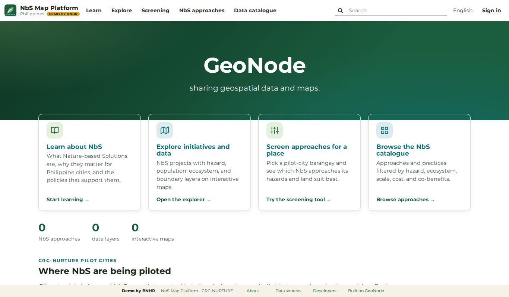
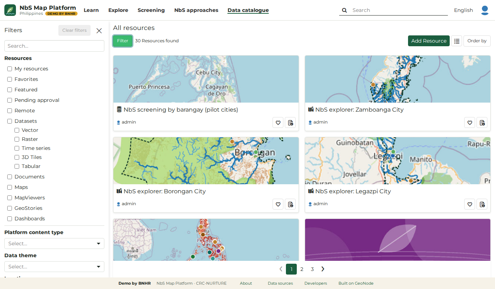
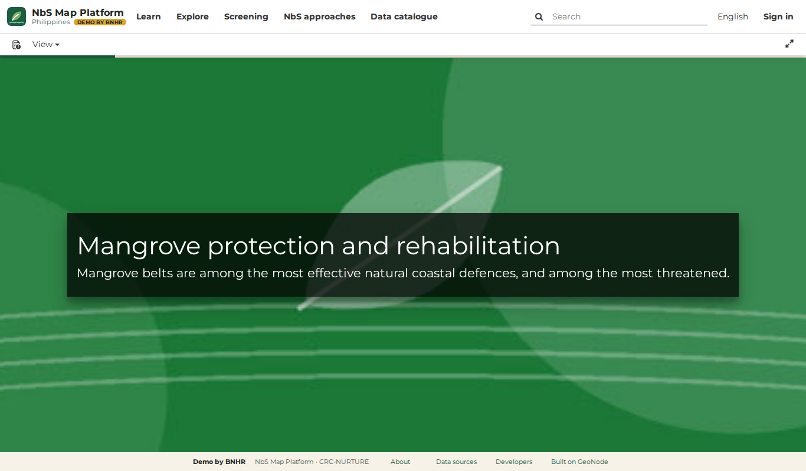
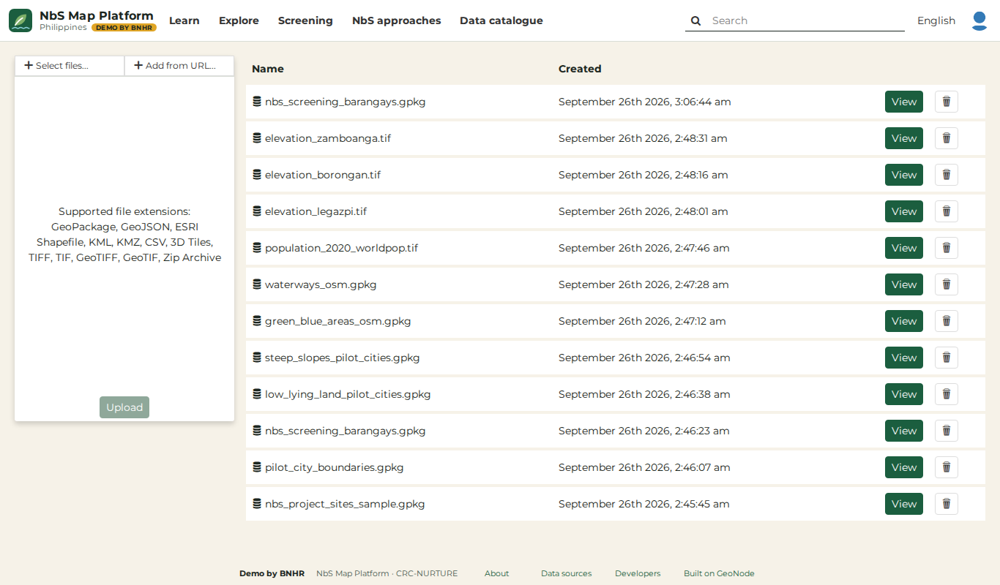
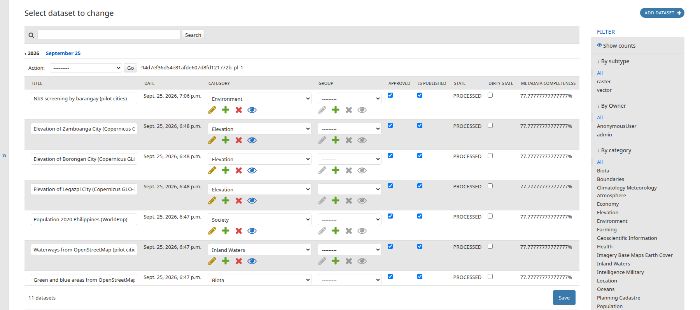
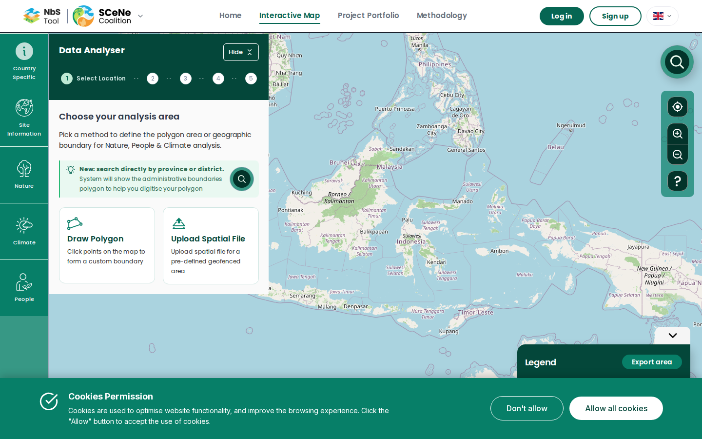
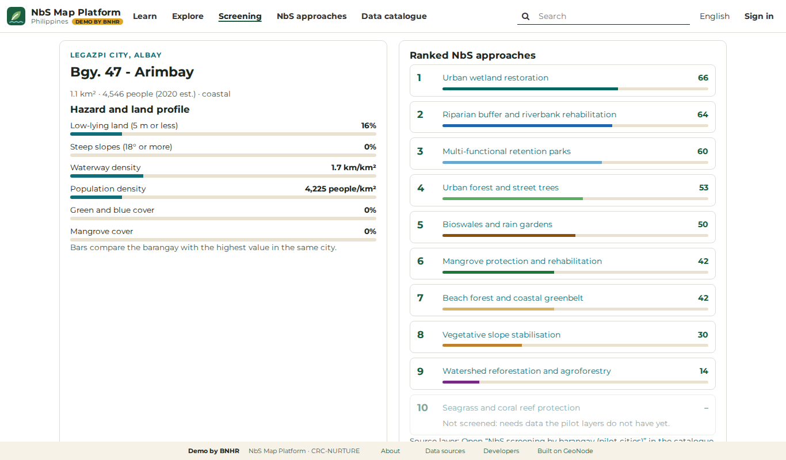

<!--
OUTLINE (the common opening, both sessions: 9:45 with CRS and DENR, 13:35 with the NbS Support Network)
About 15 minutes of slides (1 to 15), then SCeNe and its steps (16 to 18), the live tour on Borongan (19), and the activity: its title (20) and how it works (21 to 25).
The build adds slide 1 from the frontmatter; this comment sits in slide 2 because the build needs the frontmatter first.

1. [title] Use what works. Build what matters. With the tagline.
2. [content, table] Workshop design: time (AM, PM), session topic and objectives, method, materials, person-in-charge, for BNHR's two hours.
3. [content] We have four months, so we don't start from scratch: today, beta 1 Dec 2026, version 2 1 Feb 2027, handover 24 Feb 2027.
4. [content + screen] GeoNode is a ready-made map platform that governments already use (demo home page).
5. [content, sticker grid] GeoNode already does most of what the platform needs: ten site-map and terms-of-reference items marked GeoNode does this (green), we can do this (yellow), we build this (blue).
6. [content + screen] Finding, opening and downloading map information comes ready-made (demo catalogue).
7. [content, QR] We already have a working demo: demo-pcp4nbs.bnhr.xyz, with a QR code.
8. [section] Three things we'll set up together.
9. [content + screen] Information pages can get their own addresses and an easy editor (Django flat pages, to test).
10. [content + screen] Projects can come in through a simple spreadsheet (template; FFP joins them into one national map).
11. [content + screen] You choose who checks before anything goes public (a GeoNode setting).
12. [content] What do you think? Three quick questions on pages, projects and checking.
13. [content, steps] Most people will come for the Interactive Map, our NbS tool: its four steps from the draft user journey, in blue.
14. [two-column] So we build the NbS tool, and use GeoNode as it comes.
15. [content] Today, we decide four things together: how to build the tool, what comes first, what map information it needs and who has it, how we work together.
16. [content + screen] We start from a good example: SCeNe's NbS tool.
17. [content, steps] SCeNe's tool has five steps; ours adds one (recommended NbS approaches). Then: save, documents or monitoring, with an account.
18. [content + screen] Our added step recommends NbS approaches for a place (demo recommendation for a Legazpi barangay).
19. [section, QR] Let's look at it on Borongan, with a QR code to SCeNe's interactive map. The live tour follows.
20. [section, QR] Build our NbS tool: the activity, with a QR code to bnhr.xyz/workshops/2026-10-21-nbs-tool-builder.
21. [content] Each table builds the tool for one person: the five people, or a person of your own.
22. [content, cards] For every card, choose one: keep (up to 40 of the 53 cards, across all steps), maybe, we don't need it (say why: tell your host, or write it on a note or the card), we wish it had; a card can also stay without a choice.
23. [content, two-column] Priority dots say how much it matters: 15 card dots on kept cards and wishes, 10 data dots on data.
24. [content, two-column] Last, the data the tool needs: need it, why, can you share it, where is it; 10 data dots.
25. [section, QR] Now it's your turn. Into the activity, with a QR code to How it works on the activity website.
-->

<link rel="stylesheet" href="brand-2026.css">

## Workshop *design*.

<table class="design">
<thead><tr><th>Time AM/PM</th><th>Session topic &amp; objectives</th><th>Method</th><th>Materials</th><th>Person-in-charge</th></tr></thead>
<tbody>
<tr><td>9:45–10:05 --- 13:35–13:55</td><td><b>Why GeoNode, and what we build</b> Know what GeoNode already does, what we set up, and what we build</td><td>Talk, demo, live tour of SCeNe's tool</td><td>Slides, demo site, SCeNe's tool</td><td>BNHR</td></tr>
<tr><td>10:05–10:35 --- 13:55–14:25</td><td><b>Rounds 1–3: Choose a place, What's there (land and nature; people and climate)</b> Choose what our person needs</td><td>Show, try, build</td><td>Workshop website on each table's laptop; phones if you like</td><td>BNHR, FFP table hosts</td></tr>
<tr><td>10:35–10:45 --- 14:25–14:35</td><td><b>Break</b></td><td></td><td>Snacks</td><td>FFP</td></tr>
<tr><td>10:45–11:15 --- 14:35–15:05</td><td><b>Rounds 4–5: Threats and What NbS could work; Benefits and Take it home</b></td><td>Show, try, build</td><td>Workshop website</td><td>BNHR, FFP table hosts</td></tr>
<tr><td>11:15–11:30 --- 15:05–15:20</td><td><b>What matters most</b> Agree on the top cards and wishes</td><td>15 card dots per table; read-back of all tables' results</td><td>Workshop website, results on the big screen</td><td>BNHR</td></tr>
<tr><td>11:30–11:45 --- 15:20–15:35</td><td><b>Data and working together</b> Which data the tool needs, who can share it, and who keeps it up to date</td><td>"Data we need" tab, 10 data dots</td><td>Workshop website</td><td>FFP, BNHR</td></tr>
</tbody>
</table>

Note:
This is how the next two hours run, in the morning from 9:45 and in the afternoon from 13:35. First I'll explain why we build on GeoNode and what we build ourselves, and we'll look at SCeNe's tool together. Then the activity, in five rounds: in each one I show a step, you can try it on your phone if you like, and your table builds its version of the tool on its board, on the workshop website. A break in the middle. Then we agree on what matters most, looking at all the tables' results together on the big screen, and we finish with the data the tool needs and how we work together, including who will keep the tool's map information and recommendations up to date. (Morning: this includes how the platform should work with DENR's CCIMS, before FFP's segment on DENR's data.) Online participants do exactly the same on their own computers, with their own host.

---

## We have four months, so we don't start *from scratch*.

21 Oct

2026

Today

1 Dec

2026

Beta: a first version to try

1 Feb

2027

Version 2

24 Feb

2027

Handover

Note:
Good morning (good afternoon). I'm from BNHR, and I'm building the platform with FFP. Before we get to the fun part, I want to share how we're thinking about the work, because it shapes everything we ask you today.

Here are the three dates that set our pace. The beta is due on 1 December, about six weeks from today. Version 2 comes on 1 February, and we hand over on 24 February.

That's about four months from today to handover. In four months there's no time to build a platform from nothing, test it and train people on it. So we start from something that already works.

---

## GeoNode is a ready-made map platform that *governments* already use.

<ul>
<li>Made for storing, finding and sharing map information</li>
<li>Free and open: no licence to buy or renew</li>
<li>Used by governments and agencies for their national map information</li>
<li>DENR can keep it running after the project</li>
</ul>

Screen: NbS Map Platform demo by BNHR, built on GeoNode

Note:
That something is GeoNode. Think of it as a ready-made platform for map information. It's free and open, so nobody has to buy or renew a licence, and governments and agencies already use it for their national map information.

That matters for the handover. When the project ends, DENR keeps a platform that others already run, rather than something only one company understands.

On the right is our demo, which already runs on GeoNode. You'll see more of it later.

---

## GeoNode already does *most* of what the platform needs.

GeoNode does this

We can do this

We build this

Find map information in a catalogue

Store it and share it

Download it, or open it in other map software

Maps to explore

Dashboards for reports

User accounts and organisation pages

Information pages: NbS 101, Learn More

Checking projects before they go public

Adding projects from a simple spreadsheet

The Interactive Map: our NbS tool

Note:
This is the terms of reference and the draft site map, side by side with what GeoNode already does. It's the same as the stickers on the poster on the wall.

Green means GeoNode does it as it comes: a catalogue to find map information, storing and sharing it, downloads, maps to explore, dashboards for the reports, user accounts, where each organisation in the Network can have its own page, and a check before anything goes public.

Yellow means we can do it with a little setup on top of GeoNode. There are two: the information pages, and adding projects. I'll show you how in a minute.

Blue is the one thing we build: the Interactive Map, the NbS tool.

---

## Finding, opening and downloading map information comes *ready-made*.

<ul>
<li>Search and filter by hazard, NbS approach, ecosystem and more</li>
<li>Download it, or open it in QGIS or ArcGIS</li>
<li>DENR's own systems can read it too</li>
</ul>

Screen: NbS Map Platform demo by BNHR, built on GeoNode

Note:
Here's what green looks like. This is the catalogue in our demo. One search covers everything on the platform: map information, maps, stories, dashboards and documents. The filters on the left include the NbS ones, such as hazard, NbS approach and ecosystem.

Anyone can download what they're allowed to, and technical staff at DENR and partner organisations can open the same map information straight in QGIS, ArcGIS or their own systems, including DENR's CCIMS. One caution: a few datasets have licences that don't allow sharing copies, so for those we switch downloads off.

None of this needed development. It comes with GeoNode.

---

## We already have a *working demo*.

demo-pcp4nbs.bnhr.xyz

<ul>
<li>Built on GeoNode, with map information for Legazpi, Borongan and Zamboanga</li>
<li>Try the catalogue, the maps and the NbS recommendations on your phone</li>
<li>It's a sketch for today: some of its data is for illustration only</li>
</ul>

Scan to open the demo

Note:
Everything I've shown you so far is running today. This is our demo, built on GeoNode with map information for the three pilot cities. Scan the code if you'd like to follow along on your phone, now or during the activity.

It's a sketch for this workshop, not the final platform: the NbS project sites and the recommendation table in it are for illustration only. Tell us what's wrong with it; that's what it's for.

---

<!-- .slide: class="section-slide" data-background-color="#0c2340" -->
We can do this

# Three things we'll set up *together*.

Note:
Now the yellow stickers, and one green one where you get to choose. These are places where GeoNode works a bit differently from what we'd draw on a blank page. Each has a way forward, and for each I'd like your view.

---

## Information pages can get their own addresses and an *easy editor*.

We can do this · 1 of 3

<ul>
<li>Today, NbS 101 and Learn More are GeoNode stories, with addresses that Google can't find one by one</li>
<li>GeoNode is built on Django, which has simple text pages with their own address and a word-processor-like editor</li>
<li>We'll test these for NbS 101, Learn More and About</li>
</ul>

…/catalogue/#/geostory/<b>13</b>

Screen: NbS Map Platform demo by BNHR, built on GeoNode

Note:
First, the information pages: NbS 101, Learn More, About. In the demo they're GeoNode "stories". A story mixes text, pictures and live maps, and the people who run the platform can write one in the browser without a developer.

Two things we want to improve. Every story lives at an address like this one, ending in a number GeoNode gives it, and Google sees them all as the same page, so people can't find a story straight from a search. And GeoNode itself has no simple page editor for plain text pages.

GeoNode is built on Django, and Django has simple text pages, called flat pages, that each get their own address and can be edited in the back office with a word-processor-like editor. We'll test them for NbS 101, Learn More and About, and keep stories for pages that need live maps.

---

## Projects can come in through a *simple spreadsheet*.

We can do this · 2 of 3

<ul>
<li>GeoNode takes a map file, or a spreadsheet with a location for each project</li>
<li>We'll give Network members a spreadsheet template: one row per project</li>
<li>FFP joins them into one national map of NbS projects, the one the NbS tool shows</li>
</ul>

Screen: NbS Map Platform demo by BNHR, built on GeoNode

Note:
Second, adding projects. GeoNode's upload expects a map file, like a shapefile or a KML, or a spreadsheet with a latitude and longitude for each project. Most Network members don't make map files, and GeoNode has no form where you type in a project and click its place on a map. Each upload also becomes its own separate layer, so twenty organisations would mean twenty project maps.

So we'll keep it simple: a spreadsheet template with one row per project and the same columns for everyone, which anyone with Excel can fill in. FFP joins the rows into one national map of NbS projects, and that's the map the NbS tool shows.

(Afternoon) In the activity's "Data we need" tab, tell us what you have on your projects' locations: map files, a spreadsheet, barangay names, or maps inside reports.

---

## You choose *who checks* before anything goes public.

GeoNode does this · 3 of 3

<ul>
<li>A contributor uploads a project</li>
<li>Someone who runs the platform checks it, then it goes public</li>
<li>It's a setting: we can change who checks, or switch it off</li>
</ul>

Screen: where approvals happen, NbS Map Platform demo by BNHR

Note:
Third, a choice for you. In the demo, when a Network member uploads a project, it doesn't go public straight away: someone who runs the platform checks it first. That protects against mistakes and keeps DENR-only information private.

This is a GeoNode setting, not a fixed rule. We can decide who checks, for example each organisation for its own projects, or FFP for everything, or switch the check off. Whoever checks will own that job after handover.

---

## What do *you* think?

Pages: would simple text pages work for NbS 101 and Learn More?

Projects: could your organisation fill in a spreadsheet of its projects?

Checking: who should check projects before they go public?

Note:
Three quick questions, by show of hands and a few voices.

Pages: would simple text pages, with their own address, be enough for NbS 101 and Learn More? Projects: could your organisation fill in a spreadsheet with one row per project? Checking: who should check a project before it goes public: FFP, DENR, or each organisation for its own?

FFP records the answers on the poster.

---

## Most people will come for the *Interactive Map*, our NbS tool.

1

Choose a place

Click a barangay, type a place, draw an area, or add a map file

2

See what's there

All the map information for that place, with any of it switched off

3

Get recommended NbS approaches

From the place's land and climate data, in the pilot cities

4

Take it home

A summary to download as a PDF

From the draft user journey for the platform.

Note:
Now the blue sticker. The heart of the platform is the Interactive Map, the NbS tool. We expect most people to come to the platform for this.

This is what the draft user journey asks it to do. Choose a place: click a barangay, type a place name, draw an area, or add a map file. See everything the platform knows about that place. Get recommended NbS approaches, starting with the pilot cities. And take home a summary as a PDF.

GeoNode doesn't do any of this on its own. It can show maps, but it can't sum up a place across all its map information or recommend approaches. That's why this is the part we build.

---

## So we build the NbS tool, and use GeoNode *as it comes*.

GeoNode as it comes

CatalogueStorage and sharingDownloadsMapsStoriesDashboardsAccountsUploads with approval

Where we build

The Interactive Map: the NbS tool

It reads its map information from GeoNode, so everything is added, described and approved once.

Note:
So this is the plan. Everything green and yellow, we use the way GeoNode comes, and we put our development time into the NbS tool.

The two fit together. The tool reads its map information from GeoNode, so a dataset is added, described and approved once, in GeoNode, and then it shows up in the tool.

If someone asks for something new outside the tool, our first answer will be to see what GeoNode already offers, so that the time goes where most people will feel it.

---

## Today, we decide four things *together*.

1<b>How we build the tool</b>Which steps, and what each step shows

2<b>What comes first</b>Not everything can be ready by 1 December

3<b>What map information it needs</b>And who has it

4<b>How we work together</b>So the tool fits the Philippines

Note:
Which brings us to why you're here. Not everything can be ready by 1 December, so today we need your help with four things.

How we build the tool: which steps it has, and what each one shows. What comes first. What map information the tool needs, and who has it. Many of you hold exactly the data it needs. And how we'll work together after today so the tool really fits the Philippines.

---

## We start from a good example: *SCeNe's* NbS tool.

<ul>
<li>Built by the SCeNe Coalition for Southeast Asia</li>
<li>Open to try, without signing in</li>
<li>Its steps are close to what our draft asks for</li>
</ul>

Screen: SCeNe Coalition NbS Tool (beta), nbstool-beta.scenecoalition.org

Note:
We don't have to imagine the tool from a blank page. The SCeNe Coalition has built an NbS tool for Southeast Asia, and anyone can try it without signing in. Its steps are close to what our draft user journey asks for, so it's a good place to start.

We're not copying it. We're using it as something concrete to point at: this we want, this we don't need, this we wish it had.

---

## SCeNe's tool has five steps; ours *adds one*.

1

Choose a place

Search, draw or upload an area

2

What's there

Land, nature, people, climate

3

Threats

What's been lost or disturbed

Ours

Recommended NbS approaches

For a place, from its data

4

Pathway

Protect, manage or restore

5

Benefits

What the chosen pathway could bring

Then, with an account: save it, draft the project documents, or plan the monitoring.

Note:
Here are SCeNe's five steps. Choose a place. See what's there: land, nature, people and climate. Look at the threats: how much has been lost or disturbed. Choose a pathway: protect, manage or restore, and its activities. See the potential benefits for nature, people and climate. Then, with an account, save the project, draft its documents, or plan its monitoring.

Ours follows the same idea and adds one step that SCeNe doesn't have: recommended NbS approaches for a place, here in orange. In the activity, ours and SCeNe's pathway share one step, What NbS could work, so you can compare them: ours starts from the place's hazards, SCeNe's from its ecosystems.

---

## Our added step recommends *NbS approaches* for a place.

<ul>
<li>Uses the place's land, hazard and climate data</li>
<li>Starts with the pilot cities</li>
<li>Points to what else to weigh: people, gender, biodiversity</li>
</ul>

Screen: an early version in the NbS Map Platform demo by BNHR (Bgy. 47 Arimbay, Legazpi City)

Note:
This is an early version of that step in our demo, for a barangay in Legazpi. On the left is the place's profile: low-lying land, slopes, waterways, people. On the right, NbS approaches ranked for that barangay.

In the draft, the recommendation comes from a matrix of the place's physical and climate data, and it starts with the pilot cities, not the whole country. It also points to other things to weigh, like socio-economic and gender factors and biodiversity, and links to how to design your NbS. What goes into that matrix is something we'll work on with you.

---

<!-- .slide: class="section-slide" data-background-color="#0c2340" -->
Live tour · SCeNe NbS Tool

# Let's look at it on *Borongan*.

nbstool-beta.scenecoalition.org/<wbr>interactive-map

Note:
Let's see SCeNe's tool on a place we know: Borongan, one of our pilot cities. Scan the code to follow along on your phone. Switch to the browser: https://nbstool-beta.scenecoalition.org/interactive-map

Tour, about 5 minutes; each round shows its step again: upload the Borongan area (borongan-area.kml on the activity website, 4,705 ha) and confirm its size. Site Characterisation: the General, Nature, People and Climate tabs, scrolled to the bottom. Threat Profile. Pathway Selection: switch on Protect, Manage or Restore to see the activities. Potential Benefit: the Nature, People and Climate tabs. Finish: Save to my Project, Generate Document and Create Monitoring Plan, which need an account. Each step takes 30 to 45 seconds to load: open it in tabs beforehand.

What to point out for Borongan: the search finds provinces and cities, not barangays; it rated the area "no risk" for every hazard, so its benefits show 0 people less exposed to disasters; the People tab uses PSA data, but for the whole of Eastern Visayas; it's built for forests, mangroves and peatlands, while our pilot cities need coastal, river and urban green areas; it has no activity for managing mangroves; and some figures need checking, such as forest loss of "23.74% per year".

Come back to the deck after the tour.

---

<!-- .slide: class="section-slide" data-background-color="#0c2340" -->
The activity

# Build our *NbS tool*.

bnhr.xyz/workshops/<wbr>2026-10-21-nbs-tool-builder

Note:
Now it's our turn to build. Starting from SCeNe's steps, each table builds its own version of the NbS tool for the Philippines.

Scan the code for the activity's website. Its first page, How it works, explains every step for participants and for table hosts. Every table builds there: open "Build our tool" on your table's laptop, and your host will help you start. The card guide on the same site has every card with its picture and an explanation, and the people you can build for. If you're joining online, you do the same on your own computer.

---

## Each table builds the tool for *one person*.

Ana

City planner in Borongan

Jun

Technical officer at DENR-CCS

Liza

Decision-maker who prioritizes budgets for projects

Rosa

NbS implementer from an NGO

Paolo

Student researcher

At every card, ask: *would our person use this?* None of them fits? Choose **Someone else** and create your own.

Note:
Each table builds the tool for one person. Their stories are on the website, in the card guide and on your board when you choose them. They're made up, but their work is real: Ana has to tell the city council which barangays flood and which nature-based solutions could help; Jun needs the national picture; Liza, a provincial governor, wants to see the NbS projects in the province and where the province can support them; Rosa wants her organisation's NbS projects on the national map; Paolo is looking for data for a thesis. If none of them is like you, create your own: on your board, choose Someone else and describe who they are and what they need. Building for one person stops a table from wanting everything for everyone.

---

## For every card, choose *one*.

Green

Keep it

Up to 40 of the 53 cards, across all steps.

Blue

Maybe

Not sure? It doesn't count either way.

Grey

We don't need it

Our person wouldn't use this. Say why: tell your host, or write it down.

Orange

We wish it had…

What information would it need? Who has it?

You don't have to choose for every card. Can't agree? Leave it and move on.

Note:
You've now seen the tool. For every card, choose one of these. Green: keep it. But you can keep only 40 of the 53 cards, counted across all the steps together, so keeping means choosing. Keep more in the steps that matter most to your person; your board shows how many keeps you have left, and you can change a Keep to Maybe to free one up. Blue: maybe, when you're not sure; it doesn't count either way. Grey: we don't need it; our person wouldn't use it. When you choose this one, say why in a few words: tell your host, or write it on a note or on the card. That's what tells us what to leave out, and why. Orange: a wish, for something missing. For every wish, add what information it would need and who has it. That's how a wish turns into something we can build. Wishes don't use up your keeps. And you don't have to choose for every card: if your table can't agree or runs out of time, leave the card without a choice and move on.

---

## Then, show what matters *most*.

15 card dots

On your kept cards and wishes. **The more dots, the more it matters to your person.**

10 data dots

On the data the tool needs most, in the Data we need tab.

Keeps say <em>what</em> your person needs. Dots say <em>how much</em> it matters.

Note:
Keeps say what your person needs. Priority dots say how much each one matters. Each table has 15 card dots for its kept cards and wishes: the more dots a card gets, the more important it is to your person, so put several on one card if it matters a lot. A kept card with no dots is still kept. The 10 data dots are separate, for the data the tool needs most. When we put all the tables' boards on the big screen, the cards and wishes with the most dots come first.

---

## Last, the *data* the tool needs.

For each kind of data

Do we need it? Why? Can your organisation share it? If not, where is it?

Then

10 data dots for the data the tool needs most.

Note:
The tool can only show what it has data for. The "Data we need" tab lists eighteen kinds of data, from official hazard maps to existing NbS projects, with who we think holds each. Correct us. For each one: do we need it, why, can your organisation share it, and if not, where is it? Then give your 10 data dots to the data the tool needs most.

---

<!-- .slide: class="section-slide" data-background-color="#0c2340" -->
Next: the activity

# Now it's *your* turn.

bnhr.xyz/workshops/<wbr>2026-10-21-nbs-tool-builder/<wbr>index.html

Note:
That's the framing. Let's get to work. (Explain the activity and hand over to the table hosts.)
