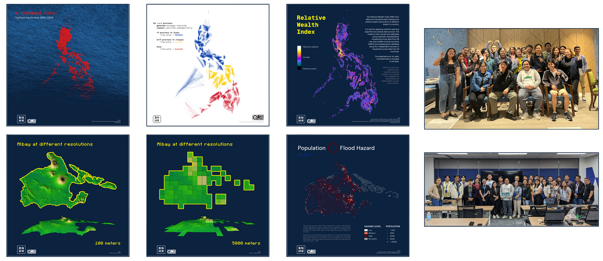

<link rel="stylesheet" href="deck.css">

## Hi, I'm *Ben*.

<p class="kicker">[open] technology and geospatial consultant</p>

<div class="about">

<div class="terminal">
<div class="bar"><i></i><i></i><i></i></div>
<div class="screen">
<div class="prompt">ben@psa:~$ ./intro.sh</div>
<div>&gt; Hi, my name is Ben.</div>
<div>&gt; I'm an open technology and digital autonomy advocate.</div>
<div>&gt; I also make a living building cool stuff that help people and organizations make the most of open technologies through BNHR, SmartCT, and the Civic Literacy Initiative.</div>
</div>
</div>
<div class="qr-col"><p class="qr-caption">facebook.com/<wbr><span class="nw">bnhr.xyz</span></p></div>
</div>

Note:
(08:40, after the PSA opening programme.) Good morning. I'm Ben. I build tools that help people and organizations make the most of open technologies, through BNHR, SmartCT and the Civic Literacy Initiative, and I teach them. The code goes to my page if you want to follow along after the course.

---

## I make maps and data tools, and *teach* them.

<div class="about">

<div class="qr-col"><p class="qr-caption">facebook.com/<wbr><span class="nw">bnhr.xyz</span></p></div>
</div>

Note:
Some of the work: maps made from open data with free software, and some of the rooms I have taught in. Every tool in this course is open source too, and the course folder is yours to keep.

---

<!-- .slide: class="toc-slide" -->

## Contents

<ol class="toc-list">
<li>Introduction to the training</li>
<li>Case study: the EITI data pipeline</li>
<li>Day 1 · Get: Round 1 arrives</li>
<li>Day 2 · Check and Store: Round 2 arrives</li>
<li>Day 3 · Share: Round 3 arrives, and the capstone</li>
</ol>

Note:
This one deck runs all three days. This morning: how the training works and the tools, then a real pipeline built on the same ideas, then Day 1. Each morning after this I open the deck at that day's section; in between we work in the notebooks, and I come back here for the tests, the check-ins and the end of the day.

---

<!-- .slide: class="section-slide" -->
<span class="section-label">Introduction to the training</span>

# How the next three days *work*.

Note:
For the next three days we work as a statistics office does when a survey round comes in. Ten minutes on how the course works and the two tools, then a show and tell, then a short test, then your laptops.

---

## Three days, three rounds, *one* pipeline.

<div class="steps" style="--n: 4">
<div class="step"><div class="n">Day 1</div><div class="name">Round 1</div><div class="what">2023 Q4, a Stata file. Read it without losing a code.</div></div>
<div class="step"><div class="n">Day 2</div><div class="name">Round 2</div><div class="what">2024 Q1, renamed columns and errors. Rules that hold.</div></div>
<div class="step"><div class="n">Day 3</div><div class="name">Round 3</div><div class="what">2024 Q2, a new edition of the code list. One command, then share.</div></div>
<div class="step ours"><div class="n">Day 3 · capstone</div><div class="name">Round 4</div><div class="what">Unseen until the capstone. Your pipeline takes it.</div></div>
</div>

<p class="steps-note">Every round is synthetic: the shape of real statistical files, about no real person or place.</p>

Note:
Each day a new round of a household survey arrives, like a quarterly labour force round. Each one brings a new problem: on Day 1, a file format that loves to drop leading zeros; on Day 2, someone renamed the columns and there are errors in it; on Day 3, the geographic codes come from a new edition of the code list. And on the afternoon of Day 3, a round none of you has seen arrives, and the pipeline you built has to take it. All the data is made up, so you can break it, share it and show it freely.

---

## Every round goes through the same *four* stages.

<div class="steps" style="--n: 4">
<div class="step ours"><div class="n">Day 1</div><div class="name">Get</div><div class="what">Read it whole, describe it, join it, check its totals.</div></div>
<div class="step"><div class="n">Day 2</div><div class="name">Check</div><div class="what">The rules a correct round meets, and code that cleans it.</div></div>
<div class="step"><div class="n">Day 2</div><div class="name">Store</div><div class="what">A database that refuses what breaks those rules.</div></div>
<div class="step"><div class="n">Day 3</div><div class="name">Share</div><div class="what">A release, a codebook and a data portal.</div></div>
</div>

<p class="steps-note">By Day 3, all four run as one command: <code>uv run python run.py --round 2024Q2</code></p>

Note:
Get, Check, Store, Share. Today is Get. Tomorrow is Check and Store. The last day is Share. You build each stage as functions in the notebooks, and run.py strings them together, so by the last day one command takes a new round from the file that arrived to the release you publish. That is the point of the course: the next round costs you a command, not a week.

---

## Every day has the same *shape*.

<div class="rows">
<div><b>Morning</b>&nbsp; an opener, and a fifteen-question pre-test</div>
<div><b>Blocks</b>&nbsp; hands-on in the notebooks, a check-in after the morning and after the afternoon</div>
<div><b>End of day</b>&nbsp; the pre-test's questions again, then the ones the room found hardest</div>
</div>

<p class="steps-note">None of the quizzes count toward anything. They tell us what to go over.</p>

Note:
The rhythm repeats, so after today you know what comes next. The pre-test and the post-test are the same fifteen questions, so at the end of the day you see what you learned. The check-ins are three questions and a traffic light, two minutes, and they tell the training assistants which tables to visit first. Nothing counts toward a grade or the certificate.

---

## Four house rules for the *room*.

<div class="numbered">
<div><span class="n">1</span><span class="t"><b>Ask anytime</b>Interrupt me, out loud. Disagreeing is welcome.</span></div>
<div><span class="n">2</span><span class="t"><b>08:00 to 17:00</b>Breaks at 10:00 and 14:30, lunch at 12:00.</span></div>
<div><span class="n">3</span><span class="t"><b>Never edit <code>rounds/</code> by hand</b>The files stay as they arrived; your code does the fixing.</span></div>
<div><span class="n">4</span><span class="t"><b>Your data stays with you</b>Files you bring for the capstone stay on your laptop.</span></div>
</div>

Note:
Four rules. Ask anytime: if I lose you, say so, out loud; you will not be the only one. The day runs 08:00 to 17:00, with breaks at 10:00 and 14:30 and lunch at 12:00; times may shift a little with how the room is doing. The rounds folder holds the files exactly as they arrived: never fix them by hand, because the point is that your code does the fixing, the same way every quarter. And on Day 3, if your group brings its own data, it stays on your laptops; nothing is uploaded anywhere.

---

## Ask your table first, *then* raise a hand.

<div class="numbered">
<div><span class="n">1</span><span class="t"><b>Your table</b>You sit with your office: same data, same problems.</span></div>
<div><span class="n">2</span><span class="t"><b>A raised hand</b>A training assistant comes to you.</span></div>
<div><span class="n">3</span><span class="t"><b>The checks</b>A red check names the input that failed and what your code returned.</span></div>
<div><span class="n">4</span><span class="t"><b>Stuck for ten minutes?</b>Open the companion. Still stuck, we paste the solution in.</span></div>
</div>

Note:
Every exercise is yours to do on your own laptop, but you are not alone with it. Your tablemates work on the same files, so ask them first. If the table is stuck, raise a hand. Every exercise has a check: a red check tells you which input failed and what your function returned, never the answer. If an exercise has held you for ten minutes, open the companion, next slide. If you still cannot move, say so: a training assistant pastes the solution in, so the sections after it keep running, and nobody falls behind for the rest of the day because of one exercise.

---

## The companion explains every solution, and *why it works*.

<div class="split qr-split">
<div>
<div class="rows">
<div><b>Red check</b>&nbsp; stuck ten minutes? Open its link</div>
<div><b>Green check</b>&nbsp; its link compares your code with ours</div>
<div><b>Every answer</b>&nbsp; stays closed until you click to open it</div>
</div>
<p class="steps-note">The site also has every notebook, and stays after the course.</p>
</div>
<div class="qr-col"><p class="qr-caption"><span class="nw">learn-python.bnhr.xyz</span></p></div>
</div>

Note:
The course has a companion on the Learn Python site: for every exercise in every notebook, the solution and why it works, written for this course. You rarely need the address, because every check links to its exercise there: a red check, under "Still stuck after ten minutes?", and a green one, to compare your code with ours. Every answer stays closed until you click to open it, so nobody reads one by accident. Try first: the ten minutes are where the learning happens. The site also has every notebook to read, and it stays online after the course, so you can come back to it when your own survey's next round arrives.

---

## uv brings the right Python, and keeps it *in the course folder*.

<div class="rows">
<div><b>One download</b>&nbsp; the Python and packages the course was tested with, up to 300 MB</div>
<div><b>Inside the course folder</b>&nbsp; nothing you install here changes any Python you already have</div>
<div><b><code>uv run</code></b>&nbsp; runs a command with the course's Python, so you never choose one</div>
</div>

<p class="steps-note">You installed it with the setup guide, <code>SETUP.md</code>. The USB sticks have the installer if you didn't.</p>

Note:
The first of the two tools. uv is a small program that downloads the version of Python the course was tested with, 3.12, and every package the course needs, and keeps them inside the course folder. Whatever Python your office laptop already has stays untouched. You never pick a Python: uv run takes care of it. If you did not get through the setup guide, a training assistant has the installer on a USB stick.

---

## marimo notebooks are cells that *update each other*.

<div class="rows">
<div><b>A cell</b>&nbsp; holds Python, or SQL; its result appears above the code</div>
<div><b>Change a cell</b>&nbsp; every cell that uses it runs again, so there is no order to remember</div>
<div><b>Each name lives in one cell</b>&nbsp; a second <code>total = …</code> elsewhere is an error, not a surprise</div>
<div><b>Saved as you go</b>&nbsp; each notebook is a plain Python file in the course folder</div>
</div>

<p class="steps-note">At 09:15 you start both with one command: <code>uv run marimo edit</code></p>

Note:
The second tool. A marimo notebook is a list of cells. When you change one, every cell that depends on it reruns by itself, so a notebook never shows a result from code you have since changed. That is also why each name may be created in only one cell. Every notebook is a plain Python file, which is how run.py can call the functions you write in them. You try all of this yourself at 09:15, in 00_start.py.

---

## The notebooks are numbered *by day*.

| Numbers | What they are |
|:--|:--|
| `00` | The agenda, and `00_start.py`: is your laptop ready, how a notebook works, a Python refresher |
| `10`, `20`–`22`, `30`–`32` | Each day's lessons: Day 1 in the 10s, Day 2 in the 20s, Day 3 in the 30s |
| `33`–`36` | The Day 3 capstone, in groups: pick one of `33`, `34`, `35`; `36` is for the presentations |
| `81`–`83` | Stretch exercises, one notebook a day, for when you finish early |
| `90`, `91` | Reference, at any time: the primers and the glossary |

Note:
When you open marimo you see the notebooks in this order. The first digit is the day. If you finish early, the 80s are harder exercises with less help. The 90s are for any time: the primers explain the idea behind the code, and the glossary has every word the course uses, searchable.

---

<!-- .slide: class="section-slide" -->
<span class="section-label">Case study</span>

# The EITI data *pipeline*.

Note:
(08:50, fifteen minutes.) Before we write any code, a real pipeline built on the same four stages: the one behind the EITI's companies database, which I work on. Keep the question in mind: what has to be true about the spreadsheets for a portal like this to exist?

---

## Every EITI country files the same workbook, in one of *three* versions.

<div class="rows">
<div><b>The EITI</b>&nbsp; countries disclose what oil, gas and mining companies pay governments</div>
<div><b>What arrives</b>&nbsp; an Excel Summary Data Template (v1, 2.0 or 2.1), or an API extract</div>
<div><b>Who takes it in</b>&nbsp; the EITI Secretariat's data team, with an importer built for them</div>
</div>

<p class="steps-note">The same problem as a survey round: a file you don't control, every year, in a shape that drifts.</p>

Note:
The EITI, the Extractive Industries Transparency Initiative, is a global standard: its member countries disclose what oil, gas and mining companies pay their governments. Every EITI country reports in the same Excel workbook, the Summary Data Template. But the template has changed over the years, so a file can be any of three versions, with different sheets and columns; and some data arrives as an extract from EITI's API, many countries and years in one file. The importer takes each of these in for the Secretariat's data team. Sound familiar? A file you do not control, arriving every year, in a shape that drifts. That is your survey rounds.

---

## The importer runs the *same four stages* you build this week.

<div class="steps" style="--n: 4">
<div class="step"><div class="n">Get</div><div class="name">Which template?</div><div class="what">Identify the version, then read every table it should have.</div></div>
<div class="step"><div class="n">Check</div><div class="name">What's wrong?</div><div class="what">Placeholders like &lt;Enter company name&gt; left in, "not available" spelled many ways, company names matched.</div></div>
<div class="step"><div class="n">Store</div><div class="name">Into the database</div><div class="what">Mapped to its tables, and imported only once confirmed.</div></div>
<div class="step ours"><div class="n">Share</div><div class="name">Out to the public</div><div class="what">A companies database, and a public dashboard.</div></div>
</div>

Note:
Get: the importer first works out which template and version a file is, because that decides which sheets and tables to read. Check: the problems are ones you will meet. People leave the template's placeholders in, like "Enter company name" in angle brackets; they write "not available" in many spellings; the same company appears under slightly different names. Each finding gets a proposed fix. Store: the clean data is mapped to the database's tables. Share: the EITI's companies database, and a public dashboard built from it.

---

## When the importer isn't sure, it stops and *asks a person*.

<div class="steps" style="--n: 3">
<div class="step"><div class="n">1</div><div class="name">What to import</div><div class="what">Which countries and years, and which template when two could fit.</div></div>
<div class="step"><div class="n">2</div><div class="name">Review the findings</div><div class="what">Every problem found, and every fix proposed, before anything changes.</div></div>
<div class="step ours"><div class="n">3</div><div class="name">Confirm</div><div class="what">What goes into the database, before it goes in.</div></div>
</div>

<p class="steps-note">On Day 3 your own command stops too. A stop is the pipeline doing its job.</p>

Note:
The importer never guesses where a person should decide. It stops three times: to ask which countries and years to import, and which template if two could fit; to let the data team review every finding and every proposed fix; and to confirm what will go into the database. The machine does the reading and the checking; the person makes the calls. Your pipeline will stop on Day 3, when Round 3 arrives with a new code list, and that stop is the lesson.

---

## What comes out: data anyone can *browse*.

<p class="address-bar">https://<b>eiti-dashboard.eiti.org</b></p>

<div class="rows">
<div><b>Domestic resource mobilisation</b>&nbsp; government revenue from the sector</div>
<div><b>Reserves</b>&nbsp; what is still in the ground</div>
<div><b>Production and exports</b>&nbsp; what is produced, and what is exported</div>
</div>

Note:
(Switch to the browser.) This is the public dashboard, built from a snapshot of the database. Then the companies database itself, if the connection allows: anyone can browse a table, filter it, and download what they see. Ask the room: what had to be true about the spreadsheets for this to exist? Keep the answers on a board for the three days; we come back to them on Day 3, when you publish your own portal.

---

## You build the same four stages this week, *at course size*.

| Stage | The EITI importer | Your pipeline |
|:--|:--|:--|
| Get | Which template version; read every table | Read Round 1 without losing a code; describe it |
| Check | Placeholders, absence words, names matched | The contract, warnings, cleaning as code |
| Store | Mapped, imported once confirmed | A database that refuses what breaks the rules |
| Share | A companies database, a public dashboard | A release, a codebook, a data portal |

Note:
The same four stages, smaller. By Friday afternoon you will have a pipeline that takes a round from the file that arrived to a published portal, in one command. Now, a short test, so we know where the room starts.

---

<!-- .slide: class="section-slide" -->
<span class="section-label">Wednesday 28 October</span>

# Day 1. Get Round 1 in without losing *anything*.

Note:
(09:05.) Day 1 starts with a ten-minute test, then your laptops.

---

## Today, Round 1 arrives and you *get* it.

<div class="steps" style="--n: 4">
<div class="step"><div class="n">10:15</div><div class="name">Read it whole</div><div class="what">Every code intact, the value labels kept.</div></div>
<div class="step"><div class="n">10:15</div><div class="name">Describe it</div><div class="what">A configuration file says what the round is.</div></div>
<div class="step"><div class="n">13:00</div><div class="name">Join it</div><div class="what">To the code list and an older system's database, without multiplying rows.</div></div>
<div class="step ours"><div class="n">14:45</div><div class="name">Check its totals</div><div class="what">Against the published table and the API. Then Get runs as one command.</div></div>
</div>

<p class="steps-note">All of it in <code>10_get_round.py</code>, after the refresher in <code>00_start.py</code>.</p>

Note:
Today's plan in four steps. Before the break, the laptops and a Python refresher in 00_start. Then Round 1 arrives: you read it without losing a single code, and you describe it in a configuration file. After lunch, the reference data: you join the round to the geographic code list and to an older system's database, with joins that never multiply rows. Last, you check the round against published totals, from a table and from an API, and the Get stage becomes one command.

---

## A test takes about *ten* minutes, and comes back at the end of the day.

<div class="steps" style="--n: 4">
<div class="step"><div class="n">1</div><div class="name">Your name and table</div><div class="what">A first name is enough. Write your table the same way every time, like Table 3.</div></div>
<div class="step"><div class="n">2</div><div class="name">Answer and submit</div><div class="what">Nothing says which answers are right, yet.</div></div>
<div class="step"><div class="n">3</div><div class="name">Hand in the file</div><div class="what">Submitting downloads a small file. Put it in the course folder.</div></div>
<div class="step ours"><div class="n">4</div><div class="name">After the post-test</div><div class="what">A passphrase shows your score, the right answers and why.</div></div>
</div>

Note:
How a test works, once, for all three days. Open the link on your phone or laptop, give your first name and your table. Your table matters: the pre-test and the post-test are matched by name and table, so write it exactly the same way both times, like "Table 3". Answer and submit; the page downloads a small file with your answers. Put that file in the course folder, using the second code on the next slide. At the end of the day, when everyone's post-test file is in, I announce a passphrase: type it on the page and it shows your score, your morning score beside it, and every question with the right answer and the explanation.

---

## Day 1 pre-test: nobody expects you to know these *yet*.

<bnhr-timer minutes="10" extra="3"></bnhr-timer>

<div class="qr-pair">
<div class="qr-col"><p class="qr-caption"><b>1 · The test</b>bnhr.xyz/quizzes/<wbr><span class="nw">python-data-management/</span><wbr><span class="nw">day1/pre/</span></p></div>
<div class="qr-col"><p class="qr-caption"><b>2 · The course folder</b>Your downloaded file goes here</p></div>
</div>

Note:
(09:05, ten minutes, three more if the room needs them; T starts the timer.) Fifteen questions on what today covers. Nobody expects you to know the answers yet: the same questions come back at 16:30. Scan the first code, answer, submit, and put the file it downloads in the folder behind the second code. The link is also in 00_start.py.

---

## Is your laptop ready? Start marimo *in the course folder*.

```bash
uv run marimo edit
```

<p class="after-command">Your browser opens on the list of notebooks. Start with <code>00_start.py</code>: its readiness check says what to fix, line by line.</p>

<div class="callout">A red line for DuckDB's sqlite extension is fine: the course still works.</div>

Note:
(09:15.) In a terminal, in your data-management folder, type uv run marimo edit. The first time, uv downloads Python and the packages, so give it a minute. In 00_start, run the readiness check first; every red line says what to do in its last column. Then how a notebook works, and the refresher: the Python the rest of the course leans on. If the browser does not open, copy the address that starts with localhost:2718 from the terminal, all of it, into the browser.

---

## Morning check-in: three questions and a *traffic light*.

<bnhr-timer minutes="2" extra="1"></bnhr-timer>

<div class="split qr-split">
<div>
<div class="rows">
<div><span class="dot light-green"></span>I could do this on my own data tomorrow</div>
<div><span class="dot light-yellow"></span>I could do it with the notes</div>
<div><span class="dot light-red"></span>Not yet</div>
</div>
<p class="steps-note">Two minutes. You see the right answers and why at once.</p>
</div>
<div class="qr-col"><p class="qr-caption">bnhr.xyz/quizzes/<wbr><span class="nw">python-data-management/</span><wbr><span class="nw">day1-morning/</span></p></div>
</div>

Note:
(Before lunch. Two minutes, one more if the room needs it; T starts the timer.) Three questions on the morning, one each on an idea, a tool and code, then the traffic light: be honest with it. Green if you could do this on your own data tomorrow, yellow if you could with the notes, red if not yet. Nothing is collected and nothing is scored; the training assistants go first to the tables showing red and yellow.

---

## Afternoon check-in: how did the *reference data* go?

<bnhr-timer minutes="2" extra="1"></bnhr-timer>

<div class="split qr-split">
<div>
<div class="rows">
<div><span class="dot light-green"></span>I could do this on my own data tomorrow</div>
<div><span class="dot light-yellow"></span>I could do it with the notes</div>
<div><span class="dot light-red"></span>Not yet</div>
</div>
<p class="steps-note">The code list, the older system's database, joins that never multiply rows.</p>
</div>
<div class="qr-col"><p class="qr-caption">bnhr.xyz/quizzes/<wbr><span class="nw">python-data-management/</span><wbr><span class="nw">day1-afternoon/</span></p></div>
</div>

Note:
(Around 14:30, before the break.) Same as this morning: three questions on the reference-data block, then the traffic light.

---

## Day 1 post-test: the morning's questions *again*.

<bnhr-timer minutes="8" extra="3"></bnhr-timer>

<div class="qr-pair">
<div class="qr-col"><p class="qr-caption"><b>1 · The test</b>bnhr.xyz/quizzes/<wbr><span class="nw">python-data-management/</span><wbr><span class="nw">day1/post/</span></p></div>
<div class="qr-col"><p class="qr-caption"><b>2 · The course folder</b>Your downloaded file goes here</p></div>
</div>

Note:
(16:30, eight minutes, three more if the room needs them; T starts the timer.) The same fifteen questions as this morning. Same name, same table, written the same way. Submit, and put the file in the folder. When every file is in, I announce the passphrase.

---

<!-- .slide: class="subsection-slide" -->
<span class="section-label">Day 1 · the post-test</span>

# The questions the room found *hardest*.

Note:
(16:40.) Announce the passphrase now. Then open the summary page with today's files and project the room view: the share right before and after, then the questions fewest got right, one at a time, with how many chose each option and why the right one is right.

---

## Exit ticket: one sentence before you go.

<div class="callout">
<p class="big-line">Which problem in your own files would have slipped through today?</p>
</div>

<p class="steps-note">Leave it with a training assistant on your way out. Tomorrow morning, Round 2 arrives.</p>

Note:
One sentence, your own files, not the course's. We read them tonight by table, and they decide what we go over again tomorrow morning. See you at 08:00.

---

<!-- .slide: class="section-slide" -->
<span class="section-label">Thursday 29 October</span>

# Day 2. Rules that *hold*.

Note:
(08:00.) Good morning. First the Day 2 update, then yesterday's hardest question, then the pre-test.

---

## The Day 2 notebooks arrive as an *update*.

```bash
uv run python -m zipfile -e data-management-day2-update.zip ..
```

<p class="after-command">Copy the zip <b>into</b> your <code>data-management</code> folder, run this there, then refresh the list of notebooks. Your notebooks and saved configuration are never touched.</p>

<div class="alert">Don't unzip it by double-clicking: on a Mac that makes a second folder instead of adding to yours.</div>

Note:
If you got the full course zip before the course, you already have every day: skip this. Everyone else: copy the update zip into your data-management folder, and in a terminal in that folder run this line. The two dots at the end matter: they unzip into the folder above, so the files land next to yours. The update has only today's new files and the shared files you never edit, so yesterday's work is safe.

---

<!-- .slide: class="subsection-slide" -->
<span class="section-label">Day 1, again</span>

# Yesterday's hardest *question*.

Note:
(08:15.) Open the summary page with yesterday's post-test files and go to the question fewest got right. Ask a table to explain the right answer before you show it.

---

## Today, you write the rules a correct round *meets*.

<div class="steps" style="--n: 4">
<div class="step"><div class="n">08:40</div><div class="name">The contract</div><div class="what">Rules written once; the full failure report, not the first error.</div></div>
<div class="step"><div class="n">10:15</div><div class="name">Warnings</div><div class="what">What is odd, not impossible.</div></div>
<div class="step"><div class="n">11:00</div><div class="name">Cleaning as code</div><div class="what">Duplicates, not-stated codes, lookups. Then the contract passes.</div></div>
<div class="step ours"><div class="n">14:00</div><div class="name">Store</div><div class="what">A database whose rules come from the contract. Loads are all or nothing.</div></div>
</div>

<p class="steps-note">In <code>20_check_round.py</code> and <code>22_store_round.py</code>, with a debugging drill after lunch in <code>21_debugging_drill.py</code>.</p>

Note:
Round 2 arrives with renamed columns, and something is off in it. You write the contract once: the rules any correct round meets. It reports every failure at once, not just the first. Some things are only odd, not impossible, so those warn instead of fail. Then you clean with code, so next quarter's cleaning is a rerun, not a redo. After lunch, five broken functions to fix, then Store: a database table whose constraints are generated from the same contract, and loads that either go in whole or not at all.

---

## Day 2 pre-test: today's fifteen questions, *before* we start.

<bnhr-timer minutes="10" extra="3"></bnhr-timer>

<div class="qr-pair">
<div class="qr-col"><p class="qr-caption"><b>1 · The test</b>bnhr.xyz/quizzes/<wbr><span class="nw">python-data-management/</span><wbr><span class="nw">day2/pre/</span></p></div>
<div class="qr-col"><p class="qr-caption"><b>2 · The course folder</b>Your downloaded file goes here</p></div>
</div>

Note:
(08:30, ten minutes, three more if the room needs them; T starts the timer.) Same as yesterday: first name, your table written the same way, submit, file in the folder. The link is also at the top of 20_check_round.py.

---

## Morning check-in: the contract and the *cleaning*.

<bnhr-timer minutes="2" extra="1"></bnhr-timer>

<div class="split qr-split">
<div>
<div class="rows">
<div><span class="dot light-green"></span>I could do this on my own data tomorrow</div>
<div><span class="dot light-yellow"></span>I could do it with the notes</div>
<div><span class="dot light-red"></span>Not yet</div>
</div>
<p class="steps-note">The contract, the warnings, cleaning as code.</p>
</div>
<div class="qr-col"><p class="qr-caption">bnhr.xyz/quizzes/<wbr><span class="nw">python-data-management/</span><wbr><span class="nw">day2-morning/</span></p></div>
</div>

Note:
(Before lunch.) Three questions and the traffic light.

---

## Afternoon check-in: after the *debugging drill*.

<bnhr-timer minutes="2" extra="1"></bnhr-timer>

<div class="split qr-split">
<div>
<div class="rows">
<div><span class="dot light-green"></span>I could do this on my own data tomorrow</div>
<div><span class="dot light-yellow"></span>I could do it with the notes</div>
<div><span class="dot light-red"></span>Not yet</div>
</div>
<p class="steps-note">Five broken functions: reading the error, finding the line.</p>
</div>
<div class="qr-col"><p class="qr-caption">bnhr.xyz/quizzes/<wbr><span class="nw">python-data-management/</span><wbr><span class="nw">day2-afternoon/</span></p></div>
</div>

Note:
(Around 13:20, after the drill.) Three questions and the traffic light, then back to cleaning, part 2.

---

## Day 2 post-test: this morning's questions *again*.

<bnhr-timer minutes="8" extra="3"></bnhr-timer>

<div class="qr-pair">
<div class="qr-col"><p class="qr-caption"><b>1 · The test</b>bnhr.xyz/quizzes/<wbr><span class="nw">python-data-management/</span><wbr><span class="nw">day2/post/</span></p></div>
<div class="qr-col"><p class="qr-caption"><b>2 · The course folder</b>Your downloaded file goes here</p></div>
</div>

Note:
(16:30, eight minutes, three more if the room needs them; T starts the timer.) The same fifteen questions as this morning. Submit, file in the folder, then the passphrase.

---

<!-- .slide: class="subsection-slide" -->
<span class="section-label">Day 2 · the post-test</span>

# The questions the room found *hardest*.

Note:
(16:40.) Announce the passphrase, then the summary page's room view with today's files.

---

## Exit ticket: one sentence before you go.

<div class="callout">
<p class="big-line">Which rule will you write first for your own files?</p>
</div>

<p class="steps-note">Leave it with a training assistant on your way out. If your group wants its own data in the capstone, bring it tomorrow.</p>

Note:
One sentence. And for tomorrow: in the capstone, groups may bring their own data, or an idea to take further. If yours will, bring the files tomorrow; they stay on your laptops.

---

<!-- .slide: class="section-slide" -->
<span class="section-label">Friday 30 October</span>

# Day 3. One command, then *share*.

Note:
(08:00.) Good morning, last day. The Day 3 update, a download for later, yesterday's hardest question, then the pre-test.

---

## The Day 3 notebooks arrive as an *update*.

```bash
uv run python -m zipfile -e data-management-day3-update.zip ..
```

<p class="after-command">Copy the zip <b>into</b> your <code>data-management</code> folder, run this there, then refresh the list of notebooks.</p>

<div class="alert">Don't unzip it by double-clicking: on a Mac that makes a second folder instead of adding to yours.</div>

Note:
Same as yesterday, with the Day 3 zip. Those with the full course zip: skip this.

---

## Download marimo Studio now, *while the internet is quiet*.

```bash
uv run --with "marimo-studio[typst]==0.4.1" marimo-studio --version
```

<p class="after-command">It prints <code>marimo-studio, version 0.4.1</code>. It makes report pages from a notebook: shown before lunch, yours to try in the capstone.</p>

Note:
Run this once, in the course folder, right after the update. It downloads Studio, about 50 megabytes, into uv's cache, so 24 laptops don't download it at the same moment later. When it prints the version, you are done, and it works offline from then on.

---

<!-- .slide: class="subsection-slide" -->
<span class="section-label">Day 2, again</span>

# Yesterday's hardest *question*.

Note:
(08:15.) Summary page, yesterday's post-test files, the question fewest got right. A table explains it first.

---

## Today, one command takes Round 3 to a *release*.

<div class="steps" style="--n: 4">
<div class="step"><div class="n">08:40</div><div class="name">The command stops</div><div class="what">A new edition of the code list. Find out why; make the rounds comparable.</div></div>
<div class="step"><div class="n">10:15</div><div class="name">The release</div><div class="what">Small cells suppressed, a codebook from the contract, every file checked.</div></div>
<div class="step"><div class="n">13:00</div><div class="name">A data portal</div><div class="what">The release in Datasette, and read back from Python.</div></div>
<div class="step ours"><div class="n">13:50</div><div class="name">The capstone</div><div class="what">In groups, then each group presents at 15:45.</div></div>
</div>

<p class="steps-note">In <code>30_new_edition.py</code>, <code>31_share_round.py</code> and <code>32_datasette.py</code>, then the capstone.</p>

Note:
Round 3 is coded with a new edition of the geographic code list, so this morning the command stops, and that is the lesson: you find out why, fix the configuration, and build a crosswalk so the three rounds can be compared. Then Share: the release table, with small cells suppressed before anything leaves, a codebook generated from the contract, and every file written and checked. After lunch you publish it in a data portal, like the one on Day 1. Then the capstone, in groups.

---

## Day 3 pre-test: the last fifteen,<br>*before* we start.

<bnhr-timer minutes="10" extra="3"></bnhr-timer>

<div class="qr-pair">
<div class="qr-col"><p class="qr-caption"><b>1 · The test</b>bnhr.xyz/quizzes/<wbr><span class="nw">python-data-management/</span><wbr><span class="nw">day3/pre/</span></p></div>
<div class="qr-col"><p class="qr-caption"><b>2 · The course folder</b>Your downloaded file goes here</p></div>
</div>

Note:
(08:30, ten minutes, three more if the room needs them; T starts the timer.) First name, the same table, submit, file in the folder. The link is also at the top of 30_new_edition.py.

---

<!-- .slide: class="subsection-slide" -->
<span class="section-label">Show and tell</span>

# A report page, made from a *notebook*.

Note:
(11:45.) marimo Studio, from studio/work: the notebook and the page side by side, with --watch. Change a cell, and the page follows. Then the printed page, one per round. Participants who want to try it take the Studio idea in 35_capstone_explore.py. Only suppressed tables go on a public page.

---

## Morning check-in: the release, and what *leaves*.

<bnhr-timer minutes="2" extra="1"></bnhr-timer>

<div class="split qr-split">
<div>
<div class="rows">
<div><span class="dot light-green"></span>I could do this on my own data tomorrow</div>
<div><span class="dot light-yellow"></span>I could do it with the notes</div>
<div><span class="dot light-red"></span>Not yet</div>
</div>
<p class="steps-note">The crosswalk, suppression, the codebook, the files.</p>
</div>
<div class="qr-col"><p class="qr-caption">bnhr.xyz/quizzes/<wbr><span class="nw">python-data-management/</span><wbr><span class="nw">day3-morning/</span></p></div>
</div>

Note:
(Before lunch.) Three questions and the traffic light.

---

## Afternoon check-in: your *portal*.

<bnhr-timer minutes="2" extra="1"></bnhr-timer>

<div class="split qr-split">
<div>
<div class="rows">
<div><span class="dot light-green"></span>I could do this on my own data tomorrow</div>
<div><span class="dot light-yellow"></span>I could do it with the notes</div>
<div><span class="dot light-red"></span>Not yet</div>
</div>
<p class="steps-note">Datasette, its metadata, and reading it from Python.</p>
</div>
<div class="qr-col"><p class="qr-caption">bnhr.xyz/quizzes/<wbr><span class="nw">python-data-management/</span><wbr><span class="nw">day3-afternoon/</span></p></div>
</div>

Note:
(Around 13:50, before the capstone.) The last check-in.

---

## Each group picks *one* capstone.

<div class="steps" style="--n: 3">
<div class="step"><div class="n">33</div><div class="name">The next round</div><div class="what">Round 4 arrives. Take it through your pipeline and say what changed.</div></div>
<div class="step"><div class="n">34</div><div class="name">Your own data</div><div class="what">A file you brought, through Get, Check, Store and Share.</div></div>
<div class="step"><div class="n">35</div><div class="name">Explore</div><div class="what">One tool or idea from the course, taken further.</div></div>
</div>

<p class="steps-note">Each notebook ends with your group's note. Save it: in <code>36</code>, it is what you present at 15:45.</p>

Note:
(13:50.) Your table is your group. Pick one of the three: the next round, your own data, or explore. Whatever you pick, the notebook ends with your group's note: save it, because that note is your presentation. Take your break within the capstone, when it suits your group.

---

## Round 4 arrives the same way as an *update*.

```bash
uv run python -m zipfile -e data-management-round4.zip ..
```

<p class="after-command">For capstone 33, even if you have the full course zip. Then configure <code>rounds/2024Q3/survey.csv</code> and run the pipeline on it.</p>

Note:
(Hand out data-management-round4.zip now, by USB or chat, not before.) Copy it into the course folder and unzip it with the same command as the updates. Two of its columns need picking by hand when you configure it. Then one command, and see what the pipeline says.

---

## Day 3 post-test: this morning's questions *again*.

<bnhr-timer minutes="8" extra="3"></bnhr-timer>

<div class="qr-pair">
<div class="qr-col"><p class="qr-caption"><b>1 · The test</b>bnhr.xyz/quizzes/<wbr><span class="nw">python-data-management/</span><wbr><span class="nw">day3/post/</span></p></div>
<div class="qr-col"><p class="qr-caption"><b>2 · The course folder</b>Your downloaded file goes here</p></div>
</div>

Note:
(15:15, eight minutes, three more if the room needs them; T starts the timer.) The last test. Submit, file in the folder, then the passphrase.

---

<!-- .slide: class="subsection-slide" -->
<span class="section-label">Day 3 · the post-test</span>

# The questions the room found *hardest*.

Note:
(15:25.) Passphrase, then the room view. Ask each group to finish its note and choose who presents, by 15:45.

---

## Each group presents its note, *one section at a time*.

<div class="rows">
<div><b>15:45</b>&nbsp; one laptop, every group's note in its <code>notes/</code> folder</div>
<div><b>Each group</b>&nbsp; what you picked, what your pipeline found, what you would do next</div>
<div><b>Time</b>&nbsp; a hard stop per group, and a minute to switch</div>
</div>

<p class="steps-note">Then the PSA closing programme.</p>

Note:
(15:45.) Copy the groups' notes into the notes folder of one laptop and serve 36_capstone_presentation.py. With a 25 to 30 minute closing programme, 45 minutes remain: up to 10 minutes per group for 4 groups, 8 for 5, 6 for 6. Keep the stop hard.

---

<!-- .slide: class="section-slide" -->
<span class="section-label">Python for Data Management</span>

# Humayo kayo<br>at magpaka-<br>*open-source*.

Note:
Thank you. The course folder is yours: every notebook, the primers and the glossary keep working on your laptop, and the companion stays at learn-python.bnhr.xyz. The next round of your own survey is one command away.
