<link rel="stylesheet" href="deck.css">

## Hi, I'm *Ben*.

<p class="kicker">[open] technology and geospatial consultant</p>

<div class="about">

<div class="terminal">
<div class="bar"><i></i><i></i><i></i></div>
<div class="screen">
<div class="prompt">ben@nrdc:~$ ./intro.sh</div>
<div>&gt; Hi, my name is Ben.</div>
<div>&gt; I'm an open technology and digital autonomy advocate.</div>
<div>&gt; I also make a living building cool stuff that help people and organizations make the most of open technologies through BNHR, SmartCT, and the Civic Literacy Initiative.</div>
</div>
</div>
<div class="qr-col"><p class="qr-caption">facebook.com/<wbr><span class="nw">bnhr.xyz</span></p></div>
</div>

Note:
(08:30, or 08:45 once everyone is in; 08:00 to 08:30 is prep.) Good morning. I'm Ben. I build tools that help people and organizations make the most of open technologies, through BNHR, SmartCT and the Civic Literacy Initiative, and I teach them. The code goes to my page if you want to follow along after the course.

---

## I make maps and data tools, and *teach* them.

<div class="about">
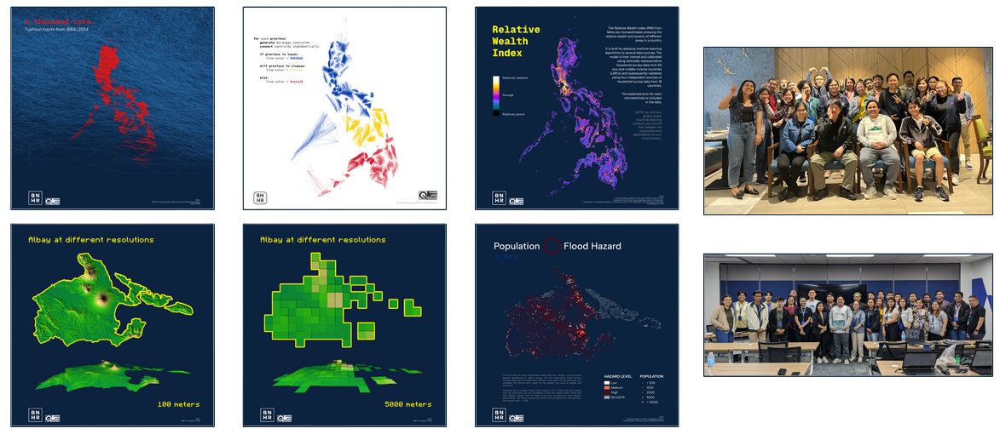
<div class="qr-col"><p class="qr-caption">facebook.com/<wbr><span class="nw">bnhr.xyz</span></p></div>
</div>

Note:
Some of the work: maps made from open data with free software, and some of the rooms I have taught in. QGIS is free and open source too: what you learn here runs on any computer in your office, with no licence to renew.

---

## I also post maps made from *open* data.

<div class="posts">
<figure>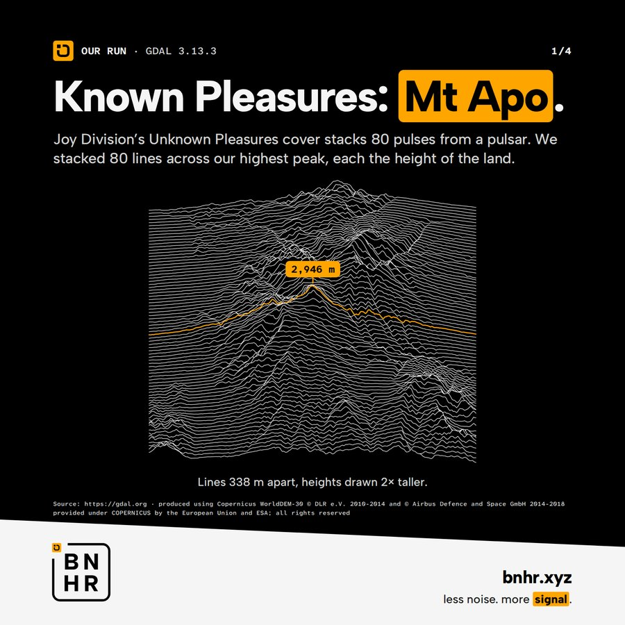<figcaption>Ridgelines of Mt Apo</figcaption></figure>
<figure>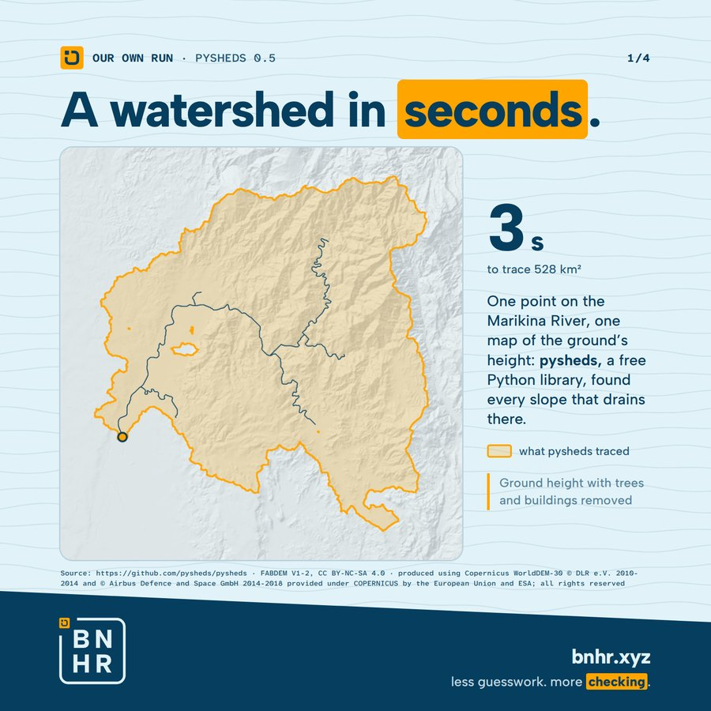<figcaption>The Marikina watershed</figcaption></figure>
<figure>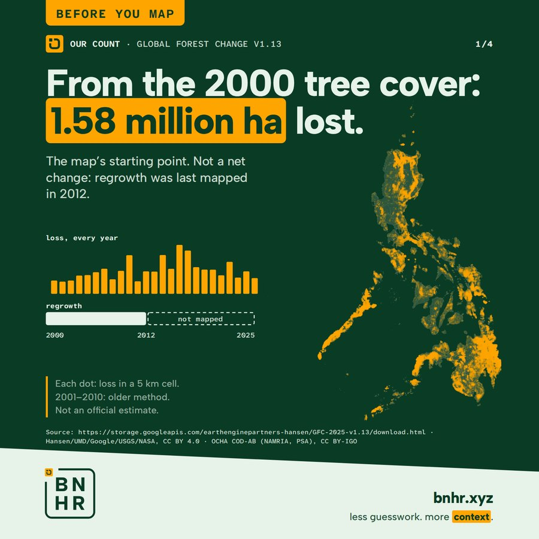<figcaption>Forest cover lost</figcaption></figure>
<figure>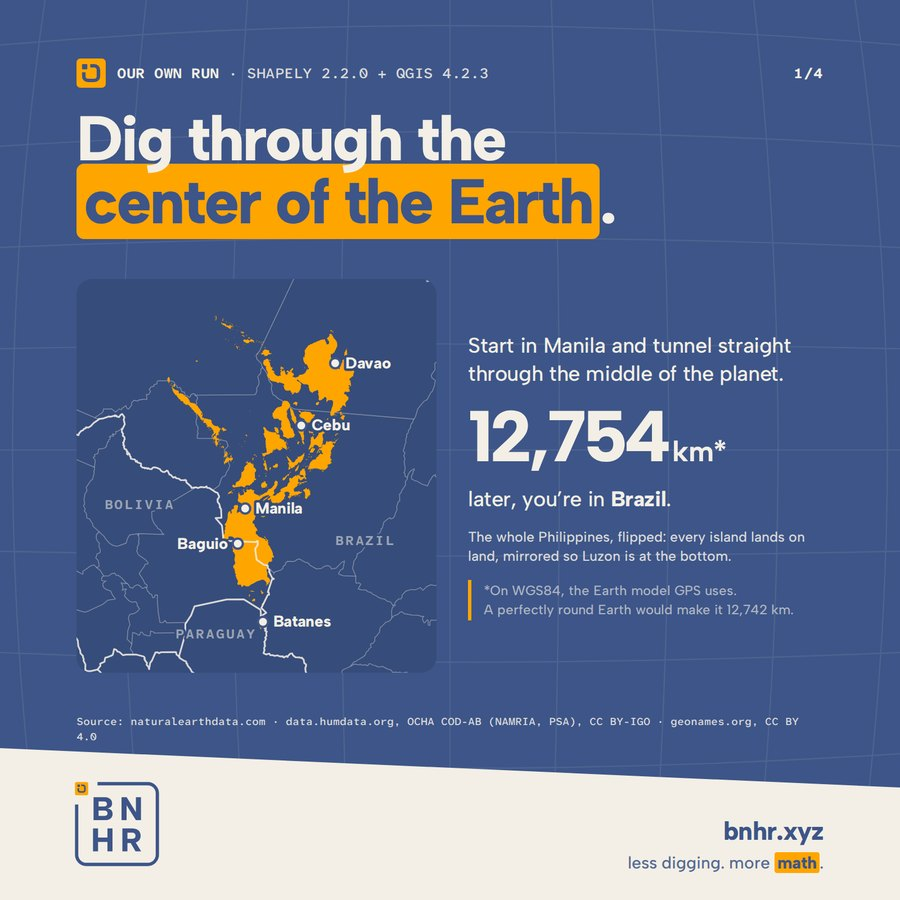<figcaption>The antipodes</figcaption></figure>
</div>

<p class="steps-note">Elevation, rivers, forest cover, boundaries: free data, free software, and the code to make them yourself.</p>

Note:
A few of the maps I post on the page. The ridgelines of Mt Apo, from a free elevation model. The Marikina watershed, traced from one point on the river in three seconds. The tree cover the Philippines lost from 2001 to 2025, from Global Forest Change, closest to your work. And where you would come out if you dug straight through the Earth from Manila: Brazil. Every one is open data and free software; the same elevation, forest and boundary data you can load in QGIS.

---

## A lot of *maps*, from open data.

<div class="posts">
<figure>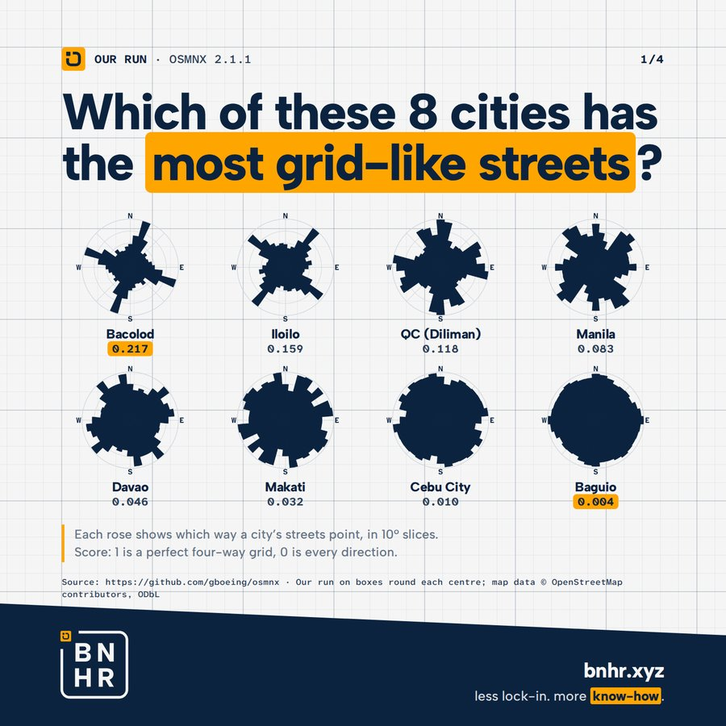<figcaption>Street orientation</figcaption></figure>
<figure>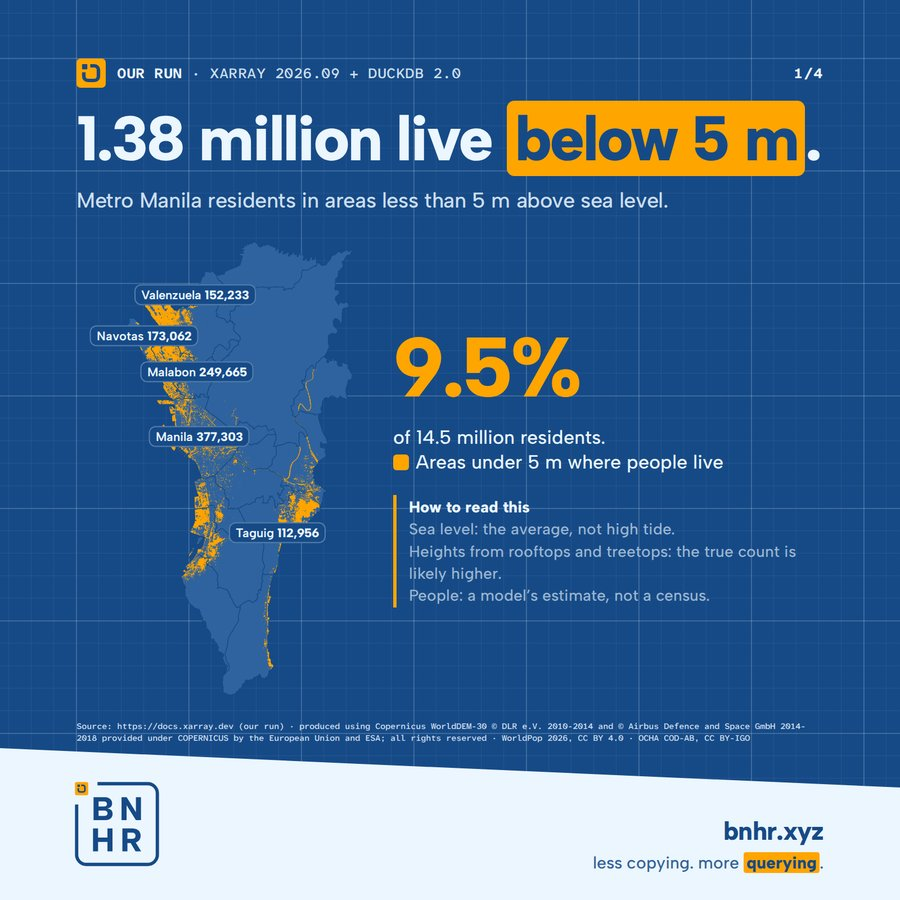<figcaption>Below 5 m</figcaption></figure>
<figure>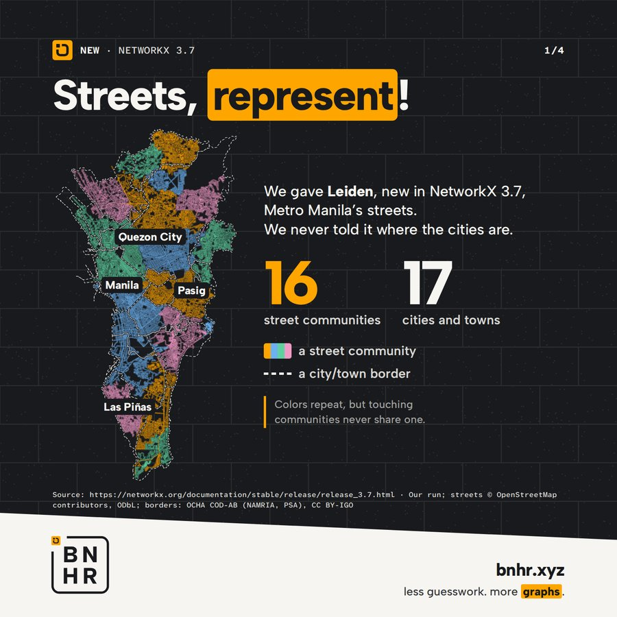<figcaption>Street communities</figcaption></figure>
<figure><figcaption>Roads that end short</figcaption></figure>
</div>

<p class="steps-note">Streets, roads, heights, people: free data, free software, and the code to make them yourself.</p>

Note:
Four more from the page. Which of eight Philippine cities has the most grid-like streets: Bacolod, and Baguio the least, from OpenStreetMap. How many Metro Manila residents live less than 5 m above sea level: 1.38 million, from a free elevation model and WorldPop. Metro Manila's streets split into 16 communities by an algorithm that was never told where its 17 cities and towns are. And one made in QGIS itself: Validate network, new in QGIS 4, found 148 roads around Metro Manila that end just short of another. Every one is open data and free software.

---

<!-- .slide: class="toc-slide" -->

## Contents

<ol class="toc-list">
<li>Introduction to the training</li>
<li>Your format and workflow</li>
<li>Day 1 · From the guide to the area data</li>
<li>Day 2 · The corners, the TD and the map</li>
<li>Day 3 · The checks, and your own application</li>
</ol>

Note:
This one deck runs all three days. This morning: how the training works, then your team walks us through NRDC's format and workflow, then Day 1. Each morning after this I open the deck at that day's section; in between we work in QGIS, and I come back here for the tests, the check-ins and the end of the day.

---

<!-- .slide: class="section-slide" -->
<span class="section-label">Introduction to the training</span>

# How the next three days *work*.

Note:
Ten minutes on how the course works, then a short test, then NRDC has the floor.

---

## Every application needs *four* outputs that agree.

<div class="steps" style="--n: 4">
<div class="step"><div class="n">Output 1</div><div class="name">The map</div><div class="what">The subject area in the prescribed layout, with its signatories.</div></div>
<div class="step"><div class="n">Output 2</div><div class="name">Shapefiles</div><div class="what">The corners as points, the boundary as a polygon, with the prescribed attributes.</div></div>
<div class="step"><div class="n">Output 3</div><div class="name">Technical description</div><div class="what">Bearings and distances, with the tie point and the tie line.</div></div>
<div class="step"><div class="n">Output 4</div><div class="name">Corner coordinates</div><div class="what">The northing and easting of every corner.</div></div>
</div>

<p class="steps-note">Most returned applications fail on agreement, not on any one output.</p>

Note:
The Guide for the Standard Mapping, the FMB memorandum of 15 February 2024, asks for four digital outputs with every forestry tenure application. They are not four separate tasks: they are four views of the same area. The corners in the point shapefile are the corners in the technical description; the polygon is the area on the map; the area on the map is the area in the attribute table. When an application comes back, it is usually because two of these disagree: a technical description that doesn't close, an area that differs between the map and the table, coordinates that don't match the shapefile. Everything this week builds the four outputs from one source, so they can't disagree, and Day 3 checks that they don't.

---

## One fictional application carries the *course*.

<div class="split map-shot">
<div class="rows">
<div><b>Bagong Gubat</b>an agroforestry cooperative applying for about 23.76 ha in General Nakar, Quezon</div>
<div><b>Days 2 and 3</b>four more applications join, and a returned one to check</div>
</div>
<div class="shot-col">
<div class="screenshot-container">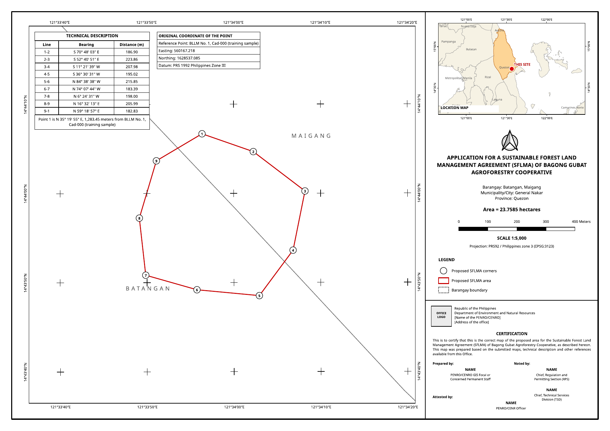</div>
<p class="slide-source">The map you make by Day 2</p>
</div>
</div>

Note:
Every exercise works on one application: the Bagong Gubat Agroforestry Cooperative, about 23.76 hectares in General Nakar, Quezon, in PRS 1992 Zone III. The applicant, the BLLM it is tied to and the tenure layers are made up for the course, so we can break things freely. This is the map you will have made by Day 2's afternoon. Then four more applications come in, to map all five with one layout, and on Day 3 a returned application gives us something to cross-check. From late morning on Day 3 we switch to your own data.

---

## Three days, one application from plot to *final*.

<div class="steps" style="--n: 4">
<div class="step"><div class="n">Day 1</div><div class="name">The area data</div><div class="what">The guide, the right CRS, the two shapefiles; your own data inspected, a messy one cleaned.</div></div>
<div class="step"><div class="n">Day 2</div><div class="name">The TD and the map</div><div class="what">Corners, coordinates, bearings, the tie line; the prescribed map as a template, and the atlas.</div></div>
<div class="step"><div class="n">Day 3 · morning</div><div class="name">Checked</div><div class="what">Every check before submission, on a returned application.</div></div>
<div class="step ours"><div class="n">Day 3 · from 11:40</div><div class="name">Your application</div><div class="what">Your own data, cleaned, then from plot to final, in groups.</div></div>
</div>

Note:
Day 1: what the guide requires, the coordinate reference systems, and the two shapefiles, plotted three ways and filled in; before lunch you inspect your own data against a checklist, and in the afternoon you clean a made-up messy application. Day 2: the technical description and corner coordinates in the morning, the prescribed map in the afternoon, saved as a template you keep, and the atlas, to map several applications with it. Day 3 morning: the checks that the four outputs agree. From 11:40 on Day 3 it's yours: your own data, cleaned, and one application from plot to final, in groups.

---

## Every day has the same *shape*.

<div class="rows">
<div><b>Morning</b>a fifteen-question pre-test on what the day covers</div>
<div><b>Blocks</b>hands-on in QGIS, a three-question check-in after the morning and after the afternoon</div>
<div><b>End of day</b>the pre-test's questions again, then the ones the room found hardest</div>
</div>

<p class="steps-note">None of it counts toward anything. It tells me what to go over. On Day 3 the post-test comes before lunch.</p>

Note:
The rhythm repeats, so after today you know what comes next. The pre-test and the post-test are the same fifteen questions, so at the end of the day you see what you learned. The check-ins are three questions and a traffic light, about three minutes, and they tell me who to sit with first. Nothing counts toward the certificate. Day 3 is different: the post-test comes at 11:25, and the rest of the day goes to your own applications.

---

## Four house rules for the *room*.

<div class="numbered">
<div><span class="n">1</span><span class="t"><b>Ask anytime</b>Interrupt me, out loud. Disagreeing is welcome.</span></div>
<div><span class="n">2</span><span class="t"><b>Breaks at 10:00 and 15:00</b>Ten minutes each, lunch from 12:00 to 13:00. We end at 17:00.</span></div>
<div><span class="n">3</span><span class="t"><b>Your format wins</b>Where NRDC does it differently from the workbook, we follow NRDC.</span></div>
<div><span class="n">4</span><span class="t"><b>Your data stays with you</b>Applications you bring stay on your computer.</span></div>
</div>

Note:
Four rules. Ask anytime: if I lose you, say so, out loud; you will not be the only one. Breaks at 10:00 and 15:00, ten minutes each, lunch from 12:00 to 13:00, and we end at 17:00; times may shift a little with how the room is doing. The workbook follows the FMB guide; where your office's format differs, you know better than the workbook, so tell me and we follow yours. Some details the guide leaves open, like how many decimals the area takes or the page size, are marked in the workbook to confirm with your office. And the data you bring, from today's inspection to Day 3's capstone, stays on your computers; nothing is uploaded anywhere.

---

## Ask your neighbour first, *then* raise a hand.

<div class="numbered">
<div><span class="n">1</span><span class="t"><b>Your neighbour</b>Same data, same exercise, often the same problem.</span></div>
<div><span class="n">2</span><span class="t"><b>A raised hand</b>I come to you, or the training assistant does.</span></div>
<div><span class="n">3</span><span class="t"><b>The workbook</b>Every exercise, step by step, with screenshots.</span></div>
<div><span class="n">4</span><span class="t"><b>The outputs folder</b>Every exercise finished: open it and compare.</span></div>
</div>

Note:
Every exercise is yours to do on your own computer, but you are not alone with it. Ask the person beside you first. If you are both stuck, raise a hand. The workbook has every step with a screenshot, so you can catch up if you missed one. And the outputs folder has the finished result of every exercise: the projects, the shapefiles, the technical description and the layout templates. If one exercise has held you too long, open its output and carry on from there, so you don't fall behind for the rest of the day because of one step.

---

## The workbook and the data are yours to *keep*.

<div class="split qr-split">
<div>
<div class="rows">
<div><b>data</b>the GeoPackage, the corners as CSV, the plugin's input files</div>
<div><b>outputs</b>every exercise finished, and the layout templates</div>
<div><b>The workbook</b>online, every module, and it stays after the course</div>
</div>
<p class="steps-note">The folder is <code>BNHR_QGIS-for-SFLMA-Mapping</code>.</p>
</div>
<div class="qr-col"><p class="qr-caption"><span class="nw">learn-qgis.bnhr.xyz/</span><wbr><span class="nw">sflma-mapping/00-about</span></p></div>
</div>

Note:
The course folder, BNHR_QGIS-for-SFLMA-Mapping, has two subfolders. data has what the exercises start from: one GeoPackage with the sample technical description, the tie point and the reference boundaries, the corners as CSV, and the input files for the Azimuth and Distance plugin. outputs has every exercise finished, with the projects and the layout templates of the prescribed map. The workbook is on the Learn QGIS site, open to anyone, and it stays online after the course, so you can come back to it with the next application.

---

<!-- .slide: class="section-slide" -->
<span class="section-label">From NRDC</span>

# Your format, your *workflow*.

Note:
(09:00, after the pre-test, twenty minutes.) NRDC has the floor. If the team brought its own materials, switch the screen to them now. Take notes on anything that differs from the FMB guide: it changes what we do in the exercises, the layout template, and the checklist you take home.

---

## Show us what the next three days should *fit*.

<div class="rows">
<div><b>Your format</b>where NRDC's maps and files differ from the FMB guide</div>
<div><b>Your workflow</b>how an application moves: who plots, who checks, who signs</div>
<div><b>Your returns</b>why applications came back, so we check for it</div>
<div><b>Your data</b>what you brought: we inspect it before lunch, and clean it on Day 3</div>
</div>

Note:
If NRDC has no materials of its own, these four questions run the conversation. The format: an approved map, the fields, the names, the signatories, anything on top of the guide. The workflow: who does which output, and where the checks happen. The returns: every reason an application came back is a check we can add on Day 3. And the data: what the team brought, which everyone inspects against the primer's checklist before lunch today, then cleans and takes from plot to final in the capstone on Day 3.

---

<!-- .slide: class="section-slide" -->
<span class="section-label">Monday 9 November</span>

# Day 1. From the guide to the *area data*.

Note:
Day 1: Modules 1 and 2 of the workbook, your own data inspected with the primer P1, and the drill D1.

---

## Today, the guide becomes two shapefiles, and your data gets *checked*.

<div class="steps" style="--n: 5">
<div class="step"><div class="n">09:00</div><div class="name">Your format</div><div class="what">NRDC walks us through its format, workflow and data.</div></div>
<div class="step"><div class="n">09:20</div><div class="name">The guide</div><div class="what">Four outputs, their names, the right datum and zone, and the project.</div></div>
<div class="step ours"><div class="n">11:05</div><div class="name">Your data</div><div class="what">Checked against the primer's checklist; what you find, written down.</div></div>
<div class="step"><div class="n">13:00</div><div class="name">Plot the area</div><div class="what">The two shapefiles, plotted three ways, valid, and filled in.</div></div>
<div class="step"><div class="n">15:15</div><div class="name">The drill</div><div class="what">A made-up messy application, cleaned one fix at a time.</div></div>
</div>

<p class="steps-note">Module 1, Laying the foundation; Module 2, Preparing the area data; Primer P1 and Drill D1.</p>

Note:
Today's plan in five steps. After the pre-test, NRDC's walkthrough of its format, workflow and data, twenty minutes. Then Module 1 until 11:00, the break inside it: what the guide requires, why we work in a GeoPackage and submit shapefiles, Luzon 1911 and PRS 1992 and the national grid, and Exercise 1.1, the project set to the TD's datum and zone. After the morning check-in, your own data: load it, go through the primer's checklist, Is your area data ready?, and write down what you find; no fixing yet, that comes on Day 3. After lunch, all of Module 2: the two shapefiles with the prescribed fields, the area plotted three ways, the geometry checked and fixed, the area and location attributes computed, and what changes with several parcels. After the break and the check-in, the drill, Clean a messy application: every problem on the checklist once, found and fixed in order, with a check after each fix. What is left of it carries into tomorrow's prep, from 08:00.

---

## A test takes about *ten* minutes, and comes back at the end of the day.

<div class="steps" style="--n: 4">
<div class="step"><div class="n">1</div><div class="name">Your name and group</div><div class="what">Your first name. For the group, write NRDC, the same way every time.</div></div>
<div class="step"><div class="n">2</div><div class="name">Answer and submit</div><div class="what">Nothing says which answers are right, yet.</div></div>
<div class="step"><div class="n">3</div><div class="name">Hand in the file</div><div class="what">Submitting downloads a small file. Put it in the shared folder.</div></div>
<div class="step ours"><div class="n">4</div><div class="name">After the post-test</div><div class="what">A passphrase shows your score, the right answers and why.</div></div>
</div>

Note:
How a test works, once, for all three days. Open the link on your phone or computer and give your first name; if two of you share a first name, add your last initial. For the group, write NRDC, every time: the pre-test and the post-test are matched by name and group, so write both the same way each time. Answer and submit; the page downloads a small file with your answers. Put that file in the shared folder, with the second code on the next slide. At the end of the day, when everyone's post-test file is in, I announce a passphrase: type it on the page and it shows your score, your morning score beside it, and every question with the right answer and the explanation.

---

## Day 1 pre-test: nobody expects you to know these *yet*.

<bnhr-timer minutes="10" extra="3"></bnhr-timer>

<div class="qr-pair">
<div class="qr-col"><p class="qr-caption"><b>1 · The test</b>bnhr.xyz/quizzes/<wbr><span class="nw">sflma-mapping/</span><wbr><span class="nw">day1/pre/</span></p></div>
<div class="qr-col"><p class="qr-caption"><b>2 · The shared folder</b>Your downloaded file goes here</p></div>
</div>

Note:
(About 08:45, ten minutes, three more if the room needs them; T starts the timer.) Fifteen questions on what today covers. Nobody expects you to know the answers yet: the same questions come back at 16:30. Scan the first code, answer, submit, and put the file it downloads in the folder behind the second code. The folder is restricted: check before Day 1 that every participant's account has access.

---

## Is QGIS ready? Add the *Azimuth and Distance* plugin.

<div class="rows">
<div><b>Help ‣ About</b>the course was made in QGIS 3.44</div>
<div><b>Plugins ‣ Manage and Install</b>search for Azimuth and Distance, then install it</div>
<div><b>The Browser panel</b>right-click the course folder ‣ Add as a Favorite</div>
</div>

<p class="steps-note">Something doesn't work? Raise a hand now, not at 13:00.</p>

Note:
(Right after the pre-test, before NRDC's walkthrough, or at 10:10 if time is short.) Three checks. Help, About: the course was made and tested in QGIS 3.44; an older 3.x mostly works, but menus may sit in different places, so tell me which version you have. Install the Azimuth and Distance plugin now, while the internet is quiet: this afternoon we plot the area from the technical description with it, and it then sits under Plugins, Topography. And add the course folder as a favourite in the Browser panel, so every exercise starts one click away.

---

## The guide fixes every file's *name*.

| Files | Name |
|:--|:--|
| Shapefiles | `<Region>_<Tenure Type>_<Point or Polygon>_<Applicant's Name>` |
| TD and coordinates | `TD_<Region>_<Tenure Type>_<Applicant's Name>` |

<p class="steps-note">The sample: <code>IV-A_SFLMA_Polygon_Bagong Gubat Agroforestry Cooperative.shp</code></p>

Note:
(09:20, Module 1.) Before any map, the names. The guide prescribes two patterns: the shapefiles carry region, tenure type, point or polygon, and the applicant's name in full; the technical description and the coordinates start with TD. For the sample that gives four files: the point and polygon shapefiles, and the TD as a spreadsheet and as CSV. A wrong name is one of the easiest reasons to return an application, and one of the easiest to avoid. Several parcels: each parcel's TD on its own sheet, one point shapefile per parcel, and one polygon shapefile for all of them.

---

## Submit shapefiles; work in a *GeoPackage*.

<div class="two-column">
<div class="column">
<div class="column-header">Shapefile · what you submit</div>
<div class="facts">
<p>Field names cut to 10 characters: <code>TIE_DISTANCE</code> becomes <code>TIE_DISTAN</code></p>
<p>Text fields hold 254 characters, not the guide's 255</p>
<p>Several files: lose the <code>.prj</code> and the layer has no CRS</p>
</div>
</div>
<div class="column focus">
<div class="column-header">GeoPackage · where you work</div>
<div class="facts">
<p>One file, many layers: the TD lines, the tie point, the reference layers</p>
<p>Long field names, long text</p>
<p>It holds the QGIS project too, so data and project travel together</p>
</div>
</div>
</div>

Note:
The guide requires shapefiles, and we submit shapefiles. But the format's limits show up in this very workflow: the tie line's field names get cut at ten characters, a text field of 255 silently becomes 254, and a shapefile is five files, so one missing .prj and it opens with no coordinate system. So each application's working data lives in a GeoPackage, and only the two submission layers are shapefiles, made with the prescribed fields from the start.

---

## Two datums, five zones: the TD *decides*.

<div class="compact">

| Zone | Central meridian | Luzon 1911 | PRS 1992 |
|:--|:--|:--|:--|
| I | 117° E | EPSG:25391 | EPSG:3121 |
| II | 119° E | EPSG:25392 | EPSG:3122 |
| III | 121° E | EPSG:25393 | **EPSG:3123** |
| IV | 123° E | EPSG:25394 | EPSG:3124 |
| V | 125° E | EPSG:25395 | EPSG:3125 |

</div>

<p class="steps-note">The national grid is not UTM: EPSG:32651 looks alike, and isn't.</p>

Note:
Luzon 1911 and PRS 1992 are two datums; the same point on the ground has different coordinates in each. Both use the national grid's five zones, two degrees wide, so each zone has two CRSs in QGIS. Which one you use is not a preference: the technical description and its tie point decide it. Our sample says PRS 1992 Philippines Zone III, EPSG:3123. If a TD doesn't say its zone, take the zone whose central meridian is nearest the area. And UTM 51N coordinates look similar in size, but they are a different projection: not interchangeable. Leave this slide up during Exercise 1.1.

---

## Another datum moves the area *7.7 m*.

<div class="split">
<div class="rows stack">
<div><b>Default transformation</b>7.7 m off at corner 1</div>
<div><b>Another one</b>22.6 m off</div>
<div><b>The fix</b>the tie point in the TD's datum, never a reprojection</div>
</div>
<div class="shot-col">
<div class="screenshot-container">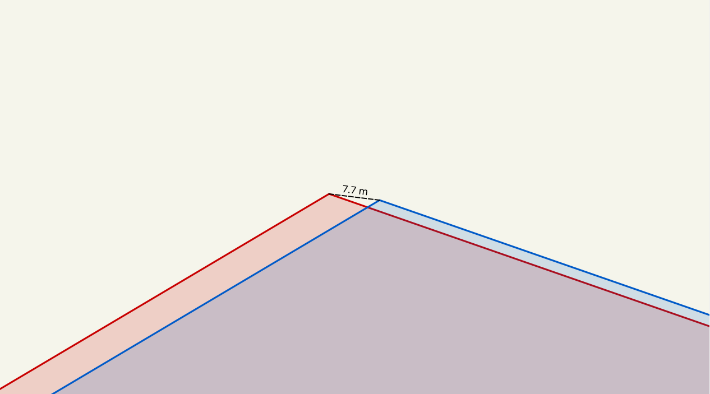</div>
<p class="slide-source">The sample's corner 1, read as PRS 1992 (red) and as Luzon 1911 (blue)</p>
</div>
</div>

Note:
QGIS can reproject between Luzon 1911 and PRS 1992, but the result is not survey-grade, and it depends on which transformation QGIS picks. The sample's corners, read as the other datum, land 7.7 metres away with the default transformation, 22.6 with another. A boundary 7.7 metres off overlaps its neighbour's. So the rule: keep the shapefiles, the TD and the tie point in the TD's datum and zone, and if something doesn't match, get the tie point's coordinates in the right datum instead of reprojecting the area.

---

## Your turn: Exercise *1.1*.

<div class="split qr-split turn">
<div>
<div class="rows">
<div><b>1.1</b>The project in the TD's datum and zone</div>
<div><b>Then</b>Load the reference layers and the tie point, and check each one's CRS</div>
<div><b>Save</b>The project inside the GeoPackage</div>
</div>
<div class="callout done"><b>Done when</b> the status bar and every layer read EPSG:3123.</div>
</div>
<div class="qr-col"><p class="qr-caption"><span class="nw">learn-qgis.bnhr.xyz/</span><wbr><span class="nw">sflma-mapping/</span><wbr><span class="nw">01-laying-the-foundation/</span></p></div>
</div>

Note:
Exercise 1.1, in the workbook's Module 1. The sample TD says PRS 1992 Philippines Zone III: filter the Project Properties for "Philippines zone" and pick PRS92 / Philippines zone 3. Load the barangays, municipalities, provinces and the tie point, check each one's CRS, then save the project into the GeoPackage. If you finish early, read "Beyond files" in the module: what changes when an office handles hundreds of applications.

---

## Morning check-in: the guide and the *CRS*.

<bnhr-timer minutes="3" extra="1"></bnhr-timer>

<div class="lights"><span><span class="dot light-green"></span>On my own data tomorrow</span><span><span class="dot light-yellow"></span>With the notes</span><span><span class="dot light-red"></span>Not yet</span></div>

<div class="qr-pair">
<div class="qr-col"><p class="qr-caption"><b>1 · The check-in</b>bnhr.xyz/quizzes/<wbr><span class="nw">sflma-mapping/</span><wbr><span class="nw">day1-morning/</span></p></div>
<div class="qr-col"><p class="qr-caption"><b>2 · The shared folder</b>Your downloaded file goes here</p></div>
</div>

Note:
(11:00, at the end of Module 1. Three minutes, one more if the room needs it; T starts the timer.) Three questions on the morning, on the guide, the GeoPackage and the CRS, then the traffic light: be honest with it. Green if you could do this on your own data tomorrow, yellow if you could with the notes, red if not yet. Check my answers shows the right answers and why at once, and downloads a small file: put it in the same folder. Nothing is scored; I go first to whoever shows red or yellow.

---

## Clean area data passes *twelve* checks.

<div class="steps" style="--n: 3">
<div class="step"><div class="n">Checks 1 to 5</div><div class="name">The files</div><div class="what">Where it came from, the files, the CRS, the encoding, the field names.</div></div>
<div class="step"><div class="n">Checks 6 to 10</div><div class="name">The geometry</div><div class="what">Its type, one feature per parcel, validity, holes, and only real corners.</div></div>
<div class="step"><div class="n">Checks 11 and 12</div><div class="name">The values</div><div class="what">The attributes as the guide writes them, and the place they name.</div></div>
</div>

<p class="steps-note">Where to look: Layer Properties, the attribute table, the Field Calculator's preview, Check validity.</p>

Note:
(11:05.) The primer, Is your area data ready? The course's sample is clean: it was plotted from its technical description, in the right CRS, with the guide's fields. Area data from an applicant, an office's archive or another program often isn't. Twelve checks, in three groups. The files: how the layer was made, plotted from a TD or traced; the .prj and the .cpg beside the .shp; the TD's datum and zone; names that read correctly, ñ and not a question mark; the guide's field names, none cut at 10 characters. The geometry: a polygon with no Z or M; one feature per parcel, checked first, so that each feature you check after is one parcel; valid; no holes unless they are real exclusions; every vertex a real corner. Many more vertices than the TD has corners, and holes the size of raster cells, are the signs of a traced layer. The values: REGION in Roman numerals, nothing abbreviated, names spelled as the reference layers spell them; and the area inside the municipality and barangays it names. It is the input's side of the final QC checklist we use on Day 3.

---

## Your turn: check *your own* data.

<div class="split qr-split turn">
<div>
<div class="rows">
<div><b>P1.1</b>The sample first: every check passes, so you see what clean reads like</div>
<div><b>Your data</b>The twelve checks, with its TD at hand</div>
<div><b>Your list</b>What each check reads, and whether it passes</div>
</div>
<div class="callout done"><b>Done when</b> every check has a line on your list. Fix nothing yet: that comes on Day 3.</div>
</div>
<div class="qr-col"><p class="qr-caption"><span class="nw">learn-qgis.bnhr.xyz/</span><wbr><span class="nw">sflma-mapping/</span><wbr><span class="nw">p1-is-your-area-data-ready/</span></p></div>
</div>

Note:
(11:05 to 11:30; the half hour to lunch is for it to run on, or for questions.) P1.1 takes about ten minutes on the sample: the Information page, the attribute table, the expressions in the Field Calculator's preview, Check validity. Then your own data, with its TD if you have it. Write down, for each check, what your layer reads and whether it passes, and which problems you could fix yourself and which are for the data's owner to answer. Keep the list: tomorrow we hold it against Module 3, and on Day 3 the capstone starts from it. If you didn't bring data, pair with someone who did.

---

## The guide's field types, in *QGIS's* words.

| The guide (ArcGIS) | QGIS type | Length | Precision |
|:--|:--|:--|:--|
| Short Integer | Integer (32 bit) | 4 | |
| Double | Decimal (double) | 20 | 3 |
| Text, length 255 | Text (string) | **254** | |
| Text, length 50 | Text (string) | 50 | |

<p class="steps-note">X and Y stay blank. The coordinates go in NORTHINGS and EASTINGS, with 3 decimals.</p>

Note:
(13:00, Module 2.) The guide lists the fields of both shapefiles in ArcGIS's names; in QGIS's New Shapefile Layer dialog they are these. Two traps. Type 255 for a text field and QGIS quietly makes it 254, the most a shapefile holds. And the coordinates take precision 3, the guide's own millimetres; left at the default, a northing exports to CSV as 1629584.142999999923632. X and Y are in the prescribed table, but the guide says to leave them blank.

---

## Three ways to plot, *one* polygon.

<div class="steps" style="--n: 3">
<div class="step"><div class="n">2.2 · a TD</div><div class="name">Bearings and distances</div><div class="what">The Azimuth and Distance plugin, from the tie point to corner 1, then around.</div></div>
<div class="step"><div class="n">2.3 · a corner list</div><div class="name">Northings and eastings</div><div class="what">The CSV as points, the points as a path, the path as a polygon.</div></div>
<div class="step"><div class="n">2.4 · a layer</div><div class="name">An existing area</div><div class="what">Digitized or edited against the reference layers, with snapping on.</div></div>
</div>

<p class="steps-note">What the applicant gives you picks the method. Each ends in a closed polygon in the TD's CRS.</p>

Note:
How you plot depends on what the applicant hands you. A technical description: the Azimuth and Distance plugin walks the tie line from the BLLM to corner 1, then each line around the boundary. A list of corner coordinates: the CSV as points, the points joined in order into a path, the path closed into a polygon. An existing layer, a survey or an older application: digitize or clean it against the reference layers, with snapping on so the vertices land exactly. All three land in the same place, and the rest of the course doesn't care which you used.

---

## Your turn: Exercises *2.1 to 2.4*.

<div class="split qr-split turn">
<div>
<div class="rows">
<div><b>2.1</b>The two shapefiles, named and with the prescribed fields</div>
<div><b>2.2</b>The area from the TD, with the plugin</div>
<div><b>2.3</b>The area from the corners' CSV</div>
<div><b>2.4</b>The area from an existing layer</div>
</div>
<div class="callout done"><b>Done when</b> the polygon has nine corners, and corner 1 sits 1,283.45 m from BLLM No. 1.</div>
</div>
<div class="qr-col"><p class="qr-caption"><span class="nw">learn-qgis.bnhr.xyz/</span><wbr><span class="nw">sflma-mapping/</span><wbr><span class="nw">02-preparing-the-area-data/</span></p></div>
</div>

Note:
Exercises 2.1 to 2.4. 2.1 makes the two empty shapefiles, in EPSG:3123, with the prescribed fields and names. 2.2 is the one everyone does: the area from the TD with the plugin. 2.3 and 2.4 are the other two starting points; if time is short, do 2.3 and read 2.4. Check: nine corners, and the tie line from BLLM No. 1 to corner 1 is 1,283.45 metres. The finished shapefiles are in outputs if you need to catch up.

---

## Check the geometry *before* computing.

<div class="split">
<div>
<div class="rows stack">
<div><b>Invalid</b>a wrong area and a wrong TD</div>
<div><b>Check validity</b>marks where the boundary crosses itself</div>
<div><b>Fix by hand</b>with the Vertex Tool, against the TD</div>
</div>
<div class="alert"><b>Not Fix geometries:</b> it cuts the area in two.</div>
</div>
<div class="shot-col">
<div class="screenshot-container">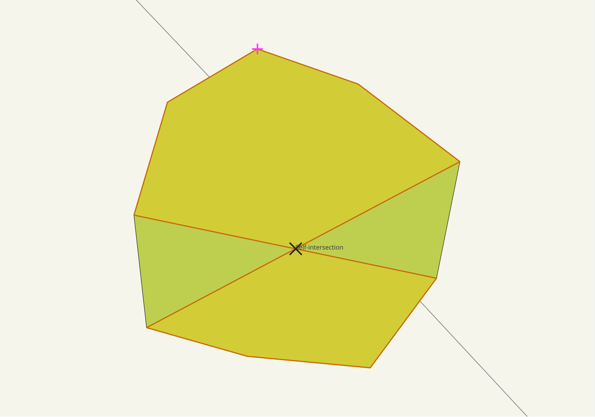</div>
<p class="slide-source">The sample with two corners swapped, checked</p>
</div>
</div>

Note:
(After Exercise 2.4.) Everything after this reads the polygon: the area, the corners, the bearings. So check it first. The broken sample has two corners swapped, so the boundary crosses itself, and one corner entered twice. Check validity, GEOS method, marks the crossing. Fix it by hand with the Vertex Tool: put the corners back in the TD's order and delete the repeated one. Don't reach for Fix geometries: it makes the polygon valid by cutting it into two parts, which is valid and wrong.

---

## The guide's rules for the *attribute* values.

<div class="rows">
<div><b>Never abbreviate</b>General Nakar, not Gen. Nakar; the applicant's name in full</div>
<div><b>Region</b>in Roman numerals: IV-A</div>
<div><b>Two or more</b>alphabetical, a comma only: Batangan,Maigang</div>
<div><b>AREA</b>in hectares, from <code>area($geometry)</code>, not <code>$area</code></div>
</div>

<p class="steps-note">Several parcels: one polygon shapefile for all, one point shapefile per parcel.</p>

Note:
The rules the guide puts on the values. No abbreviations, anywhere. Region in Roman numerals. Two or more municipalities or barangays: alphabetical, separated by a comma and nothing else, not even a space. And the area: area of geometry computes on the national grid, the same plane as the TD; dollar-area computes on the ellipsoid, and differs in the fourth decimal of the hectares, enough for a reviewer to see two areas. For several parcels: all the parcels in one polygon shapefile, one feature each, and one point shapefile per parcel with its own numbering.

---

## Your turn: Exercises *2.5 and 2.6*.

<div class="split qr-split turn">
<div>
<div class="rows">
<div><b>2.5</b>The broken sample, checked and fixed by hand</div>
<div><b>2.6</b>AREA and the location fields, computed</div>
</div>
<div class="callout done"><b>Done when</b> Check validity finds nothing, AREA reads 23.7585, and BARANGAY reads Batangan,Maigang.</div>
</div>
<div class="qr-col"><p class="qr-caption"><span class="nw">learn-qgis.bnhr.xyz/</span><wbr><span class="nw">sflma-mapping/</span><wbr><span class="nw">02-preparing-the-area-data/</span></p></div>
</div>

Note:
Exercises 2.5 and 2.6. Fix the broken sample until Check validity returns nothing, then compute the area in hectares and the location fields from the reference layers. The sample's AREA is 23.7585; the barangays are Batangan and Maigang, alphabetical, comma only; the municipality General Nakar; the region IV-A. Then read "Multiple parcels" at the end of the module.

---

## Afternoon check-in: how did *plotting* go?

<bnhr-timer minutes="3" extra="1"></bnhr-timer>

<div class="lights"><span><span class="dot light-green"></span>On my own data tomorrow</span><span><span class="dot light-yellow"></span>With the notes</span><span><span class="dot light-red"></span>Not yet</span></div>

<div class="qr-pair">
<div class="qr-col"><p class="qr-caption"><b>1 · The check-in</b>bnhr.xyz/quizzes/<wbr><span class="nw">sflma-mapping/</span><wbr><span class="nw">day1-afternoon/</span></p></div>
<div class="qr-col"><p class="qr-caption"><b>2 · The shared folder</b>Your downloaded file goes here</p></div>
</div>

Note:
(15:10, after the break: Module 2 is done.) Same as this morning: three questions on the shapefiles and plotting, then the traffic light, and the file in the folder. Then the drill.

---

## One messy application, every problem *once*.

<div class="split map-shot">
<div class="rows">
<div><b>The drill</b>two parcels, as the applicant sent them</div>
<div><b>Find</b>the twelve checks, nothing fixed yet</div>
<div><b>Fix</b>one at a time, each with its check</div>
<div><b>Prove</b>the TD's corners on its vertices</div>
</div>
<div class="shot-col">
<div class="screenshot-container">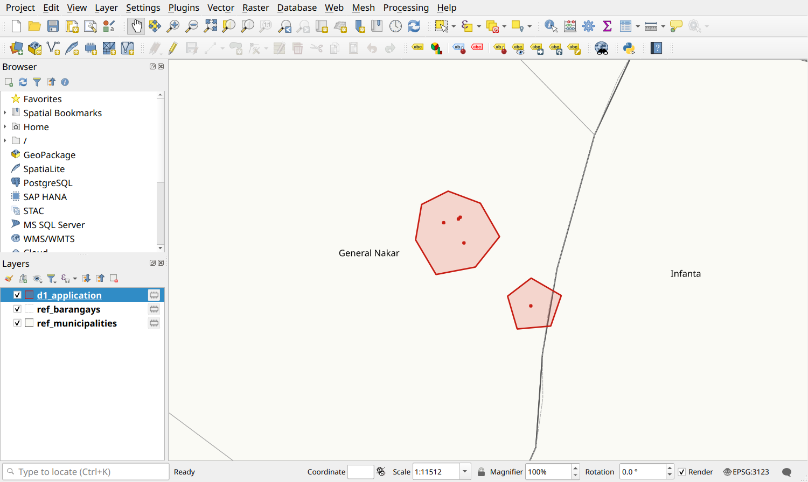</div>
<p class="slide-source">As delivered: four holes, a parcel in Infanta</p>
</div>
</div>

Note:
(15:15, after the check-in, until 16:00; the half hour after it is a buffer for Module 2 and the drill.) A fictional application, the Piñahan sa Lambak Agroforestry Cooperative's, with every problem of this morning's checklist once: no .cpg, so the ñ in its name reads wrong; in WGS 84; PolygonZ; two parcels in one feature; holes the size of raster cells, one of which makes it invalid; 249 vertices for the 12 corners of its TD; a field cut at 10 characters and one not named as the guide names it; the region and the municipality written wrong; and part of parcel 2 in Infanta. First find them all with the checklist, D1.1, and write them down, as you did with your own data. Then fix them.

---

## Each fix makes the *next* one possible.

<div class="steps" style="--n: 4">
<div class="step"><div class="n">D1.2 and D1.3</div><div class="name">Read it</div><div class="what">The encoding set, then reprojected into the TD's zone.</div></div>
<div class="step"><div class="n">D1.4 to D1.8</div><div class="name">The geometry</div><div class="what">From the whole to the detail: Z values, parts, holes, vertices.</div></div>
<div class="step"><div class="n">D1.9 and D1.10</div><div class="name">The fields</div><div class="what">The guide's names, then the values computed again.</div></div>
<div class="step ours"><div class="n">D1.11 and D1.12</div><div class="name">The checks</div><div class="what">The location flagged; the corners against the TD.</div></div>
</div>

<div class="alert"><b>Reproject, don't assign:</b> assigned EPSG:3123, its degrees land 1,740 km away.</div>

Note:
The order is the lesson: first what lets you read the data, its names and its coordinates in metres; then the geometry, from the whole to its details; then the fields and their values, which the geometry's changes make out of date; and last the checks. Reproject layer converts the coordinates; assigning a CRS only relabels them. The holes are raster cells of 100 square metres: Delete holes below 500, so a larger hole, which could be a real exclusion, stays, and ask the data's owner before you delete one; record the 0.05 ha it adds. The validity error is in a hole, so deleting the hole fixes it: not Fix geometries, which splits the hole and keeps it. Simplify, Douglas-Peucker at 0.01 m, removes only the vertices on straight lines. And the part in Infanta is not yours to fix: flag it, 0.6139 ha, for the data's owner.

---

## Your turn: Drill *D1*.

<div class="split qr-split turn">
<div>
<div class="rows">
<div><b>D1.1</b>Find: every problem, written down</div>
<div><b>D1.2 to D1.11</b>Fix: each with its check</div>
<div><b>D1.12</b>Prove: against the TD, saved in UTF-8</div>
<div><b>D1.13</b>Stretch: the cleaning as one Processing model</div>
</div>
<div class="callout done"><b>Done when</b> no corner of the TD is off a vertex, the parcels have 7 and 5 corners, and AREA reads 14.2783 and 5.4771.</div>
</div>
<div class="qr-col"><p class="qr-caption"><span class="nw">learn-qgis.bnhr.xyz/</span><wbr><span class="nw">sflma-mapping/</span><wbr><span class="nw">d1-debugging-drill/</span></p></div>
</div>

Note:
Each fix ends with its check, which shows the problem before the fix and passes after it. D1.12 is the proof: load the TD's corners as points and select those more than a millimetre from a vertex of the cleaned layer; none should be selected. Then save it as a shapefile in UTF-8, which writes its .cpg. Finished early: D1.13, the same cleaning as a Processing model, the way an office cleans its next application in one run. What is left of the drill at 16:30 carries into tomorrow's prep, from 08:00.

---

## Day 1 post-test: the morning's questions *again*.

<bnhr-timer minutes="8" extra="3"></bnhr-timer>

<div class="qr-pair">
<div class="qr-col"><p class="qr-caption"><b>1 · The test</b>bnhr.xyz/quizzes/<wbr><span class="nw">sflma-mapping/</span><wbr><span class="nw">day1/post/</span></p></div>
<div class="qr-col"><p class="qr-caption"><b>2 · The shared folder</b>Your downloaded file goes here</p></div>
</div>

Note:
(16:30, eight minutes, three more if the room needs them; T starts the timer.) The same fifteen questions as this morning. Same name, and NRDC for the group. Submit, and put the file in the folder. When every file is in, I announce the passphrase.

---

<!-- .slide: class="subsection-slide" -->
<span class="section-label">Day 1 · the post-test</span>

# The questions the room found *hardest*.

Note:
(16:40.) Announce the passphrase now. Then open the summary page with today's files and project the room view: the share right before and after, then the questions fewest got right, one at a time, with how many chose each option and why the right one is right.

---

## Exit ticket: one sentence before you go.

<div class="callout">
<p class="big-line">Which of today's steps does your office do differently, and why?</p>
</div>

<p class="steps-note">Tell me on your way out. Tomorrow, the corners become a technical description.</p>

Note:
One sentence about your own office, not the course. I read them tonight, and they decide what we adjust tomorrow, including the layout template we build in the afternoon. See you tomorrow morning.

---

<!-- .slide: class="section-slide" -->
<span class="section-label">Tuesday 10 November</span>

# Day 2. The corners, the TD and the *map*.

Note:
Day 2: Module 3, and Module 4: the map of one application, then the atlas for several.

---

<!-- .slide: class="subsection-slide" -->
<span class="section-label">Day 1, again</span>

# Yesterday, in a few *questions*.

Note:
(08:30, ten minutes with today's plan; 08:00 to 08:30 is prep, for finishing yesterday's drill.) A few quick questions to the room on yesterday: why a GeoPackage, which datum and zone the TD decides, the three ways to plot, what Check validity finds. Not the hardest questions again: those closed yesterday. Then anything from the exit tickets that changes today, and today's plan on the next slide.

---

## Today, the corners become a TD, and the TD a *map*.

<div class="steps" style="--n: 5">
<div class="step"><div class="n">08:55</div><div class="name">The corners</div><div class="what">Number them, then compute their northings and eastings.</div></div>
<div class="step"><div class="n">10:10</div><div class="name">The TD</div><div class="what">Bearings, distances and the tie line, exported with the prescribed names.</div></div>
<div class="step ours"><div class="n">11:45</div><div class="name">Your data</div><div class="what">Would it pass? Your Day 1 list against Module 3.</div></div>
<div class="step"><div class="n">13:00</div><div class="name">The map</div><div class="what">The page, the grid, the styling, the tables and a title block read from the layer.</div></div>
<div class="step"><div class="n">15:10</div><div class="name">The template</div><div class="what">Location map, legend, signatories, saved and exported; then the atlas.</div></div>
</div>

<p class="steps-note">Module 3, Technical descriptions and corner coordinates; Module 4, The prescribed map layout, 4.1 to 4.13.</p>

Note:
Today's plan in five steps. Before the break, the corners: numbered consistently, and their coordinates computed with Add X/Y fields, as the guide prescribes, with when that is safe. Then the technical description itself: bearings and distances from the boundary, the tie line from the BLLM, and the export, the TD and the coordinates, with the prescribed names. Module 3 has until 11:40, with time to run on, then the morning check-in. Before lunch, fifteen minutes on your own data: would your list from yesterday trip any of Module 3's steps? Then questions. After lunch, the map of one application: the page and main map, the latitude and longitude grid, the styling, the tables, and a title block that reads the layer's attributes, so the map can't disagree with the shapefile. After the break: the location map, the legend, the certification and signatories, the layout saved as a template and the map exported; then the atlas, so the same template maps several applications. What isn't finished by the check-in has tomorrow's prep and Day 3's first block.

---

## Day 2 pre-test: today's fifteen questions, *before* we start.

<bnhr-timer minutes="10" extra="3"></bnhr-timer>

<div class="qr-pair">
<div class="qr-col"><p class="qr-caption"><b>1 · The test</b>bnhr.xyz/quizzes/<wbr><span class="nw">sflma-mapping/</span><wbr><span class="nw">day2/pre/</span></p></div>
<div class="qr-col"><p class="qr-caption"><b>2 · The shared folder</b>Your downloaded file goes here</p></div>
</div>

Note:
(08:40, ten minutes, three more if the room needs them.) Same as yesterday: first name, NRDC for the group, the file in the folder.

---

## A technical description has *three* parts.

| Part | What it holds | The sample |
|:--|:--|:--|
| Lines | One per side: the line, its bearing, its distance | `1-2` · S 70° 48' 03" E · 186.90 m |
| Tie line | Bearing and distance, tie point to corner 1 | N 35° 19' 55" E · 1,283.45 m from BLLM No. 1 |
| Original coordinate | The tie point's easting, northing, datum and zone | E 560167.218 · N 1628537.085 · PRS 1992 Zone III |

<p class="steps-note">The guide: the tie point's coordinates and the tie line are always given, and complete.</p>

Note:
(08:55, Module 3.) Yesterday we read a TD to plot the area; today we write one from the area. Three parts. The lines, one per side of the area, corner to corner, with a bearing and a distance in metres. The tie line, from the tie point, here BLLM No. 1, to corner 1. And the original coordinate of that tie point, with its datum and zone. The guide is strict on the last two: they are always given, always complete.

---

## QGIS gives azimuths; the TD wants *bearings*.

<div class="split">
<div class="compact">

| Azimuth | Bearing |
|:--|:--|
| 0° to 90° | N *az* E |
| 90° to 180° | S (180° − *az*) E |
| 180° to 270° | S (*az* − 180°) W |
| 270° to 360° | N (360° − *az*) W |

</div>
<div class="shot-col">
<div class="screenshot-container figure">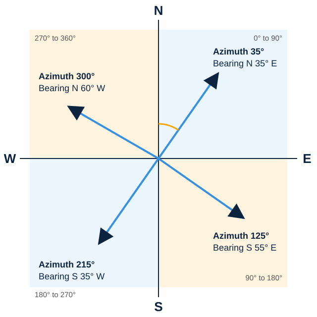</div>
</div>
</div>

Note:
An azimuth runs clockwise from north, zero to 360. A bearing starts from north or south and turns toward east or west, zero to 90. QGIS's azimuth function gives azimuths, so every bearing we write is converted, quadrant by quadrant. Line 1-2 of the sample has an azimuth of about 109 degrees: second quadrant, so south, 180 minus 109, east: S 70° 48' 03" E. The Field Calculator expression in Exercise 3.3 does this for every line.

---

## Add X/Y fields is safe with *four* settings.

<div class="numbered">
<div><span class="n">1</span><span class="t"><b>The layer's own CRS</b>Its default, EPSG:4326, writes degrees; another datum moves corners 7.7 m.</span></div>
<div><span class="n">2</span><span class="t"><b>Run normally</b>Not as Edit Features In-Place: there it stops with an error.</span></div>
<div><span class="n">3</span><span class="t"><b>On the vertices, prefixed</b><code>NE_</code> on the vertices, not on the shapefile, where it makes <code>x_2</code>.</span></div>
<div><span class="n">4</span><span class="t"><b>Rounded</b>It keeps ten decimals; the guide's coordinates have three.</span></div>
</div>

Note:
The guide names the tool: compute the northings and eastings with Add X/Y fields. It computes correctly, but four of its defaults work against the prescribed shapefile. Its CRS defaults to WGS 84, which writes degrees, and any other CRS converts silently, 7.7 metres for the wrong datum, with no warning. In place, it fails. On a layer that already has X and Y it names its fields x_2 and y_2, because shapefile names ignore case; so run it on the vertices with a prefix, and copy the corners into the shapefile afterwards. And round to three decimals.

---

## Your turn: Exercises *3.1 and 3.2*.

<div class="split qr-split turn">
<div>
<div class="rows">
<div><b>3.1</b>The corners, extracted and numbered from corner 1</div>
<div><b>3.2</b>NORTHINGS and EASTINGS, with Add X/Y fields</div>
</div>
<div class="callout done"><b>Done when</b> there are nine corners, and corner 1 reads N 1629584.143, E 560909.453.</div>
</div>
<div class="qr-col"><p class="qr-caption"><span class="nw">learn-qgis.bnhr.xyz/</span><wbr><span class="nw">sflma-mapping/</span><wbr><span class="nw">03-technical-descriptions/</span></p></div>
</div>

Note:
Exercises 3.1 and 3.2. Extract vertices gives ten points for nine corners: in a closed polygon the last vertex repeats the first, so delete it. Number the corners from corner 1, where the tie line lands; the workbook has the expression for a polygon that starts elsewhere. Then the coordinates, with the four settings on the last slide. Corner 1 is northing 1629584.143, easting 560909.453.

---

## The tie line ties the area to a *known* point.

<div class="split">
<div class="rows stack">
<div><b>From</b>the tie point, BLLM No. 1, in the TD's datum</div>
<div><b>To</b>corner 1, and only corner 1</div>
<div><b>Written</b>"Point 1 is N 35° 19' 55" E, 1,283.45 m from BLLM No. 1"</div>
</div>
<div class="shot-col">
<div class="screenshot-container">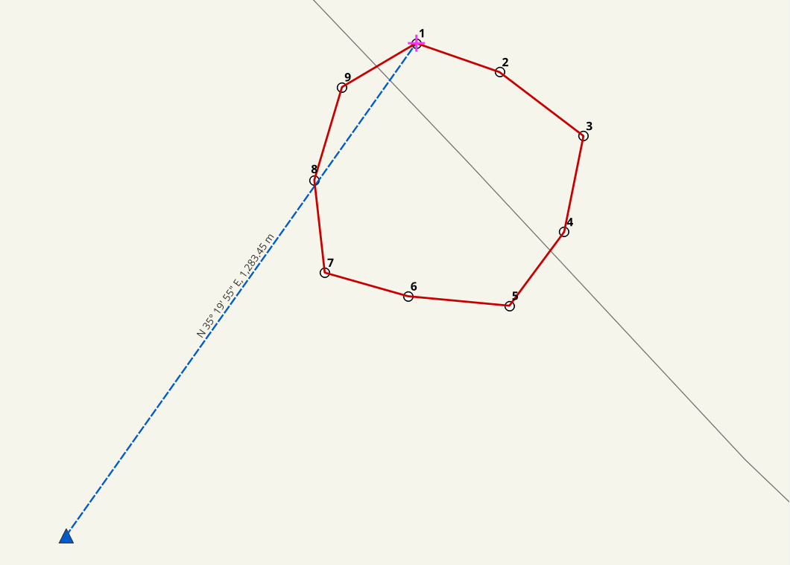</div>
<p class="slide-source">The sample's tie line, from BLLM No. 1 to corner 1</p>
</div>
</div>

Note:
(10:10.) The lines describe the shape; the tie line puts it on the ground. Without it, the same nine lines could be anywhere. It runs from a monument with known coordinates, here BLLM No. 1, to corner 1, and is written as a bearing and a distance in the guide's sentence. The tie point must be in the same datum as everything else: a BLLM's Luzon 1911 coordinates in a PRS 1992 project is the 7.7 metres from yesterday.

---

## Your turn: Exercises *3.3 to 3.5*.

<div class="split qr-split turn">
<div>
<div class="rows">
<div><b>3.3</b>The lines: bearing and distance for each side</div>
<div><b>3.4</b>The tie line, from BLLM No. 1 to corner 1</div>
<div><b>3.5</b>The TD and the coordinates, exported with the prescribed names</div>
</div>
<div class="callout done"><b>Done when</b> line 1-2 reads S 70° 48' 03" E, 186.90, and both <code>TD_IV-A_SFLMA_…</code> files exist.</div>
</div>
<div class="qr-col"><p class="qr-caption"><span class="nw">learn-qgis.bnhr.xyz/</span><wbr><span class="nw">sflma-mapping/</span><wbr><span class="nw">03-technical-descriptions/</span></p></div>
</div>

Note:
Exercises 3.3 to 3.5. One line per side, with its bearing in degrees, minutes and seconds and its distance in metres. Line 1-2 is S 70° 48' 03" E, 186.90 metres. Then the tie line: N 35° 19' 55" E, 1,283.45 metres. Then export the TD as a spreadsheet and the corner coordinates as CSV, both named TD_IV-A_SFLMA_ and the applicant's name.

---

## Morning check-in: the TD and the *tie line*.

<bnhr-timer minutes="3" extra="1"></bnhr-timer>

<div class="lights"><span><span class="dot light-green"></span>On my own data tomorrow</span><span><span class="dot light-yellow"></span>With the notes</span><span><span class="dot light-red"></span>Not yet</span></div>

<div class="qr-pair">
<div class="qr-col"><p class="qr-caption"><b>1 · The check-in</b>bnhr.xyz/quizzes/<wbr><span class="nw">sflma-mapping/</span><wbr><span class="nw">day2-morning/</span></p></div>
<div class="qr-col"><p class="qr-caption"><b>2 · The shared folder</b>Your downloaded file goes here</p></div>
</div>

Note:
(11:40, after Module 3 and its time to run on.) Three questions on the corners, the technical description and the tie line, then the traffic light, and the file in the folder.

---

## Would your data pass *Module 3*?

<div class="rows">
<div><b>Holes</b>Extract vertices gives a hole's vertices as corners (check 9)</div>
<div><b>Extra vertices</b>each one becomes a corner, and a line of the TD (check 10)</div>
<div><b>Parcels in one</b>one TD for all of them, not one per parcel (check 7)</div>
<div><b>Another CRS</b>distances in degrees, bearings off the grid (check 3)</div>
</div>

<p class="steps-note">Your list from Day 1: which of these did it find?</p>

Note:
(11:45, five to ten minutes, then questions until lunch.) Take out yesterday's list. This morning's steps read every vertex of the polygon, so what the checklist found becomes a wrong TD. A hole: Extract vertices gives its vertices as corners, and the TD gets lines that are not the boundary's. A vertex on a straight line, or a traced boundary's hundreds of vertices: each becomes a corner and a line. Several parcels in one feature: one TD for all, where the guide wants each parcel's on its own sheet. A layer in WGS 84: distances in degrees. Ask two or three people what their list would break, then open the floor for questions.

---

## The prescribed map has *eleven* elements.

<div class="split map-shot">
<div class="rows">
<div><b>1–4</b>the main map, the TD, the original coordinate, the location map</div>
<div><b>5–9</b>north arrow, title, location and area, scale and projection, legend</div>
<div><b>10–11</b>the office and certification, the signatories</div>
</div>
<div class="shot-col">
<div class="screenshot-container">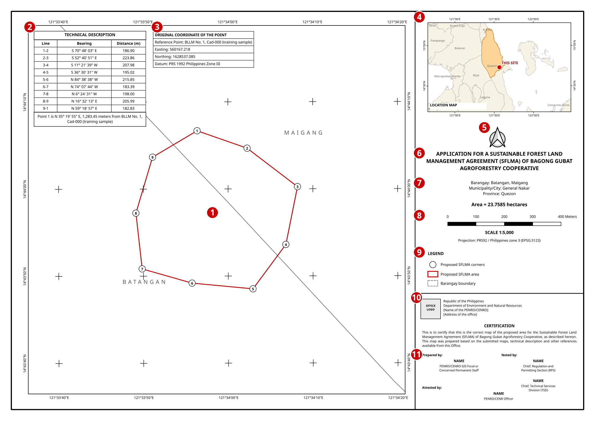</div>
<p class="slide-source">The sample's map, A3 landscape, its elements numbered</p>
</div>
</div>

Note:
(13:00, Module 4.) The guide asks the map for the title, location, area and projection; the prescribed SFLMA format puts eleven elements on the page. The main map with its numbered corners and a latitude and longitude grid, the TD table with the tie line under it, the original coordinate, and a small location map. Then the title block: north arrow, title, location and area, scale and projection, legend. And the office, the certification and the four signatories. This afternoon we build it once, and save it as a template.

---

## Read every value from the layer; never *type* it.

```text
[% 'Area = ' || aggregate('area_boundary', 'max', "AREA") || ' hectares' %]
```

<div class="rows">
<div><b>Typed</b>a second copy of the area, which can drift from the shapefile</div>
<div><b>Read</b>one value, so the map can't disagree with the attribute table</div>
</div>

Note:
The one idea behind the whole layout. Every text on the map that also lives in the data, the applicant's name, the barangays, the area, is read from the layer with an expression, not typed. A typed area is a second copy; the day someone edits the polygon and recomputes AREA, the map still says the old number, and the application comes back. Read from the layer, there is one value, and the map follows it.

---

## The grid takes the map's *own* datum.

| The map's CRS | The grid's CRS |
|:--|:--|
| PRS92 / Philippines zone 1 to 5 (EPSG:3121 to 3125) | **PRS92**, EPSG:4683 |
| Luzon 1911 / Philippines zone I to V (EPSG:25391 to 25395) | **Luzon 1911**, EPSG:4253 |

<p class="steps-note">Not WGS 84: at the sample, the same latitude and longitude are 221 m apart.</p>

Note:
The prescribed map labels its grid in degrees, minutes and seconds. A grid has its own CRS, separate from the map's, so the main map stays in EPSG:3123 and only the grid goes geographic. But latitude and longitude depend on the datum too: in WGS 84, the default everyone picks, the same numbers at the sample are 221 metres from PRS92's. So the grid takes the geographic CRS of the map's datum.

---

## Your turn: Exercises *4.1 to 4.5*.

<div class="split qr-split turn">
<div>
<div class="rows">
<div><b>4.1–4.2</b>The A3 page, the main map, the grid</div>
<div><b>4.3–4.4</b>The area and corners styled; the TD and coordinate tables</div>
<div><b>4.5</b>The title block, read from the layer</div>
</div>
<div class="callout done"><b>Done when</b> the map reads "Area = 23.7585 hectares", and the grid reads 14°44'00"N.</div>
</div>
<div class="qr-col"><p class="qr-caption"><span class="nw">learn-qgis.bnhr.xyz/</span><wbr><span class="nw">sflma-mapping/</span><wbr><span class="nw">04-maps-and-layouts/</span></p></div>
</div>

Note:
Exercises 4.1 to 4.5. The page, the main map and the grid; the area and corners styled; the two tables; then the title block with expressions. The check: the area reads 23.7585 hectares, straight from the attribute, and the grid is labelled in degrees, minutes and seconds, 14°44'00"N and 121°34'00"E around the sample. If NRDC's format differs from what we saw yesterday, this is where we change it.

---

## The signatories are your office's to *confirm*.

<div class="rows">
<div><b>Prepared by</b>PENRO/CENRO GIS Focal or Concerned Permanent Staff</div>
<div><b>Noted by</b>Chief, Regulation and Permitting Section</div>
<div><b>Noted by</b>Chief, Technical Services Division</div>
<div><b>Attested by</b>PENRO/CENR Officer</div>
</div>

<div class="alert">Confirm the page size, the certification and the names with your office. The sample's logo is a placeholder.</div>

Note:
(15:10.) The prescribed format's four signatories: prepared by the GIS focal person or permanent staff, noted by the chiefs of the RPS and the TSD, attested by the PENRO or CENR officer. These, the certification text and the page size are where offices differ most, so this is where NRDC's format from Monday goes into the template.

---

## Your turn: Exercises *4.6 to 4.9*.

<div class="split qr-split turn">
<div>
<div class="rows">
<div><b>4.6–4.7</b>The location map, the legend, certification and signatories</div>
<div><b>4.8</b>The layout, saved as a template</div>
<div><b>4.9</b>The map, exported as PDF</div>
</div>
<div class="callout done"><b>Done when</b> your <code>.qpt</code> is saved, and the PDF shows all eleven elements.</div>
</div>
<div class="qr-col"><p class="qr-caption"><span class="nw">learn-qgis.bnhr.xyz/</span><wbr><span class="nw">sflma-mapping/</span><wbr><span class="nw">04-maps-and-layouts/</span></p></div>
</div>

Note:
Exercises 4.6 to 4.9. The location map, the legend, the certification and signatories, then save the layout as a template: that file is what you take home. Export the map as IV-A_SFLMA_Map_ and the applicant's name, open the PDF, and check it against the eleven elements. The finished template is SFLMA-prescribed-map.qpt in outputs.

---

## One atlas, a map for *every* application.

<div class="rows">
<div><b>Coverage layer</b>the area boundary: one page per application</div>
<div><b>Labels</b><code>"NAME"</code> instead of <code>aggregate('area_boundary', 'max', "NAME")</code></div>
<div><b>Tables</b>filtered to <code>"NAME" = attribute(@atlas_feature, 'NAME')</code></div>
<div><b>Main map</b>only the current application, at a scale that fits it</div>
<div><b>The PDF</b>named from the application's attributes</div>
</div>

<p class="steps-note">The merged layers are for making maps. Each application is still submitted with its own files.</p>

Note:
(After 4.9: the last of Module 4. On Day 3 from 08:55, again for those who need it.) The layout works for one application; every new one means re-zooming and checking each label. The atlas takes a coverage layer, the area boundary, and makes one page per feature: the map follows the application, the labels read its attributes directly, and the file is named from them. For several applications we merge them into working layers keyed by NAME, filter the tables and the tie line to the current one, draw only the current application on the main map, so a neighbour's corners don't appear beside its own, and let its size choose the map's scale. The merged layers only make the maps: each application still goes in with its own shapefiles, TD and coordinates.

---

## Your turn: Exercises *4.10 to 4.13*.

<div class="split qr-split turn">
<div>
<div class="rows">
<div><b>4.10</b>The atlas, driving your layout</div>
<div><b>4.11</b>Five applications, merged and keyed by NAME</div>
<div><b>4.12</b>Each page keyed to its application, at a scale that fits it</div>
<div><b>4.13</b>One PDF for each application</div>
</div>
<div class="callout done"><b>Done when</b> page 3 shows the Malawak na Kagubatan Agroforestry Cooperative, 255.29 ha, at 1:20,000.</div>
</div>
<div class="qr-col"><p class="qr-caption"><span class="nw">learn-qgis.bnhr.xyz/</span><wbr><span class="nw">sflma-mapping/</span><wbr><span class="nw">04-maps-and-layouts/</span></p></div>
</div>

Note:
Exercises 4.10 to 4.13. Turn on the atlas, merge the four prepared applications in, filter, fit, and step through the preview: each page has its own tables, tie line and title; page 1 shows only the sample, not the neighbour that shares its line 4-5; page 3, the Malawak na Kagubatan Agroforestry Cooperative, 255.29 hectares, comes out at 1:20,000; and page 4's tie line sits under its 24 lines. Export the atlas: five PDFs, one per applicant. 4.12 is the hardest exercise of the course; its finished template is in outputs.

---

## Afternoon check-in: how is the *map* going?

<bnhr-timer minutes="3" extra="1"></bnhr-timer>

<div class="lights"><span><span class="dot light-green"></span>On my own data tomorrow</span><span><span class="dot light-yellow"></span>With the notes</span><span><span class="dot light-red"></span>Not yet</span></div>

<div class="qr-pair">
<div class="qr-col"><p class="qr-caption"><b>1 · The check-in</b>bnhr.xyz/quizzes/<wbr><span class="nw">sflma-mapping/</span><wbr><span class="nw">day2-afternoon/</span></p></div>
<div class="qr-col"><p class="qr-caption"><b>2 · The shared folder</b>Your downloaded file goes here</p></div>
</div>

Note:
(16:25, at the end of Module 4.) Three questions on the page, the grid and the title block, then the traffic light, and the file in the folder.

---

## Day 2 post-test: this morning's questions *again*.

<bnhr-timer minutes="8" extra="3"></bnhr-timer>

<div class="qr-pair">
<div class="qr-col"><p class="qr-caption"><b>1 · The test</b>bnhr.xyz/quizzes/<wbr><span class="nw">sflma-mapping/</span><wbr><span class="nw">day2/post/</span></p></div>
<div class="qr-col"><p class="qr-caption"><b>2 · The shared folder</b>Your downloaded file goes here</p></div>
</div>

Note:
(16:30, eight minutes, three more if the room needs them.) The same fifteen questions as this morning. When every file is in, I announce the passphrase.

---

<!-- .slide: class="subsection-slide" -->
<span class="section-label">Day 2 · the post-test</span>

# The questions the room found *hardest*.

Note:
(16:40.) Announce the passphrase, then the room view of today's post-test on the summary page, one question at a time.

---

## Exit ticket: one sentence before you go.

<div class="callout">
<p class="big-line">Where does today's map still differ from the maps NRDC submits?</p>
</div>

<p class="steps-note">Tell me on your way out. Tomorrow, the checks before submission, and your own application.</p>

Note:
One sentence. Tonight I fold the answers into the layout template you take home, so it matches NRDC's format, not only the guide's. Tomorrow the capstone starts before lunch, on your own data: think about which application you want to take through it.

---

<!-- .slide: class="section-slide" -->
<span class="section-label">Wednesday 11 November</span>

# Day 3. The checks, and your own *application*.

Note:
Day 3: Module 4 as needed and Module 5 in the morning; from 11:40, the capstone on your own data.

---

<!-- .slide: class="subsection-slide" -->
<span class="section-label">Day 2, again</span>

# Yesterday, in a few *questions*.

Note:
(08:30, ten minutes with today's plan; 08:00 to 08:30 is prep, for what is left of yesterday's Module 4.) A few quick questions on yesterday: how the corners are numbered, an azimuth as a bearing, what the tie line ties, which datum the grid takes. Then what changed in the layout template from yesterday's exit tickets, and today's plan on the next slide, with what the capstone needs: your own data and your list from Day 1, and a TD of your own if your office has one. Anything else from the office, you find and prepare during the capstone.

---

## Today, every output gets checked, then *your* application.

<div class="steps" style="--n: 5">
<div class="step"><div class="n">08:55</div><div class="name">The atlas</div><div class="what">As needed: several applications with one layout.</div></div>
<div class="step"><div class="n">09:40</div><div class="name">Do they agree?</div><div class="what">The TD closes; the area and the corners agree everywhere; the attributes follow the guide.</div></div>
<div class="step"><div class="n">10:10</div><div class="name">Final QC</div><div class="what">Against forest land and existing tenures, then the checklist.</div></div>
<div class="step ours"><div class="n">11:40</div><div class="name">Your application</div><div class="what">Your own data cleaned, then from plot to final, in groups.</div></div>
<div class="step"><div class="n">16:00</div><div class="name">Show it</div><div class="what">Each group's outputs and QC results to the room.</div></div>
</div>

<p class="steps-note">Module 4, as needed; Module 5, Cross-validation and quality control; the capstone. The post-test comes before it.</p>

Note:
Today's plan. From 08:55, Module 4 as the room needs it: the atlas and several applications for those who didn't finish them yesterday, while the others start Module 5. From 09:40, Module 5 on a returned application: does the technical description close, does the area agree across the polygon, the TD, the table and the map, do the corners agree across the shapefile, the coordinates and the TD, and do the attributes and file names follow the guide. After the break, the overlap checks against forest land and existing tenures, and the final QC checklist. The check-in and the post-test close the morning, by 11:35. At 11:40 the capstone starts: your own data, cleaned against your list from Day 1, then in groups one application from plot to final, the map, Module 5's checks and the checklist; at 16:00 each group shows its outputs and its QC results.

---

## Day 3 pre-test: the last fifteen, *before* we start.

<bnhr-timer minutes="10" extra="3"></bnhr-timer>

<div class="qr-pair">
<div class="qr-col"><p class="qr-caption"><b>1 · The test</b>bnhr.xyz/quizzes/<wbr><span class="nw">sflma-mapping/</span><wbr><span class="nw">day3/pre/</span></p></div>
<div class="qr-col"><p class="qr-caption"><b>2 · The shared folder</b>Your downloaded file goes here</p></div>
</div>

Note:
(08:40, ten minutes, three more if the room needs them.) The last pre-test. Its post-test comes before lunch, not at the end of the day.

---

## Every value in two outputs must *agree*.

| Value | Appears in |
|:--|:--|
| Corner coordinates | The point shapefile, the coordinates file, the TD's traverse |
| Bearings and distances | The TD, the map's table, the polygon |
| Area | The polygon, AREA, the map, the TD's traverse |
| Location and applicant | Both shapefiles, the map's title block, the file names |

<p class="steps-note">Rounding is not an error: it moves the sample's corners 7 mm, and its area 4.6 m².</p>

Note:
(09:40, Module 5.) Why cross-validate: reviewers compare the four outputs against each other, so every value that appears twice must agree. Some difference is expected: bearings rounded to the second and distances to the centimetre don't rebuild a polygon to the millimetre. On the sample, rounding moves corners by up to 7 millimetres and the area by 4.6 square metres. The checks separate that from real errors.

---

## A TD that closes adds up to *zero*.

<div class="rows">
<div><b>Each line</b>departure = distance × sin(azimuth), latitude = distance × cos(azimuth)</div>
<div><b>Misclosure</b>how far the sums of the departures and the latitudes miss zero</div>
<div><b>Precision</b>the perimeter divided by the misclosure</div>
</div>

| TD | Misclosure | Precision |
|:--|:--|:--|
| The sample | 0.005 m | 1:369,491 |
| The returned application | 447.92 m | 1:3 |

Note:
Closure. Walk the TD's lines from corner 1 and you should land back on corner 1: the east-west parts, the departures, and the north-south parts, the latitudes, each add to zero. How far they miss is the misclosure, and the perimeter over the misclosure is the relative precision. The sample closes within five millimetres. The returned application misses by almost half a kilometre; no rounding does that. Ask the room what could: one bearing with its E and W swapped.

---

## One fault for every *check*: find them.

<div class="split">
<div class="rows stack">
<div><b>Closure</b>does the TD close?</div>
<div><b>Area</b>does AREA match the polygon?</div>
<div><b>Corners</b>do the coordinates match the points?</div>
<div><b>Attributes</b>do the values follow the guide?</div>
</div>
<div class="shot-col">
<div class="screenshot-container">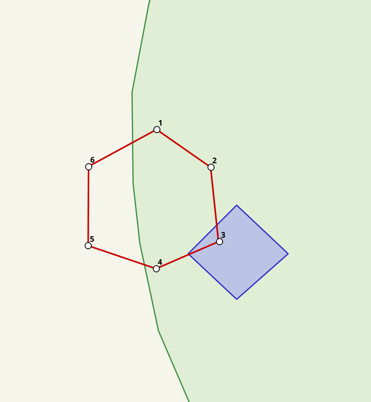</div>
<p class="slide-source">Returned (red), a tenure (blue), forest land (green)</p>
</div>
</div>

Note:
The rest of the morning works on a fictional returned application with one deliberate fault for each check. Don't tell them what's wrong; let them find it. The answers, for you: one bearing has E and W swapped, a misclosure of 447.92 m. AREA says 15.1427 ha, the polygon 14.7927. Corner 5 has its easting and northing swapped, and corner 3 lies 2.5 m off the boundary. X is filled in on corner 2, REGION reads "Region IV-A", the municipality is "Gen. Nakar", the barangays "Pisa, Batangan", and the corners disagree with the boundary on three fields. After the check-in: it overlaps an existing tenure, 5.20 ha lies outside the forest land, and it touches only Batangan.

---

## Your turn: Exercises *5.1 to 5.4*.

<div class="split qr-split turn">
<div>
<div class="rows">
<div><b>5.1</b>Does the TD close?</div>
<div><b>5.2</b>Does the area agree everywhere?</div>
<div><b>5.3</b>Do the corners agree everywhere?</div>
<div><b>5.4</b>Do the attributes follow the guide?</div>
</div>
<div class="callout done"><b>Done when</b> you've found a fault in each, and can say which line, corner or field it is.</div>
</div>
<div class="qr-col"><p class="qr-caption"><span class="nw">learn-qgis.bnhr.xyz/</span><wbr><span class="nw">sflma-mapping/</span><wbr><span class="nw">05-cross-validation-and-qc/</span></p></div>
</div>

Note:
Exercises 5.1 to 5.4, on the returned application, loaded as area_boundary and area_corners so the same expressions work on any application later. Each exercise is an expression you keep. Ask each table to name the faults it found before the check-in; the answers are in the last slide's notes.

---

## Reference layers show where to *look*.

<div class="rows">
<div><b>Existing tenures</b>Select by Location: does the area intersect one?</div>
<div><b>Forest land</b>Difference: any output is area outside it</div>
<div><b>Barangays</b>recompute them from the polygon, and compare with the attribute</div>
</div>

<div class="alert">An overlap is something to verify with the source records, not a finding.</div>

Note:
(After Exercise 5.4.) The last checks are against other data: existing tenures, the forest land, the barangays. On the returned application all three fire. But reference layers, administrative boundaries especially, are not always authoritative. An overlap tells you where to look in the records; it doesn't decide the application.

---

## One checklist, before every *submission*.

<div class="steps" style="--n: 5">
<div class="step"><div class="n">1</div><div class="name">CRS</div><div class="what">One datum and zone; nothing converted; the grid on the map's datum.</div></div>
<div class="step"><div class="n">2</div><div class="name">Shapefiles</div><div class="what">The prescribed fields; valid, fixed by hand; X and Y blank.</div></div>
<div class="step"><div class="n">3</div><div class="name">TD</div><div class="what">Numbered with the corners; it closes; the tie line complete.</div></div>
<div class="step"><div class="n">4</div><div class="name">Map</div><div class="what">Every element, read from the attributes; signatories complete.</div></div>
<div class="step ours"><div class="n">5</div><div class="name">Files</div><div class="what">Every name in the prescribed format.</div></div>
</div>

Note:
Exercise 5.6 is the checklist that ends every application: five groups, seventeen boxes, in the workbook. It is the checklist you take home, with the reasons for NRDC's returns from Monday added to it.

---

## Your turn: Exercises *5.5 and 5.6*.

<div class="split qr-split turn">
<div>
<div class="rows">
<div><b>5.5</b>The returned application, against the reference layers</div>
<div><b>5.6</b>The checklist, on the sample</div>
</div>
<div class="callout done"><b>Done when</b> you've found the overlap and the 5.20 ha outside the forest land, and every box on the sample is ticked.</div>
</div>
<div class="qr-col"><p class="qr-caption"><span class="nw">learn-qgis.bnhr.xyz/</span><wbr><span class="nw">sflma-mapping/</span><wbr><span class="nw">05-cross-validation-and-qc/</span></p></div>
</div>

Note:
Exercises 5.5 and 5.6. The returned application overlaps an existing tenure, has 5.20 hectares outside the forest land, and touches only Batangan though its attribute says Pisa and Batangan. Then the checklist on Bagong Gubat, which should pass every box. Thirty minutes, then the post-test.

---

## Morning check-in: the atlas and the *checks*.

<bnhr-timer minutes="3" extra="1"></bnhr-timer>

<div class="lights"><span><span class="dot light-green"></span>On my own data tomorrow</span><span><span class="dot light-yellow"></span>With the notes</span><span><span class="dot light-red"></span>Not yet</span></div>

<div class="qr-pair">
<div class="qr-col"><p class="qr-caption"><b>1 · The check-in</b>bnhr.xyz/quizzes/<wbr><span class="nw">sflma-mapping/</span><wbr><span class="nw">day3-morning/</span></p></div>
<div class="qr-col"><p class="qr-caption"><b>2 · The shared folder</b>Your downloaded file goes here</p></div>
</div>

Note:
(11:20, at the end of Module 5.) Three questions on the atlas and the attribute checks, then the traffic light, and the file in the folder. The answers tell me who to sit with first in the capstone.

---

## Day 3 post-test: this morning's questions *again*.

<bnhr-timer minutes="8" extra="3"></bnhr-timer>

<div class="qr-pair">
<div class="qr-col"><p class="qr-caption"><b>1 · The test</b>bnhr.xyz/quizzes/<wbr><span class="nw">sflma-mapping/</span><wbr><span class="nw">day3/post/</span></p></div>
<div class="qr-col"><p class="qr-caption"><b>2 · The shared folder</b>Your downloaded file goes here</p></div>
</div>

Note:
(11:25, eight minutes, three more if the room needs them.) The last test: the same fifteen questions as this morning. When every file is in, I announce the passphrase.

---

<!-- .slide: class="subsection-slide" -->
<span class="section-label">Day 3 · the post-test</span>

# The questions the room found *hardest*.

Note:
(11:35, five minutes, before the capstone.) Announce the passphrase, then the room view of the post-test: the questions fewest got right, quickly. Any left over go to the closing.

---

## The capstone: your own data, from clean to *final*.

<div class="steps" style="--n: 4">
<div class="step"><div class="n">11:40</div><div class="name">Clean it</div><div class="what">Your own data, against your list from Day 1. By 13:40, a clean layer.</div></div>
<div class="step"><div class="n">13:40</div><div class="name">Plot to TD</div><div class="what">Your own TD, else your cleaned layer, else mine. By 15:00, shapefiles, TD and coordinates.</div></div>
<div class="step"><div class="n">15:10</div><div class="name">Map and checks</div><div class="what">The map, Module 5's checks and the QC checklist. By 15:40.</div></div>
<div class="step ours"><div class="n">16:00</div><div class="name">Show it</div><div class="what">Each group's outputs and QC results to the room.</div></div>
</div>

<p class="steps-note">In groups, at most three. Your files stay on your computer.</p>

Note:
The capstone, on NRDC's own data, in four parts, each with what you have by its end. Until 13:40, lunch in between, clean your own data against your list from Day 1, the drill's fixes in order, until the layer passes the checklist. Then, in groups, one application from plot to final: your own TD if your office has one, else your cleaned layer, else my TD; by 15:00, the shapefiles, the TD and the coordinates. After the break, the map from your template, Module 5's checks and the final QC checklist, by 15:40. Twenty minutes for it to run on, then at 16:00 each group shows its outputs and QC results. What you need from the office, you find and prepare as you go. I go from group to group, without the sample outputs to lean on: this is the time to bring every question about your real work.

---

## Your turn: clean *your own* data.

<div class="split qr-split turn">
<div>
<div class="rows">
<div><b>Your list</b>from Day 1: each check your data failed</div>
<div><b>In order</b>as in the drill: read it, geometry, fields</div>
<div><b>Ask first</b>holes and locations: the owner decides</div>
<div><b>Prove it</b>with its TD, if you have one</div>
</div>
<div class="callout done"><b>By 13:40</b> a clean layer, and a note of what you changed.</div>
</div>
<div class="qr-col"><p class="qr-caption"><span class="nw">learn-qgis.bnhr.xyz/</span><wbr><span class="nw">sflma-mapping/</span><wbr><span class="nw">d1-debugging-drill/</span></p></div>
</div>

Note:
(11:40 until lunch, then to 13:40.) The capstone's first part, on your own: your data, your list from Day 1, and the drill's fixes, in the drill's order, each with its check. What the drill decided for you, you now decide with the data's owner: whether a hole is a real exclusion, and what a part outside the municipality means. Write down what you changed and by how much, the area the deleted holes added, the vertices removed: that goes in your presentation. If your office has the TD, end with D1.12's check. At 13:40 we form the groups.

---

## The capstone: four outputs that *agree*.

<div class="rows">
<div><b>Done when</b>four outputs, named as the guide prescribes, and every Module 5 check passes</div>
<div><b>At 16:00, show</b>the map, the checklist, and one thing that failed and how you fixed it</div>
<div><b>Each group</b>about ten minutes, so every group gets its turn</div>
</div>

<p class="steps-note">Checks that pass on your own data are the ones you'll trust on the next application.</p>

Note:
What finished means today: all four outputs, in the prescribed names, and every check from this morning passing, on your own application. At 16:00, each group shows the map and the checklist, and tells us one thing that failed and how it fixed it: that's where the room learns most. About ten minutes a group, at most three groups in the half hour; if time runs short, keep the "what failed".

---

## What you take *home*.

<div class="numbered">
<div><span class="n">1</span><span class="t"><b>The workbook</b>Every module, online, and it stays there.</span></div>
<div><span class="n">2</span><span class="t"><b>The data and outputs</b>Every exercise, finished, to start the next one from.</span></div>
<div><span class="n">3</span><span class="t"><b>Your checklist and template</b>Built to NRDC's format.</span></div>
<div><span class="n">4</span><span class="t"><b>A certificate</b>Of completion or of attendance, from BNHR.</span></div>
</div>

Note:
(16:30, the closing.) What stays with you: the workbook, online; the course folder with every exercise finished; the requirements checklist and the layout template, built to NRDC's format with what you showed us this week; and the BNHR certificate. Thank the team, and the people who made the room ready.

---

<!-- .slide: class="section-slide" -->
<span class="section-label">QGIS for SFLMA and Forestry Tenure Mapping</span>

# Humayo kayo<br>at magpaka-<br>*open-source*.

Note:
Thank you. Questions, now or anytime after: hi@bnhr.xyz.
