## Who got a scam text this *week*?

<b>This week?</b>

<b>This month?</b>

<b>Someone at home</b>who lost money or an account?

{{i:message-circle}}Messages

Your parcel is on hold. Update your address within 24 hours: parcel-update.example

Congrats! You qualified for a P10,000 scholarship. Pay the P350 release fee today.

Note:
Ask each question and wait for hands. Then: "Look around: you're not alone, and nobody here is stupid." Scammers do this for a living. That's the message for anyone in the hall who's been caught.

---

<link rel="stylesheet" href="deck.css">

## Hi, I'm *Ben*.

[open] technology and digital autonomy advocate

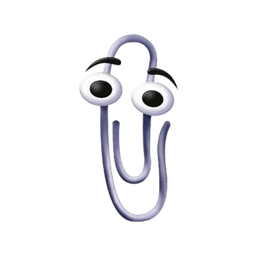

<i></i><i></i><i></i>

ben@nyls:~$ ./intro.sh

&gt; Hi, my name is Ben.

&gt; I'm an open technology and digital autonomy advocate.

&gt; Linux user since 2013. /e/OS, LineageOS and GrapheneOS on mobile.

&gt; I also make a living building cool stuff that help people and organizations make the most of open technologies through BNHR, SmartCT, and the Civic Literacy Initiative.

facebook.com/<wbr>bnhr.xyz

Note:
Not a cybersecurity expert: someone who practises and teaches personal security and privacy. Today is about you and your family. Keep it short, but land the daily drivers: everything I'll recommend today, I use every day. That's the proof that switching is livable. Why Clippy: a paper clip that helps, and a reminder that tech should work for its users.

---

## I use what I'll *show* you.

<figure>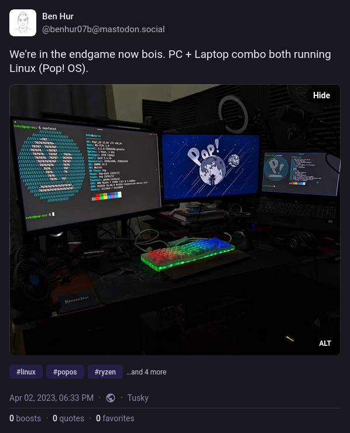<figcaption>Linux since 2013</figcaption></figure>
<figure><figcaption>/e/OS and LineageOS on old devices</figcaption></figure>
<figure>

12:45{{b:grapheneos}}

{{b:signal}}<i>Signal</i>{{b:keepassxc}}<i>KeePassDX</i>{{b:aegisauthenticator}}<i>Aegis</i>
{{m:ente-auth}}<i>Ente Auth</i>{{b:firefoxbrowser}}<i>Firefox</i>{{b:protonmail}}<i>Proton Mail</i>
{{b:fdroid}}<i>F-Droid</i>{{b:simplelogin}}<i>SimpleLogin</i>{{b:duckduckgo}}<i>DuckDuckGo</i>

Illustration

<figcaption>GrapheneOS, every day</figcaption></figure>

Note:
Proof that this is livable: these are my own posts about my own machines, and they're years old. An old phone or tablet with an open-source system gets updates again, and stays out of the landfill. GrapheneOS is on my daily phone. The third picture is a drawing of a home screen with the apps from today; swap in a real screenshot (yours, with notifications and anything personal cleared, or a freely licensed one) when we have it.

---

## You're your family's *tech support*.

{{i:user-round}}

Mama

Her e-wallet

{{i:user-round}}

Papa

His Facebook

{{i:user-round}}

Lola

Her new phone

{{i:users}}

Barkada

The group chat

You set them up. You can protect them, too.

Note:
Ask: "Who here set up a parent's or grandparent's phone?" This is the summit's theme: young people leading on online safety, starting at home.

---

## Spot it. Stop it. *Switch* it.

{{i:fish}}

Part 1

How scams get in

The scammer's playbook

{{i:search}}

Part 2

Spot it

Nine warning signs

{{i:shield-check}}

Part 3

Stop it

Habits that cost nothing

{{i:siren}}

Part 4

When it happens

What to do, who to call

{{i:arrow-right-left}}

Part 5

Switch it

Tools that work for you

{{i:users}}

Part 6

What's next

Protect one person, then more

Note:
Thirty seconds: this is where we're going. How scams get in, then spot it, stop it, what to do when it happens, switch it, and what's next. A bonus part after Part 5 is for those who want to go further; skip it if time is short.

---

<!-- .slide: class="section-slide" -->
Part 1 · The scammer's playbook

# How scams get *in*.

---

## Scammers hack *people*, not phones.

{{i:search}}

Step 1

Research

What you post

{{i:fish}}

Step 2

Bait

A message made for you

{{i:timer}}

Step 3

Pressure

Act before you think

It's called social engineering. Almost every scam follows these three steps.

Note:
One frame for every scam that follows. It's also how the Threat actor plays in BUDOL, our card game at the booth.

---

## Step 1: your posts are their *notes*.

L
<b>Ma'am Liza</b>Teacher since 2008
Kwentuhan · made up

Happy birthday to my eldest, Bianca! Aug 180818

Teaching since 2008, still in love with this job2008

Room 3104 decorations done for the new school year!3104

Blessed birthday to me, Jan 270127

Which one is her PIN?

Any of them. A scammer gets more than one guess.

Ma'am Liza is made up. She's from BUDOL, the card game at our booth.

Note:
Ma'am Liza is made up: she's a persona from our card game. Read each post and ask for hands: "Who thinks it's this one?" Then reveal all four. A birthday, a year or a number you post is a PIN a stranger can guess.

---

## That quiz is collecting your *answers*.

{{i:key-round}}"What month were you born?"

{{i:key-round}}"What was your first pet's name?"

Two common security questions, answered in public.

{{i:sparkles}}Fun Quizzes PH

What's your K-drama name? Comment your <b>birth month</b> + your <b>first pet's name</b>!
2.4K comments

March + Bantay = Min-Ho Bantay 😂

August + Mingming!!

Note:
Ask who has answered a quiz like this. No shame: they're made to be fun. The page name is made up.

---

## Privacy isn't *secrecy*.

We all know what happens in the bathroom. We still close the door.

<!-- more -->
"I have nothing to hide" misses the point. Privacy is a right, and it still applies online. Everything you share can be used, by advertisers and by scammers.
<!-- /more -->

Note:
This answers "I have nothing to hide" before we look at what scammers do with what we share.

---

## Step 2: AI writes the bait in *one second*.

Speed

~1 second

per scam text, on our own PC

Language

Fluent Taglish

or Filipino, or English

Cost

Free

an open AI model, no internet needed

Voices too

A cloned voice

copied from a short clip

"Look for bad spelling" doesn't work any more.

<!-- more -->
We measured it: 72 messages, a median of 0.9 seconds each, written for a made-up e-wallet.
<!-- /more -->

Note:
Measured on our event PC on 6 November 2026 (gemma3:12b, after loading). The old advice to look for typos is dead. And it isn't only text: a voice can be copied from a short recording of someone talking. Hold that thought; a family code word beats it.

---

## Step 3: they want you to act before you *think*.

{{i:clock}}

Rush

"Within 24 hours"

{{i:eye-off}}

Keep it secret

"Don't tell Papa"

{{i:zap}}

Shock

"Share this now!"

They don't need you to believe them. They need you not to stop and check.

Note:
Three of the nine warning signs we'll practise soon. Next, their toolbox. Short on time? Press G, type 18 ("Nine warning signs"), and Enter to skip it.

---

<!-- .slide: class="subsection-slide" -->
Part 1 · The scammer's playbook

# What's in their *toolbox*.

---

## Cheap tools do the *heavy lifting*.

{{i:radio-tower}}

SMS blasters

A fake cell tower in a car

{{i:venetian-mask}}

Spoofed names

Your bank's name, their message

{{i:package-open}}

Phishing kits

A copy of a login page, ready-made

{{i:wifi}}

Fake Wi-Fi

"FREE_MALL_WIFI", asking for your login

{{i:smartphone-nfc}}

Bad apps

An untrusted app file, sent in a chat

{{i:users-round}}

Rented accounts

Yours, if you say yes

<!-- more -->
Most of these are sold ready to use. Scammers don't need to be experts: they buy the tools, and they rent ordinary people's accounts to move the money.
<!-- /more -->

Note:
How scams are done, at the level of what you'd see. No instructions, no tool names. The point: these are cheap and common, so the defences are what matter. Rented accounts are where young people get pulled in.

---

## An SMS blaster is a fake tower in a *car*.

{{i:car-front}}

1

It drives by

A fake tower in the car

{{i:radio-tower}}

2

Your phone joins it

Pulled down to old, weak 2G

{{i:message-circle-warning}}

3

A fake text arrives

Under any name, even your bank's

{{i:shield-check}}On Android, turn off 2G: Settings → Network → SIM → Allow 2G.

<!-- more -->
The text can even land in your bank's real message thread. A link in a text is suspect, whoever it seems to come from.
<!-- /more -->

Note:
Metro Manila police have caught people driving around with these. EFF's Rayhunter can detect fake towers like these (see the bonus part). Check the latest reports and the exact menu path the week of the event: the 2G switch is on many Android phones (Android 12 and later), not all; on iPhone, only Lockdown Mode turns 2G off.

---

## The name on the screen proves *nothing*.

{{i:circle-x}}Same name, same thread, still fake.

{{i:smartphone}}Open the app yourself, or call the number on your card.

<!-- more -->
Sender names and caller IDs can be faked. Only the app you installed and the number on your card are yours to trust. Install apps only from an official store or the maker's own site, never an untrusted app file (APK) like one sent in a chat, and at a counter check the "Scan to pay" QR for a sticker stuck on top.
<!-- /more -->

{{i:landmark}}YOUR BANK

Your OTP for login is 391 552. Do not share it.

Your account will be locked today. Verify now: yourbank-verify.example

Note:
The first message is real, the second is not, and both sit under the same name. "YOUR BANK" stands in for any bank: no real brand on our slides.

---

<!-- .slide: class="section-slide" -->
Part 2 · Spot it

# Nine warning *signs*.

---

## Nine signs give a scam *away*.

{{signs}}

Note:
Read them out, English then Filipino. They're the same signs as in BUDOL at the booth.

---

## Shout the *sign*!

{{signs:RUSH,SECRET,IMPOSTOR}}

{{i:phone-call}}Call Jun on the number you already have.

<!-- more -->
A new number, an emergency, and "don't tell Papa": three signs in one message.
<!-- /more -->

?+63 9•• ••• 4471

Ma, si Jun 'to, bagong number ko. Emergency, need P3,000 now. Wag mo munang sabihin kay Papa.

Note:
Aimed at parents. Let the hall shout, then reveal the signs one by one.

---

## Shout the *sign*!

{{signs:EASY,SECRET,CODE}}

{{i:ban}}Your account is not for rent.

<!-- more -->
The "renter" moves stolen money through your account. That makes you a money mule, which is a crime under the Anti-Financial Account Scamming Act.
<!-- /more -->

?Unknown

Pa-rent ng e-wallet account mo, P1,000 a week! Ibibigay mo lang ang OTP. Easy!

Note:
Aimed at students. Legal review pending for the money-mule line. Say it plainly, without scaring: "You'd be the one the police find."

---

## Shout the *sign*!

{{signs:EASY,RUSH,LINK}}

{{i:gamepad-2}}Free items come inside the game, never through a link.

<!-- more -->
The page asks for your game login. Once they have it, they take the account and everything you've bought in it.
<!-- /more -->

{{i:gamepad-2}}Game Rewards PH

FREE 5,000 diamonds! Tonight lang ang event. Log in with your game account: free-diamonds.example

Note:
Aimed at students and gamers. The page name and link are made up, and no real game is named. Ask: "Who's seen one of these in a game chat or a comment?"

---

## Shout the *sign*!

{{signs:SHOCK,IMPOSTOR,RUSH}}

{{i:search}}Check the school's own page first.

<!-- more -->
Fake news is a scam on your attention. It spreads because we share before we check.
<!-- /more -->

{{i:school}}Pasig Schools Update

🚨 BREAKING: Classes suspended tomorrow in all levels! Share to your GCs!
a post with a copied school logo

Note:
Aimed at everyone. The page name is made up. Ask: "Where would you check?" The school's or the city's official page.

---

## Shout the *sign*!

{{signs:DATA,RUSH}}

{{i:badge-check}}Borrow from registered lenders only.

<!-- more -->
Apps that read your contacts can shame you to everyone you know when you're late. No real lender needs your photos.
<!-- /more -->

{{i:hand-coins}}Instant Loan

INSTANT P5,000 in 5 minutes! No collateral. Just allow access to your contacts and photos.

Note:
Aimed at parents and teachers. For the parents and teachers in the hall.

---

## Shout the *sign*!

{{signs:IMPOSTOR,DATA,RUSH}}

{{i:phone-call}}Check with the real office, on a number you know.

<!-- more -->
It asks for your students' birthdays and addresses: minors' data, which a real office doesn't collect by text.
<!-- /more -->

{{i:landmark}}"Central Office"

Hi Ma'am/Sir, kindly send today the updated list of your students with birthdays and addresses.

Note:
Aimed at teachers. For the teachers in the hall. The sender is made up.

---

## Spot *one* sign. That's enough.

Ma, si Jun 'to, bagong number ko…

{{i:venetian-mask}}Impostor

Pa-rent ng e-wallet mo…

{{i:coins}}Easy money

Classes suspended! Share!

{{i:zap}}Shock

Allow access to your contacts…

{{i:id-card}}Personal info

Most scams show two or three. You only need to catch one to stop and check.

Note:

---

<!-- .slide: class="section-slide" -->
Part 3 · Stop it · Level 1

# Habits *first*.

---

## Climb one step at a *time*.

Level 1

Habits

Free, and protects everyone

Level 2

Better tools

A few minutes per switch

Level 3

Full control

More effort, most protection

There's no fully protected. There's better protected.

Note:
Each step costs a little convenience. Take the next one, not all of them.

---

## Guard three *keys*.

{{i:smartphone}}

Your phone

<!-- more -->

Screen lock on, updates on.

<!-- /more -->

{{i:mail}}

Your email

<!-- more -->

Whoever has it can reset every other account.

<!-- /more -->

{{i:wallet}}

Your e-wallet

<!-- more -->

It's where the money is.

<!-- /more -->

What do you protect, and from whom? For most of us: these three, from scammers.

Note:
This is threat modelling cut to its core.

---

## Lock them *well*.

{{i:key-round}}

Own password

<!-- more -->

Email and e-wallet each get one used nowhere else.

<!-- /more -->

{{i:shield-check}}

2FA on

<!-- more -->

A second check after your password.

<!-- /more -->

{{i:cake}}

PIN ≠ birthday

<!-- more -->

No birthday, year or number you post.

<!-- /more -->

{{i:message-circle-question}}

Fake answers

<!-- more -->

Security answers nobody could look up.

<!-- /more -->

Remember Ma'am Liza.

Note:
"Fake answers": your first pet can be "Purple Rocket 42". Keep it in your password manager, which we'll get to.

---

## Your codes are *yours* alone.

{{i:ban}}Never read out an OTP, MPIN or PIN.

No real bank, office or friend will ask.

{{i:phone-call}}"Bank Fraud Dept."

May suspicious login po sa account ninyo. Paki-read po ang code na na-send namin?

Your code is 482 913

Note:
The OTP is the last lock. Whoever asks for it is the thief, whatever name they give.

---

## Pause, then *check*.

{{i:hourglass}}

1

Wait ten minutes

{{i:phone-call}}

2

Call a number you know

{{i:message-circle-heart}}

3

Ask for the family code word

Agree it tonight, face to face. A cloned voice can't answer it.

Note:
AI can copy a voice from a short recording. A code word agreed in person beats it.

---

## Money on offer? Check before you say *yes*.

{{i:landmark}}

SEC check

<!-- more -->

Check any investment, whoever recommends it.

<!-- /more -->

{{i:badge-check}}

Registered lenders

<!-- more -->

Borrow only from lenders you can look up, and never give a loan app your contacts.

<!-- /more -->

{{i:ban}}

No renting

<!-- more -->

Never lend your account or SIM, whatever the fee.

<!-- /more -->

Note:
The habits behind three of the shouts: the investment, the loan app and the account for rent. Legal review pending for the money-mule and SEC lines.

---

## Angry or scared? *Check* before you share.

The strongest feeling is the moment to stop.

<!-- more -->
Look for the original source: the school's, the city's or the agency's own page. If it isn't there, don't pass it on.
<!-- /more -->

Note:
Fake news spreads through people who care. Caring includes checking.

---

## Does a flashlight need your *contacts*?

Check what your apps can see.

<b>Where</b>Settings → Apps → Permissions

<b>Android</b>{{b:fdroid}} F-Droid, a store of open-source apps

{{i:flashlight}}Super Flashlight

{{i:contact-round}} Contacts · <b>Off</b>

{{i:image}} Photos · <b>Off</b>

{{i:map-pin}} Location · <b>Off</b>

<!-- more -->
Turn off what an app doesn't need, delete apps you don't use, and never install an untrusted app file (APK), like one sent in a chat.
<!-- /more -->

Note:
Loan apps that read contacts are the worst case.

---

## Two minutes, on your *phone*.

{{i:shield-check}}

Turn on 2FA for your email

{{i:key-round}}

Change a birthday PIN

{{i:smartphone}}

Check your app permissions

{{b:signal}}

Install Signal

Pick one and do it now. Changing a PIN? Cover your screen.

<bnhr-timer minutes="2"></bnhr-timer>

Note:
Three are in your phone's settings and work without mobile data; installing Signal needs a signal or Wi-Fi in the court. A password manager can wait until you're home on Wi-Fi.
Press T to start the timer. Walk the hall; ask a few people what they picked.

---

<!-- .slide: class="section-slide" -->
Part 4

# When it *happens*.

---

## Scammed? Act *fast*, not ashamed.

{{i:landmark}}

1

Bank first

<!-- more -->

Through its app, or the number on your card.

<!-- /more -->

{{i:key-round}}

2

New email password

{{i:siren}}

3

Report

{{i:heart-handshake}}

4

Tell someone

Scammers do this for a living. Being caught isn't stupidity.

Note:
Shame is what keeps people from reporting. Say it plainly.

---

## Report it *here*.

<b>{{i:landmark}} Your bank or e-wallet</b>in its app, or the number on your card

<b>{{i:shield}} CICC · I-ARC</b>132624/7, free · or eGov app → eReport

<b>{{i:siren}} PNP Anti-Cybercrime Group</b>0998 598 8116acg@pnp.gov.ph

<b>{{i:scale}} NBI Cybercrime Division</b>(02) 8523-8231ccd@nbi.gov.ph

{{i:camera}} Take a photo of this slide.

Note:
Call your bank or e-wallet first: it can freeze the money. Then 1326, the government's Inter-Agency Response Center run by the CICC, for any online scam, any time. Sources, checked 17 November 2026: 1326 from the Philippine News Agency (pna.gov.ph/articles/1207775) and ABS-CBN (Nov 2024); PNP-ACG mobile from the PNP telephone directory (May 2025) and PNA (2026), which also gives (02) 8414-1560 and acg@pnp.gov.ph; NBI hotline and ccd@nbi.gov.ph from nbi.gov.ph. The eGov app's eReport (pick "Scam", attach screenshots) is from PNA (pna.gov.ph/articles/1228318). A CICC email, report@cicc.gov.ph, appears only on a law-firm blog, not on an official page, so it's left off the slide until someone confirms it with the CICC. Call each number once the week of the event to confirm it still answers.

---

## When the threat is someone you *know*.

{{i:lock-keyhole}}

Your PIN is yours

Even from a partner

{{i:map-pin}}

Check location sharing

Who can see where you are?

{{i:scan-search}}

Check your apps

Any you didn't install?

{{i:log-out}}

Log out everywhere

Devices you don't recognise

If you feel watched, tell an adult you trust.

Note:
Stalkerware and shared passwords are common in relationships, including young ones. Keep it practical and kind.

---

## Threatened online? It's *not your fault*.

{{i:hand}}

Don't pay

{{i:camera}}

Keep the chat

{{i:user-x}}

Block and report

{{i:heart-handshake}}

Tell an adult you trust

<!-- more -->
This includes someone threatening to share your photos. Whatever happened, it's not your fault, and adults can help.
<!-- /more -->

Note:
Say it calmly and move on. The word sextortion isn't on the slide; the line above covers it gently. Not on the slide, because minors are in the hall; say it only one to one, if someone asks: "Keep the chat" means the messages and the account names. Leave any such photo where it is and let the police or the platform take it from there, because keeping or sending a sexual image of a minor can be a crime even when it's meant as proof (RA 11930, the Anti-OSAEC and Anti-CSAEM Act). Legal review pending for this line, including how it applies to a minor's own photo.

---

<!-- .slide: class="section-slide" -->
Part 5 · Switch it · Level 2

# Tools that work for *you*.

---

## Mainstream apps get worse on *purpose*.

{{i:gift}}

1 · Bait

A great app

Fast, friendly, often free

{{i:lock}}

2 · Switch

You're locked in

Your friends and files are there

{{i:database}}

3 · Squeeze

Your data pays

Ads, data sold, leaks

Free or paid, it's the same story.

<!-- more -->
What they collect gets sold or leaked, and ends up on scammers' lists. Open-source tools that collect less have less to sell and less to leak. Tools protect your data; habits protect your decisions.
<!-- /more -->

Note:
The same bait, switch and squeeze as in my open-source and local-first talk. Paying no longer opts you out: paid apps and services sell and share data too. That's why we switch to tools that are built to collect less.

---

## There's a word for it: *enshittification*.

en·shit·ti·fi·ca·tion

[en-shit-uh-fi-kay-shun] · noun

How online platforms decay: first good to users, then to advertisers, then only to shareholders.

Coined by writer Cory Doctorow, 2022.

Note:
A rude word for a real pattern, and dictionaries have picked it up. Say it once, smile, then move on: the way out is tools built to collect less.

---

## The way out: switch to tools built for *you*.

<table class="switch">
<thead><tr><th>For</th><th>Switch to</th><th>Instead of</th><th>Takes about</th></tr></thead>
<tbody>
<tr><td>Apps</td><td>{{b:fdroid}}F-Droid</td><td class="old">{{b:googleplay}}</td><td>5 min</td></tr>
<tr><td>Chats</td><td>{{b:signal}}Signal</td><td class="old">{{b:messenger}}{{b:telegram}}{{b:viber}}</td><td>2 min</td></tr>
<tr><td>Browser</td><td>{{b:librewolf}}LibreWolf · {{b:firefoxbrowser}}Firefox · {{b:brave}}Brave</td><td class="old">{{b:googlechrome}}</td><td>5 min</td></tr>
<tr><td>Search</td><td>{{b:duckduckgo}}DuckDuckGo · {{b:startpage}}Startpage</td><td class="old">{{b:google}}</td><td>30 s</td></tr>
<tr><td>Passwords</td><td>{{b:keepassxc}}KeePassXC · {{b:bitwarden}}Bitwarden</td><td class="old">One password everywhere</td><td>10 min</td></tr>
<tr><td>2FA</td><td>{{m:ente-auth}}Ente Auth · {{b:aegisauthenticator}}Aegis</td><td class="old">Codes by SMS</td><td>2 min</td></tr>
<tr><td>Sign-in</td><td>{{b:fidoalliance}}Passkeys · {{b:yubico}}Security keys</td><td class="old">Passwords alone</td><td>5 min</td></tr>
<tr><td>Email</td><td>{{b:protonmail}}Proton Mail · {{b:tutanota}}Tuta</td><td class="old">{{b:gmail}}</td><td>10 min</td></tr>
<tr><td>Aliases</td><td>{{b:simplelogin}}SimpleLogin</td><td class="old">One address for every site</td><td>5 min</td></tr>
<tr><td>VPN/DNS</td><td>{{b:protonvpn}}Proton VPN · {{b:mullvad}}Mullvad · {{b:quad9}}Quad9</td><td class="old">Free VPN apps · your ISP's DNS</td><td>5 min</td></tr>
</tbody>
</table>

<!-- more -->
Free to start, except Mullvad and security keys. KeePassXC and LibreWolf: computers only. F-Droid and Aegis: Android only.
<!-- /more -->

Note:
The answer to enshittification: tools built to collect less, most of them free, and quick to switch to. The times are our estimates: time each switch on our test phone before the event and correct them.
The rest also run on iPhone. Most bring your old stuff along: passwords, bookmarks, even your email. VPN/DNS: many free VPN apps make their money from your data, so pick one you can check. Proton VPN has a free plan; Mullvad is paid (about €5 a month) and needs no email to sign up. Quad9 is a free DNS service that blocks known scam and malware sites; set it as Private DNS (dns.quad9.net) in Android's network settings. A VPN hides your browsing from your network, not from the sites you log in to. Check each tool's price, free-plan limits and minimum age the week of the event.

---

## F-Droid: *open apps*, no account needed.

{{b:fdroid}}
<b>F-Droid</b>free · Android · about 5 minutes

<b>Is</b>an app store of free and open-source apps

<b>Need the Play Store?</b>Keep it or use <strong>Aurora Store</strong>. Leaving Google? <strong>microG</strong>.

<b>Warns</b>when an app has ads or tracking

<figure class="app-shot"><figcaption class="slide-source">F-Droid 2 · Discover</figcaption></figure>

f-droid.org

<!-- more -->
Aurora Store gets apps from Google Play without a Google account. microG stands in for Google's background services, on phones set up for it, like /e/OS.
<!-- /more -->

Note:
The screenshot is our own, of F-Droid 2's Discover screen (2.0 came out in September 2026). A dark-mode copy is in img/tools/fdroid2-drk.png. The QR opens f-droid.org. Android only; there's no F-Droid for iPhone. Installing it means downloading its app file from f-droid.org and allowing your browser to install it once: say clearly that this app file is trusted because it comes from the official site, unlike one sent in a chat. Every app's code is public, and F-Droid builds most apps from it itself. Aurora Store is an open-source front end to Google Play, on F-Droid: its anonymous login means no Google account, though downloads still come from Google's servers, and signing in with your own Google account there can put that account at risk. microG is an open-source stand-in for Google Play Services, which many apps need; it isn't an app store, and it needs a system built for it (/e/OS, LineageOS for microG), so it belongs with Level 3. GrapheneOS takes a different route, sandboxed Google Play. Apps with ads, tracking or paid parts carry a warning label (F-Droid calls them Anti-Features). Check the install steps on a current Android phone the week of the event.

---

## *End-to-end encrypted* messaging. Almost nothing kept.

{{b:signal}}
<b>Signal</b>free · about 2 minutes

{{i:smartphone}}You

{{i:lock}}The server sees<code>x9#Lq…</code>

{{i:smartphone}}Mama

{{i:lock}}

Locks

Every chat and call

{{i:database}}

Keeps only

Join date, last connection

{{i:eye-off}}

Not kept

Messages, contacts, groups

signal.org/download

<!-- more -->
When courts ordered Signal to hand over a user's data, those two dates were all it had. Start with your family's group.
<!-- /more -->

Note:
Signal publishes the court orders it receives and its answers at signal.org/bigbrother: each time, the only data it had was the date an account was made and the date it last connected. Be fair to the others: Messenger, WhatsApp and Viber lock chats by default now too (Telegram only in "secret chats"), so the reason to switch is how little Signal collects and keeps, not the lock alone. Stickers, groups, voice and video calls work as you'd expect. Signal can't read profiles either: names and photos are encrypted too. The QR opens Signal's download page, which links to the official app stores. Check signal.org/bigbrother and each app's current default the week of the event.
---

## *Block the ads* and the scam ads go too.

{{b:ublockorigin}}
<b>uBlock Origin</b>free · in your browser · about 5 minutes

<b>Blocks</b>ads, scam ads and trackers

<b>In</b>Firefox; built into LibreWolf

<figure class="ad-shot">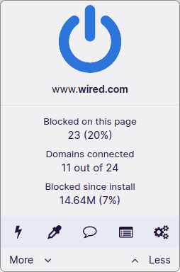<figcaption class="slide-source">uBlock Origin on a news site · GPL-3.0</figcaption></figure>

{{b:pihole}}
<b>Pi-hole</b>free · DIY · for the whole house

<b>Blocks</b>ads on every device on your Wi-Fi

<b>Runs on</b>a Raspberry Pi at home

<figure class="ad-shot wide"><figcaption class="slide-source">Pi-hole's dashboard · MIT</figcaption></figure>

<!-- more -->
Scam ads and fake download buttons go with the ordinary ads. Pi-hole covers phones and TVs too.
<!-- /more -->

Note:
The screenshot is from uBlock Origin's own README: one news page, 23 requests blocked. uBlock Origin runs fully in Firefox and its relatives; Chrome now allows only the lighter uBlock Origin Lite. Pi-hole is the DIY option for a household: a Raspberry Pi that blocks ads on every device on the network. The Pi-hole screenshot is Pi-hole's own (version 6 dashboard, github.com/pi-hole/graphics, MIT), cropped to its counters and the 24-hour chart. Check both the week of the event.

---

## *Browse* without being profiled.

<i></i><i></i><i></i>{{b:librewolf}}LibreWolf

{{i:lock}}news.example{{b:ublockorigin}}<b>23</b>

{{b:ublockorigin}}uBlock Origin, built in

{{b:librewolf}}LibreWolf

Firefox, set up for privacy

Computer

<i></i><i></i><i></i>{{b:firefoxbrowser}}Firefox

{{i:lock}}news.example{{i:puzzle}}

{{b:ublockorigin}}uBlock Origin<em>Add</em>

{{b:firefoxbrowser}}Firefox

From a nonprofit; add uBlock Origin

Phone · computer

<i></i><i></i><i></i>{{b:brave}}Brave

{{i:lock}}news.example{{b:brave}}<b>23</b>

{{i:shield-check}}Shields up · 23 blocked

{{b:brave}}Brave

Blocks ads by itself

Phone · computer

<i></i><i></i><i></i>{{b:vivaldi}}Vivaldi

{{i:lock}}news.example{{i:shield-check}}

<i></i><i></i><i></i><i></i>

{{i:shield-check}}Ads and trackers blocked

{{b:vivaldi}}Vivaldi

Built-in ad and tracker blocker

Phone · computer

<!-- more -->
They replace Chrome. Firefox brings your bookmarks and passwords across.
<!-- /more -->

Note:
A browser that doesn't profile you has less to sell and less to leak. The four windows are drawings, not screenshots: each shows what sets that browser apart. Firefox, Brave and Vivaldi work on phones too; LibreWolf is for computers. Brave has its own optional ads and crypto wallet: say it can be switched off. Check each browser's current features the week of the event.

---

## *Search* without being profiled.

{{shot:img/tools/search-duckduckgo.jpg|DuckDuckGo's home page}}

{{b:duckduckgo}}DuckDuckGo

No search history kept

Phone · computer

{{shot:img/tools/search-startpage.jpg|Startpage's home page}}

{{b:startpage}}Startpage

Google's results, untracked

Phone · computer

{{shot:img/tools/search-brave-crop.jpg|Brave Search's home page}}

{{b:brave}}Brave Search

Its own index, no profiling

Phone · computer

{{shot:img/tools/search-qwant-crop.jpg|Qwant's home page}}

{{b:qwant}}Qwant

European, no profiling

Phone · computer

Screenshots: DuckDuckGo, CC BY 4.0 · Startpage, public domain · Brave Software, public domain · via Wikimedia Commons · Qwant, ours

<!-- more -->
They replace Google Search. Make one your browser's default search engine.
<!-- /more -->

Note:
A search engine that doesn't profile you has less to sell. Screenshots, cropped: DuckDuckGo (Wikimedia Commons, CC BY 4.0, DuckDuckGo, June 2026); Startpage (Commons, public domain, Startpage.com, 2025); Brave Search (Commons, public domain, Brave Software, 2025); Qwant's home page, our own. All four work in any browser, on phones and computers. Brave Search runs its own index rather than renting Google's or Bing's. Qwant is a French search engine that says it doesn't profile its users; check its current privacy terms the week of the event.
---

## *Passwords*: remember one, it keeps the rest.

{{i:key-round}}
<b>A password manager</b>free · open source · phone and computer

<b>Replaces</b>the same password everywhere

<b>Brings</b>your saved passwords

<b>Try</b>{{b:keepassxc}} KeePassXC · KeePassDX · {{b:bitwarden}} Bitwarden

{{i:circle-check}}perago.example → fills in

{{i:circle-x}}perago-verify.example → nothing

{{i:triangle-alert}}Never save a password on a shared computer.

<!-- more -->
Saving passwords in your browser? Better than reusing one. A dedicated manager works in every browser and isn't tied to one company's account.
<!-- /more -->

Note:
You remember one strong password; it makes and keeps a different one for every site, and checks the address, so a fake page gets nothing. KeePassXC is for computers and KeePassDX for Android; Bitwarden runs on both, and on iPhone. The example addresses are made up. Shared computers: a pisonet or computer-shop PC, a library machine, a classmate's laptop. Don't say "avoid your browser's password manager": it's far better than reusing one password, and it also fills in only on the real site. The dedicated manager's edge: it works across browsers and devices, it isn't tied to one company's account, and password-stealing malware goes after browser-saved passwords first. Protect the vault: a strong main password used nowhere else, 2FA on it, and the recovery kit saved somewhere safe.

---

## *2FA codes* a SIM swap can't steal.

{{i:shield-check}}
<b>An authenticator app</b>free · Android, iPhone

<b>Replaces</b>codes by SMS

<b>Try</b>{{m:ente-auth}} Ente Auth, {{b:aegisauthenticator}} Aegis (Android)

{{i:circle-x}}SMS code → a swapped SIM

{{i:circle-check}}App code → stays on your phone

<figure class="app-shot">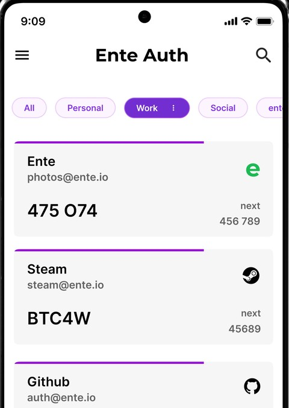<figcaption class="slide-source">Ente Auth · AGPL-3.0</figcaption></figure>
<figure class="app-shot"><figcaption class="slide-source">Aegis · GPL-3.0</figcaption></figure>

<!-- more -->
A scammer who talks your telco into a new SIM gets your texts, not your app. Where a bank or e-wallet only sends SMS, keep it; switch everywhere else.
<!-- /more -->

Note:
The screenshots are the apps' own store screenshots, cropped to the phone screen: Ente Auth from github.com/ente/ente (AGPL-3.0), Aegis from github.com/beemdevelopment/Aegis (GPL-3.0); the accounts in them are the projects' sample data. Setup: turn on 2FA in an app's settings, choose "authenticator app", scan the QR code.

---

## *Sign in* with a physical key.

{{b:yubico}}
<b>A security key</b>a small USB or tap key · paid · one-time cost

<b>Replaces</b>codes you could type into a fake page

<b>Try</b>{{b:yubico}} YubiKey, Nitrokey

<b>Free</b>{{b:fidoalliance}} passkeys, on your own phone

<figure class="key-photo">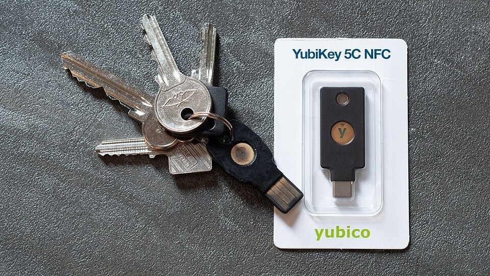<figcaption class="slide-source">YubiKey 5C NFC · Daniel Aleksandersen, CC BY 4.0, via Wikimedia Commons</figcaption></figure>

{{i:circle-check}}Real site → one touch, you're in

{{i:circle-x}}Fake site → the key says no

<!-- more -->
It checks the site's real address. Most Philippine banks and e-wallets don't take keys yet. Save each account's recovery codes too.
<!-- /more -->

Note:
The photo is a YubiKey 5C NFC on a keyring, from Wikimedia Commons (CC BY 4.0, Daniel Aleksandersen, 2026). The only Level 2 item that costs money. The key checks the website's real address before it answers, so a perfect copy of the page gets nothing. Use it on your email and big accounts. Passkeys work the same way and cost nothing. It stops fake pages, not every attack: a scammer who talks you into approving something still can. Keep two keys, one as a spare, and the recovery codes somewhere safe. Check prices from local sellers the week of the event, and which big services and local banks support keys and passkeys.

---

## *Private email* with *aliases* for every site.

{{b:protonmail}}
<b>Private email</b>free · about 10 minutes

<b>Try</b>{{b:protonmail}} Proton Mail · {{b:tutanota}} Tuta

<b>Locks</b>your inbox: only you can read it

<b>No ads</b>nobody reads your mail to sell to you

<b>Brings</b>your old mail and contacts

{{b:simplelogin}}
<b>Aliases</b>free to start · about 5 minutes

<b>Try</b>{{b:simplelogin}} SimpleLogin

<b>One per site</b>all landing in one inbox

{{i:at-sign}}shop.liza@… → only the shop

{{i:circle-x}}"Your bank" writes to shop.liza@ → scam

{{i:triangle-alert}}Throwaway inboxes: one-time sign-ups only, never for accounts you need to keep.

<!-- more -->
An alias forwards to your real inbox. If one leaks, you switch it off, and you know who leaked it.
<!-- /more -->

Note:
Proton's import tool brings Gmail across. Start by using the new address for new sign-ups. SimpleLogin belongs to Proton. Throwaway inboxes (temporary-mail sites) are often readable by anyone who types the same address and disappear after a while: fine for a one-time download or coupon, never for an account you'll need to recover or anything with your name, money or school on it.

---

## *VPN and DNS*: safer on any Wi-Fi.

{{b:protonvpn}}
<b>A VPN you can check</b>free or paid · about 5 minutes

<b>Try</b>{{b:protonvpn}} Proton VPN · {{b:mullvad}} Mullvad

<b>Hides</b>your browsing from the Wi-Fi you're on

<b>Instead of</b>free VPN apps that sell your data

{{b:quad9}}
<b>Private DNS</b>free · about 2 minutes

<b>Try</b>{{b:quad9}} Quad9

<b>Blocks</b>known scam and malware sites

<b>Android</b>Settings → Network → Private DNS → dns.quad9.net

{{i:triangle-alert}}A VPN hides where you go from the network, not who you are from the sites you log in to.

<!-- more -->
Proton VPN has a free plan; Mullvad is paid and needs no email to sign up. On "FREE_MALL_WIFI", a VPN keeps what you do away from whoever runs it.
<!-- /more -->

Note:
Ties back to the fake Wi-Fi in Part 1's toolbox. Many free VPN apps make their money from your data, so pick one whose owner and policy you can check. Proton VPN's free plan has no data cap but fewer servers; Mullvad costs about €5 a month and takes cash or an account number, no email. A VPN moves your trust from the Wi-Fi to the VPN company; it doesn't make you anonymous. Quad9 is a free, nonprofit DNS service that refuses to look up known scam and malware sites. On Android 9 and later: Settings → Network & internet → Private DNS → "Private DNS provider hostname" → dns.quad9.net (the menu name varies by phone). On iPhone, Quad9's site offers a profile to install. Check the prices and menu paths the week of the event.
---

## Switch without breaking your *life*.

{{i:plus}}

1

Add

Install it beside the old one

{{i:arrow-right-left}}

2

Move one

One group, one account

{{i:check}}

3

Let go

When nothing's left

One switch a week.

<!-- more -->
Your e-wallet, your school chats and some of your family will stay where they are for now. That's fine.
<!-- /more -->

Note:
Nobody has to delete anything today. Add first.

---

## Want to go *further*?

{{i:book-open}}

Tools, by your threat

privacyguides.org

{{i:life-buoy}}

At higher risk

Access Now's Helpline

Free help for civil society

{{i:map-pin}}

Today

Our booth

Ask us anything from today

Next: Level 3, your own cloud, higher risk, and spotting surveillance.

Note:
Three places to keep going after today. Then the bonus part, Going further; its section slide has the skip-ahead note.

---

<!-- .slide: class="section-slide" -->
Bonus part

# Going *further*.

Note:
For those who want more, or who face more than scammers. Bonus part: Level 3, your own cloud, threats from people you know and from powerful groups, and the tools that detect fake towers and trackers. Short on time? Press G, type 67 (the "What's next" section), and Enter to skip it.

---

## Level 3: take full *control*.

{{i:server}}

Self-host

Your own cloud

Next slide

{{b:grapheneos}}

Phone

GrapheneOS, LineageOS

{{b:linux}}

Computer

Linux

{{b:torbrowser}}

Browse

Tor Browser

{{b:mastodon}}

Social

Mastodon, PeerTube

{{b:google}}

Accounts

Leave Google

{{b:monero}}

Pay

Cash, Monero

Not an investment

{{i:book-open}}

Learn more

privacyguides.org

ssd.eff.org · awesome-selfhosted.net

<!-- more -->
For when you're ready. Anyone promising returns in crypto is showing you Easy money.
<!-- /more -->

Note:
Show, don't push. One minute here. Point back to the intro: "Linux and GrapheneOS are what I use every day." Learn more: Privacy Guides (privacyguides.org) for tools, EFF's Surveillance Self-Defense (ssd.eff.org) for step-by-step guides, and awesome-selfhosted.net for apps you can run yourself.

---

## Your own cloud, at *home*.

{{i:hard-drive}}

Your storage

A NAS or old PC

Drives you own, at home

{{b:immich}}

Instead of Google Photos

Immich

Your photos, backed up from your phone

{{b:jellyfin}}

For media you own

Jellyfin

Your films, shows and music

{{b:nextcloud}}

Instead of Google Drive

Nextcloud

Files, calendar, contacts

{{b:vaultwarden}}

Instead of a cloud vault

Vaultwarden

Your own password server

{{b:pihole}}

For the whole house

Pi-hole

Blocks ads on every device

<!-- more -->
A homelab can start with an old laptop or a Raspberry Pi and one external drive. Everything stays on hardware you own, so nobody can change the price, the terms or what they do with your files.
<!-- /more -->

Note:
This is Level 3 for people who like to tinker, and a good club or school project. Start small: one old computer, one app (Immich for the family's photos is the easiest win), and a backup. awesome-selfhosted.net lists hundreds more. Self-hosting also means you're responsible for updates and backups: say so.

---

## Match your defences to your *threat*.

{{i:venetian-mask}}

Everyone

Scammers

Levels 1 and 2

{{i:user-search}}

Many of us

Someone you know

An ex, a classmate, a stalker

{{i:building-2}}

Everyone

Companies

Data brokers and ad trackers

{{i:landmark}}

Some of us

Powerful groups

Governments, armed groups

<!-- more -->
Five questions decide how far to go: What do I want to protect? From whom? How likely is it? How bad if I fail? How much trouble will I take to prevent it?
<!-- /more -->

Note:
Threat modelling, from Privacy Guides. Most of the hall needs the first column. Say it calmly: this isn't to scare anyone, it's so the people who need more know where to start.

---

## At higher risk? Start with your *phone*.

{{b:grapheneos}}

Enter PIN

<i></i><i></i><i></i><i></i><i></i><i></i>

{{i:triangle-alert}} Duress PIN → wipe

A hardened phone

GrapheneOS on a Pixel, kept updated, with a duress PIN

<svg class="key-art" viewBox="0 0 320 140" aria-hidden="true"><rect x="8" y="30" width="230" height="80" rx="22" fill="#0c2340"/><rect x="238" y="50" width="62" height="40" rx="8" fill="#9aa5b4"/><rect x="250" y="60" width="38" height="20" rx="4" fill="#6f7c8e"/><circle cx="110" cy="70" r="26" fill="#ffa500"/><circle cx="110" cy="70" r="15" fill="none" stroke="#0c2340" stroke-width="4"/><circle cx="40" cy="70" r="11" fill="none" stroke="#f5f5f5" stroke-width="5"/></svg>
Touch to sign in

Security keys

On every key account: a fake page gets nothing

{{i:lock}} End-to-end encrypted

Meeting moved to 3 pm. Same place.

{{i:timer}} Disappears after 1 day

Disappearing and encrypted messages

On Signal, for sensitive chats

<!-- more -->
For journalists, activists, community leaders and lawyers: people a powerful group might target on purpose. A duress PIN wipes the phone if someone forces you to unlock it.
<!-- /more -->

Note:
Short, and only for those who need it. GrapheneOS runs only on Google Pixel phones. Its duress PIN or password: entering it instead of the real one wipes the phone. Wiping a phone during a lawful search can itself be an offence, so flag this line for legal review and don't present it as a way around the police. Check the exact menu name on a current GrapheneOS release before the event. All three pictures are drawings.

---

## Your computer: leave nothing *behind*.

{{b:tails}}{{i:usb}} on a USB stick

Tails

<b>T</b>he <b>A</b>mnesic <b>I</b>ncognito <b>L</b>ive <b>S</b>ystem: a whole computer on a USB stick that forgets everything

{{i:hard-drive}}{{i:lock}} locked without your password

Encrypt your drives

Laptop, phone and USB sticks: lost or taken, they give nothing away

{{b:torbrowser}}{{i:eye-off}} hides where you connect from

Tor Browser

On any computer: sites can't see where you are, your network can't see which sites

<!-- more -->
Tails: plug in the USB stick, start the computer from it, and everything goes through Tor; shut down, and nothing is left. Encryption is built in: FileVault on a Mac, BitLocker or Device Encryption on Windows, LUKS on Linux, and VeraCrypt for USB sticks. Phones encrypt themselves once you set a PIN.
<!-- /more -->

Note:
Tails stands for The Amnesic Incognito Live System: amnesic because it forgets everything when you shut down, incognito because everything goes through Tor, live because it runs from the USB stick without installing. It's free and open source (tails.net). It's for when the computer itself can't be trusted, or when leaving no trace matters. Full-disk encryption is the one most people can turn on today. Windows' Device Encryption saves its recovery key to your Microsoft account, so whoever gets into that account can unlock the drive. Tor hides where you are, not who you are: log in to an account, and the site knows it's you. Check which Windows editions have BitLocker versus Device Encryption before the event.

---

## Keep things separate, and don't go it *alone*.

{{i:layers}} Keep things separate

A second number, account and browser for sensitive work.

{{i:life-buoy}} Get help, for free

Access Now's Digital Security Helpline. EFF's Surveillance Self-Defense. Privacy Guides.

<!-- more -->
If one part of your life leaks, the rest stays apart. And you don't have to work it out alone: Access Now's helpline answers civil society any time, and EFF's and Privacy Guides' guides walk you through each step.
<!-- /more -->

Note:
Check the helpline's details the week of the event. Point people to us at the booth too.

---

## Rayhunter spots fake cell *towers*.

<b>Rayhunter</b>by EFF · free and open source

<b>Spots</b>fake towers, like SMS blasters

<b>Runs on</b>a cheap mobile hotspot

Rayhunter's dashboard · EFF, GPL-3.0

Note:
github.com/EFForg/rayhunter. It runs on an Orbic mobile hotspot and raises a warning when a cell-site simulator is nearby: the same kind of fake tower as the SMS blasters in Part 1. Check what hardware is available here before recommending a purchase.

---

## OUI-SPY listens for *trackers*.

{{i:radar}}
<b>OUI-SPY</b>a small open-source board

<b>Spots</b>some trackers, cameras and drones nearby

<b>How</b>it only listens; it sends nothing

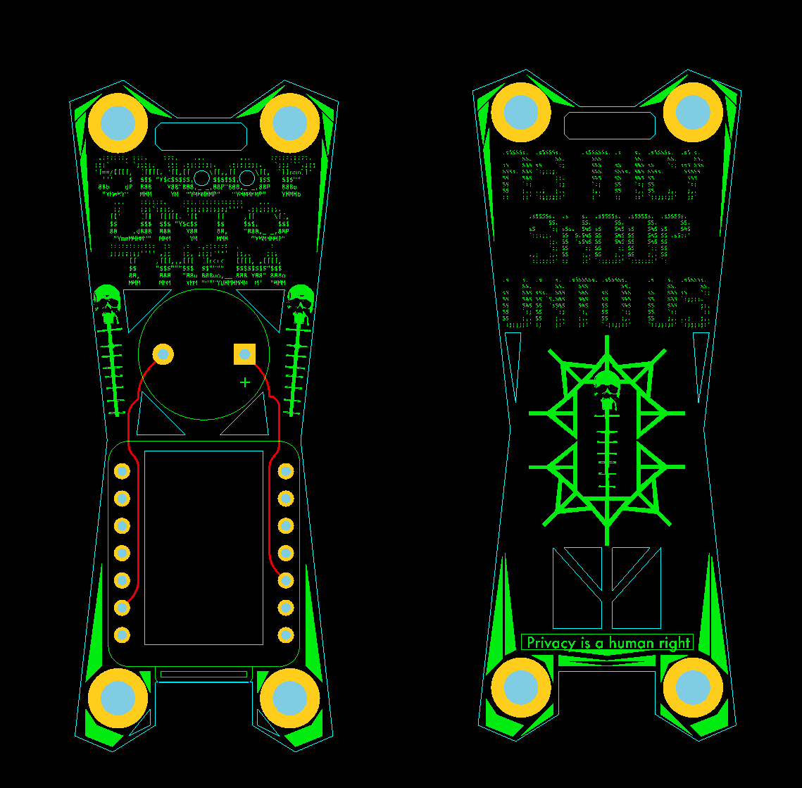

OUI-SPY board · colonelpanichacks, MIT

Note:
github.com/colonelpanichacks/oui-spy. An ESP32 board whose firmware watches for devices by their maker's Bluetooth and Wi-Fi addresses. Its current firmware is detection-only. It can miss devices that keep changing their address, which phones and AirTags do; for a tracker following you, your phone's own unknown-tracker alerts are the first check. Check availability and legality here before recommending it.

---

<!-- .slide: class="section-slide" -->
Part 6

# What's *next*.

---

## Tonight, protect *one person*.

{{i:user-round}}

Mama

2FA on

{{i:user-round}}

Papa

Code word agreed

{{i:user-round}}

Lola

Patience

{{b:signal}}

Family chat

On Signal

One fix for someone at home. No one stays safe alone.

Note:
Agree the code word, turn on their 2FA, or ask together: "Why do they need that?" Lola will ask again, and that's fine. The take-home card at the booth has a list to tick.

---

## Build a *community*.

1<b>Inform and educate</b>Share what you learned today about safety, privacy and digital rights.

2<b>Be patient</b>Not everyone will be as quick or as keen as you.

3<b>Speak up</b>Push back on rules that erode our digital freedoms.

4<b>Support the groups</b>Back those who defend our digital freedoms.

Start with your barkada, your family's group chat, your school org.

Note:
Adapted from "Be an advocate" in my open-source and local-first talk. This is the leadership part of the summit: you don't have to be an expert to be the person others ask. Point to our page (facebook.com/bnhr.xyz, the QR on my intro slide) and to the booth for anyone who wants to keep going.

---

## Communities grow from small *meetups*.

<figure>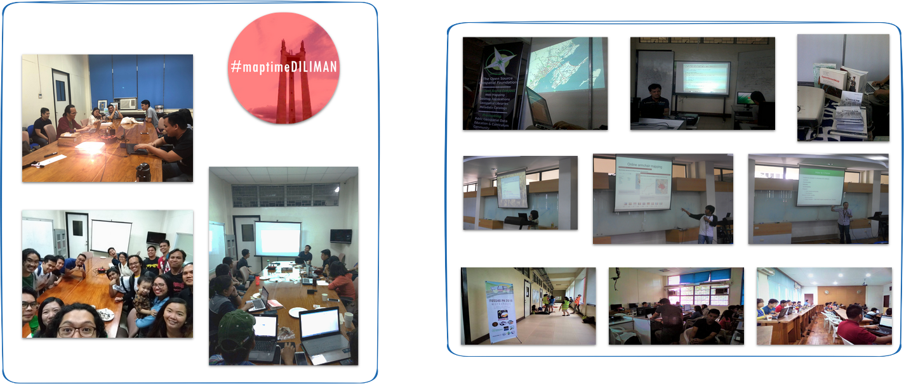<figcaption>From small local meetups…</figcaption></figure>
<figure>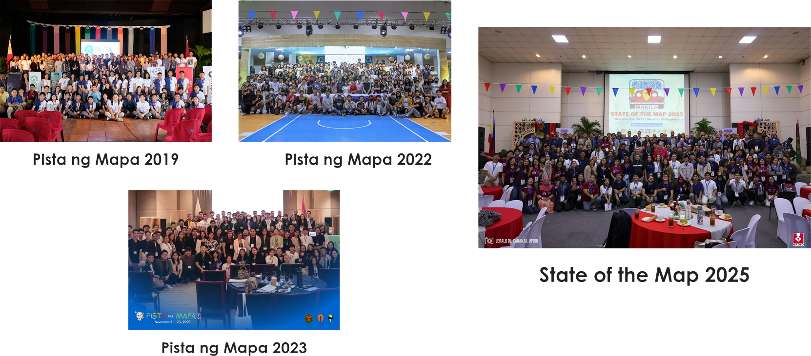<figcaption>…to Pista ng Mapa and State of the Map 2025, in Manila</figcaption></figure>

We started with only a few people around a table.

Note:
From my open-source and local-first talk. The open mapping community began as a handful of people at meetups like #maptimeDILIMAN and grew into Pista ng Mapa and the international State of the Map conference, held in Manila in 2025. A safety-minded barkada or school org can start the same way.

---

## BUDOL: play the scam from *both sides*.

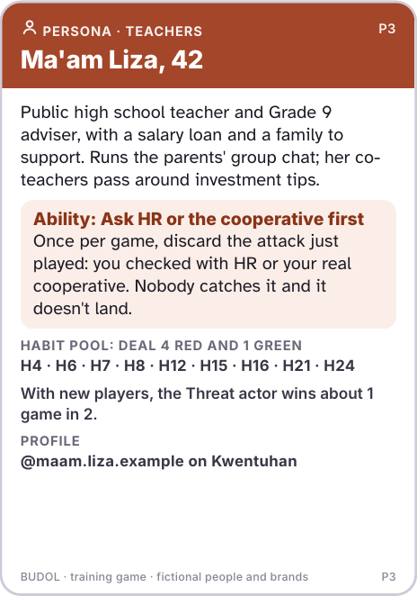
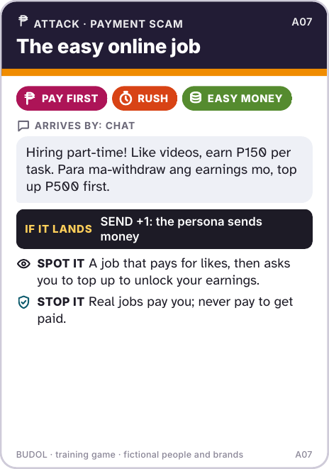
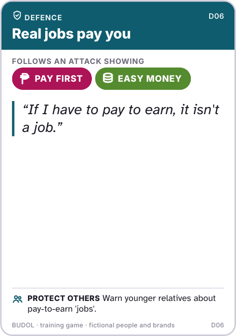
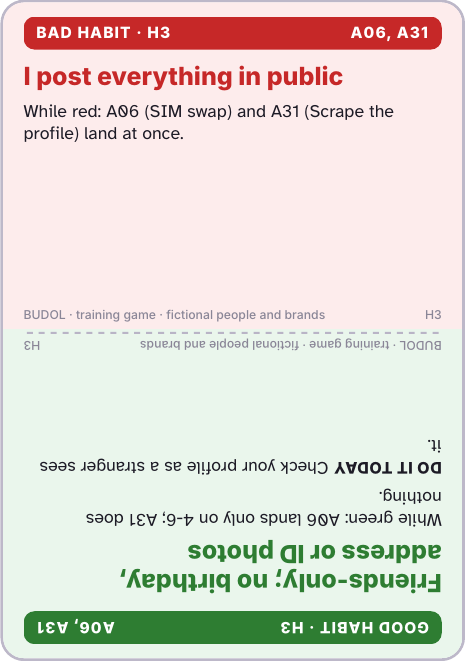

One side is the ethical tester. The other keeps Ma'am Liza safe. All ages, ten minutes.

<!-- more -->
Every scam card shows its warning signs; you block it with a card showing the same sign, and you say the sign out loud, like we just did. Catch a scam and you turn one of her bad habits green.
<!-- /more -->

Note:
This is the game behind everything the hall has done today: Ma'am Liza's PIN, the nine signs, and "shout the sign" are all from BUDOL. Show the scam card, then reveal the card that blocks it (same signs: Pay first, Easy money), then a habit card turning from red to green.

---

## Come to our *booth*.

{{i:dices}}

All ages

Play BUDOL

<!-- more -->

The card game: play the tester or the target in ten minutes, and help Ma'am Liza.

<!-- /more -->

{{i:shield-check}}

Ask us

Your questions

<!-- more -->

About anything from today: a message you're unsure of, a setting, an app.

<!-- /more -->

{{i:monitor-play}}

Watch and try

Live scam demos

<!-- more -->

See how scams are made and delivered, on our own devices.

<!-- /more -->

Note:
Say where the booth is in the hall.

---

<!-- .slide: class="section-slide" -->
Spot it. Stop it. Switch it.

# Humayo kayo at magpaka- *open-source*.

Note:
Maraming salamat. Pause, check, switch one. Questions: at our booth, all day.
