## Who got a scam text this *week*?

<b>This week?</b>

<b>This month?</b>

<b>Someone at home</b>who lost money or an account?

<svg class="ic" aria-hidden="true" xmlns="http://www.w3.org/2000/svg" viewBox="0 0 24 24" fill="none" stroke="currentColor" stroke-width="2" stroke-linecap="round" stroke-linejoin="round" > <path d="M7.9 20A9 9 0 1 0 4 16.1L2 22Z" /> </svg>Messages

Your parcel is on hold. Update your address within 24 hours: parcel-update.example

Congrats! You qualified for a P10,000 scholarship. Pay the P350 release fee today.

Note:
Ask each question and wait for hands. Then: "Look around: you're not alone, and nobody here is stupid." Scammers do this for a living. That's the message for anyone in the hall who's been caught.

---

<link rel="stylesheet" href="deck.css">

## Hi, I'm *Ben*.

[open] technology and digital autonomy advocate

<i></i><i></i><i></i>

ben@nyls:~$ ./intro.sh

&gt; Hi, my name is Ben.

&gt; I'm an open technology and digital autonomy advocate.

&gt; Linux user since 2013. /e/OS, LineageOS and GrapheneOS on mobile.

&gt; I also make a living building cool stuff that help people and organizations make the most of open technologies through BNHR, SmartCT, and the Civic Literacy Initiative.

facebook.com/<wbr>bnhr.xyz

Note:
Not a cybersecurity expert: someone who practises and teaches personal security and privacy. Today is about you and your family. Keep it short, but land the daily drivers: everything I'll recommend today, I use every day. That's the proof that switching is livable. Why Clippy: a paper clip that helps, and a reminder that tech should work for its users.

---

## I use what I'll *show* you.

<figure>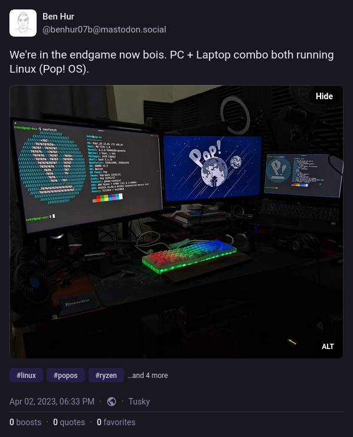<figcaption>Linux since 2013</figcaption></figure>
<figure>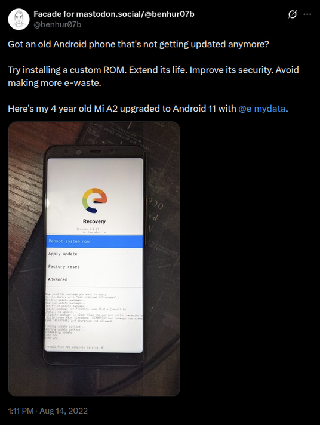<figcaption>/e/OS and LineageOS on old devices</figcaption></figure>
<figure>

12:45<svg class="logo" aria-hidden="true" fill="currentColor" role="img" viewBox="0 0 24 24" xmlns="http://www.w3.org/2000/svg"><path d="m6.953 7.244 3.458-1.97a1.901 1.901 0 0 1-.108-.608c0-.835.608-1.525 1.407-1.67V0h.58v2.995a1.704 1.704 0 0 1 1.407 1.67c0 .219-.045.418-.118.609l3.468 1.97c.127-.146.281-.273.454-.382a1.705 1.705 0 0 1 2.151.382l2.596-1.498.29.508-2.595 1.498a1.69 1.69 0 0 1-1.244 2.242v4.012a1.69 1.69 0 0 1 1.244 2.242l2.596 1.498-.29.508-2.597-1.498a1.705 1.705 0 0 1-2.151.382 2.065 2.065 0 0 1-.454-.382c-1.153.654-2.306 1.317-3.468 1.97.073.19.118.39.118.608 0 .835-.608 1.525-1.407 1.67V24h-.58v-2.995a1.704 1.704 0 0 1-1.407-1.67c0-.219.045-.418.108-.609l-3.458-1.97a2.065 2.065 0 0 1-.454.382 1.705 1.705 0 0 1-2.151-.382l-2.596 1.498-.29-.508 2.595-1.498a1.69 1.69 0 0 1 1.244-2.242V9.994a1.69 1.69 0 0 1-1.244-2.242L1.461 6.254l.29-.508 2.597 1.498a1.705 1.705 0 0 1 2.151-.382c.173.11.327.236.454.382Zm9.803 9.004a1.682 1.682 0 0 1 .128-1.425 1.702 1.702 0 0 1 1.234-.835v-3.976a1.702 1.702 0 0 1-1.234-.835 1.682 1.682 0 0 1-.128-1.425L13.29 5.773c-.318.363-.772.59-1.289.59-.517 0-.971-.227-1.289-.59L7.244 7.752c.163.454.136.98-.128 1.425a1.702 1.702 0 0 1-1.234.835v3.976c.5.073.962.363 1.234.835.264.445.291.971.128 1.425l3.467 1.979c.318-.363.772-.59 1.289-.59.517 0 .971.227 1.289.59z"/></svg>

<svg class="logo" aria-hidden="true" fill="currentColor" role="img" viewBox="0 0 24 24" xmlns="http://www.w3.org/2000/svg"><path d="M12 0q-.934 0-1.83.139l.17 1.111a11 11 0 0 1 3.32 0l.172-1.111A12 12 0 0 0 12 0M9.152.34A12 12 0 0 0 5.77 1.742l.584.961a10.8 10.8 0 0 1 3.066-1.27zm5.696 0-.268 1.094a10.8 10.8 0 0 1 3.066 1.27l.584-.962A12 12 0 0 0 14.848.34M12 2.25a9.75 9.75 0 0 0-8.539 14.459c.074.134.1.292.064.441l-1.013 4.338 4.338-1.013a.62.62 0 0 1 .441.064A9.7 9.7 0 0 0 12 21.75c5.385 0 9.75-4.365 9.75-9.75S17.385 2.25 12 2.25m-7.092.068a12 12 0 0 0-2.59 2.59l.909.664a11 11 0 0 1 2.345-2.345zm14.184 0-.664.909a11 11 0 0 1 2.345 2.345l.909-.664a12 12 0 0 0-2.59-2.59M1.742 5.77A12 12 0 0 0 .34 9.152l1.094.268a10.8 10.8 0 0 1 1.269-3.066zm20.516 0-.961.584a10.8 10.8 0 0 1 1.27 3.066l1.093-.268a12 12 0 0 0-1.402-3.383M.138 10.168A12 12 0 0 0 0 12q0 .934.139 1.83l1.111-.17A11 11 0 0 1 1.125 12q0-.848.125-1.66zm23.723.002-1.111.17q.125.812.125 1.66c0 .848-.042 1.12-.125 1.66l1.111.172a12.1 12.1 0 0 0 0-3.662M1.434 14.58l-1.094.268a12 12 0 0 0 .96 2.591l-.265 1.14 1.096.255.36-1.539-.188-.365a10.8 10.8 0 0 1-.87-2.35m21.133 0a10.8 10.8 0 0 1-1.27 3.067l.962.584a12 12 0 0 0 1.402-3.383zm-1.793 3.848a11 11 0 0 1-2.345 2.345l.664.909a12 12 0 0 0 2.59-2.59zm-19.959 1.1L.357 21.48a1.8 1.8 0 0 0 2.162 2.161l1.954-.455-.256-1.095-1.953.455a.675.675 0 0 1-.81-.81l.454-1.954zm16.832 1.769a10.8 10.8 0 0 1-3.066 1.27l.268 1.093a12 12 0 0 0 3.382-1.402zm-10.94.213-1.54.36.256 1.095 1.139-.266c.814.415 1.683.74 2.591.961l.268-1.094a10.8 10.8 0 0 1-2.35-.869zm3.634 1.24-.172 1.111a12.1 12.1 0 0 0 3.662 0l-.17-1.111q-.812.125-1.66.125a11 11 0 0 1-1.66-.125"/></svg><i>Signal</i><svg class="logo" aria-hidden="true" fill="currentColor" role="img" viewBox="0 0 24 24" xmlns="http://www.w3.org/2000/svg"><path d="M12 0C5.378 0 0 5.378 0 12c0 6.623 5.378 12 12 12 6.623 0 12-5.377 12-12 0-6.622-5.377-12-12-12zm0 .791a11.203 11.203 0 0 1 11.209 11.21A11.202 11.202 0 0 1 12 23.208 11.203 11.203 0 0 1 .791 12 11.203 11.203 0 0 1 12.001.791zm0 1.871a9.356 9.356 0 0 0-1.705.162A1.746 1.746 0 0 0 12 4.95a1.746 1.746 0 0 0 1.706-2.126A9.342 9.342 0 0 0 12 2.662zM7.2 4a9.338 9.338 0 0 0-4.54 8 9.338 9.338 0 0 0 18.677 0 9.338 9.338 0 0 0-4.54-7.998 4.888 4.888 0 0 1-2.701 5.365l-.12 2.066 1.482 1.483-1.483 1.482.989.989-.989.988.12 1.857L12 20.328l-2.096-2.096V9.367A4.89 4.89 0 0 1 7.2 4zm3.4 6.543v6.99h.7v-6.99z"/></svg><i>KeePassDX</i><svg class="logo" aria-hidden="true" fill="currentColor" role="img" viewBox="0 0 24 24" xmlns="http://www.w3.org/2000/svg"><path d="m6.9487 19.8732-.0074.0133a1.483 1.483 0 0 0-.0013 1.469l.3165.5565c.2639.4638.7563.75 1.2897.75h.0163c1.139 0 1.853-1.2301 1.2883-2.219l-.325-.5697c-.5693-.9974-2.0074-.9974-2.577-.0002m3.4905-6.1074a1.483 1.483 0 0 0-.0013 1.4688l3.7964 6.6769c.2639.4638.756.7503 1.2897.7503h.0156c1.139 0 1.853-1.2301 1.2883-2.219l-3.8118-6.677c-.5693-.9974-2.0077-.9974-2.5768 0m.3275-11.692L.1972 20.4648c-.5618.9775.1438 2.1969 1.2713 2.1969a1.467 1.467 0 0 0 1.2734-.7393l7.9513-13.9285c.5632-.9867 1.9861-.9855 2.548.0026l7.9175 13.9239a1.466 1.466 0 0 0 1.2746.7416h.0982c1.1255 0 1.8313-1.2152 1.2736-2.193L13.3116 2.0776c-.5616-.9844-1.98-.9867-2.5448-.0039"/></svg><i>Aegis</i>
<span class="logo mask" aria-hidden="true" style="--m:url()"><i>Ente Auth</i><svg class="logo" aria-hidden="true" fill="currentColor" role="img" viewBox="0 0 24 24" xmlns="http://www.w3.org/2000/svg"><path d="M8.824 7.287c.008 0 .004 0 0 0zm-2.8-1.4c.006 0 .003 0 0 0zm16.754 2.161c-.505-1.215-1.53-2.528-2.333-2.943.654 1.283 1.033 2.57 1.177 3.53l.002.02c-1.314-3.278-3.544-4.6-5.366-7.477-.091-.147-.184-.292-.273-.446a3.545 3.545 0 01-.13-.24 2.118 2.118 0 01-.172-.46.03.03 0 00-.027-.03.038.038 0 00-.021 0l-.006.001a.037.037 0 00-.01.005L15.624 0c-2.585 1.515-3.657 4.168-3.932 5.856a6.197 6.197 0 00-2.305.587.297.297 0 00-.147.37c.057.162.24.24.396.17a5.622 5.622 0 012.008-.523l.067-.005a5.847 5.847 0 011.957.222l.095.03a5.816 5.816 0 01.616.228c.08.036.16.073.238.112l.107.055a5.835 5.835 0 01.368.211 5.953 5.953 0 012.034 2.104c-.62-.437-1.733-.868-2.803-.681 4.183 2.09 3.06 9.292-2.737 9.02a5.164 5.164 0 01-1.513-.292 4.42 4.42 0 01-.538-.232c-1.42-.735-2.593-2.121-2.74-3.806 0 0 .537-2 3.845-2 .357 0 1.38-.998 1.398-1.287-.005-.095-2.029-.9-2.817-1.677-.422-.416-.622-.616-.8-.767a3.47 3.47 0 00-.301-.227 5.388 5.388 0 01-.032-2.842c-1.195.544-2.124 1.403-2.8 2.163h-.006c-.46-.584-.428-2.51-.402-2.913-.006-.025-.343.176-.389.206-.406.29-.787.616-1.136.974-.397.403-.76.839-1.085 1.303a9.816 9.816 0 00-1.562 3.52c-.003.013-.11.487-.19 1.073-.013.09-.026.181-.037.272a7.8 7.8 0 00-.069.667l-.002.034-.023.387-.001.06C.386 18.795 5.593 24 12.016 24c5.752 0 10.527-4.176 11.463-9.661.02-.149.035-.298.052-.448.232-1.994-.025-4.09-.753-5.844z"/></svg><i>Firefox</i><svg class="logo" aria-hidden="true" fill="currentColor" role="img" viewBox="0 0 24 24" xmlns="http://www.w3.org/2000/svg"><path d="m15.24 8.998 3.656-3.073v15.81H2.482C1.11 21.735 0 20.609 0 19.223V6.944l7.58 6.38a2.186 2.186 0 0 0 2.871-.042l4.792-4.284h-.003zm-5.456 3.538 1.809-1.616a2.438 2.438 0 0 1-1.178-.533L.905 2.395A.552.552 0 0 0 0 2.826v2.811l8.226 6.923a1.186 1.186 0 0 0 1.558-.024zM23.871 2.463a.551.551 0 0 0-.776-.068l-3.199 2.688v16.653h1.623c1.371 0 2.481-1.127 2.481-2.513V2.824a.551.551 0 0 0-.129-.36z"/></svg><i>Proton Mail</i>
<svg class="logo" aria-hidden="true" fill="currentColor" role="img" viewBox="0 0 24 24" xmlns="http://www.w3.org/2000/svg"><path d="M20.472,10.081H3.528c-0.877,0-1.589,0.711-1.589,1.589v10.59c0,0.877,0.711,1.589,1.589,1.589h16.944 c0.877,0,1.589-0.711,1.589-1.589V11.67C22.061,10.792,21.349,10.081,20.472,10.081z M12,22.525c-3.066,0-5.56-2.494-5.56-5.56 s2.494-5.56,5.56-5.56c3.066,0,5.56,2.494,5.56,5.56S15.066,22.525,12,22.525z M12,12.411c-2.511,0-4.554,2.043-4.554,4.554 S9.489,21.519,12,21.519s4.554-2.043,4.554-4.554S14.511,12.411,12,12.411z M12,20.274c-1.563,0-2.881-1.103-3.221-2.568h1.67 c0.275,0.581,0.859,0.979,1.551,0.979c0.96,0,1.721-0.761,1.721-1.721c0-0.96-0.761-1.721-1.721-1.721 c-0.649,0-1.2,0.352-1.493,0.874H8.805c0.378-1.412,1.669-2.462,3.195-2.462c1.818,0,3.309,1.491,3.309,3.309 C15.309,18.783,13.818,20.274,12,20.274z M23.849,0.396c-0.001,0.001-0.002,0.002-0.002,0.003 c-0.002-0.002-0.004-0.003-0.006-0.005c0.001-0.001,0.002-0.003,0.004-0.004c-0.116-0.137-0.279-0.231-0.519-0.238 c-0.202,0.005-0.391,0.097-0.512,0.259l-1.818,2.353c-0.164-0.058-0.339-0.095-0.523-0.095H3.528c-0.184,0-0.358,0.038-0.523,0.095 L1.187,0.41c-0.121-0.162-0.31-0.253-0.512-0.259c-0.24,0.006-0.403,0.1-0.519,0.238c0.001,0.001,0.002,0.003,0.004,0.004 C0.157,0.395,0.155,0.397,0.153,0.399C0.153,0.398,0.152,0.397,0.151,0.396C0.085,0.474-0.146,0.822,0.139,1.22l1.909,2.471 C1.981,3.867,1.94,4.057,1.94,4.257v3.707c0,0.877,0.711,1.589,1.589,1.589h16.944c0.877,0,1.589-0.711,1.589-1.589V4.257 c0-0.2-0.041-0.39-0.109-0.566l1.909-2.471C24.146,0.822,23.915,0.474,23.849,0.396z M6.904,8.228c-0.987,0-1.787-0.8-1.787-1.787 s0.8-1.787,1.787-1.787s1.787,0.8,1.787,1.787S7.891,8.228,6.904,8.228z M17.229,8.228c-0.987,0-1.787-0.8-1.787-1.787 s0.8-1.787,1.787-1.787c0.987,0,1.787,0.8,1.787,1.787S18.216,8.228,17.229,8.228z"/></svg><i>F-Droid</i><svg class="logo" aria-hidden="true" fill="currentColor" role="img" viewBox="0 0 24 24" xmlns="http://www.w3.org/2000/svg"><path d="M23.451 3.672c.106.105.199.222.277.348.178.293.272.628.272.97v9.604c0 .342-.095.679-.274.971a1.899 1.899 0 0 1-.383.444c-.335.286-.76.443-1.201.443H11.727a9.773 9.773 0 0 1-5.2 4.365l-.136.049-.135-.052a9.741 9.741 0 0 1-4.499-3.526A9.702 9.702 0 0 1 0 11.701a9.794 9.794 0 0 1 .227-2.1l.052-.237.236-.058c.055-.013.109-.028.162-.042a11.979 11.979 0 0 0 5.568-3.262l.04-.043.232-.239v-.73c0-.343.095-.68.274-.972.078-.126.171-.242.278-.346a1.835 1.835 0 0 1 1.193-.537h13.994a1.84 1.84 0 0 1 1.195.537Zm-15.075.346c-.033 0-.066.001-.098.004h-.142l.023.021 6.815 6.029a.435.435 0 0 0 .576 0l6.815-6.029.023-.021h-.146a1.042 1.042 0 0 0-.098-.004H8.376Zm-.898.605a.945.945 0 0 0-.072.367v1.586a11.997 11.997 0 0 0 4.938 2.681l.114.029.057.015.237.058.051.239a8.49 8.49 0 0 1 .1.565l.417-.369-5.842-5.171ZM2.329 16.719a9.049 9.049 0 0 0 4.074 3.312 8.997 8.997 0 0 0 5.68-10.036 12.736 12.736 0 0 1-5.555-3.169 12.751 12.751 0 0 1-5.583 3.177 9.044 9.044 0 0 0-.161 1.698 9.038 9.038 0 0 0 1.545 5.018Zm10.684-5.098a9.709 9.709 0 0 1-.837 3.944h10.212l-.028-.025-5.826-5.153-.985.87a.43.43 0 0 1-.575 0l-.985-.87-.984.87c.005.122.008.242.008.364Zm10.029 3.339a.94.94 0 0 0 .072-.366l.001-9.603a.967.967 0 0 0-.071-.364l-5.84 5.168 5.838 5.165ZM6.609 8.206a10.24 10.24 0 0 0 4.379 2.464c.074.404.113.813.118 1.223v.082a7.233 7.233 0 0 1-1.705 4.655l-.007.008a7.234 7.234 0 0 1-2.97 2.095 7.259 7.259 0 0 1-4.515-6.692c0-.458.043-.915.129-1.365a10.252 10.252 0 0 0 4.486-2.551l.084.081h.001Zm-3.177 5.053 2.752 2.752h.001l3.831-3.831-.847-.846-2.983 2.984-1.908-1.907-.846.848Z"/></svg><i>SimpleLogin</i><svg class="logo" aria-hidden="true" fill="currentColor" role="img" viewBox="0 0 24 24" xmlns="http://www.w3.org/2000/svg"><path d="M12 0C5.373 0 0 5.373 0 12s5.373 12 12 12 12-5.373 12-12S18.627 0 12 0zm0 23C5.925 23 1 18.074 1 12S5.926 1 12 1s11 4.925 11 11-4.925 11-11 11zm10.219-11c0 4.805-3.317 8.833-7.786 9.925-.27-.521-.53-1.017-.749-1.438.645.249 1.93.718 2.208.615.376-.144.282-3.149-.14-3.245-.338-.075-1.632.837-2.141 1.209l.034.156c.078.397.144.993.03 1.247-.001.004-.002.01-.004.013a.218.218 0 0 1-.068.088c-.284.188-1.081.284-1.503.188a.516.516 0 0 1-.064-.02c-.694.396-2.01 1.109-2.25.971-.329-.188-.377-2.676-.329-3.288.035-.46 1.653.286 2.442.679.174-.163.602-.272.98-.31-.57-1.389-.99-2.977-.733-4.105 0 .002.002.002.002.002.356.248 2.73 1.05 3.91 1.027 1.18-.024 3.114-.743 2.903-1.323-.212-.58-2.135.51-4.142.324-1.486-.138-1.748-.804-1.42-1.29.414-.611 1.168.116 2.411-.256 1.245-.371 2.987-1.035 3.632-1.397 1.494-.833-.625-1.177-1.125-.947-.474.22-2.123.637-2.889.82.428-1.516-.603-4.149-1.757-5.3-.376-.376-.951-.612-1.603-.736-.25-.344-.654-.671-1.225-.977a5.772 5.772 0 0 0-3.595-.584l-.024.004-.034.004.004.002c-.148.028-.237.08-.357.098.148.016.705.276 1.057.418-.174.068-.412.108-.596.184a.828.828 0 0 0-.204.056c-.173.08-.303.375-.3.515.84-.086 2.082-.026 2.991.246-.644.09-1.235.258-1.661.482-.016.008-.03.018-.048.028-.054.02-.106.042-.152.066-1.367.72-1.971 2.405-1.611 4.424.323 1.824 1.665 8.088 2.29 11.064-3.973-1.4-6.822-5.186-6.822-9.639C1.781 6.356 6.356 1.781 12 1.781S22.219 6.356 22.219 12zM9.095 9.581a.758.758 0 1 0 0 1.516.758.758 0 0 0 0-1.516zm.338.702a.196.196 0 1 1 0-.392.196.196 0 0 1 0 .392zm4.724-1.043a.65.65 0 1 0 0 1.299.65.65 0 0 0 0-1.3zm.29.601a.168.168 0 1 1 0-.336.168.168 0 0 1 0 .336zM9.313 8.146s-.571-.26-1.125.09c-.554.348-.534.704-.534.704s-.294-.656.49-.978c.786-.32 1.17.184 1.17.184zm5.236-.052s-.41-.234-.73-.23c-.654.008-.831.296-.831.296s.11-.688.945-.55a.84.84 0 0 1 .616.484z"/></svg><i>DuckDuckGo</i>

Illustration

<figcaption>GrapheneOS, every day</figcaption></figure>

Note:
Proof that this is livable: these are my own posts about my own machines, and they're years old. An old phone or tablet with an open-source system gets updates again, and stays out of the landfill. GrapheneOS is on my daily phone. The third picture is a drawing of a home screen with the apps from today; swap in a real screenshot (yours, with notifications and anything personal cleared, or a freely licensed one) when we have it.

---

## You're your family's *tech support*.

<svg class="ic" aria-hidden="true" xmlns="http://www.w3.org/2000/svg" viewBox="0 0 24 24" fill="none" stroke="currentColor" stroke-width="2" stroke-linecap="round" stroke-linejoin="round" > <circle cx="12" cy="8" r="5" /> <path d="M20 21a8 8 0 0 0-16 0" /> </svg>

Mama

Her e-wallet

<svg class="ic" aria-hidden="true" xmlns="http://www.w3.org/2000/svg" viewBox="0 0 24 24" fill="none" stroke="currentColor" stroke-width="2" stroke-linecap="round" stroke-linejoin="round" > <circle cx="12" cy="8" r="5" /> <path d="M20 21a8 8 0 0 0-16 0" /> </svg>

Papa

His Facebook

<svg class="ic" aria-hidden="true" xmlns="http://www.w3.org/2000/svg" viewBox="0 0 24 24" fill="none" stroke="currentColor" stroke-width="2" stroke-linecap="round" stroke-linejoin="round" > <circle cx="12" cy="8" r="5" /> <path d="M20 21a8 8 0 0 0-16 0" /> </svg>

Lola

Her new phone

<svg class="ic" aria-hidden="true" xmlns="http://www.w3.org/2000/svg" viewBox="0 0 24 24" fill="none" stroke="currentColor" stroke-width="2" stroke-linecap="round" stroke-linejoin="round" > <path d="M16 21v-2a4 4 0 0 0-4-4H6a4 4 0 0 0-4 4v2" /> <circle cx="9" cy="7" r="4" /> <path d="M22 21v-2a4 4 0 0 0-3-3.87" /> <path d="M16 3.13a4 4 0 0 1 0 7.75" /> </svg>

Barkada

The group chat

You set them up. You can protect them, too.

Note:
Ask: "Who here set up a parent's or grandparent's phone?" This is the summit's theme: young people leading on online safety, starting at home.

---

## Spot it. Stop it. *Switch* it.

<svg class="ic" aria-hidden="true" xmlns="http://www.w3.org/2000/svg" viewBox="0 0 24 24" fill="none" stroke="currentColor" stroke-width="2" stroke-linecap="round" stroke-linejoin="round" > <path d="M6.5 12c.94-3.46 4.94-6 8.5-6 3.56 0 6.06 2.54 7 6-.94 3.47-3.44 6-7 6s-7.56-2.53-8.5-6Z" /> <path d="M18 12v.5" /> <path d="M16 17.93a9.77 9.77 0 0 1 0-11.86" /> <path d="M7 10.67C7 8 5.58 5.97 2.73 5.5c-1 1.5-1 5 .23 6.5-1.24 1.5-1.24 5-.23 6.5C5.58 18.03 7 16 7 13.33" /> <path d="M10.46 7.26C10.2 5.88 9.17 4.24 8 3h5.8a2 2 0 0 1 1.98 1.67l.23 1.4" /> <path d="m16.01 17.93-.23 1.4A2 2 0 0 1 13.8 21H9.5a5.96 5.96 0 0 0 1.49-3.98" /> </svg>

Part 1

How scams get in

The scammer's playbook

<svg class="ic" aria-hidden="true" xmlns="http://www.w3.org/2000/svg" viewBox="0 0 24 24" fill="none" stroke="currentColor" stroke-width="2" stroke-linecap="round" stroke-linejoin="round" > <circle cx="11" cy="11" r="8" /> <path d="m21 21-4.3-4.3" /> </svg>

Part 2

Spot it

Nine warning signs

<svg class="ic" aria-hidden="true" xmlns="http://www.w3.org/2000/svg" viewBox="0 0 24 24" fill="none" stroke="currentColor" stroke-width="2" stroke-linecap="round" stroke-linejoin="round" > <path d="M20 13c0 5-3.5 7.5-7.66 8.95a1 1 0 0 1-.67-.01C7.5 20.5 4 18 4 13V6a1 1 0 0 1 1-1c2 0 4.5-1.2 6.24-2.72a1.17 1.17 0 0 1 1.52 0C14.51 3.81 17 5 19 5a1 1 0 0 1 1 1z" /> <path d="m9 12 2 2 4-4" /> </svg>

Part 3

Stop it

Habits that cost nothing

<svg class="ic" aria-hidden="true" xmlns="http://www.w3.org/2000/svg" viewBox="0 0 24 24" fill="none" stroke="currentColor" stroke-width="2" stroke-linecap="round" stroke-linejoin="round" > <path d="M7 18v-6a5 5 0 1 1 10 0v6" /> <path d="M5 21a1 1 0 0 0 1 1h12a1 1 0 0 0 1-1v-1a2 2 0 0 0-2-2H7a2 2 0 0 0-2 2z" /> <path d="M21 12h1" /> <path d="M18.5 4.5 18 5" /> <path d="M2 12h1" /> <path d="M12 2v1" /> <path d="m4.929 4.929.707.707" /> <path d="M12 12v6" /> </svg>

Part 4

When it happens

What to do, who to call

<svg class="ic" aria-hidden="true" xmlns="http://www.w3.org/2000/svg" viewBox="0 0 24 24" fill="none" stroke="currentColor" stroke-width="2" stroke-linecap="round" stroke-linejoin="round" > <path d="m16 3 4 4-4 4" /> <path d="M20 7H4" /> <path d="m8 21-4-4 4-4" /> <path d="M4 17h16" /> </svg>

Part 5

Switch it

Tools that work for you

<svg class="ic" aria-hidden="true" xmlns="http://www.w3.org/2000/svg" viewBox="0 0 24 24" fill="none" stroke="currentColor" stroke-width="2" stroke-linecap="round" stroke-linejoin="round" > <path d="M16 21v-2a4 4 0 0 0-4-4H6a4 4 0 0 0-4 4v2" /> <circle cx="9" cy="7" r="4" /> <path d="M22 21v-2a4 4 0 0 0-3-3.87" /> <path d="M16 3.13a4 4 0 0 1 0 7.75" /> </svg>

Part 6

What's next

Protect one person, then more

Note:
Thirty seconds: this is where we're going. How scams get in, then spot it, stop it, what to do when it happens, switch it, and what's next. A bonus part after Part 5 is for those who want to go further; skip it if time is short.

---

<!-- .slide: class="section-slide" -->
Part 1 · The scammer's playbook

# How scams get *in*.

---

## Scammers hack *people*, not phones.

<svg class="ic" aria-hidden="true" xmlns="http://www.w3.org/2000/svg" viewBox="0 0 24 24" fill="none" stroke="currentColor" stroke-width="2" stroke-linecap="round" stroke-linejoin="round" > <circle cx="11" cy="11" r="8" /> <path d="m21 21-4.3-4.3" /> </svg>

Step 1

Research

What you post

<svg class="ic" aria-hidden="true" xmlns="http://www.w3.org/2000/svg" viewBox="0 0 24 24" fill="none" stroke="currentColor" stroke-width="2" stroke-linecap="round" stroke-linejoin="round" > <path d="M6.5 12c.94-3.46 4.94-6 8.5-6 3.56 0 6.06 2.54 7 6-.94 3.47-3.44 6-7 6s-7.56-2.53-8.5-6Z" /> <path d="M18 12v.5" /> <path d="M16 17.93a9.77 9.77 0 0 1 0-11.86" /> <path d="M7 10.67C7 8 5.58 5.97 2.73 5.5c-1 1.5-1 5 .23 6.5-1.24 1.5-1.24 5-.23 6.5C5.58 18.03 7 16 7 13.33" /> <path d="M10.46 7.26C10.2 5.88 9.17 4.24 8 3h5.8a2 2 0 0 1 1.98 1.67l.23 1.4" /> <path d="m16.01 17.93-.23 1.4A2 2 0 0 1 13.8 21H9.5a5.96 5.96 0 0 0 1.49-3.98" /> </svg>

Step 2

Bait

A message made for you

<svg class="ic" aria-hidden="true" xmlns="http://www.w3.org/2000/svg" viewBox="0 0 24 24" fill="none" stroke="currentColor" stroke-width="2" stroke-linecap="round" stroke-linejoin="round" > <line x1="10" x2="14" y1="2" y2="2" /> <line x1="12" x2="15" y1="14" y2="11" /> <circle cx="12" cy="14" r="8" /> </svg>

Step 3

Pressure

Act before you think

It's called social engineering. Almost every scam follows these three steps.

Note:
One frame for every scam that follows. It's also how the Threat actor plays in BUDOL, our card game at the booth.

---

## Step 1: your posts are their *notes*.

L
<b>Ma'am Liza</b>Teacher since 2008
Kwentuhan · made up

Happy birthday to my eldest, Bianca! Aug 180818

Teaching since 2008, still in love with this job2008

Room 3104 decorations done for the new school year!3104

Blessed birthday to me, Jan 270127

Which one is her PIN?

Any of them. A scammer gets more than one guess.

Ma'am Liza is made up. She's from BUDOL, the card game at our booth.

Note:
Ma'am Liza is made up: she's a persona from our card game. Read each post and ask for hands: "Who thinks it's this one?" Then reveal all four. A birthday, a year or a number you post is a PIN a stranger can guess.

---

## That quiz is collecting your *answers*.

<svg class="ic" aria-hidden="true" xmlns="http://www.w3.org/2000/svg" viewBox="0 0 24 24" fill="none" stroke="currentColor" stroke-width="2" stroke-linecap="round" stroke-linejoin="round" > <path d="M2.586 17.414A2 2 0 0 0 2 18.828V21a1 1 0 0 0 1 1h3a1 1 0 0 0 1-1v-1a1 1 0 0 1 1-1h1a1 1 0 0 0 1-1v-1a1 1 0 0 1 1-1h.172a2 2 0 0 0 1.414-.586l.814-.814a6.5 6.5 0 1 0-4-4z" /> <circle cx="16.5" cy="7.5" r=".5" fill="currentColor" /> </svg>"What month were you born?"

<svg class="ic" aria-hidden="true" xmlns="http://www.w3.org/2000/svg" viewBox="0 0 24 24" fill="none" stroke="currentColor" stroke-width="2" stroke-linecap="round" stroke-linejoin="round" > <path d="M2.586 17.414A2 2 0 0 0 2 18.828V21a1 1 0 0 0 1 1h3a1 1 0 0 0 1-1v-1a1 1 0 0 1 1-1h1a1 1 0 0 0 1-1v-1a1 1 0 0 1 1-1h.172a2 2 0 0 0 1.414-.586l.814-.814a6.5 6.5 0 1 0-4-4z" /> <circle cx="16.5" cy="7.5" r=".5" fill="currentColor" /> </svg>"What was your first pet's name?"

Two common security questions, answered in public.

<svg class="ic" aria-hidden="true" xmlns="http://www.w3.org/2000/svg" viewBox="0 0 24 24" fill="none" stroke="currentColor" stroke-width="2" stroke-linecap="round" stroke-linejoin="round" > <path d="M9.937 15.5A2 2 0 0 0 8.5 14.063l-6.135-1.582a.5.5 0 0 1 0-.962L8.5 9.936A2 2 0 0 0 9.937 8.5l1.582-6.135a.5.5 0 0 1 .963 0L14.063 8.5A2 2 0 0 0 15.5 9.937l6.135 1.581a.5.5 0 0 1 0 .964L15.5 14.063a2 2 0 0 0-1.437 1.437l-1.582 6.135a.5.5 0 0 1-.963 0z" /> <path d="M20 3v4" /> <path d="M22 5h-4" /> <path d="M4 17v2" /> <path d="M5 18H3" /> </svg>Fun Quizzes PH

What's your K-drama name? Comment your <b>birth month</b> + your <b>first pet's name</b>!
2.4K comments

March + Bantay = Min-Ho Bantay 😂

August + Mingming!!

Note:
Ask who has answered a quiz like this. No shame: they're made to be fun. The page name is made up.

---

## Privacy isn't *secrecy*.

We all know what happens in the bathroom. We still close the door.

Note:
"I have nothing to hide" misses the point. Privacy is a right, and it still applies online. Everything you share can be used, by advertisers and by scammers.

This answers "I have nothing to hide" before we look at what scammers do with what we share.

---

## Step 2: AI writes the bait in *one second*.

Speed

~1 second

per scam text, on our own PC

Language

Fluent Taglish

or Filipino, or English

Cost

Free

an open AI model, no internet needed

Voices too

A cloned voice

copied from a short clip

"Look for bad spelling" doesn't work any more.

Note:
We measured it: 72 messages, a median of 0.9 seconds each, written for a made-up e-wallet.

Measured on our event PC on 6 November 2026 (gemma3:12b, after loading). The old advice to look for typos is dead. And it isn't only text: a voice can be copied from a short recording of someone talking. Hold that thought; a family code word beats it.

---

## Step 3: they want you to act before you *think*.

<svg class="ic" aria-hidden="true" xmlns="http://www.w3.org/2000/svg" viewBox="0 0 24 24" fill="none" stroke="currentColor" stroke-width="2" stroke-linecap="round" stroke-linejoin="round" > <circle cx="12" cy="12" r="10" /> <polyline points="12 6 12 12 16 14" /> </svg>

Rush

"Within 24 hours"

<svg class="ic" aria-hidden="true" xmlns="http://www.w3.org/2000/svg" viewBox="0 0 24 24" fill="none" stroke="currentColor" stroke-width="2" stroke-linecap="round" stroke-linejoin="round" > <path d="M10.733 5.076a10.744 10.744 0 0 1 11.205 6.575 1 1 0 0 1 0 .696 10.747 10.747 0 0 1-1.444 2.49" /> <path d="M14.084 14.158a3 3 0 0 1-4.242-4.242" /> <path d="M17.479 17.499a10.75 10.75 0 0 1-15.417-5.151 1 1 0 0 1 0-.696 10.75 10.75 0 0 1 4.446-5.143" /> <path d="m2 2 20 20" /> </svg>

Keep it secret

"Don't tell Papa"

<svg class="ic" aria-hidden="true" xmlns="http://www.w3.org/2000/svg" viewBox="0 0 24 24" fill="none" stroke="currentColor" stroke-width="2" stroke-linecap="round" stroke-linejoin="round" > <path d="M4 14a1 1 0 0 1-.78-1.63l9.9-10.2a.5.5 0 0 1 .86.46l-1.92 6.02A1 1 0 0 0 13 10h7a1 1 0 0 1 .78 1.63l-9.9 10.2a.5.5 0 0 1-.86-.46l1.92-6.02A1 1 0 0 0 11 14z" /> </svg>

Shock

"Share this now!"

They don't need you to believe them. They need you not to stop and check.

Note:
Three of the nine warning signs we'll practise soon. Next, their toolbox. Short on time? Press G, type 18 ("Nine warning signs"), and Enter to skip it.

---

<!-- .slide: class="subsection-slide" -->
Part 1 · The scammer's playbook

# What's in their *toolbox*.

---

## Cheap tools do the *heavy lifting*.

<svg class="ic" aria-hidden="true" xmlns="http://www.w3.org/2000/svg" viewBox="0 0 24 24" fill="none" stroke="currentColor" stroke-width="2" stroke-linecap="round" stroke-linejoin="round" > <path d="M4.9 16.1C1 12.2 1 5.8 4.9 1.9" /> <path d="M7.8 4.7a6.14 6.14 0 0 0-.8 7.5" /> <circle cx="12" cy="9" r="2" /> <path d="M16.2 4.8c2 2 2.26 5.11.8 7.47" /> <path d="M19.1 1.9a9.96 9.96 0 0 1 0 14.1" /> <path d="M9.5 18h5" /> <path d="m8 22 4-11 4 11" /> </svg>

SMS blasters

A fake cell tower in a car

<svg class="ic" aria-hidden="true" xmlns="http://www.w3.org/2000/svg" viewBox="0 0 24 24" fill="none" stroke="currentColor" stroke-width="2" stroke-linecap="round" stroke-linejoin="round" > <path d="M2 12a5 5 0 0 0 5 5 8 8 0 0 1 5 2 8 8 0 0 1 5-2 5 5 0 0 0 5-5V7h-5a8 8 0 0 0-5 2 8 8 0 0 0-5-2H2Z" /> <path d="M6 11c1.5 0 3 .5 3 2-2 0-3 0-3-2Z" /> <path d="M18 11c-1.5 0-3 .5-3 2 2 0 3 0 3-2Z" /> </svg>

Spoofed names

Your bank's name, their message

<svg class="ic" aria-hidden="true" xmlns="http://www.w3.org/2000/svg" viewBox="0 0 24 24" fill="none" stroke="currentColor" stroke-width="2" stroke-linecap="round" stroke-linejoin="round" > <path d="M12 22v-9" /> <path d="M15.17 2.21a1.67 1.67 0 0 1 1.63 0L21 4.57a1.93 1.93 0 0 1 0 3.36L8.82 14.79a1.655 1.655 0 0 1-1.64 0L3 12.43a1.93 1.93 0 0 1 0-3.36z" /> <path d="M20 13v3.87a2.06 2.06 0 0 1-1.11 1.83l-6 3.08a1.93 1.93 0 0 1-1.78 0l-6-3.08A2.06 2.06 0 0 1 4 16.87V13" /> <path d="M21 12.43a1.93 1.93 0 0 0 0-3.36L8.83 2.2a1.64 1.64 0 0 0-1.63 0L3 4.57a1.93 1.93 0 0 0 0 3.36l12.18 6.86a1.636 1.636 0 0 0 1.63 0z" /> </svg>

Phishing kits

A copy of a login page, ready-made

<svg class="ic" aria-hidden="true" xmlns="http://www.w3.org/2000/svg" viewBox="0 0 24 24" fill="none" stroke="currentColor" stroke-width="2" stroke-linecap="round" stroke-linejoin="round" > <path d="M12 20h.01" /> <path d="M2 8.82a15 15 0 0 1 20 0" /> <path d="M5 12.859a10 10 0 0 1 14 0" /> <path d="M8.5 16.429a5 5 0 0 1 7 0" /> </svg>

Fake Wi-Fi

"FREE_MALL_WIFI", asking for your login

<svg class="ic" aria-hidden="true" xmlns="http://www.w3.org/2000/svg" viewBox="0 0 24 24" fill="none" stroke="currentColor" stroke-width="2" stroke-linecap="round" stroke-linejoin="round" > <rect width="7" height="12" x="2" y="6" rx="1" /> <path d="M13 8.32a7.43 7.43 0 0 1 0 7.36" /> <path d="M16.46 6.21a11.76 11.76 0 0 1 0 11.58" /> <path d="M19.91 4.1a15.91 15.91 0 0 1 .01 15.8" /> </svg>

Bad apps

An untrusted app file, sent in a chat

<svg class="ic" aria-hidden="true" xmlns="http://www.w3.org/2000/svg" viewBox="0 0 24 24" fill="none" stroke="currentColor" stroke-width="2" stroke-linecap="round" stroke-linejoin="round" > <path d="M18 21a8 8 0 0 0-16 0" /> <circle cx="10" cy="8" r="5" /> <path d="M22 20c0-3.37-2-6.5-4-8a5 5 0 0 0-.45-8.3" /> </svg>

Rented accounts

Yours, if you say yes

Note:
Most of these are sold ready to use. Scammers don't need to be experts: they buy the tools, and they rent ordinary people's accounts to move the money.

How scams are done, at the level of what you'd see. No instructions, no tool names. The point: these are cheap and common, so the defences are what matter. Rented accounts are where young people get pulled in.

---

## An SMS blaster is a fake tower in a *car*.

<svg class="ic" aria-hidden="true" xmlns="http://www.w3.org/2000/svg" viewBox="0 0 24 24" fill="none" stroke="currentColor" stroke-width="2" stroke-linecap="round" stroke-linejoin="round" > <path d="m21 8-2 2-1.5-3.7A2 2 0 0 0 15.646 5H8.4a2 2 0 0 0-1.903 1.257L5 10 3 8" /> <path d="M7 14h.01" /> <path d="M17 14h.01" /> <rect width="18" height="8" x="3" y="10" rx="2" /> <path d="M5 18v2" /> <path d="M19 18v2" /> </svg>

1

It drives by

A fake tower in the car

<svg class="ic" aria-hidden="true" xmlns="http://www.w3.org/2000/svg" viewBox="0 0 24 24" fill="none" stroke="currentColor" stroke-width="2" stroke-linecap="round" stroke-linejoin="round" > <path d="M4.9 16.1C1 12.2 1 5.8 4.9 1.9" /> <path d="M7.8 4.7a6.14 6.14 0 0 0-.8 7.5" /> <circle cx="12" cy="9" r="2" /> <path d="M16.2 4.8c2 2 2.26 5.11.8 7.47" /> <path d="M19.1 1.9a9.96 9.96 0 0 1 0 14.1" /> <path d="M9.5 18h5" /> <path d="m8 22 4-11 4 11" /> </svg>

2

Your phone joins it

Pulled down to old, weak 2G

<svg class="ic" aria-hidden="true" xmlns="http://www.w3.org/2000/svg" viewBox="0 0 24 24" fill="none" stroke="currentColor" stroke-width="2" stroke-linecap="round" stroke-linejoin="round" > <path d="M7.9 20A9 9 0 1 0 4 16.1L2 22Z" /> <path d="M12 8v4" /> <path d="M12 16h.01" /> </svg>

3

A fake text arrives

Under any name, even your bank's

<svg class="ic" aria-hidden="true" xmlns="http://www.w3.org/2000/svg" viewBox="0 0 24 24" fill="none" stroke="currentColor" stroke-width="2" stroke-linecap="round" stroke-linejoin="round" > <path d="M20 13c0 5-3.5 7.5-7.66 8.95a1 1 0 0 1-.67-.01C7.5 20.5 4 18 4 13V6a1 1 0 0 1 1-1c2 0 4.5-1.2 6.24-2.72a1.17 1.17 0 0 1 1.52 0C14.51 3.81 17 5 19 5a1 1 0 0 1 1 1z" /> <path d="m9 12 2 2 4-4" /> </svg>On Android, turn off 2G: Settings → Network → SIM → Allow 2G.

Note:
The text can even land in your bank's real message thread. A link in a text is suspect, whoever it seems to come from.

Metro Manila police have caught people driving around with these. EFF's Rayhunter can detect fake towers like these (see the bonus part). Check the latest reports and the exact menu path the week of the event: the 2G switch is on many Android phones (Android 12 and later), not all; on iPhone, only Lockdown Mode turns 2G off.

---

## The name on the screen proves *nothing*.

<svg class="ic" aria-hidden="true" xmlns="http://www.w3.org/2000/svg" viewBox="0 0 24 24" fill="none" stroke="currentColor" stroke-width="2" stroke-linecap="round" stroke-linejoin="round" > <circle cx="12" cy="12" r="10" /> <path d="m15 9-6 6" /> <path d="m9 9 6 6" /> </svg>Same name, same thread, still fake.

<svg class="ic" aria-hidden="true" xmlns="http://www.w3.org/2000/svg" viewBox="0 0 24 24" fill="none" stroke="currentColor" stroke-width="2" stroke-linecap="round" stroke-linejoin="round" > <rect width="14" height="20" x="5" y="2" rx="2" ry="2" /> <path d="M12 18h.01" /> </svg>Open the app yourself, or call the number on your card.

<svg class="ic" aria-hidden="true" xmlns="http://www.w3.org/2000/svg" viewBox="0 0 24 24" fill="none" stroke="currentColor" stroke-width="2" stroke-linecap="round" stroke-linejoin="round" > <line x1="3" x2="21" y1="22" y2="22" /> <line x1="6" x2="6" y1="18" y2="11" /> <line x1="10" x2="10" y1="18" y2="11" /> <line x1="14" x2="14" y1="18" y2="11" /> <line x1="18" x2="18" y1="18" y2="11" /> <polygon points="12 2 20 7 4 7" /> </svg>YOUR BANK

Your OTP for login is 391 552. Do not share it.

Your account will be locked today. Verify now: yourbank-verify.example

Note:
Sender names and caller IDs can be faked. Only the app you installed and the number on your card are yours to trust. Install apps only from an official store or the maker's own site, never an untrusted app file (APK) like one sent in a chat, and at a counter check the "Scan to pay" QR for a sticker stuck on top.

The first message is real, the second is not, and both sit under the same name. "YOUR BANK" stands in for any bank: no real brand on our slides.

---

<!-- .slide: class="section-slide" -->
Part 2 · Spot it

# Nine warning *signs*.

---

## Nine signs give a scam *away*.

<svg class="ic" aria-hidden="true" xmlns="http://www.w3.org/2000/svg" viewBox="0 0 24 24" fill="none" stroke="currentColor" stroke-width="2" stroke-linecap="round" stroke-linejoin="round" > <circle cx="12" cy="12" r="10" /> <polyline points="12 6 12 12 16 14" /> </svg>Rush<small>Minamadali ka</small><svg class="ic" aria-hidden="true" xmlns="http://www.w3.org/2000/svg" viewBox="0 0 24 24" fill="none" stroke="currentColor" stroke-width="2" stroke-linecap="round" stroke-linejoin="round" > <path d="M2.586 17.414A2 2 0 0 0 2 18.828V21a1 1 0 0 0 1 1h3a1 1 0 0 0 1-1v-1a1 1 0 0 1 1-1h1a1 1 0 0 0 1-1v-1a1 1 0 0 1 1-1h.172a2 2 0 0 0 1.414-.586l.814-.814a6.5 6.5 0 1 0-4-4z" /> <circle cx="16.5" cy="7.5" r=".5" fill="currentColor" /> </svg>Asks for a code<small>Humihingi ng code</small><svg class="ic" aria-hidden="true" xmlns="http://www.w3.org/2000/svg" viewBox="0 0 24 24" fill="none" stroke="currentColor" stroke-width="2" stroke-linecap="round" stroke-linejoin="round" > <path d="M10 13a5 5 0 0 0 7.54.54l3-3a5 5 0 0 0-7.07-7.07l-1.72 1.71" /> <path d="M14 11a5 5 0 0 0-7.54-.54l-3 3a5 5 0 0 0 7.07 7.07l1.71-1.71" /> </svg>Link or QR<small>May link o QR</small><svg class="ic" aria-hidden="true" xmlns="http://www.w3.org/2000/svg" viewBox="0 0 24 24" fill="none" stroke="currentColor" stroke-width="2" stroke-linecap="round" stroke-linejoin="round" > <path d="M2 12a5 5 0 0 0 5 5 8 8 0 0 1 5 2 8 8 0 0 1 5-2 5 5 0 0 0 5-5V7h-5a8 8 0 0 0-5 2 8 8 0 0 0-5-2H2Z" /> <path d="M6 11c1.5 0 3 .5 3 2-2 0-3 0-3-2Z" /> <path d="M18 11c-1.5 0-3 .5-3 2 2 0 3 0 3-2Z" /> </svg>Impostor<small>Nagpapanggap</small><svg class="ic" aria-hidden="true" xmlns="http://www.w3.org/2000/svg" viewBox="0 0 24 24" fill="none" stroke="currentColor" stroke-width="2" stroke-linecap="round" stroke-linejoin="round" > <path d="M20 11H4" /> <path d="M20 7H4" /> <path d="M7 21V4a1 1 0 0 1 1-1h4a1 1 0 0 1 0 12H7" /> </svg>Pay first<small>Magbayad muna</small><svg class="ic" aria-hidden="true" xmlns="http://www.w3.org/2000/svg" viewBox="0 0 24 24" fill="none" stroke="currentColor" stroke-width="2" stroke-linecap="round" stroke-linejoin="round" > <path d="M10.733 5.076a10.744 10.744 0 0 1 11.205 6.575 1 1 0 0 1 0 .696 10.747 10.747 0 0 1-1.444 2.49" /> <path d="M14.084 14.158a3 3 0 0 1-4.242-4.242" /> <path d="M17.479 17.499a10.75 10.75 0 0 1-15.417-5.151 1 1 0 0 1 0-.696 10.75 10.75 0 0 1 4.446-5.143" /> <path d="m2 2 20 20" /> </svg>Keep it secret<small>Ilihim daw</small><svg class="ic" aria-hidden="true" xmlns="http://www.w3.org/2000/svg" viewBox="0 0 24 24" fill="none" stroke="currentColor" stroke-width="2" stroke-linecap="round" stroke-linejoin="round" > <path d="M16 10h2" /> <path d="M16 14h2" /> <path d="M6.17 15a3 3 0 0 1 5.66 0" /> <circle cx="9" cy="11" r="2" /> <rect x="2" y="5" width="20" height="14" rx="2" /> </svg>Asks for personal info<small>Humihingi ng personal na info</small><svg class="ic" aria-hidden="true" xmlns="http://www.w3.org/2000/svg" viewBox="0 0 24 24" fill="none" stroke="currentColor" stroke-width="2" stroke-linecap="round" stroke-linejoin="round" > <path d="M4 14a1 1 0 0 1-.78-1.63l9.9-10.2a.5.5 0 0 1 .86.46l-1.92 6.02A1 1 0 0 0 13 10h7a1 1 0 0 1 .78 1.63l-9.9 10.2a.5.5 0 0 1-.86-.46l1.92-6.02A1 1 0 0 0 11 14z" /> </svg>Shock: share now<small>Nakakagulat, i-share agad</small><svg class="ic" aria-hidden="true" xmlns="http://www.w3.org/2000/svg" viewBox="0 0 24 24" fill="none" stroke="currentColor" stroke-width="2" stroke-linecap="round" stroke-linejoin="round" > <circle cx="8" cy="8" r="6" /> <path d="M18.09 10.37A6 6 0 1 1 10.34 18" /> <path d="M7 6h1v4" /> <path d="m16.71 13.88.7.71-2.82 2.82" /> </svg>Easy money<small>Madaling pera</small>

Note:
Read them out, English then Filipino. They're the same signs as in BUDOL at the booth.

---

## Shout the *sign*!

<svg class="ic" aria-hidden="true" xmlns="http://www.w3.org/2000/svg" viewBox="0 0 24 24" fill="none" stroke="currentColor" stroke-width="2" stroke-linecap="round" stroke-linejoin="round" > <circle cx="12" cy="12" r="10" /> <polyline points="12 6 12 12 16 14" /> </svg>Rush<svg class="ic" aria-hidden="true" xmlns="http://www.w3.org/2000/svg" viewBox="0 0 24 24" fill="none" stroke="currentColor" stroke-width="2" stroke-linecap="round" stroke-linejoin="round" > <path d="M2.586 17.414A2 2 0 0 0 2 18.828V21a1 1 0 0 0 1 1h3a1 1 0 0 0 1-1v-1a1 1 0 0 1 1-1h1a1 1 0 0 0 1-1v-1a1 1 0 0 1 1-1h.172a2 2 0 0 0 1.414-.586l.814-.814a6.5 6.5 0 1 0-4-4z" /> <circle cx="16.5" cy="7.5" r=".5" fill="currentColor" /> </svg>Asks for a code<svg class="ic" aria-hidden="true" xmlns="http://www.w3.org/2000/svg" viewBox="0 0 24 24" fill="none" stroke="currentColor" stroke-width="2" stroke-linecap="round" stroke-linejoin="round" > <path d="M10 13a5 5 0 0 0 7.54.54l3-3a5 5 0 0 0-7.07-7.07l-1.72 1.71" /> <path d="M14 11a5 5 0 0 0-7.54-.54l-3 3a5 5 0 0 0 7.07 7.07l1.71-1.71" /> </svg>Link or QR<svg class="ic" aria-hidden="true" xmlns="http://www.w3.org/2000/svg" viewBox="0 0 24 24" fill="none" stroke="currentColor" stroke-width="2" stroke-linecap="round" stroke-linejoin="round" > <path d="M2 12a5 5 0 0 0 5 5 8 8 0 0 1 5 2 8 8 0 0 1 5-2 5 5 0 0 0 5-5V7h-5a8 8 0 0 0-5 2 8 8 0 0 0-5-2H2Z" /> <path d="M6 11c1.5 0 3 .5 3 2-2 0-3 0-3-2Z" /> <path d="M18 11c-1.5 0-3 .5-3 2 2 0 3 0 3-2Z" /> </svg>Impostor<svg class="ic" aria-hidden="true" xmlns="http://www.w3.org/2000/svg" viewBox="0 0 24 24" fill="none" stroke="currentColor" stroke-width="2" stroke-linecap="round" stroke-linejoin="round" > <path d="M20 11H4" /> <path d="M20 7H4" /> <path d="M7 21V4a1 1 0 0 1 1-1h4a1 1 0 0 1 0 12H7" /> </svg>Pay first<svg class="ic" aria-hidden="true" xmlns="http://www.w3.org/2000/svg" viewBox="0 0 24 24" fill="none" stroke="currentColor" stroke-width="2" stroke-linecap="round" stroke-linejoin="round" > <path d="M10.733 5.076a10.744 10.744 0 0 1 11.205 6.575 1 1 0 0 1 0 .696 10.747 10.747 0 0 1-1.444 2.49" /> <path d="M14.084 14.158a3 3 0 0 1-4.242-4.242" /> <path d="M17.479 17.499a10.75 10.75 0 0 1-15.417-5.151 1 1 0 0 1 0-.696 10.75 10.75 0 0 1 4.446-5.143" /> <path d="m2 2 20 20" /> </svg>Keep it secret<svg class="ic" aria-hidden="true" xmlns="http://www.w3.org/2000/svg" viewBox="0 0 24 24" fill="none" stroke="currentColor" stroke-width="2" stroke-linecap="round" stroke-linejoin="round" > <path d="M16 10h2" /> <path d="M16 14h2" /> <path d="M6.17 15a3 3 0 0 1 5.66 0" /> <circle cx="9" cy="11" r="2" /> <rect x="2" y="5" width="20" height="14" rx="2" /> </svg>Asks for personal info<svg class="ic" aria-hidden="true" xmlns="http://www.w3.org/2000/svg" viewBox="0 0 24 24" fill="none" stroke="currentColor" stroke-width="2" stroke-linecap="round" stroke-linejoin="round" > <path d="M4 14a1 1 0 0 1-.78-1.63l9.9-10.2a.5.5 0 0 1 .86.46l-1.92 6.02A1 1 0 0 0 13 10h7a1 1 0 0 1 .78 1.63l-9.9 10.2a.5.5 0 0 1-.86-.46l1.92-6.02A1 1 0 0 0 11 14z" /> </svg>Shock: share now<svg class="ic" aria-hidden="true" xmlns="http://www.w3.org/2000/svg" viewBox="0 0 24 24" fill="none" stroke="currentColor" stroke-width="2" stroke-linecap="round" stroke-linejoin="round" > <circle cx="8" cy="8" r="6" /> <path d="M18.09 10.37A6 6 0 1 1 10.34 18" /> <path d="M7 6h1v4" /> <path d="m16.71 13.88.7.71-2.82 2.82" /> </svg>Easy money

<svg class="ic" aria-hidden="true" xmlns="http://www.w3.org/2000/svg" viewBox="0 0 24 24" fill="none" stroke="currentColor" stroke-width="2" stroke-linecap="round" stroke-linejoin="round" > <path d="M22 16.92v3a2 2 0 0 1-2.18 2 19.79 19.79 0 0 1-8.63-3.07 19.5 19.5 0 0 1-6-6 19.79 19.79 0 0 1-3.07-8.67A2 2 0 0 1 4.11 2h3a2 2 0 0 1 2 1.72 12.84 12.84 0 0 0 .7 2.81 2 2 0 0 1-.45 2.11L8.09 9.91a16 16 0 0 0 6 6l1.27-1.27a2 2 0 0 1 2.11-.45 12.84 12.84 0 0 0 2.81.7A2 2 0 0 1 22 16.92z" /> <path d="M14.05 2a9 9 0 0 1 8 7.94" /> <path d="M14.05 6A5 5 0 0 1 18 10" /> </svg>Call Jun on the number you already have.

?+63 9•• ••• 4471

Ma, si Jun 'to, bagong number ko. Emergency, need P3,000 now. Wag mo munang sabihin kay Papa.

Note:
A new number, an emergency, and "don't tell Papa": three signs in one message.

Aimed at parents. Let the hall shout, then reveal the signs one by one.

---

## Shout the *sign*!

<svg class="ic" aria-hidden="true" xmlns="http://www.w3.org/2000/svg" viewBox="0 0 24 24" fill="none" stroke="currentColor" stroke-width="2" stroke-linecap="round" stroke-linejoin="round" > <circle cx="12" cy="12" r="10" /> <polyline points="12 6 12 12 16 14" /> </svg>Rush<svg class="ic" aria-hidden="true" xmlns="http://www.w3.org/2000/svg" viewBox="0 0 24 24" fill="none" stroke="currentColor" stroke-width="2" stroke-linecap="round" stroke-linejoin="round" > <path d="M2.586 17.414A2 2 0 0 0 2 18.828V21a1 1 0 0 0 1 1h3a1 1 0 0 0 1-1v-1a1 1 0 0 1 1-1h1a1 1 0 0 0 1-1v-1a1 1 0 0 1 1-1h.172a2 2 0 0 0 1.414-.586l.814-.814a6.5 6.5 0 1 0-4-4z" /> <circle cx="16.5" cy="7.5" r=".5" fill="currentColor" /> </svg>Asks for a code<svg class="ic" aria-hidden="true" xmlns="http://www.w3.org/2000/svg" viewBox="0 0 24 24" fill="none" stroke="currentColor" stroke-width="2" stroke-linecap="round" stroke-linejoin="round" > <path d="M10 13a5 5 0 0 0 7.54.54l3-3a5 5 0 0 0-7.07-7.07l-1.72 1.71" /> <path d="M14 11a5 5 0 0 0-7.54-.54l-3 3a5 5 0 0 0 7.07 7.07l1.71-1.71" /> </svg>Link or QR<svg class="ic" aria-hidden="true" xmlns="http://www.w3.org/2000/svg" viewBox="0 0 24 24" fill="none" stroke="currentColor" stroke-width="2" stroke-linecap="round" stroke-linejoin="round" > <path d="M2 12a5 5 0 0 0 5 5 8 8 0 0 1 5 2 8 8 0 0 1 5-2 5 5 0 0 0 5-5V7h-5a8 8 0 0 0-5 2 8 8 0 0 0-5-2H2Z" /> <path d="M6 11c1.5 0 3 .5 3 2-2 0-3 0-3-2Z" /> <path d="M18 11c-1.5 0-3 .5-3 2 2 0 3 0 3-2Z" /> </svg>Impostor<svg class="ic" aria-hidden="true" xmlns="http://www.w3.org/2000/svg" viewBox="0 0 24 24" fill="none" stroke="currentColor" stroke-width="2" stroke-linecap="round" stroke-linejoin="round" > <path d="M20 11H4" /> <path d="M20 7H4" /> <path d="M7 21V4a1 1 0 0 1 1-1h4a1 1 0 0 1 0 12H7" /> </svg>Pay first<svg class="ic" aria-hidden="true" xmlns="http://www.w3.org/2000/svg" viewBox="0 0 24 24" fill="none" stroke="currentColor" stroke-width="2" stroke-linecap="round" stroke-linejoin="round" > <path d="M10.733 5.076a10.744 10.744 0 0 1 11.205 6.575 1 1 0 0 1 0 .696 10.747 10.747 0 0 1-1.444 2.49" /> <path d="M14.084 14.158a3 3 0 0 1-4.242-4.242" /> <path d="M17.479 17.499a10.75 10.75 0 0 1-15.417-5.151 1 1 0 0 1 0-.696 10.75 10.75 0 0 1 4.446-5.143" /> <path d="m2 2 20 20" /> </svg>Keep it secret<svg class="ic" aria-hidden="true" xmlns="http://www.w3.org/2000/svg" viewBox="0 0 24 24" fill="none" stroke="currentColor" stroke-width="2" stroke-linecap="round" stroke-linejoin="round" > <path d="M16 10h2" /> <path d="M16 14h2" /> <path d="M6.17 15a3 3 0 0 1 5.66 0" /> <circle cx="9" cy="11" r="2" /> <rect x="2" y="5" width="20" height="14" rx="2" /> </svg>Asks for personal info<svg class="ic" aria-hidden="true" xmlns="http://www.w3.org/2000/svg" viewBox="0 0 24 24" fill="none" stroke="currentColor" stroke-width="2" stroke-linecap="round" stroke-linejoin="round" > <path d="M4 14a1 1 0 0 1-.78-1.63l9.9-10.2a.5.5 0 0 1 .86.46l-1.92 6.02A1 1 0 0 0 13 10h7a1 1 0 0 1 .78 1.63l-9.9 10.2a.5.5 0 0 1-.86-.46l1.92-6.02A1 1 0 0 0 11 14z" /> </svg>Shock: share now<svg class="ic" aria-hidden="true" xmlns="http://www.w3.org/2000/svg" viewBox="0 0 24 24" fill="none" stroke="currentColor" stroke-width="2" stroke-linecap="round" stroke-linejoin="round" > <circle cx="8" cy="8" r="6" /> <path d="M18.09 10.37A6 6 0 1 1 10.34 18" /> <path d="M7 6h1v4" /> <path d="m16.71 13.88.7.71-2.82 2.82" /> </svg>Easy money

<svg class="ic" aria-hidden="true" xmlns="http://www.w3.org/2000/svg" viewBox="0 0 24 24" fill="none" stroke="currentColor" stroke-width="2" stroke-linecap="round" stroke-linejoin="round" > <circle cx="12" cy="12" r="10" /> <path d="m4.9 4.9 14.2 14.2" /> </svg>Your account is not for rent.

?Unknown

Pa-rent ng e-wallet account mo, P1,000 a week! Ibibigay mo lang ang OTP. Easy!

Note:
The "renter" moves stolen money through your account. That makes you a money mule, which is a crime under the Anti-Financial Account Scamming Act.

Aimed at students. Legal review pending for the money-mule line. Say it plainly, without scaring: "You'd be the one the police find."

---

## Shout the *sign*!

<svg class="ic" aria-hidden="true" xmlns="http://www.w3.org/2000/svg" viewBox="0 0 24 24" fill="none" stroke="currentColor" stroke-width="2" stroke-linecap="round" stroke-linejoin="round" > <circle cx="12" cy="12" r="10" /> <polyline points="12 6 12 12 16 14" /> </svg>Rush<svg class="ic" aria-hidden="true" xmlns="http://www.w3.org/2000/svg" viewBox="0 0 24 24" fill="none" stroke="currentColor" stroke-width="2" stroke-linecap="round" stroke-linejoin="round" > <path d="M2.586 17.414A2 2 0 0 0 2 18.828V21a1 1 0 0 0 1 1h3a1 1 0 0 0 1-1v-1a1 1 0 0 1 1-1h1a1 1 0 0 0 1-1v-1a1 1 0 0 1 1-1h.172a2 2 0 0 0 1.414-.586l.814-.814a6.5 6.5 0 1 0-4-4z" /> <circle cx="16.5" cy="7.5" r=".5" fill="currentColor" /> </svg>Asks for a code<svg class="ic" aria-hidden="true" xmlns="http://www.w3.org/2000/svg" viewBox="0 0 24 24" fill="none" stroke="currentColor" stroke-width="2" stroke-linecap="round" stroke-linejoin="round" > <path d="M10 13a5 5 0 0 0 7.54.54l3-3a5 5 0 0 0-7.07-7.07l-1.72 1.71" /> <path d="M14 11a5 5 0 0 0-7.54-.54l-3 3a5 5 0 0 0 7.07 7.07l1.71-1.71" /> </svg>Link or QR<svg class="ic" aria-hidden="true" xmlns="http://www.w3.org/2000/svg" viewBox="0 0 24 24" fill="none" stroke="currentColor" stroke-width="2" stroke-linecap="round" stroke-linejoin="round" > <path d="M2 12a5 5 0 0 0 5 5 8 8 0 0 1 5 2 8 8 0 0 1 5-2 5 5 0 0 0 5-5V7h-5a8 8 0 0 0-5 2 8 8 0 0 0-5-2H2Z" /> <path d="M6 11c1.5 0 3 .5 3 2-2 0-3 0-3-2Z" /> <path d="M18 11c-1.5 0-3 .5-3 2 2 0 3 0 3-2Z" /> </svg>Impostor<svg class="ic" aria-hidden="true" xmlns="http://www.w3.org/2000/svg" viewBox="0 0 24 24" fill="none" stroke="currentColor" stroke-width="2" stroke-linecap="round" stroke-linejoin="round" > <path d="M20 11H4" /> <path d="M20 7H4" /> <path d="M7 21V4a1 1 0 0 1 1-1h4a1 1 0 0 1 0 12H7" /> </svg>Pay first<svg class="ic" aria-hidden="true" xmlns="http://www.w3.org/2000/svg" viewBox="0 0 24 24" fill="none" stroke="currentColor" stroke-width="2" stroke-linecap="round" stroke-linejoin="round" > <path d="M10.733 5.076a10.744 10.744 0 0 1 11.205 6.575 1 1 0 0 1 0 .696 10.747 10.747 0 0 1-1.444 2.49" /> <path d="M14.084 14.158a3 3 0 0 1-4.242-4.242" /> <path d="M17.479 17.499a10.75 10.75 0 0 1-15.417-5.151 1 1 0 0 1 0-.696 10.75 10.75 0 0 1 4.446-5.143" /> <path d="m2 2 20 20" /> </svg>Keep it secret<svg class="ic" aria-hidden="true" xmlns="http://www.w3.org/2000/svg" viewBox="0 0 24 24" fill="none" stroke="currentColor" stroke-width="2" stroke-linecap="round" stroke-linejoin="round" > <path d="M16 10h2" /> <path d="M16 14h2" /> <path d="M6.17 15a3 3 0 0 1 5.66 0" /> <circle cx="9" cy="11" r="2" /> <rect x="2" y="5" width="20" height="14" rx="2" /> </svg>Asks for personal info<svg class="ic" aria-hidden="true" xmlns="http://www.w3.org/2000/svg" viewBox="0 0 24 24" fill="none" stroke="currentColor" stroke-width="2" stroke-linecap="round" stroke-linejoin="round" > <path d="M4 14a1 1 0 0 1-.78-1.63l9.9-10.2a.5.5 0 0 1 .86.46l-1.92 6.02A1 1 0 0 0 13 10h7a1 1 0 0 1 .78 1.63l-9.9 10.2a.5.5 0 0 1-.86-.46l1.92-6.02A1 1 0 0 0 11 14z" /> </svg>Shock: share now<svg class="ic" aria-hidden="true" xmlns="http://www.w3.org/2000/svg" viewBox="0 0 24 24" fill="none" stroke="currentColor" stroke-width="2" stroke-linecap="round" stroke-linejoin="round" > <circle cx="8" cy="8" r="6" /> <path d="M18.09 10.37A6 6 0 1 1 10.34 18" /> <path d="M7 6h1v4" /> <path d="m16.71 13.88.7.71-2.82 2.82" /> </svg>Easy money

<svg class="ic" aria-hidden="true" xmlns="http://www.w3.org/2000/svg" viewBox="0 0 24 24" fill="none" stroke="currentColor" stroke-width="2" stroke-linecap="round" stroke-linejoin="round" > <line x1="6" x2="10" y1="11" y2="11" /> <line x1="8" x2="8" y1="9" y2="13" /> <line x1="15" x2="15.01" y1="12" y2="12" /> <line x1="18" x2="18.01" y1="10" y2="10" /> <path d="M17.32 5H6.68a4 4 0 0 0-3.978 3.59c-.006.052-.01.101-.017.152C2.604 9.416 2 14.456 2 16a3 3 0 0 0 3 3c1 0 1.5-.5 2-1l1.414-1.414A2 2 0 0 1 9.828 16h4.344a2 2 0 0 1 1.414.586L17 18c.5.5 1 1 2 1a3 3 0 0 0 3-3c0-1.545-.604-6.584-.685-7.258-.007-.05-.011-.1-.017-.151A4 4 0 0 0 17.32 5z" /> </svg>Free items come inside the game, never through a link.

<svg class="ic" aria-hidden="true" xmlns="http://www.w3.org/2000/svg" viewBox="0 0 24 24" fill="none" stroke="currentColor" stroke-width="2" stroke-linecap="round" stroke-linejoin="round" > <line x1="6" x2="10" y1="11" y2="11" /> <line x1="8" x2="8" y1="9" y2="13" /> <line x1="15" x2="15.01" y1="12" y2="12" /> <line x1="18" x2="18.01" y1="10" y2="10" /> <path d="M17.32 5H6.68a4 4 0 0 0-3.978 3.59c-.006.052-.01.101-.017.152C2.604 9.416 2 14.456 2 16a3 3 0 0 0 3 3c1 0 1.5-.5 2-1l1.414-1.414A2 2 0 0 1 9.828 16h4.344a2 2 0 0 1 1.414.586L17 18c.5.5 1 1 2 1a3 3 0 0 0 3-3c0-1.545-.604-6.584-.685-7.258-.007-.05-.011-.1-.017-.151A4 4 0 0 0 17.32 5z" /> </svg>Game Rewards PH

FREE 5,000 diamonds! Tonight lang ang event. Log in with your game account: free-diamonds.example

Note:
The page asks for your game login. Once they have it, they take the account and everything you've bought in it.

Aimed at students and gamers. The page name and link are made up, and no real game is named. Ask: "Who's seen one of these in a game chat or a comment?"

---

## Shout the *sign*!

<svg class="ic" aria-hidden="true" xmlns="http://www.w3.org/2000/svg" viewBox="0 0 24 24" fill="none" stroke="currentColor" stroke-width="2" stroke-linecap="round" stroke-linejoin="round" > <circle cx="12" cy="12" r="10" /> <polyline points="12 6 12 12 16 14" /> </svg>Rush<svg class="ic" aria-hidden="true" xmlns="http://www.w3.org/2000/svg" viewBox="0 0 24 24" fill="none" stroke="currentColor" stroke-width="2" stroke-linecap="round" stroke-linejoin="round" > <path d="M2.586 17.414A2 2 0 0 0 2 18.828V21a1 1 0 0 0 1 1h3a1 1 0 0 0 1-1v-1a1 1 0 0 1 1-1h1a1 1 0 0 0 1-1v-1a1 1 0 0 1 1-1h.172a2 2 0 0 0 1.414-.586l.814-.814a6.5 6.5 0 1 0-4-4z" /> <circle cx="16.5" cy="7.5" r=".5" fill="currentColor" /> </svg>Asks for a code<svg class="ic" aria-hidden="true" xmlns="http://www.w3.org/2000/svg" viewBox="0 0 24 24" fill="none" stroke="currentColor" stroke-width="2" stroke-linecap="round" stroke-linejoin="round" > <path d="M10 13a5 5 0 0 0 7.54.54l3-3a5 5 0 0 0-7.07-7.07l-1.72 1.71" /> <path d="M14 11a5 5 0 0 0-7.54-.54l-3 3a5 5 0 0 0 7.07 7.07l1.71-1.71" /> </svg>Link or QR<svg class="ic" aria-hidden="true" xmlns="http://www.w3.org/2000/svg" viewBox="0 0 24 24" fill="none" stroke="currentColor" stroke-width="2" stroke-linecap="round" stroke-linejoin="round" > <path d="M2 12a5 5 0 0 0 5 5 8 8 0 0 1 5 2 8 8 0 0 1 5-2 5 5 0 0 0 5-5V7h-5a8 8 0 0 0-5 2 8 8 0 0 0-5-2H2Z" /> <path d="M6 11c1.5 0 3 .5 3 2-2 0-3 0-3-2Z" /> <path d="M18 11c-1.5 0-3 .5-3 2 2 0 3 0 3-2Z" /> </svg>Impostor<svg class="ic" aria-hidden="true" xmlns="http://www.w3.org/2000/svg" viewBox="0 0 24 24" fill="none" stroke="currentColor" stroke-width="2" stroke-linecap="round" stroke-linejoin="round" > <path d="M20 11H4" /> <path d="M20 7H4" /> <path d="M7 21V4a1 1 0 0 1 1-1h4a1 1 0 0 1 0 12H7" /> </svg>Pay first<svg class="ic" aria-hidden="true" xmlns="http://www.w3.org/2000/svg" viewBox="0 0 24 24" fill="none" stroke="currentColor" stroke-width="2" stroke-linecap="round" stroke-linejoin="round" > <path d="M10.733 5.076a10.744 10.744 0 0 1 11.205 6.575 1 1 0 0 1 0 .696 10.747 10.747 0 0 1-1.444 2.49" /> <path d="M14.084 14.158a3 3 0 0 1-4.242-4.242" /> <path d="M17.479 17.499a10.75 10.75 0 0 1-15.417-5.151 1 1 0 0 1 0-.696 10.75 10.75 0 0 1 4.446-5.143" /> <path d="m2 2 20 20" /> </svg>Keep it secret<svg class="ic" aria-hidden="true" xmlns="http://www.w3.org/2000/svg" viewBox="0 0 24 24" fill="none" stroke="currentColor" stroke-width="2" stroke-linecap="round" stroke-linejoin="round" > <path d="M16 10h2" /> <path d="M16 14h2" /> <path d="M6.17 15a3 3 0 0 1 5.66 0" /> <circle cx="9" cy="11" r="2" /> <rect x="2" y="5" width="20" height="14" rx="2" /> </svg>Asks for personal info<svg class="ic" aria-hidden="true" xmlns="http://www.w3.org/2000/svg" viewBox="0 0 24 24" fill="none" stroke="currentColor" stroke-width="2" stroke-linecap="round" stroke-linejoin="round" > <path d="M4 14a1 1 0 0 1-.78-1.63l9.9-10.2a.5.5 0 0 1 .86.46l-1.92 6.02A1 1 0 0 0 13 10h7a1 1 0 0 1 .78 1.63l-9.9 10.2a.5.5 0 0 1-.86-.46l1.92-6.02A1 1 0 0 0 11 14z" /> </svg>Shock: share now<svg class="ic" aria-hidden="true" xmlns="http://www.w3.org/2000/svg" viewBox="0 0 24 24" fill="none" stroke="currentColor" stroke-width="2" stroke-linecap="round" stroke-linejoin="round" > <circle cx="8" cy="8" r="6" /> <path d="M18.09 10.37A6 6 0 1 1 10.34 18" /> <path d="M7 6h1v4" /> <path d="m16.71 13.88.7.71-2.82 2.82" /> </svg>Easy money

<svg class="ic" aria-hidden="true" xmlns="http://www.w3.org/2000/svg" viewBox="0 0 24 24" fill="none" stroke="currentColor" stroke-width="2" stroke-linecap="round" stroke-linejoin="round" > <circle cx="11" cy="11" r="8" /> <path d="m21 21-4.3-4.3" /> </svg>Check the school's own page first.

<svg class="ic" aria-hidden="true" xmlns="http://www.w3.org/2000/svg" viewBox="0 0 24 24" fill="none" stroke="currentColor" stroke-width="2" stroke-linecap="round" stroke-linejoin="round" > <path d="M14 22v-4a2 2 0 1 0-4 0v4" /> <path d="m18 10 3.447 1.724a1 1 0 0 1 .553.894V20a2 2 0 0 1-2 2H4a2 2 0 0 1-2-2v-7.382a1 1 0 0 1 .553-.894L6 10" /> <path d="M18 5v17" /> <path d="m4 6 7.106-3.553a2 2 0 0 1 1.788 0L20 6" /> <path d="M6 5v17" /> <circle cx="12" cy="9" r="2" /> </svg>Pasig Schools Update

🚨 BREAKING: Classes suspended tomorrow in all levels! Share to your GCs!
a post with a copied school logo

Note:
Fake news is a scam on your attention. It spreads because we share before we check.

Aimed at everyone. The page name is made up. Ask: "Where would you check?" The school's or the city's official page.

---

## Shout the *sign*!

<svg class="ic" aria-hidden="true" xmlns="http://www.w3.org/2000/svg" viewBox="0 0 24 24" fill="none" stroke="currentColor" stroke-width="2" stroke-linecap="round" stroke-linejoin="round" > <circle cx="12" cy="12" r="10" /> <polyline points="12 6 12 12 16 14" /> </svg>Rush<svg class="ic" aria-hidden="true" xmlns="http://www.w3.org/2000/svg" viewBox="0 0 24 24" fill="none" stroke="currentColor" stroke-width="2" stroke-linecap="round" stroke-linejoin="round" > <path d="M2.586 17.414A2 2 0 0 0 2 18.828V21a1 1 0 0 0 1 1h3a1 1 0 0 0 1-1v-1a1 1 0 0 1 1-1h1a1 1 0 0 0 1-1v-1a1 1 0 0 1 1-1h.172a2 2 0 0 0 1.414-.586l.814-.814a6.5 6.5 0 1 0-4-4z" /> <circle cx="16.5" cy="7.5" r=".5" fill="currentColor" /> </svg>Asks for a code<svg class="ic" aria-hidden="true" xmlns="http://www.w3.org/2000/svg" viewBox="0 0 24 24" fill="none" stroke="currentColor" stroke-width="2" stroke-linecap="round" stroke-linejoin="round" > <path d="M10 13a5 5 0 0 0 7.54.54l3-3a5 5 0 0 0-7.07-7.07l-1.72 1.71" /> <path d="M14 11a5 5 0 0 0-7.54-.54l-3 3a5 5 0 0 0 7.07 7.07l1.71-1.71" /> </svg>Link or QR<svg class="ic" aria-hidden="true" xmlns="http://www.w3.org/2000/svg" viewBox="0 0 24 24" fill="none" stroke="currentColor" stroke-width="2" stroke-linecap="round" stroke-linejoin="round" > <path d="M2 12a5 5 0 0 0 5 5 8 8 0 0 1 5 2 8 8 0 0 1 5-2 5 5 0 0 0 5-5V7h-5a8 8 0 0 0-5 2 8 8 0 0 0-5-2H2Z" /> <path d="M6 11c1.5 0 3 .5 3 2-2 0-3 0-3-2Z" /> <path d="M18 11c-1.5 0-3 .5-3 2 2 0 3 0 3-2Z" /> </svg>Impostor<svg class="ic" aria-hidden="true" xmlns="http://www.w3.org/2000/svg" viewBox="0 0 24 24" fill="none" stroke="currentColor" stroke-width="2" stroke-linecap="round" stroke-linejoin="round" > <path d="M20 11H4" /> <path d="M20 7H4" /> <path d="M7 21V4a1 1 0 0 1 1-1h4a1 1 0 0 1 0 12H7" /> </svg>Pay first<svg class="ic" aria-hidden="true" xmlns="http://www.w3.org/2000/svg" viewBox="0 0 24 24" fill="none" stroke="currentColor" stroke-width="2" stroke-linecap="round" stroke-linejoin="round" > <path d="M10.733 5.076a10.744 10.744 0 0 1 11.205 6.575 1 1 0 0 1 0 .696 10.747 10.747 0 0 1-1.444 2.49" /> <path d="M14.084 14.158a3 3 0 0 1-4.242-4.242" /> <path d="M17.479 17.499a10.75 10.75 0 0 1-15.417-5.151 1 1 0 0 1 0-.696 10.75 10.75 0 0 1 4.446-5.143" /> <path d="m2 2 20 20" /> </svg>Keep it secret<svg class="ic" aria-hidden="true" xmlns="http://www.w3.org/2000/svg" viewBox="0 0 24 24" fill="none" stroke="currentColor" stroke-width="2" stroke-linecap="round" stroke-linejoin="round" > <path d="M16 10h2" /> <path d="M16 14h2" /> <path d="M6.17 15a3 3 0 0 1 5.66 0" /> <circle cx="9" cy="11" r="2" /> <rect x="2" y="5" width="20" height="14" rx="2" /> </svg>Asks for personal info<svg class="ic" aria-hidden="true" xmlns="http://www.w3.org/2000/svg" viewBox="0 0 24 24" fill="none" stroke="currentColor" stroke-width="2" stroke-linecap="round" stroke-linejoin="round" > <path d="M4 14a1 1 0 0 1-.78-1.63l9.9-10.2a.5.5 0 0 1 .86.46l-1.92 6.02A1 1 0 0 0 13 10h7a1 1 0 0 1 .78 1.63l-9.9 10.2a.5.5 0 0 1-.86-.46l1.92-6.02A1 1 0 0 0 11 14z" /> </svg>Shock: share now<svg class="ic" aria-hidden="true" xmlns="http://www.w3.org/2000/svg" viewBox="0 0 24 24" fill="none" stroke="currentColor" stroke-width="2" stroke-linecap="round" stroke-linejoin="round" > <circle cx="8" cy="8" r="6" /> <path d="M18.09 10.37A6 6 0 1 1 10.34 18" /> <path d="M7 6h1v4" /> <path d="m16.71 13.88.7.71-2.82 2.82" /> </svg>Easy money

<svg class="ic" aria-hidden="true" xmlns="http://www.w3.org/2000/svg" viewBox="0 0 24 24" fill="none" stroke="currentColor" stroke-width="2" stroke-linecap="round" stroke-linejoin="round" > <path d="M3.85 8.62a4 4 0 0 1 4.78-4.77 4 4 0 0 1 6.74 0 4 4 0 0 1 4.78 4.78 4 4 0 0 1 0 6.74 4 4 0 0 1-4.77 4.78 4 4 0 0 1-6.75 0 4 4 0 0 1-4.78-4.77 4 4 0 0 1 0-6.76Z" /> <path d="m9 12 2 2 4-4" /> </svg>Borrow from registered lenders only.

<svg class="ic" aria-hidden="true" xmlns="http://www.w3.org/2000/svg" viewBox="0 0 24 24" fill="none" stroke="currentColor" stroke-width="2" stroke-linecap="round" stroke-linejoin="round" > <path d="M11 15h2a2 2 0 1 0 0-4h-3c-.6 0-1.1.2-1.4.6L3 17" /> <path d="m7 21 1.6-1.4c.3-.4.8-.6 1.4-.6h4c1.1 0 2.1-.4 2.8-1.2l4.6-4.4a2 2 0 0 0-2.75-2.91l-4.2 3.9" /> <path d="m2 16 6 6" /> <circle cx="16" cy="9" r="2.9" /> <circle cx="6" cy="5" r="3" /> </svg>Instant Loan

INSTANT P5,000 in 5 minutes! No collateral. Just allow access to your contacts and photos.

Note:
Apps that read your contacts can shame you to everyone you know when you're late. No real lender needs your photos.

Aimed at parents and teachers. For the parents and teachers in the hall.

---

## Shout the *sign*!

<svg class="ic" aria-hidden="true" xmlns="http://www.w3.org/2000/svg" viewBox="0 0 24 24" fill="none" stroke="currentColor" stroke-width="2" stroke-linecap="round" stroke-linejoin="round" > <circle cx="12" cy="12" r="10" /> <polyline points="12 6 12 12 16 14" /> </svg>Rush<svg class="ic" aria-hidden="true" xmlns="http://www.w3.org/2000/svg" viewBox="0 0 24 24" fill="none" stroke="currentColor" stroke-width="2" stroke-linecap="round" stroke-linejoin="round" > <path d="M2.586 17.414A2 2 0 0 0 2 18.828V21a1 1 0 0 0 1 1h3a1 1 0 0 0 1-1v-1a1 1 0 0 1 1-1h1a1 1 0 0 0 1-1v-1a1 1 0 0 1 1-1h.172a2 2 0 0 0 1.414-.586l.814-.814a6.5 6.5 0 1 0-4-4z" /> <circle cx="16.5" cy="7.5" r=".5" fill="currentColor" /> </svg>Asks for a code<svg class="ic" aria-hidden="true" xmlns="http://www.w3.org/2000/svg" viewBox="0 0 24 24" fill="none" stroke="currentColor" stroke-width="2" stroke-linecap="round" stroke-linejoin="round" > <path d="M10 13a5 5 0 0 0 7.54.54l3-3a5 5 0 0 0-7.07-7.07l-1.72 1.71" /> <path d="M14 11a5 5 0 0 0-7.54-.54l-3 3a5 5 0 0 0 7.07 7.07l1.71-1.71" /> </svg>Link or QR<svg class="ic" aria-hidden="true" xmlns="http://www.w3.org/2000/svg" viewBox="0 0 24 24" fill="none" stroke="currentColor" stroke-width="2" stroke-linecap="round" stroke-linejoin="round" > <path d="M2 12a5 5 0 0 0 5 5 8 8 0 0 1 5 2 8 8 0 0 1 5-2 5 5 0 0 0 5-5V7h-5a8 8 0 0 0-5 2 8 8 0 0 0-5-2H2Z" /> <path d="M6 11c1.5 0 3 .5 3 2-2 0-3 0-3-2Z" /> <path d="M18 11c-1.5 0-3 .5-3 2 2 0 3 0 3-2Z" /> </svg>Impostor<svg class="ic" aria-hidden="true" xmlns="http://www.w3.org/2000/svg" viewBox="0 0 24 24" fill="none" stroke="currentColor" stroke-width="2" stroke-linecap="round" stroke-linejoin="round" > <path d="M20 11H4" /> <path d="M20 7H4" /> <path d="M7 21V4a1 1 0 0 1 1-1h4a1 1 0 0 1 0 12H7" /> </svg>Pay first<svg class="ic" aria-hidden="true" xmlns="http://www.w3.org/2000/svg" viewBox="0 0 24 24" fill="none" stroke="currentColor" stroke-width="2" stroke-linecap="round" stroke-linejoin="round" > <path d="M10.733 5.076a10.744 10.744 0 0 1 11.205 6.575 1 1 0 0 1 0 .696 10.747 10.747 0 0 1-1.444 2.49" /> <path d="M14.084 14.158a3 3 0 0 1-4.242-4.242" /> <path d="M17.479 17.499a10.75 10.75 0 0 1-15.417-5.151 1 1 0 0 1 0-.696 10.75 10.75 0 0 1 4.446-5.143" /> <path d="m2 2 20 20" /> </svg>Keep it secret<svg class="ic" aria-hidden="true" xmlns="http://www.w3.org/2000/svg" viewBox="0 0 24 24" fill="none" stroke="currentColor" stroke-width="2" stroke-linecap="round" stroke-linejoin="round" > <path d="M16 10h2" /> <path d="M16 14h2" /> <path d="M6.17 15a3 3 0 0 1 5.66 0" /> <circle cx="9" cy="11" r="2" /> <rect x="2" y="5" width="20" height="14" rx="2" /> </svg>Asks for personal info<svg class="ic" aria-hidden="true" xmlns="http://www.w3.org/2000/svg" viewBox="0 0 24 24" fill="none" stroke="currentColor" stroke-width="2" stroke-linecap="round" stroke-linejoin="round" > <path d="M4 14a1 1 0 0 1-.78-1.63l9.9-10.2a.5.5 0 0 1 .86.46l-1.92 6.02A1 1 0 0 0 13 10h7a1 1 0 0 1 .78 1.63l-9.9 10.2a.5.5 0 0 1-.86-.46l1.92-6.02A1 1 0 0 0 11 14z" /> </svg>Shock: share now<svg class="ic" aria-hidden="true" xmlns="http://www.w3.org/2000/svg" viewBox="0 0 24 24" fill="none" stroke="currentColor" stroke-width="2" stroke-linecap="round" stroke-linejoin="round" > <circle cx="8" cy="8" r="6" /> <path d="M18.09 10.37A6 6 0 1 1 10.34 18" /> <path d="M7 6h1v4" /> <path d="m16.71 13.88.7.71-2.82 2.82" /> </svg>Easy money

<svg class="ic" aria-hidden="true" xmlns="http://www.w3.org/2000/svg" viewBox="0 0 24 24" fill="none" stroke="currentColor" stroke-width="2" stroke-linecap="round" stroke-linejoin="round" > <path d="M22 16.92v3a2 2 0 0 1-2.18 2 19.79 19.79 0 0 1-8.63-3.07 19.5 19.5 0 0 1-6-6 19.79 19.79 0 0 1-3.07-8.67A2 2 0 0 1 4.11 2h3a2 2 0 0 1 2 1.72 12.84 12.84 0 0 0 .7 2.81 2 2 0 0 1-.45 2.11L8.09 9.91a16 16 0 0 0 6 6l1.27-1.27a2 2 0 0 1 2.11-.45 12.84 12.84 0 0 0 2.81.7A2 2 0 0 1 22 16.92z" /> <path d="M14.05 2a9 9 0 0 1 8 7.94" /> <path d="M14.05 6A5 5 0 0 1 18 10" /> </svg>Check with the real office, on a number you know.

<svg class="ic" aria-hidden="true" xmlns="http://www.w3.org/2000/svg" viewBox="0 0 24 24" fill="none" stroke="currentColor" stroke-width="2" stroke-linecap="round" stroke-linejoin="round" > <line x1="3" x2="21" y1="22" y2="22" /> <line x1="6" x2="6" y1="18" y2="11" /> <line x1="10" x2="10" y1="18" y2="11" /> <line x1="14" x2="14" y1="18" y2="11" /> <line x1="18" x2="18" y1="18" y2="11" /> <polygon points="12 2 20 7 4 7" /> </svg>"Central Office"

Hi Ma'am/Sir, kindly send today the updated list of your students with birthdays and addresses.

Note:
It asks for your students' birthdays and addresses: minors' data, which a real office doesn't collect by text.

Aimed at teachers. For the teachers in the hall. The sender is made up.

---

## Spot *one* sign. That's enough.

Ma, si Jun 'to, bagong number ko…

<svg class="ic" aria-hidden="true" xmlns="http://www.w3.org/2000/svg" viewBox="0 0 24 24" fill="none" stroke="currentColor" stroke-width="2" stroke-linecap="round" stroke-linejoin="round" > <path d="M2 12a5 5 0 0 0 5 5 8 8 0 0 1 5 2 8 8 0 0 1 5-2 5 5 0 0 0 5-5V7h-5a8 8 0 0 0-5 2 8 8 0 0 0-5-2H2Z" /> <path d="M6 11c1.5 0 3 .5 3 2-2 0-3 0-3-2Z" /> <path d="M18 11c-1.5 0-3 .5-3 2 2 0 3 0 3-2Z" /> </svg>Impostor

Pa-rent ng e-wallet mo…

<svg class="ic" aria-hidden="true" xmlns="http://www.w3.org/2000/svg" viewBox="0 0 24 24" fill="none" stroke="currentColor" stroke-width="2" stroke-linecap="round" stroke-linejoin="round" > <circle cx="8" cy="8" r="6" /> <path d="M18.09 10.37A6 6 0 1 1 10.34 18" /> <path d="M7 6h1v4" /> <path d="m16.71 13.88.7.71-2.82 2.82" /> </svg>Easy money

Classes suspended! Share!

<svg class="ic" aria-hidden="true" xmlns="http://www.w3.org/2000/svg" viewBox="0 0 24 24" fill="none" stroke="currentColor" stroke-width="2" stroke-linecap="round" stroke-linejoin="round" > <path d="M4 14a1 1 0 0 1-.78-1.63l9.9-10.2a.5.5 0 0 1 .86.46l-1.92 6.02A1 1 0 0 0 13 10h7a1 1 0 0 1 .78 1.63l-9.9 10.2a.5.5 0 0 1-.86-.46l1.92-6.02A1 1 0 0 0 11 14z" /> </svg>Shock

Allow access to your contacts…

<svg class="ic" aria-hidden="true" xmlns="http://www.w3.org/2000/svg" viewBox="0 0 24 24" fill="none" stroke="currentColor" stroke-width="2" stroke-linecap="round" stroke-linejoin="round" > <path d="M16 10h2" /> <path d="M16 14h2" /> <path d="M6.17 15a3 3 0 0 1 5.66 0" /> <circle cx="9" cy="11" r="2" /> <rect x="2" y="5" width="20" height="14" rx="2" /> </svg>Personal info

Most scams show two or three. You only need to catch one to stop and check.

Note:

---

<!-- .slide: class="section-slide" -->
Part 3 · Stop it · Level 1

# Habits *first*.

---

## Climb one step at a *time*.

Level 1

Habits

Free, and protects everyone

Level 2

Better tools

A few minutes per switch

Level 3

Full control

More effort, most protection

There's no fully protected. There's better protected.

Note:
Each step costs a little convenience. Take the next one, not all of them.

---

## Guard three *keys*.

<svg class="ic" aria-hidden="true" xmlns="http://www.w3.org/2000/svg" viewBox="0 0 24 24" fill="none" stroke="currentColor" stroke-width="2" stroke-linecap="round" stroke-linejoin="round" > <rect width="14" height="20" x="5" y="2" rx="2" ry="2" /> <path d="M12 18h.01" /> </svg>

Your phone

<svg class="ic" aria-hidden="true" xmlns="http://www.w3.org/2000/svg" viewBox="0 0 24 24" fill="none" stroke="currentColor" stroke-width="2" stroke-linecap="round" stroke-linejoin="round" > <rect width="20" height="16" x="2" y="4" rx="2" /> <path d="m22 7-8.97 5.7a1.94 1.94 0 0 1-2.06 0L2 7" /> </svg>

Your email

<svg class="ic" aria-hidden="true" xmlns="http://www.w3.org/2000/svg" viewBox="0 0 24 24" fill="none" stroke="currentColor" stroke-width="2" stroke-linecap="round" stroke-linejoin="round" > <path d="M19 7V4a1 1 0 0 0-1-1H5a2 2 0 0 0 0 4h15a1 1 0 0 1 1 1v4h-3a2 2 0 0 0 0 4h3a1 1 0 0 0 1-1v-2a1 1 0 0 0-1-1" /> <path d="M3 5v14a2 2 0 0 0 2 2h15a1 1 0 0 0 1-1v-4" /> </svg>

Your e-wallet

What do you protect, and from whom? For most of us: these three, from scammers.

Note:
Screen lock on, updates on.

Whoever has it can reset every other account.

It's where the money is.

This is threat modelling cut to its core.

---

## Lock them *well*.

<svg class="ic" aria-hidden="true" xmlns="http://www.w3.org/2000/svg" viewBox="0 0 24 24" fill="none" stroke="currentColor" stroke-width="2" stroke-linecap="round" stroke-linejoin="round" > <path d="M2.586 17.414A2 2 0 0 0 2 18.828V21a1 1 0 0 0 1 1h3a1 1 0 0 0 1-1v-1a1 1 0 0 1 1-1h1a1 1 0 0 0 1-1v-1a1 1 0 0 1 1-1h.172a2 2 0 0 0 1.414-.586l.814-.814a6.5 6.5 0 1 0-4-4z" /> <circle cx="16.5" cy="7.5" r=".5" fill="currentColor" /> </svg>

Own password

<svg class="ic" aria-hidden="true" xmlns="http://www.w3.org/2000/svg" viewBox="0 0 24 24" fill="none" stroke="currentColor" stroke-width="2" stroke-linecap="round" stroke-linejoin="round" > <path d="M20 13c0 5-3.5 7.5-7.66 8.95a1 1 0 0 1-.67-.01C7.5 20.5 4 18 4 13V6a1 1 0 0 1 1-1c2 0 4.5-1.2 6.24-2.72a1.17 1.17 0 0 1 1.52 0C14.51 3.81 17 5 19 5a1 1 0 0 1 1 1z" /> <path d="m9 12 2 2 4-4" /> </svg>

2FA on

<svg class="ic" aria-hidden="true" xmlns="http://www.w3.org/2000/svg" viewBox="0 0 24 24" fill="none" stroke="currentColor" stroke-width="2" stroke-linecap="round" stroke-linejoin="round" > <path d="M20 21v-8a2 2 0 0 0-2-2H6a2 2 0 0 0-2 2v8" /> <path d="M4 16s.5-1 2-1 2.5 2 4 2 2.5-2 4-2 2.5 2 4 2 2-1 2-1" /> <path d="M2 21h20" /> <path d="M7 8v3" /> <path d="M12 8v3" /> <path d="M17 8v3" /> <path d="M7 4h.01" /> <path d="M12 4h.01" /> <path d="M17 4h.01" /> </svg>

PIN ≠ birthday

<svg class="ic" aria-hidden="true" xmlns="http://www.w3.org/2000/svg" viewBox="0 0 24 24" fill="none" stroke="currentColor" stroke-width="2" stroke-linecap="round" stroke-linejoin="round" > <path d="M7.9 20A9 9 0 1 0 4 16.1L2 22Z" /> <path d="M9.09 9a3 3 0 0 1 5.83 1c0 2-3 3-3 3" /> <path d="M12 17h.01" /> </svg>

Fake answers

Remember Ma'am Liza.

Note:
Email and e-wallet each get one used nowhere else.

A second check after your password.

No birthday, year or number you post.

Security answers nobody could look up.

"Fake answers": your first pet can be "Purple Rocket 42". Keep it in your password manager, which we'll get to.

---

## Your codes are *yours* alone.

<svg class="ic" aria-hidden="true" xmlns="http://www.w3.org/2000/svg" viewBox="0 0 24 24" fill="none" stroke="currentColor" stroke-width="2" stroke-linecap="round" stroke-linejoin="round" > <circle cx="12" cy="12" r="10" /> <path d="m4.9 4.9 14.2 14.2" /> </svg>Never read out an OTP, MPIN or PIN.

No real bank, office or friend will ask.

<svg class="ic" aria-hidden="true" xmlns="http://www.w3.org/2000/svg" viewBox="0 0 24 24" fill="none" stroke="currentColor" stroke-width="2" stroke-linecap="round" stroke-linejoin="round" > <path d="M22 16.92v3a2 2 0 0 1-2.18 2 19.79 19.79 0 0 1-8.63-3.07 19.5 19.5 0 0 1-6-6 19.79 19.79 0 0 1-3.07-8.67A2 2 0 0 1 4.11 2h3a2 2 0 0 1 2 1.72 12.84 12.84 0 0 0 .7 2.81 2 2 0 0 1-.45 2.11L8.09 9.91a16 16 0 0 0 6 6l1.27-1.27a2 2 0 0 1 2.11-.45 12.84 12.84 0 0 0 2.81.7A2 2 0 0 1 22 16.92z" /> <path d="M14.05 2a9 9 0 0 1 8 7.94" /> <path d="M14.05 6A5 5 0 0 1 18 10" /> </svg>"Bank Fraud Dept."

May suspicious login po sa account ninyo. Paki-read po ang code na na-send namin?

Your code is 482 913

Note:
The OTP is the last lock. Whoever asks for it is the thief, whatever name they give.

---

## Pause, then *check*.

<svg class="ic" aria-hidden="true" xmlns="http://www.w3.org/2000/svg" viewBox="0 0 24 24" fill="none" stroke="currentColor" stroke-width="2" stroke-linecap="round" stroke-linejoin="round" > <path d="M5 22h14" /> <path d="M5 2h14" /> <path d="M17 22v-4.172a2 2 0 0 0-.586-1.414L12 12l-4.414 4.414A2 2 0 0 0 7 17.828V22" /> <path d="M7 2v4.172a2 2 0 0 0 .586 1.414L12 12l4.414-4.414A2 2 0 0 0 17 6.172V2" /> </svg>

1

Wait ten minutes

<svg class="ic" aria-hidden="true" xmlns="http://www.w3.org/2000/svg" viewBox="0 0 24 24" fill="none" stroke="currentColor" stroke-width="2" stroke-linecap="round" stroke-linejoin="round" > <path d="M22 16.92v3a2 2 0 0 1-2.18 2 19.79 19.79 0 0 1-8.63-3.07 19.5 19.5 0 0 1-6-6 19.79 19.79 0 0 1-3.07-8.67A2 2 0 0 1 4.11 2h3a2 2 0 0 1 2 1.72 12.84 12.84 0 0 0 .7 2.81 2 2 0 0 1-.45 2.11L8.09 9.91a16 16 0 0 0 6 6l1.27-1.27a2 2 0 0 1 2.11-.45 12.84 12.84 0 0 0 2.81.7A2 2 0 0 1 22 16.92z" /> <path d="M14.05 2a9 9 0 0 1 8 7.94" /> <path d="M14.05 6A5 5 0 0 1 18 10" /> </svg>

2

Call a number you know

<svg class="ic" aria-hidden="true" xmlns="http://www.w3.org/2000/svg" viewBox="0 0 24 24" fill="none" stroke="currentColor" stroke-width="2" stroke-linecap="round" stroke-linejoin="round" > <path d="M7.9 20A9 9 0 1 0 4 16.1L2 22Z" /> <path d="M15.8 9.2a2.5 2.5 0 0 0-3.5 0l-.3.4-.35-.3a2.42 2.42 0 1 0-3.2 3.6l3.6 3.5 3.6-3.5c1.2-1.2 1.1-2.7.2-3.7" /> </svg>

3

Ask for the family code word

Agree it tonight, face to face. A cloned voice can't answer it.

Note:
AI can copy a voice from a short recording. A code word agreed in person beats it.

---

## Money on offer? Check before you say *yes*.

<svg class="ic" aria-hidden="true" xmlns="http://www.w3.org/2000/svg" viewBox="0 0 24 24" fill="none" stroke="currentColor" stroke-width="2" stroke-linecap="round" stroke-linejoin="round" > <line x1="3" x2="21" y1="22" y2="22" /> <line x1="6" x2="6" y1="18" y2="11" /> <line x1="10" x2="10" y1="18" y2="11" /> <line x1="14" x2="14" y1="18" y2="11" /> <line x1="18" x2="18" y1="18" y2="11" /> <polygon points="12 2 20 7 4 7" /> </svg>

SEC check

<svg class="ic" aria-hidden="true" xmlns="http://www.w3.org/2000/svg" viewBox="0 0 24 24" fill="none" stroke="currentColor" stroke-width="2" stroke-linecap="round" stroke-linejoin="round" > <path d="M3.85 8.62a4 4 0 0 1 4.78-4.77 4 4 0 0 1 6.74 0 4 4 0 0 1 4.78 4.78 4 4 0 0 1 0 6.74 4 4 0 0 1-4.77 4.78 4 4 0 0 1-6.75 0 4 4 0 0 1-4.78-4.77 4 4 0 0 1 0-6.76Z" /> <path d="m9 12 2 2 4-4" /> </svg>

Registered lenders

<svg class="ic" aria-hidden="true" xmlns="http://www.w3.org/2000/svg" viewBox="0 0 24 24" fill="none" stroke="currentColor" stroke-width="2" stroke-linecap="round" stroke-linejoin="round" > <circle cx="12" cy="12" r="10" /> <path d="m4.9 4.9 14.2 14.2" /> </svg>

No renting

Note:
Check any investment, whoever recommends it.

Borrow only from lenders you can look up, and never give a loan app your contacts.

Never lend your account or SIM, whatever the fee.

The habits behind three of the shouts: the investment, the loan app and the account for rent. Legal review pending for the money-mule and SEC lines.

---

## Angry or scared? *Check* before you share.

The strongest feeling is the moment to stop.

Note:
Look for the original source: the school's, the city's or the agency's own page. If it isn't there, don't pass it on.

Fake news spreads through people who care. Caring includes checking.

---

## Does a flashlight need your *contacts*?

Check what your apps can see.

<b>Where</b>Settings → Apps → Permissions

<b>Android</b><svg class="logo" aria-hidden="true" fill="currentColor" role="img" viewBox="0 0 24 24" xmlns="http://www.w3.org/2000/svg"><path d="M20.472,10.081H3.528c-0.877,0-1.589,0.711-1.589,1.589v10.59c0,0.877,0.711,1.589,1.589,1.589h16.944 c0.877,0,1.589-0.711,1.589-1.589V11.67C22.061,10.792,21.349,10.081,20.472,10.081z M12,22.525c-3.066,0-5.56-2.494-5.56-5.56 s2.494-5.56,5.56-5.56c3.066,0,5.56,2.494,5.56,5.56S15.066,22.525,12,22.525z M12,12.411c-2.511,0-4.554,2.043-4.554,4.554 S9.489,21.519,12,21.519s4.554-2.043,4.554-4.554S14.511,12.411,12,12.411z M12,20.274c-1.563,0-2.881-1.103-3.221-2.568h1.67 c0.275,0.581,0.859,0.979,1.551,0.979c0.96,0,1.721-0.761,1.721-1.721c0-0.96-0.761-1.721-1.721-1.721 c-0.649,0-1.2,0.352-1.493,0.874H8.805c0.378-1.412,1.669-2.462,3.195-2.462c1.818,0,3.309,1.491,3.309,3.309 C15.309,18.783,13.818,20.274,12,20.274z M23.849,0.396c-0.001,0.001-0.002,0.002-0.002,0.003 c-0.002-0.002-0.004-0.003-0.006-0.005c0.001-0.001,0.002-0.003,0.004-0.004c-0.116-0.137-0.279-0.231-0.519-0.238 c-0.202,0.005-0.391,0.097-0.512,0.259l-1.818,2.353c-0.164-0.058-0.339-0.095-0.523-0.095H3.528c-0.184,0-0.358,0.038-0.523,0.095 L1.187,0.41c-0.121-0.162-0.31-0.253-0.512-0.259c-0.24,0.006-0.403,0.1-0.519,0.238c0.001,0.001,0.002,0.003,0.004,0.004 C0.157,0.395,0.155,0.397,0.153,0.399C0.153,0.398,0.152,0.397,0.151,0.396C0.085,0.474-0.146,0.822,0.139,1.22l1.909,2.471 C1.981,3.867,1.94,4.057,1.94,4.257v3.707c0,0.877,0.711,1.589,1.589,1.589h16.944c0.877,0,1.589-0.711,1.589-1.589V4.257 c0-0.2-0.041-0.39-0.109-0.566l1.909-2.471C24.146,0.822,23.915,0.474,23.849,0.396z M6.904,8.228c-0.987,0-1.787-0.8-1.787-1.787 s0.8-1.787,1.787-1.787s1.787,0.8,1.787,1.787S7.891,8.228,6.904,8.228z M17.229,8.228c-0.987,0-1.787-0.8-1.787-1.787 s0.8-1.787,1.787-1.787c0.987,0,1.787,0.8,1.787,1.787S18.216,8.228,17.229,8.228z"/></svg> F-Droid, a store of open-source apps

<svg class="ic" aria-hidden="true" xmlns="http://www.w3.org/2000/svg" viewBox="0 0 24 24" fill="none" stroke="currentColor" stroke-width="2" stroke-linecap="round" stroke-linejoin="round" > <path d="M18 6c0 2-2 2-2 4v10a2 2 0 0 1-2 2h-4a2 2 0 0 1-2-2V10c0-2-2-2-2-4V2h12z" /> <line x1="6" x2="18" y1="6" y2="6" /> <line x1="12" x2="12" y1="12" y2="12" /> </svg>Super Flashlight

<svg class="ic" aria-hidden="true" xmlns="http://www.w3.org/2000/svg" viewBox="0 0 24 24" fill="none" stroke="currentColor" stroke-width="2" stroke-linecap="round" stroke-linejoin="round" > <path d="M16 2v2" /> <path d="M17.915 22a6 6 0 0 0-12 0" /> <path d="M8 2v2" /> <circle cx="12" cy="12" r="4" /> <rect x="3" y="4" width="18" height="18" rx="2" /> </svg> Contacts · <b>Off</b>

<svg class="ic" aria-hidden="true" xmlns="http://www.w3.org/2000/svg" viewBox="0 0 24 24" fill="none" stroke="currentColor" stroke-width="2" stroke-linecap="round" stroke-linejoin="round" > <rect width="18" height="18" x="3" y="3" rx="2" ry="2" /> <circle cx="9" cy="9" r="2" /> <path d="m21 15-3.086-3.086a2 2 0 0 0-2.828 0L6 21" /> </svg> Photos · <b>Off</b>

<svg class="ic" aria-hidden="true" xmlns="http://www.w3.org/2000/svg" viewBox="0 0 24 24" fill="none" stroke="currentColor" stroke-width="2" stroke-linecap="round" stroke-linejoin="round" > <path d="M20 10c0 4.993-5.539 10.193-7.399 11.799a1 1 0 0 1-1.202 0C9.539 20.193 4 14.993 4 10a8 8 0 0 1 16 0" /> <circle cx="12" cy="10" r="3" /> </svg> Location · <b>Off</b>

Note:
Turn off what an app doesn't need, delete apps you don't use, and never install an untrusted app file (APK), like one sent in a chat.

Loan apps that read contacts are the worst case.

---

## Two minutes, on your *phone*.

<svg class="ic" aria-hidden="true" xmlns="http://www.w3.org/2000/svg" viewBox="0 0 24 24" fill="none" stroke="currentColor" stroke-width="2" stroke-linecap="round" stroke-linejoin="round" > <path d="M20 13c0 5-3.5 7.5-7.66 8.95a1 1 0 0 1-.67-.01C7.5 20.5 4 18 4 13V6a1 1 0 0 1 1-1c2 0 4.5-1.2 6.24-2.72a1.17 1.17 0 0 1 1.52 0C14.51 3.81 17 5 19 5a1 1 0 0 1 1 1z" /> <path d="m9 12 2 2 4-4" /> </svg>

Turn on 2FA for your email

<svg class="ic" aria-hidden="true" xmlns="http://www.w3.org/2000/svg" viewBox="0 0 24 24" fill="none" stroke="currentColor" stroke-width="2" stroke-linecap="round" stroke-linejoin="round" > <path d="M2.586 17.414A2 2 0 0 0 2 18.828V21a1 1 0 0 0 1 1h3a1 1 0 0 0 1-1v-1a1 1 0 0 1 1-1h1a1 1 0 0 0 1-1v-1a1 1 0 0 1 1-1h.172a2 2 0 0 0 1.414-.586l.814-.814a6.5 6.5 0 1 0-4-4z" /> <circle cx="16.5" cy="7.5" r=".5" fill="currentColor" /> </svg>

Change a birthday PIN

<svg class="ic" aria-hidden="true" xmlns="http://www.w3.org/2000/svg" viewBox="0 0 24 24" fill="none" stroke="currentColor" stroke-width="2" stroke-linecap="round" stroke-linejoin="round" > <rect width="14" height="20" x="5" y="2" rx="2" ry="2" /> <path d="M12 18h.01" /> </svg>

Check your app permissions

<svg class="logo" aria-hidden="true" fill="currentColor" role="img" viewBox="0 0 24 24" xmlns="http://www.w3.org/2000/svg"><path d="M12 0q-.934 0-1.83.139l.17 1.111a11 11 0 0 1 3.32 0l.172-1.111A12 12 0 0 0 12 0M9.152.34A12 12 0 0 0 5.77 1.742l.584.961a10.8 10.8 0 0 1 3.066-1.27zm5.696 0-.268 1.094a10.8 10.8 0 0 1 3.066 1.27l.584-.962A12 12 0 0 0 14.848.34M12 2.25a9.75 9.75 0 0 0-8.539 14.459c.074.134.1.292.064.441l-1.013 4.338 4.338-1.013a.62.62 0 0 1 .441.064A9.7 9.7 0 0 0 12 21.75c5.385 0 9.75-4.365 9.75-9.75S17.385 2.25 12 2.25m-7.092.068a12 12 0 0 0-2.59 2.59l.909.664a11 11 0 0 1 2.345-2.345zm14.184 0-.664.909a11 11 0 0 1 2.345 2.345l.909-.664a12 12 0 0 0-2.59-2.59M1.742 5.77A12 12 0 0 0 .34 9.152l1.094.268a10.8 10.8 0 0 1 1.269-3.066zm20.516 0-.961.584a10.8 10.8 0 0 1 1.27 3.066l1.093-.268a12 12 0 0 0-1.402-3.383M.138 10.168A12 12 0 0 0 0 12q0 .934.139 1.83l1.111-.17A11 11 0 0 1 1.125 12q0-.848.125-1.66zm23.723.002-1.111.17q.125.812.125 1.66c0 .848-.042 1.12-.125 1.66l1.111.172a12.1 12.1 0 0 0 0-3.662M1.434 14.58l-1.094.268a12 12 0 0 0 .96 2.591l-.265 1.14 1.096.255.36-1.539-.188-.365a10.8 10.8 0 0 1-.87-2.35m21.133 0a10.8 10.8 0 0 1-1.27 3.067l.962.584a12 12 0 0 0 1.402-3.383zm-1.793 3.848a11 11 0 0 1-2.345 2.345l.664.909a12 12 0 0 0 2.59-2.59zm-19.959 1.1L.357 21.48a1.8 1.8 0 0 0 2.162 2.161l1.954-.455-.256-1.095-1.953.455a.675.675 0 0 1-.81-.81l.454-1.954zm16.832 1.769a10.8 10.8 0 0 1-3.066 1.27l.268 1.093a12 12 0 0 0 3.382-1.402zm-10.94.213-1.54.36.256 1.095 1.139-.266c.814.415 1.683.74 2.591.961l.268-1.094a10.8 10.8 0 0 1-2.35-.869zm3.634 1.24-.172 1.111a12.1 12.1 0 0 0 3.662 0l-.17-1.111q-.812.125-1.66.125a11 11 0 0 1-1.66-.125"/></svg>

Install Signal

Pick one and do it now. Changing a PIN? Cover your screen.

<bnhr-timer minutes="2"></bnhr-timer>

Note:
Three are in your phone's settings and work without mobile data; installing Signal needs a signal or Wi-Fi in the court. A password manager can wait until you're home on Wi-Fi.
Press T to start the timer. Walk the hall; ask a few people what they picked.

---

<!-- .slide: class="section-slide" -->
Part 4

# When it *happens*.

---

## Scammed? Act *fast*, not ashamed.

<svg class="ic" aria-hidden="true" xmlns="http://www.w3.org/2000/svg" viewBox="0 0 24 24" fill="none" stroke="currentColor" stroke-width="2" stroke-linecap="round" stroke-linejoin="round" > <line x1="3" x2="21" y1="22" y2="22" /> <line x1="6" x2="6" y1="18" y2="11" /> <line x1="10" x2="10" y1="18" y2="11" /> <line x1="14" x2="14" y1="18" y2="11" /> <line x1="18" x2="18" y1="18" y2="11" /> <polygon points="12 2 20 7 4 7" /> </svg>

1

Bank first

<svg class="ic" aria-hidden="true" xmlns="http://www.w3.org/2000/svg" viewBox="0 0 24 24" fill="none" stroke="currentColor" stroke-width="2" stroke-linecap="round" stroke-linejoin="round" > <path d="M2.586 17.414A2 2 0 0 0 2 18.828V21a1 1 0 0 0 1 1h3a1 1 0 0 0 1-1v-1a1 1 0 0 1 1-1h1a1 1 0 0 0 1-1v-1a1 1 0 0 1 1-1h.172a2 2 0 0 0 1.414-.586l.814-.814a6.5 6.5 0 1 0-4-4z" /> <circle cx="16.5" cy="7.5" r=".5" fill="currentColor" /> </svg>

2

New email password

<svg class="ic" aria-hidden="true" xmlns="http://www.w3.org/2000/svg" viewBox="0 0 24 24" fill="none" stroke="currentColor" stroke-width="2" stroke-linecap="round" stroke-linejoin="round" > <path d="M7 18v-6a5 5 0 1 1 10 0v6" /> <path d="M5 21a1 1 0 0 0 1 1h12a1 1 0 0 0 1-1v-1a2 2 0 0 0-2-2H7a2 2 0 0 0-2 2z" /> <path d="M21 12h1" /> <path d="M18.5 4.5 18 5" /> <path d="M2 12h1" /> <path d="M12 2v1" /> <path d="m4.929 4.929.707.707" /> <path d="M12 12v6" /> </svg>

3

Report

<svg class="ic" aria-hidden="true" xmlns="http://www.w3.org/2000/svg" viewBox="0 0 24 24" fill="none" stroke="currentColor" stroke-width="2" stroke-linecap="round" stroke-linejoin="round" > <path d="M19 14c1.49-1.46 3-3.21 3-5.5A5.5 5.5 0 0 0 16.5 3c-1.76 0-3 .5-4.5 2-1.5-1.5-2.74-2-4.5-2A5.5 5.5 0 0 0 2 8.5c0 2.3 1.5 4.05 3 5.5l7 7Z" /> <path d="M12 5 9.04 7.96a2.17 2.17 0 0 0 0 3.08c.82.82 2.13.85 3 .07l2.07-1.9a2.82 2.82 0 0 1 3.79 0l2.96 2.66" /> <path d="m18 15-2-2" /> <path d="m15 18-2-2" /> </svg>

4

Tell someone

Scammers do this for a living. Being caught isn't stupidity.

Note:
Through its app, or the number on your card.

Shame is what keeps people from reporting. Say it plainly.

---

## Report it *here*.

<b><svg class="ic" aria-hidden="true" xmlns="http://www.w3.org/2000/svg" viewBox="0 0 24 24" fill="none" stroke="currentColor" stroke-width="2" stroke-linecap="round" stroke-linejoin="round" > <line x1="3" x2="21" y1="22" y2="22" /> <line x1="6" x2="6" y1="18" y2="11" /> <line x1="10" x2="10" y1="18" y2="11" /> <line x1="14" x2="14" y1="18" y2="11" /> <line x1="18" x2="18" y1="18" y2="11" /> <polygon points="12 2 20 7 4 7" /> </svg> Your bank or e-wallet</b>in its app, or the number on your card

<b><svg class="ic" aria-hidden="true" xmlns="http://www.w3.org/2000/svg" viewBox="0 0 24 24" fill="none" stroke="currentColor" stroke-width="2" stroke-linecap="round" stroke-linejoin="round" > <path d="M20 13c0 5-3.5 7.5-7.66 8.95a1 1 0 0 1-.67-.01C7.5 20.5 4 18 4 13V6a1 1 0 0 1 1-1c2 0 4.5-1.2 6.24-2.72a1.17 1.17 0 0 1 1.52 0C14.51 3.81 17 5 19 5a1 1 0 0 1 1 1z" /> </svg> CICC · I-ARC</b>132624/7, free · or eGov app → eReport

<b><svg class="ic" aria-hidden="true" xmlns="http://www.w3.org/2000/svg" viewBox="0 0 24 24" fill="none" stroke="currentColor" stroke-width="2" stroke-linecap="round" stroke-linejoin="round" > <path d="M7 18v-6a5 5 0 1 1 10 0v6" /> <path d="M5 21a1 1 0 0 0 1 1h12a1 1 0 0 0 1-1v-1a2 2 0 0 0-2-2H7a2 2 0 0 0-2 2z" /> <path d="M21 12h1" /> <path d="M18.5 4.5 18 5" /> <path d="M2 12h1" /> <path d="M12 2v1" /> <path d="m4.929 4.929.707.707" /> <path d="M12 12v6" /> </svg> PNP Anti-Cybercrime Group</b>0998 598 8116acg@pnp.gov.ph

<b><svg class="ic" aria-hidden="true" xmlns="http://www.w3.org/2000/svg" viewBox="0 0 24 24" fill="none" stroke="currentColor" stroke-width="2" stroke-linecap="round" stroke-linejoin="round" > <path d="m16 16 3-8 3 8c-.87.65-1.92 1-3 1s-2.13-.35-3-1Z" /> <path d="m2 16 3-8 3 8c-.87.65-1.92 1-3 1s-2.13-.35-3-1Z" /> <path d="M7 21h10" /> <path d="M12 3v18" /> <path d="M3 7h2c2 0 5-1 7-2 2 1 5 2 7 2h2" /> </svg> NBI Cybercrime Division</b>(02) 8523-8231ccd@nbi.gov.ph

<svg class="ic" aria-hidden="true" xmlns="http://www.w3.org/2000/svg" viewBox="0 0 24 24" fill="none" stroke="currentColor" stroke-width="2" stroke-linecap="round" stroke-linejoin="round" > <path d="M14.5 4h-5L7 7H4a2 2 0 0 0-2 2v9a2 2 0 0 0 2 2h16a2 2 0 0 0 2-2V9a2 2 0 0 0-2-2h-3l-2.5-3z" /> <circle cx="12" cy="13" r="3" /> </svg> Take a photo of this slide.

Note:
Call your bank or e-wallet first: it can freeze the money. Then 1326, the government's Inter-Agency Response Center run by the CICC, for any online scam, any time. Sources, checked 17 November 2026: 1326 from the Philippine News Agency (pna.gov.ph/articles/1207775) and ABS-CBN (Nov 2024); PNP-ACG mobile from the PNP telephone directory (May 2025) and PNA (2026), which also gives (02) 8414-1560 and acg@pnp.gov.ph; NBI hotline and ccd@nbi.gov.ph from nbi.gov.ph. The eGov app's eReport (pick "Scam", attach screenshots) is from PNA (pna.gov.ph/articles/1228318). A CICC email, report@cicc.gov.ph, appears only on a law-firm blog, not on an official page, so it's left off the slide until someone confirms it with the CICC. Call each number once the week of the event to confirm it still answers.

---

## When the threat is someone you *know*.

<svg class="ic" aria-hidden="true" xmlns="http://www.w3.org/2000/svg" viewBox="0 0 24 24" fill="none" stroke="currentColor" stroke-width="2" stroke-linecap="round" stroke-linejoin="round" > <circle cx="12" cy="16" r="1" /> <rect x="3" y="10" width="18" height="12" rx="2" /> <path d="M7 10V7a5 5 0 0 1 10 0v3" /> </svg>

Your PIN is yours

Even from a partner

<svg class="ic" aria-hidden="true" xmlns="http://www.w3.org/2000/svg" viewBox="0 0 24 24" fill="none" stroke="currentColor" stroke-width="2" stroke-linecap="round" stroke-linejoin="round" > <path d="M20 10c0 4.993-5.539 10.193-7.399 11.799a1 1 0 0 1-1.202 0C9.539 20.193 4 14.993 4 10a8 8 0 0 1 16 0" /> <circle cx="12" cy="10" r="3" /> </svg>

Check location sharing

Who can see where you are?

<svg class="ic" aria-hidden="true" xmlns="http://www.w3.org/2000/svg" viewBox="0 0 24 24" fill="none" stroke="currentColor" stroke-width="2" stroke-linecap="round" stroke-linejoin="round" > <path d="M3 7V5a2 2 0 0 1 2-2h2" /> <path d="M17 3h2a2 2 0 0 1 2 2v2" /> <path d="M21 17v2a2 2 0 0 1-2 2h-2" /> <path d="M7 21H5a2 2 0 0 1-2-2v-2" /> <circle cx="12" cy="12" r="3" /> <path d="m16 16-1.9-1.9" /> </svg>

Check your apps

Any you didn't install?

<svg class="ic" aria-hidden="true" xmlns="http://www.w3.org/2000/svg" viewBox="0 0 24 24" fill="none" stroke="currentColor" stroke-width="2" stroke-linecap="round" stroke-linejoin="round" > <path d="M9 21H5a2 2 0 0 1-2-2V5a2 2 0 0 1 2-2h4" /> <polyline points="16 17 21 12 16 7" /> <line x1="21" x2="9" y1="12" y2="12" /> </svg>

Log out everywhere

Devices you don't recognise

If you feel watched, tell an adult you trust.

Note:
Stalkerware and shared passwords are common in relationships, including young ones. Keep it practical and kind.

---

## Threatened online? It's *not your fault*.

<svg class="ic" aria-hidden="true" xmlns="http://www.w3.org/2000/svg" viewBox="0 0 24 24" fill="none" stroke="currentColor" stroke-width="2" stroke-linecap="round" stroke-linejoin="round" > <path d="M18 11V6a2 2 0 0 0-2-2a2 2 0 0 0-2 2" /> <path d="M14 10V4a2 2 0 0 0-2-2a2 2 0 0 0-2 2v2" /> <path d="M10 10.5V6a2 2 0 0 0-2-2a2 2 0 0 0-2 2v8" /> <path d="M18 8a2 2 0 1 1 4 0v6a8 8 0 0 1-8 8h-2c-2.8 0-4.5-.86-5.99-2.34l-3.6-3.6a2 2 0 0 1 2.83-2.82L7 15" /> </svg>

Don't pay

<svg class="ic" aria-hidden="true" xmlns="http://www.w3.org/2000/svg" viewBox="0 0 24 24" fill="none" stroke="currentColor" stroke-width="2" stroke-linecap="round" stroke-linejoin="round" > <path d="M14.5 4h-5L7 7H4a2 2 0 0 0-2 2v9a2 2 0 0 0 2 2h16a2 2 0 0 0 2-2V9a2 2 0 0 0-2-2h-3l-2.5-3z" /> <circle cx="12" cy="13" r="3" /> </svg>

Keep the chat

<svg class="ic" aria-hidden="true" xmlns="http://www.w3.org/2000/svg" viewBox="0 0 24 24" fill="none" stroke="currentColor" stroke-width="2" stroke-linecap="round" stroke-linejoin="round" > <path d="M16 21v-2a4 4 0 0 0-4-4H6a4 4 0 0 0-4 4v2" /> <circle cx="9" cy="7" r="4" /> <line x1="17" x2="22" y1="8" y2="13" /> <line x1="22" x2="17" y1="8" y2="13" /> </svg>

Block and report

<svg class="ic" aria-hidden="true" xmlns="http://www.w3.org/2000/svg" viewBox="0 0 24 24" fill="none" stroke="currentColor" stroke-width="2" stroke-linecap="round" stroke-linejoin="round" > <path d="M19 14c1.49-1.46 3-3.21 3-5.5A5.5 5.5 0 0 0 16.5 3c-1.76 0-3 .5-4.5 2-1.5-1.5-2.74-2-4.5-2A5.5 5.5 0 0 0 2 8.5c0 2.3 1.5 4.05 3 5.5l7 7Z" /> <path d="M12 5 9.04 7.96a2.17 2.17 0 0 0 0 3.08c.82.82 2.13.85 3 .07l2.07-1.9a2.82 2.82 0 0 1 3.79 0l2.96 2.66" /> <path d="m18 15-2-2" /> <path d="m15 18-2-2" /> </svg>

Tell an adult you trust

Note:
This includes someone threatening to share your photos. Whatever happened, it's not your fault, and adults can help.

Say it calmly and move on. The word sextortion isn't on the slide; the line above covers it gently. Not on the slide, because minors are in the hall; say it only one to one, if someone asks: "Keep the chat" means the messages and the account names. Leave any such photo where it is and let the police or the platform take it from there, because keeping or sending a sexual image of a minor can be a crime even when it's meant as proof (RA 11930, the Anti-OSAEC and Anti-CSAEM Act). Legal review pending for this line, including how it applies to a minor's own photo.

---

<!-- .slide: class="section-slide" -->
Part 5 · Switch it · Level 2

# Tools that work for *you*.

---

## Mainstream apps get worse on *purpose*.

<svg class="ic" aria-hidden="true" xmlns="http://www.w3.org/2000/svg" viewBox="0 0 24 24" fill="none" stroke="currentColor" stroke-width="2" stroke-linecap="round" stroke-linejoin="round" > <rect x="3" y="8" width="18" height="4" rx="1" /> <path d="M12 8v13" /> <path d="M19 12v7a2 2 0 0 1-2 2H7a2 2 0 0 1-2-2v-7" /> <path d="M7.5 8a2.5 2.5 0 0 1 0-5A4.8 8 0 0 1 12 8a4.8 8 0 0 1 4.5-5 2.5 2.5 0 0 1 0 5" /> </svg>

1 · Bait

A great app

Fast, friendly, often free

<svg class="ic" aria-hidden="true" xmlns="http://www.w3.org/2000/svg" viewBox="0 0 24 24" fill="none" stroke="currentColor" stroke-width="2" stroke-linecap="round" stroke-linejoin="round" > <rect width="18" height="11" x="3" y="11" rx="2" ry="2" /> <path d="M7 11V7a5 5 0 0 1 10 0v4" /> </svg>

2 · Switch

You're locked in

Your friends and files are there

<svg class="ic" aria-hidden="true" xmlns="http://www.w3.org/2000/svg" viewBox="0 0 24 24" fill="none" stroke="currentColor" stroke-width="2" stroke-linecap="round" stroke-linejoin="round" > <ellipse cx="12" cy="5" rx="9" ry="3" /> <path d="M3 5V19A9 3 0 0 0 21 19V5" /> <path d="M3 12A9 3 0 0 0 21 12" /> </svg>

3 · Squeeze

Your data pays

Ads, data sold, leaks

Free or paid, it's the same story.

Note:
What they collect gets sold or leaked, and ends up on scammers' lists. Open-source tools that collect less have less to sell and less to leak. Tools protect your data; habits protect your decisions.

The same bait, switch and squeeze as in my open-source and local-first talk. Paying no longer opts you out: paid apps and services sell and share data too. That's why we switch to tools that are built to collect less.

---

## There's a word for it: *enshittification*.

en·shit·ti·fi·ca·tion

[en-shit-uh-fi-kay-shun] · noun

How online platforms decay: first good to users, then to advertisers, then only to shareholders.

Coined by writer Cory Doctorow, 2022.

Note:
A rude word for a real pattern, and dictionaries have picked it up. Say it once, smile, then move on: the way out is tools built to collect less.

---

## The way out: switch to tools built for *you*.

<table class="switch">
<thead><tr><th>For</th><th>Switch to</th><th>Instead of</th><th>Takes about</th></tr></thead>
<tbody>
<tr><td>Apps</td><td><svg class="logo" aria-hidden="true" fill="currentColor" role="img" viewBox="0 0 24 24" xmlns="http://www.w3.org/2000/svg"><path d="M20.472,10.081H3.528c-0.877,0-1.589,0.711-1.589,1.589v10.59c0,0.877,0.711,1.589,1.589,1.589h16.944 c0.877,0,1.589-0.711,1.589-1.589V11.67C22.061,10.792,21.349,10.081,20.472,10.081z M12,22.525c-3.066,0-5.56-2.494-5.56-5.56 s2.494-5.56,5.56-5.56c3.066,0,5.56,2.494,5.56,5.56S15.066,22.525,12,22.525z M12,12.411c-2.511,0-4.554,2.043-4.554,4.554 S9.489,21.519,12,21.519s4.554-2.043,4.554-4.554S14.511,12.411,12,12.411z M12,20.274c-1.563,0-2.881-1.103-3.221-2.568h1.67 c0.275,0.581,0.859,0.979,1.551,0.979c0.96,0,1.721-0.761,1.721-1.721c0-0.96-0.761-1.721-1.721-1.721 c-0.649,0-1.2,0.352-1.493,0.874H8.805c0.378-1.412,1.669-2.462,3.195-2.462c1.818,0,3.309,1.491,3.309,3.309 C15.309,18.783,13.818,20.274,12,20.274z M23.849,0.396c-0.001,0.001-0.002,0.002-0.002,0.003 c-0.002-0.002-0.004-0.003-0.006-0.005c0.001-0.001,0.002-0.003,0.004-0.004c-0.116-0.137-0.279-0.231-0.519-0.238 c-0.202,0.005-0.391,0.097-0.512,0.259l-1.818,2.353c-0.164-0.058-0.339-0.095-0.523-0.095H3.528c-0.184,0-0.358,0.038-0.523,0.095 L1.187,0.41c-0.121-0.162-0.31-0.253-0.512-0.259c-0.24,0.006-0.403,0.1-0.519,0.238c0.001,0.001,0.002,0.003,0.004,0.004 C0.157,0.395,0.155,0.397,0.153,0.399C0.153,0.398,0.152,0.397,0.151,0.396C0.085,0.474-0.146,0.822,0.139,1.22l1.909,2.471 C1.981,3.867,1.94,4.057,1.94,4.257v3.707c0,0.877,0.711,1.589,1.589,1.589h16.944c0.877,0,1.589-0.711,1.589-1.589V4.257 c0-0.2-0.041-0.39-0.109-0.566l1.909-2.471C24.146,0.822,23.915,0.474,23.849,0.396z M6.904,8.228c-0.987,0-1.787-0.8-1.787-1.787 s0.8-1.787,1.787-1.787s1.787,0.8,1.787,1.787S7.891,8.228,6.904,8.228z M17.229,8.228c-0.987,0-1.787-0.8-1.787-1.787 s0.8-1.787,1.787-1.787c0.987,0,1.787,0.8,1.787,1.787S18.216,8.228,17.229,8.228z"/></svg>F-Droid</td><td class="old"><svg class="logo" aria-hidden="true" fill="currentColor" role="img" viewBox="0 0 24 24" xmlns="http://www.w3.org/2000/svg"><path d="M22.018 13.298l-3.919 2.218-3.515-3.493 3.543-3.521 3.891 2.202a1.49 1.49 0 0 1 0 2.594zM1.337.924a1.486 1.486 0 0 0-.112.568v21.017c0 .217.045.419.124.6l11.155-11.087L1.337.924zm12.207 10.065l3.258-3.238L3.45.195a1.466 1.466 0 0 0-.946-.179l11.04 10.973zm0 2.067l-11 10.933c.298.036.612-.016.906-.183l13.324-7.54-3.23-3.21z"/></svg></td><td>5 min</td></tr>
<tr><td>Chats</td><td><svg class="logo" aria-hidden="true" fill="currentColor" role="img" viewBox="0 0 24 24" xmlns="http://www.w3.org/2000/svg"><path d="M12 0q-.934 0-1.83.139l.17 1.111a11 11 0 0 1 3.32 0l.172-1.111A12 12 0 0 0 12 0M9.152.34A12 12 0 0 0 5.77 1.742l.584.961a10.8 10.8 0 0 1 3.066-1.27zm5.696 0-.268 1.094a10.8 10.8 0 0 1 3.066 1.27l.584-.962A12 12 0 0 0 14.848.34M12 2.25a9.75 9.75 0 0 0-8.539 14.459c.074.134.1.292.064.441l-1.013 4.338 4.338-1.013a.62.62 0 0 1 .441.064A9.7 9.7 0 0 0 12 21.75c5.385 0 9.75-4.365 9.75-9.75S17.385 2.25 12 2.25m-7.092.068a12 12 0 0 0-2.59 2.59l.909.664a11 11 0 0 1 2.345-2.345zm14.184 0-.664.909a11 11 0 0 1 2.345 2.345l.909-.664a12 12 0 0 0-2.59-2.59M1.742 5.77A12 12 0 0 0 .34 9.152l1.094.268a10.8 10.8 0 0 1 1.269-3.066zm20.516 0-.961.584a10.8 10.8 0 0 1 1.27 3.066l1.093-.268a12 12 0 0 0-1.402-3.383M.138 10.168A12 12 0 0 0 0 12q0 .934.139 1.83l1.111-.17A11 11 0 0 1 1.125 12q0-.848.125-1.66zm23.723.002-1.111.17q.125.812.125 1.66c0 .848-.042 1.12-.125 1.66l1.111.172a12.1 12.1 0 0 0 0-3.662M1.434 14.58l-1.094.268a12 12 0 0 0 .96 2.591l-.265 1.14 1.096.255.36-1.539-.188-.365a10.8 10.8 0 0 1-.87-2.35m21.133 0a10.8 10.8 0 0 1-1.27 3.067l.962.584a12 12 0 0 0 1.402-3.383zm-1.793 3.848a11 11 0 0 1-2.345 2.345l.664.909a12 12 0 0 0 2.59-2.59zm-19.959 1.1L.357 21.48a1.8 1.8 0 0 0 2.162 2.161l1.954-.455-.256-1.095-1.953.455a.675.675 0 0 1-.81-.81l.454-1.954zm16.832 1.769a10.8 10.8 0 0 1-3.066 1.27l.268 1.093a12 12 0 0 0 3.382-1.402zm-10.94.213-1.54.36.256 1.095 1.139-.266c.814.415 1.683.74 2.591.961l.268-1.094a10.8 10.8 0 0 1-2.35-.869zm3.634 1.24-.172 1.111a12.1 12.1 0 0 0 3.662 0l-.17-1.111q-.812.125-1.66.125a11 11 0 0 1-1.66-.125"/></svg>Signal</td><td class="old"><svg class="logo" aria-hidden="true" fill="currentColor" role="img" viewBox="0 0 24 24" xmlns="http://www.w3.org/2000/svg"><path d="M.001 11.639C.001 4.949 5.241 0 12.001 0S24 4.95 24 11.639c0 6.689-5.24 11.638-12 11.638-1.21 0-2.38-.16-3.47-.46a.96.96 0 00-.64.05l-2.39 1.05a.96.96 0 01-1.35-.85l-.07-2.14a.97.97 0 00-.32-.68A11.39 11.389 0 01.002 11.64zm8.32-2.19l-3.52 5.6c-.35.53.32 1.139.82.75l3.79-2.87c.26-.2.6-.2.87 0l2.8 2.1c.84.63 2.04.4 2.6-.48l3.52-5.6c.35-.53-.32-1.13-.82-.75l-3.79 2.87c-.25.2-.6.2-.86 0l-2.8-2.1a1.8 1.8 0 00-2.61.48z"/></svg><svg class="logo" aria-hidden="true" fill="currentColor" role="img" viewBox="0 0 24 24" xmlns="http://www.w3.org/2000/svg"><path d="M11.944 0A12 12 0 0 0 0 12a12 12 0 0 0 12 12 12 12 0 0 0 12-12A12 12 0 0 0 12 0a12 12 0 0 0-.056 0zm4.962 7.224c.1-.002.321.023.465.14a.506.506 0 0 1 .171.325c.016.093.036.306.02.472-.18 1.898-.962 6.502-1.36 8.627-.168.9-.499 1.201-.82 1.23-.696.065-1.225-.46-1.9-.902-1.056-.693-1.653-1.124-2.678-1.8-1.185-.78-.417-1.21.258-1.91.177-.184 3.247-2.977 3.307-3.23.007-.032.014-.15-.056-.212s-.174-.041-.249-.024c-.106.024-1.793 1.14-5.061 3.345-.48.33-.913.49-1.302.48-.428-.008-1.252-.241-1.865-.44-.752-.245-1.349-.374-1.297-.789.027-.216.325-.437.893-.663 3.498-1.524 5.83-2.529 6.998-3.014 3.332-1.386 4.025-1.627 4.476-1.635z"/></svg><svg class="logo" aria-hidden="true" fill="currentColor" role="img" viewBox="0 0 24 24" xmlns="http://www.w3.org/2000/svg"><path d="M11.4 0C9.473.028 5.333.344 3.02 2.467 1.302 4.187.696 6.7.633 9.817.57 12.933.488 18.776 6.12 20.36h.003l-.004 2.416s-.037.977.61 1.177c.777.242 1.234-.5 1.98-1.302.407-.44.972-1.084 1.397-1.58 3.85.326 6.812-.416 7.15-.525.776-.252 5.176-.816 5.892-6.657.74-6.02-.36-9.83-2.34-11.546-.596-.55-3.006-2.3-8.375-2.323 0 0-.395-.025-1.037-.017zm.058 1.693c.545-.004.88.017.88.017 4.542.02 6.717 1.388 7.222 1.846 1.675 1.435 2.53 4.868 1.906 9.897v.002c-.604 4.878-4.174 5.184-4.832 5.395-.28.09-2.882.737-6.153.524 0 0-2.436 2.94-3.197 3.704-.12.12-.26.167-.352.144-.13-.033-.166-.188-.165-.414l.02-4.018c-4.762-1.32-4.485-6.292-4.43-8.895.054-2.604.543-4.738 1.996-6.173 1.96-1.773 5.474-2.018 7.11-2.03zm.38 2.602c-.167 0-.303.135-.304.302 0 .167.133.303.3.305 1.624.01 2.946.537 4.028 1.592 1.073 1.046 1.62 2.468 1.633 4.334.002.167.14.3.307.3.166-.002.3-.138.3-.304-.014-1.984-.618-3.596-1.816-4.764-1.19-1.16-2.692-1.753-4.447-1.765zm-3.96.695c-.19-.032-.4.005-.616.117l-.01.002c-.43.247-.816.562-1.146.932-.002.004-.006.004-.008.008-.267.323-.42.638-.46.948-.008.046-.01.093-.007.14 0 .136.022.27.065.4l.013.01c.135.48.473 1.276 1.205 2.604.42.768.903 1.5 1.446 2.186.27.344.56.673.87.984l.132.132c.31.308.64.6.984.87.686.543 1.418 1.027 2.186 1.447 1.328.733 2.126 1.07 2.604 1.206l.01.014c.13.042.265.064.402.063.046.002.092 0 .138-.008.31-.036.627-.19.948-.46.004 0 .003-.002.008-.005.37-.33.683-.72.93-1.148l.003-.01c.225-.432.15-.842-.18-1.12-.004 0-.698-.58-1.037-.83-.36-.255-.73-.492-1.113-.71-.51-.285-1.032-.106-1.248.174l-.447.564c-.23.283-.657.246-.657.246-3.12-.796-3.955-3.955-3.955-3.955s-.037-.426.248-.656l.563-.448c.277-.215.456-.737.17-1.248-.217-.383-.454-.756-.71-1.115-.25-.34-.826-1.033-.83-1.035-.137-.165-.31-.265-.502-.297zm4.49.88c-.158.002-.29.124-.3.282-.01.167.115.312.282.324 1.16.085 2.017.466 2.645 1.15.63.688.93 1.524.906 2.57-.002.168.13.306.3.31.166.003.305-.13.31-.297.025-1.175-.334-2.193-1.067-2.994-.74-.81-1.777-1.253-3.05-1.346h-.024zm.463 1.63c-.16.002-.29.127-.3.287-.008.167.12.31.288.32.523.028.875.175 1.113.422.24.245.388.62.416 1.164.01.167.15.295.318.287.167-.008.295-.15.287-.317-.03-.644-.215-1.178-.58-1.557-.367-.378-.893-.574-1.52-.607h-.018z"/></svg></td><td>2 min</td></tr>
<tr><td>Browser</td><td><svg class="logo" aria-hidden="true" fill="currentColor" role="img" viewBox="0 0 24 24" xmlns="http://www.w3.org/2000/svg"><path d="M12 0C5.3726 0 0 5.3726 0 12s5.3726 12 12 12 12-5.3726 12-12A12 12 0 0 0 12 0m.0306 2.4174c2.539 0 4.7927.9097 6.619 2.6718.8799.849 1.47 1.654 1.9752 2.6953.6834 1.4085.96 2.6337.96 4.2503 0 2.1282-.6144 3.9841-1.891 5.7107-.3792.513-1.1202 1.2925-1.612 1.6955-1.3487 1.1057-3.068 1.8537-4.7739 2.0774-.5894.0772-1.982.0868-2.5232.0174v.0001c-1.681-.2156-3.2887-.8859-4.6919-1.9555-.4576-.3489-1.3163-1.213-1.6911-1.702-1.0497-1.3694-1.7025-2.9237-1.9179-4.5663-.0922-.7032-.0916-1.996.0011-2.6387.4635-3.213 2.4855-5.9688 5.389-7.3449 1.3505-.64 2.5868-.9111 4.1567-.9111m-.0315 1.4514c-1.4755-.0014-2.7693.3367-4.0497 1.0586-1.1657.6572-2.3708 1.8637-3.0308 3.0342-.486.862-.8417 1.8852-.9806 2.82-.091.613-.0929 1.8301-.0036 2.417.1786 1.1746.6241 2.3354 1.27 3.3091.3527.5317.3416.5259.6528.3479.5566-.3184.7018-.4726 1.005-1.0666.3546-.6946.7336-1.3016 1.0762-1.7232.3953-.4867.4496-.5732.648-1.0327.0997-.2312.2788-.5708.3978-.7546l.2165-.3341-.28-.2753c-.372-.3655-.6814-.7802-.7395-.991-.0595-.2152.0108-.3353.2902-.4967.2825-.1632.4845-.21 1.2396-.2877.3677-.0377.7668-.1069.8925-.1547.125-.0475.4988-.251.8305-.452.9577-.5807 1.0388-.6107 1.613-.5983.485.0106.4859.0103.7734-.1635.6026-.3642 1.4681-1.0215 2.607-1.9797.2183-.1838.4286-.328.4674-.3206.161.031.457.757.5019 1.2315.0272.2878-.0285.5725-.1992 1.018-.0466.1215-.068.2375-.0477.2577.0489.0486.2165-.1607.2165-.2703 0-.1397.0924-.1557.2182-.0377.0915.0859.1705.1105.3545.1105.201 0 .2507.0186.329.1232.1332.1775.1644.6616.0625.9682-.099.2983-.3986.6423-.6704.77-.2431.1143-.7354.5951-.9658.9432-.0882.1332-.2536.411-.3675.6172-.114.2063-.305.518-.4246.6925-.2354.3436-.437.823-.6316 1.5017-.1143.3987-.1238.5025-.1285 1.3918-.0057 1.0742-.0613 1.3378-.3518 1.6686-.3301.376-.6596 1.2018-.6873 1.7225-.0175.3286-.0682.649-.1401.8862-.0317.1045.0275.1032.38-.0079 1.027-.3237 1.8638-.7588 2.6718-1.3889.4296-.335 1.1722-1.0847 1.4835-1.4978.8445-1.1202 1.419-2.5235 1.5881-3.8785.0814-.6526.0342-2.0332-.0901-2.6325-.3293-1.5875-1.039-2.9284-2.1566-4.0759-.6968-.7154-1.3311-1.187-2.1473-1.5961-1.2384-.621-2.2994-.8718-3.6932-.8733m1.516 5.314-.6964.0976-.433.5544.6966-.0978z"/></svg>LibreWolf · <svg class="logo" aria-hidden="true" fill="currentColor" role="img" viewBox="0 0 24 24" xmlns="http://www.w3.org/2000/svg"><path d="M8.824 7.287c.008 0 .004 0 0 0zm-2.8-1.4c.006 0 .003 0 0 0zm16.754 2.161c-.505-1.215-1.53-2.528-2.333-2.943.654 1.283 1.033 2.57 1.177 3.53l.002.02c-1.314-3.278-3.544-4.6-5.366-7.477-.091-.147-.184-.292-.273-.446a3.545 3.545 0 01-.13-.24 2.118 2.118 0 01-.172-.46.03.03 0 00-.027-.03.038.038 0 00-.021 0l-.006.001a.037.037 0 00-.01.005L15.624 0c-2.585 1.515-3.657 4.168-3.932 5.856a6.197 6.197 0 00-2.305.587.297.297 0 00-.147.37c.057.162.24.24.396.17a5.622 5.622 0 012.008-.523l.067-.005a5.847 5.847 0 011.957.222l.095.03a5.816 5.816 0 01.616.228c.08.036.16.073.238.112l.107.055a5.835 5.835 0 01.368.211 5.953 5.953 0 012.034 2.104c-.62-.437-1.733-.868-2.803-.681 4.183 2.09 3.06 9.292-2.737 9.02a5.164 5.164 0 01-1.513-.292 4.42 4.42 0 01-.538-.232c-1.42-.735-2.593-2.121-2.74-3.806 0 0 .537-2 3.845-2 .357 0 1.38-.998 1.398-1.287-.005-.095-2.029-.9-2.817-1.677-.422-.416-.622-.616-.8-.767a3.47 3.47 0 00-.301-.227 5.388 5.388 0 01-.032-2.842c-1.195.544-2.124 1.403-2.8 2.163h-.006c-.46-.584-.428-2.51-.402-2.913-.006-.025-.343.176-.389.206-.406.29-.787.616-1.136.974-.397.403-.76.839-1.085 1.303a9.816 9.816 0 00-1.562 3.52c-.003.013-.11.487-.19 1.073-.013.09-.026.181-.037.272a7.8 7.8 0 00-.069.667l-.002.034-.023.387-.001.06C.386 18.795 5.593 24 12.016 24c5.752 0 10.527-4.176 11.463-9.661.02-.149.035-.298.052-.448.232-1.994-.025-4.09-.753-5.844z"/></svg>Firefox · <svg class="logo" aria-hidden="true" fill="currentColor" role="img" viewBox="0 0 24 24" xmlns="http://www.w3.org/2000/svg"><path d="M15.68 0l2.096 2.38s1.84-.512 2.709.358c.868.87 1.584 1.638 1.584 1.638l-.562 1.381.715 2.047s-2.104 7.98-2.35 8.955c-.486 1.919-.818 2.66-2.198 3.633-1.38.972-3.884 2.66-4.293 2.916-.409.256-.92.692-1.38.692-.46 0-.97-.436-1.38-.692a185.796 185.796 0 01-4.293-2.916c-1.38-.973-1.712-1.714-2.197-3.633-.247-.975-2.351-8.955-2.351-8.955l.715-2.047-.562-1.381s.716-.768 1.585-1.638c.868-.87 2.708-.358 2.708-.358L8.321 0h7.36zm-3.679 14.936c-.14 0-1.038.317-1.758.69-.72.373-1.242.637-1.409.742-.167.104-.065.301.087.409.152.107 2.194 1.69 2.393 1.866.198.175.489.464.687.464.198 0 .49-.29.688-.464.198-.175 2.24-1.759 2.392-1.866.152-.108.254-.305.087-.41-.167-.104-.689-.368-1.41-.741-.72-.373-1.617-.69-1.757-.69zm0-11.278s-.409.001-1.022.206-1.278.46-1.584.46c-.307 0-2.581-.434-2.581-.434S4.119 7.152 4.119 7.849c0 .697.339.881.68 1.243l2.02 2.149c.192.203.59.511.356 1.066-.235.555-.58 1.26-.196 1.977.384.716 1.042 1.194 1.464 1.115.421-.08 1.412-.598 1.776-.834.364-.237 1.518-1.19 1.518-1.554 0-.365-1.193-1.02-1.413-1.168-.22-.15-1.226-.725-1.247-.95-.02-.227-.012-.293.284-.851.297-.559.831-1.304.742-1.8-.089-.495-.95-.753-1.565-.986-.615-.232-1.799-.671-1.947-.74-.148-.068-.11-.133.339-.175.448-.043 1.719-.212 2.292-.052.573.16 1.552.403 1.632.532.079.13.149.134.067.579-.081.445-.5 2.581-.541 2.96-.04.38-.12.63.288.724.409.094 1.097.256 1.333.256s.924-.162 1.333-.256c.408-.093.329-.344.288-.723-.04-.38-.46-2.516-.541-2.961-.082-.445-.012-.45.067-.579.08-.129 1.059-.372 1.632-.532.573-.16 1.845.009 2.292.052.449.042.487.107.339.175-.148.069-1.332.508-1.947.74-.615.233-1.476.49-1.565.986-.09.496.445 1.241.742 1.8.297.558.304.624.284.85-.02.226-1.026.802-1.247.95-.22.15-1.413.804-1.413 1.169 0 .364 1.154 1.317 1.518 1.554.364.236 1.355.755 1.776.834.422.079 1.08-.4 1.464-1.115.384-.716.039-1.422-.195-1.977-.235-.555.163-.863.355-1.066l2.02-2.149c.341-.362.68-.546.68-1.243 0-.697-2.695-3.96-2.695-3.96s-2.274.436-2.58.436c-.307 0-.972-.256-1.585-.461-.613-.205-1.022-.206-1.022-.206z"/></svg>Brave</td><td class="old"><svg class="logo" aria-hidden="true" fill="currentColor" role="img" viewBox="0 0 24 24" xmlns="http://www.w3.org/2000/svg"><path d="M12 0C8.21 0 4.831 1.757 2.632 4.501l3.953 6.848A5.454 5.454 0 0 1 12 6.545h10.691A12 12 0 0 0 12 0zM1.931 5.47A11.943 11.943 0 0 0 0 12c0 6.012 4.42 10.991 10.189 11.864l3.953-6.847a5.45 5.45 0 0 1-6.865-2.29zm13.342 2.166a5.446 5.446 0 0 1 1.45 7.09l.002.001h-.002l-5.344 9.257c.206.01.413.016.621.016 6.627 0 12-5.373 12-12 0-1.54-.29-3.011-.818-4.364zM12 16.364a4.364 4.364 0 1 1 0-8.728 4.364 4.364 0 0 1 0 8.728Z"/></svg></td><td>5 min</td></tr>
<tr><td>Search</td><td><svg class="logo" aria-hidden="true" fill="currentColor" role="img" viewBox="0 0 24 24" xmlns="http://www.w3.org/2000/svg"><path d="M12 0C5.373 0 0 5.373 0 12s5.373 12 12 12 12-5.373 12-12S18.627 0 12 0zm0 23C5.925 23 1 18.074 1 12S5.926 1 12 1s11 4.925 11 11-4.925 11-11 11zm10.219-11c0 4.805-3.317 8.833-7.786 9.925-.27-.521-.53-1.017-.749-1.438.645.249 1.93.718 2.208.615.376-.144.282-3.149-.14-3.245-.338-.075-1.632.837-2.141 1.209l.034.156c.078.397.144.993.03 1.247-.001.004-.002.01-.004.013a.218.218 0 0 1-.068.088c-.284.188-1.081.284-1.503.188a.516.516 0 0 1-.064-.02c-.694.396-2.01 1.109-2.25.971-.329-.188-.377-2.676-.329-3.288.035-.46 1.653.286 2.442.679.174-.163.602-.272.98-.31-.57-1.389-.99-2.977-.733-4.105 0 .002.002.002.002.002.356.248 2.73 1.05 3.91 1.027 1.18-.024 3.114-.743 2.903-1.323-.212-.58-2.135.51-4.142.324-1.486-.138-1.748-.804-1.42-1.29.414-.611 1.168.116 2.411-.256 1.245-.371 2.987-1.035 3.632-1.397 1.494-.833-.625-1.177-1.125-.947-.474.22-2.123.637-2.889.82.428-1.516-.603-4.149-1.757-5.3-.376-.376-.951-.612-1.603-.736-.25-.344-.654-.671-1.225-.977a5.772 5.772 0 0 0-3.595-.584l-.024.004-.034.004.004.002c-.148.028-.237.08-.357.098.148.016.705.276 1.057.418-.174.068-.412.108-.596.184a.828.828 0 0 0-.204.056c-.173.08-.303.375-.3.515.84-.086 2.082-.026 2.991.246-.644.09-1.235.258-1.661.482-.016.008-.03.018-.048.028-.054.02-.106.042-.152.066-1.367.72-1.971 2.405-1.611 4.424.323 1.824 1.665 8.088 2.29 11.064-3.973-1.4-6.822-5.186-6.822-9.639C1.781 6.356 6.356 1.781 12 1.781S22.219 6.356 22.219 12zM9.095 9.581a.758.758 0 1 0 0 1.516.758.758 0 0 0 0-1.516zm.338.702a.196.196 0 1 1 0-.392.196.196 0 0 1 0 .392zm4.724-1.043a.65.65 0 1 0 0 1.299.65.65 0 0 0 0-1.3zm.29.601a.168.168 0 1 1 0-.336.168.168 0 0 1 0 .336zM9.313 8.146s-.571-.26-1.125.09c-.554.348-.534.704-.534.704s-.294-.656.49-.978c.786-.32 1.17.184 1.17.184zm5.236-.052s-.41-.234-.73-.23c-.654.008-.831.296-.831.296s.11-.688.945-.55a.84.84 0 0 1 .616.484z"/></svg>DuckDuckGo · <svg class="logo" aria-hidden="true" fill="currentColor" role="img" viewBox="0 0 24 24" xmlns="http://www.w3.org/2000/svg"><path d="m16.885 14.254.04-.06a8.723 8.723 0 0 0 1.851-4.309c-1.334 0-2.648 0-3.982.04a4.901 4.901 0 0 1-4.758 3.696 4.948 4.948 0 0 1-4.56-3.044 89.632 89.632 0 0 0-3.941.514c1.035 3.697 4.46 6.405 8.501 6.405a8.76 8.76 0 0 0 3.743-.83l.06-.02.04.04 5.455 6.603c.378.454.916.711 1.513.711.458 0 .896-.158 1.234-.435.399-.336.657-.79.697-1.304.04-.514-.1-1.009-.438-1.424zM5.118 8.56c.1-2.59 2.27-4.685 4.918-4.685a4.911 4.911 0 0 1 4.898 4.389c1.314.02 2.608.04 3.922.099C18.616 3.717 14.754 0 10.036 0c-4.858 0-8.82 3.934-8.82 8.758v.178a86.7 86.7 0 0 1 3.902-.376z"/></svg>Startpage</td><td class="old"><svg class="logo" aria-hidden="true" fill="currentColor" role="img" viewBox="0 0 24 24" xmlns="http://www.w3.org/2000/svg"><path d="M12.48 10.92v3.28h7.84c-.24 1.84-.853 3.187-1.787 4.133-1.147 1.147-2.933 2.4-6.053 2.4-4.827 0-8.6-3.893-8.6-8.72s3.773-8.72 8.6-8.72c2.6 0 4.507 1.027 5.907 2.347l2.307-2.307C18.747 1.44 16.133 0 12.48 0 5.867 0 .307 5.387.307 12s5.56 12 12.173 12c3.573 0 6.267-1.173 8.373-3.36 2.16-2.16 2.84-5.213 2.84-7.667 0-.76-.053-1.467-.173-2.053H12.48z"/></svg></td><td>30 s</td></tr>
<tr><td>Passwords</td><td><svg class="logo" aria-hidden="true" fill="currentColor" role="img" viewBox="0 0 24 24" xmlns="http://www.w3.org/2000/svg"><path d="M12 0C5.378 0 0 5.378 0 12c0 6.623 5.378 12 12 12 6.623 0 12-5.377 12-12 0-6.622-5.377-12-12-12zm0 .791a11.203 11.203 0 0 1 11.209 11.21A11.202 11.202 0 0 1 12 23.208 11.203 11.203 0 0 1 .791 12 11.203 11.203 0 0 1 12.001.791zm0 1.871a9.356 9.356 0 0 0-1.705.162A1.746 1.746 0 0 0 12 4.95a1.746 1.746 0 0 0 1.706-2.126A9.342 9.342 0 0 0 12 2.662zM7.2 4a9.338 9.338 0 0 0-4.54 8 9.338 9.338 0 0 0 18.677 0 9.338 9.338 0 0 0-4.54-7.998 4.888 4.888 0 0 1-2.701 5.365l-.12 2.066 1.482 1.483-1.483 1.482.989.989-.989.988.12 1.857L12 20.328l-2.096-2.096V9.367A4.89 4.89 0 0 1 7.2 4zm3.4 6.543v6.99h.7v-6.99z"/></svg>KeePassXC · <svg class="logo" aria-hidden="true" fill="currentColor" role="img" viewBox="0 0 24 24" xmlns="http://www.w3.org/2000/svg"><path d="M3.75 0A3.75 3.75 0 000 3.75v16.5A3.75 3.75 0 003.75 24h16.5A3.75 3.75 0 0024 20.25V3.75A3.75 3.75 0 0020.25 0zm1.36 2.92h13.8c.208 0 .388.076.54.228a.737.737 0 01.227.539v9.2c0 .687-.134 1.367-.401 2.042a7.618 7.618 0 01-.995 1.797 11.097 11.097 0 01-1.413 1.528c-.547.495-1.052.906-1.515 1.234-.464.327-.947.636-1.45.928-.503.291-.86.489-1.072.593-.212.104-.381.184-.51.24a.687.687 0 01-.31.071.688.688 0 01-.312-.072 13.784 13.784 0 01-.51-.24 20.61 20.61 0 01-1.071-.592 19.133 19.133 0 01-1.45-.928 16.457 16.457 0 01-1.515-1.234 11.11 11.11 0 01-1.414-1.528 7.617 7.617 0 01-.994-1.797 5.502 5.502 0 01-.401-2.042v-9.2c0-.208.076-.387.227-.54a.737.737 0 01.54-.227zm6.9 2.3v13.62c.95-.502 1.801-1.05 2.552-1.64 1.877-1.47 2.815-2.907 2.815-4.313V5.22Z"/></svg>Bitwarden</td><td class="old">One password everywhere</td><td>10 min</td></tr>
<tr><td>2FA</td><td><span class="logo mask" aria-hidden="true" style="--m:url()">Ente Auth · <svg class="logo" aria-hidden="true" fill="currentColor" role="img" viewBox="0 0 24 24" xmlns="http://www.w3.org/2000/svg"><path d="m6.9487 19.8732-.0074.0133a1.483 1.483 0 0 0-.0013 1.469l.3165.5565c.2639.4638.7563.75 1.2897.75h.0163c1.139 0 1.853-1.2301 1.2883-2.219l-.325-.5697c-.5693-.9974-2.0074-.9974-2.577-.0002m3.4905-6.1074a1.483 1.483 0 0 0-.0013 1.4688l3.7964 6.6769c.2639.4638.756.7503 1.2897.7503h.0156c1.139 0 1.853-1.2301 1.2883-2.219l-3.8118-6.677c-.5693-.9974-2.0077-.9974-2.5768 0m.3275-11.692L.1972 20.4648c-.5618.9775.1438 2.1969 1.2713 2.1969a1.467 1.467 0 0 0 1.2734-.7393l7.9513-13.9285c.5632-.9867 1.9861-.9855 2.548.0026l7.9175 13.9239a1.466 1.466 0 0 0 1.2746.7416h.0982c1.1255 0 1.8313-1.2152 1.2736-2.193L13.3116 2.0776c-.5616-.9844-1.98-.9867-2.5448-.0039"/></svg>Aegis</td><td class="old">Codes by SMS</td><td>2 min</td></tr>
<tr><td>Sign-in</td><td><svg class="logo" aria-hidden="true" fill="currentColor" role="img" viewBox="0 0 24 24" xmlns="http://www.w3.org/2000/svg"><path d="M7.849 7.513a1.085 1.085 0 1 0 1.085 1.086v-.001c0-.599-.486-1.085-1.085-1.085zM4.942 10.553v1.418H6.89v4.793h.704V14.04h.509v2.724h.71v-6.211H4.941zM14.122 11.089H14.1c-.287-.416-.862-.702-1.639-.702-1.489 0-2.797 1.224-2.786 3.319 0 1.936 1.181 3.201 2.659 3.201.797 0 1.56-.361 1.935-1.04l.117.893h1.669V7.651h-1.934zm0 2.904c0 .158-.012.313-.034.465l.002-.017c-.11.532-.574.925-1.13.925h-.014.001c-.797 0-1.318-.659-1.318-1.723 0-.978.446-1.767 1.329-1.767.606 0 1.022.437 1.138.947.014.09.023.194.023.3l-.001.054v-.003zM4.802 8.89l.475-1.6a2.914 2.914 0 0 0-.384-.101l-.019-.003a3.654 3.654 0 0 0-.829-.092 3.73 3.73 0 0 0-1.084.159l.027-.007a2.022 2.022 0 0 0-.38.153l.011-.005a2.624 2.624 0 0 0-.663.475c-.5.49-.754 1.155-.754 1.975v.708H-.001v1.418h1.199v4.793h1.921V11.97h1.199v-1.416H3.119v-.75a1.019 1.019 0 0 1 .23-.713l-.001.002a.736.736 0 0 1 .063-.062l.001-.001s.414-.41 1.389-.14zM20.306 10.388c-2.01 0-3.327 1.286-3.327 3.307s1.393 3.212 3.213 3.212c1.664 0 3.276-1.04 3.276-3.327-.002-1.874-1.267-3.192-3.162-3.192zm-.063 5.126c-.832 0-1.276-.797-1.276-1.871 0-.915.361-1.861 1.276-1.861.871 0 1.234.936 1.234 1.851 0 1.137-.482 1.882-1.234 1.882zM22.493 9.761h.232v.589h.14v-.589h.231v-.117h-.603v.117zM23.799 9.644l-.182.505-.181-.505h-.203v.707h.13V9.78l.198.571h.113l.195-.571v.571h.13v-.707h-.201z"/></svg>Passkeys · <svg class="logo" aria-hidden="true" fill="currentColor" role="img" viewBox="0 0 24 24" xmlns="http://www.w3.org/2000/svg"><path d="m12.356 12.388 2.521-7.138h3.64l-6.135 15.093H8.539l1.755-4.136L6 5.25h3.717ZM12 0C5.381 0 0 5.381 0 12s5.381 12 12 12 12-5.381 12-12S18.619 0 12 0Zm0 1.5c5.808 0 10.5 4.692 10.5 10.5S17.808 22.5 12 22.5 1.5 17.808 1.5 12 6.192 1.5 12 1.5Z"/></svg>Security keys</td><td class="old">Passwords alone</td><td>5 min</td></tr>
<tr><td>Email</td><td><svg class="logo" aria-hidden="true" fill="currentColor" role="img" viewBox="0 0 24 24" xmlns="http://www.w3.org/2000/svg"><path d="m15.24 8.998 3.656-3.073v15.81H2.482C1.11 21.735 0 20.609 0 19.223V6.944l7.58 6.38a2.186 2.186 0 0 0 2.871-.042l4.792-4.284h-.003zm-5.456 3.538 1.809-1.616a2.438 2.438 0 0 1-1.178-.533L.905 2.395A.552.552 0 0 0 0 2.826v2.811l8.226 6.923a1.186 1.186 0 0 0 1.558-.024zM23.871 2.463a.551.551 0 0 0-.776-.068l-3.199 2.688v16.653h1.623c1.371 0 2.481-1.127 2.481-2.513V2.824a.551.551 0 0 0-.129-.36z"/></svg>Proton Mail · <svg class="logo" aria-hidden="true" fill="currentColor" role="img" viewBox="0 0 24 24" xmlns="http://www.w3.org/2000/svg"><path d="M2.158.934C.978.934.025 1.895.023 3.08.017 9.74.005 16.413 0 23.066c.793-.297 1.67-.56 2.56-.918 6.188-2.485 11.249-4.598 11.253-6.983a1.66 1.66 0 0 0-.016-.23c-.32-2.356-5.916-3.087-5.908-4.166a.37.37 0 0 1 .05-.177c.673-1.184 3.336-1.128 4.316-1.212.982-.085 3.285-.067 3.397-.773a.44.44 0 0 0 .005-.065c.003-.656-1.584-.913-1.584-.913s1.925.29 1.92 1.042a.445.445 0 0 1-.015.114c-.207.81-1.901.962-3.021 1.017-1.06.054-2.673.175-2.679.695 0 .03.005.062.015.095.253.76 6.167 1.127 9.95 3.102 2.178 1.136 3.26 3.004 3.757 4.974V3.08A2.14 2.14 0 0 0 21.866.934H2.158Z"/></svg>Tuta</td><td class="old"><svg class="logo" aria-hidden="true" fill="currentColor" role="img" viewBox="0 0 24 24" xmlns="http://www.w3.org/2000/svg"><path d="M24 5.457v13.909c0 .904-.732 1.636-1.636 1.636h-3.819V11.73L12 16.64l-6.545-4.91v9.273H1.636A1.636 1.636 0 0 1 0 19.366V5.457c0-2.023 2.309-3.178 3.927-1.964L5.455 4.64 12 9.548l6.545-4.91 1.528-1.145C21.69 2.28 24 3.434 24 5.457z"/></svg></td><td>10 min</td></tr>
<tr><td>Aliases</td><td><svg class="logo" aria-hidden="true" fill="currentColor" role="img" viewBox="0 0 24 24" xmlns="http://www.w3.org/2000/svg"><path d="M23.451 3.672c.106.105.199.222.277.348.178.293.272.628.272.97v9.604c0 .342-.095.679-.274.971a1.899 1.899 0 0 1-.383.444c-.335.286-.76.443-1.201.443H11.727a9.773 9.773 0 0 1-5.2 4.365l-.136.049-.135-.052a9.741 9.741 0 0 1-4.499-3.526A9.702 9.702 0 0 1 0 11.701a9.794 9.794 0 0 1 .227-2.1l.052-.237.236-.058c.055-.013.109-.028.162-.042a11.979 11.979 0 0 0 5.568-3.262l.04-.043.232-.239v-.73c0-.343.095-.68.274-.972.078-.126.171-.242.278-.346a1.835 1.835 0 0 1 1.193-.537h13.994a1.84 1.84 0 0 1 1.195.537Zm-15.075.346c-.033 0-.066.001-.098.004h-.142l.023.021 6.815 6.029a.435.435 0 0 0 .576 0l6.815-6.029.023-.021h-.146a1.042 1.042 0 0 0-.098-.004H8.376Zm-.898.605a.945.945 0 0 0-.072.367v1.586a11.997 11.997 0 0 0 4.938 2.681l.114.029.057.015.237.058.051.239a8.49 8.49 0 0 1 .1.565l.417-.369-5.842-5.171ZM2.329 16.719a9.049 9.049 0 0 0 4.074 3.312 8.997 8.997 0 0 0 5.68-10.036 12.736 12.736 0 0 1-5.555-3.169 12.751 12.751 0 0 1-5.583 3.177 9.044 9.044 0 0 0-.161 1.698 9.038 9.038 0 0 0 1.545 5.018Zm10.684-5.098a9.709 9.709 0 0 1-.837 3.944h10.212l-.028-.025-5.826-5.153-.985.87a.43.43 0 0 1-.575 0l-.985-.87-.984.87c.005.122.008.242.008.364Zm10.029 3.339a.94.94 0 0 0 .072-.366l.001-9.603a.967.967 0 0 0-.071-.364l-5.84 5.168 5.838 5.165ZM6.609 8.206a10.24 10.24 0 0 0 4.379 2.464c.074.404.113.813.118 1.223v.082a7.233 7.233 0 0 1-1.705 4.655l-.007.008a7.234 7.234 0 0 1-2.97 2.095 7.259 7.259 0 0 1-4.515-6.692c0-.458.043-.915.129-1.365a10.252 10.252 0 0 0 4.486-2.551l.084.081h.001Zm-3.177 5.053 2.752 2.752h.001l3.831-3.831-.847-.846-2.983 2.984-1.908-1.907-.846.848Z"/></svg>SimpleLogin</td><td class="old">One address for every site</td><td>5 min</td></tr>
<tr><td>VPN/DNS</td><td><svg class="logo" aria-hidden="true" fill="currentColor" role="img" viewBox="0 0 24 24" xmlns="http://www.w3.org/2000/svg"><path d="m10.176 20.058.858-1.28 6.513-9.838c.57-.86.026-2.014-1.005-2.131L.378 4.95l8.373 15.055a.84.84 0 0 0 1.424.052h.001zM23.586 7.14l-9.662 14.61c-1.036 1.567-3.38 1.478-4.293-.162l-.093-.168c.3-.01.594-.086.855-.235a1.85 1.85 0 0 0 .612-.57l.86-1.28 6.516-9.844c.46-.694.525-1.56.173-2.314a2.375 2.375 0 0 0-1.899-1.364L.493 3.956l-.476-.054C-.163 2.392 1.101.95 2.784 1.143l18.991 2.16c1.856.21 2.835 2.289 1.812 3.838z"/></svg>Proton VPN · <svg class="logo" aria-hidden="true" fill="currentColor" role="img" viewBox="0 0 24 24" xmlns="http://www.w3.org/2000/svg"><path d="M12 0C5.371 0 0 5.362 0 12c0 6.629 5.381 12 12 12s12-5.371 12-12S18.629 0 12 0zm1.651 3.363c1.908-.02 4.059 1.28 4.701 2.951.381 1 .267 2.086-.057 3.086-.266.819-1.238 2-.876 2.886-.143-.038-3.124-1.048-3.98-1.505-1.344-.838-2.544-1.867-3.448-2.657l-.03-.029-3.047-1.447a1.037 1.037 0 0 1-.104-.058c.419.029 2.085.23 2.828.058-.143-.39-.105-.896.095-1.372.286-.657.83-1.095 1.343-1.095.105 0 .2.019.296.057A3.411 3.411 0 0 1 12.39 3.6a3.49 3.49 0 0 1 1.26-.237zm-2.499.97c-.457 0-.962.42-1.228 1.02-.2.447-.229.933-.086 1.304a.813.813 0 0 0 .41.457.696.696 0 0 0 .285.058c.457 0 .962-.42 1.22-1.02.161-.362.209-.742.152-1.076a.91.91 0 0 0-.467-.676.6.6 0 0 0-.286-.067zm0 .286c.057 0 .115.01.172.038.152.067.266.238.304.467.048.276.01.6-.133.905-.21.485-.619.838-.962.838a.444.444 0 0 1-.162-.029c-.142-.057-.219-.19-.257-.295-.114-.286-.085-.705.076-1.086.21-.495.62-.838.962-.838zM3.01 6.362 2.943 7.79l.133.037.943-1.123-.648 1.104c1.01-.2 2.658-.247 4.42-.114l1.837.895c.915.8 2.124 1.839 3.486 2.686l3.553 1.4.438.638h-.372l.781.943-.714-.114c.01.066.714.876.714.876l-.562.076c.02.067.572.753.572.753l-.42-.03c.03.106.677 1.153.677 1.163 0 .01-.229-.057-.381-.105.543 1.21 1.324 1.448 1.362 1.943-2.667 3.419-9.667 3.952-12.771.124-.067-.314.619-.838 1.057-1.429.21-.286.4-.59.533-.905.19-.58-.21-.533-.476-1.028-.047-.086-.086-.2-.047-.305.057-.19.38-.324.438-.286 1.314.877 3.762.59 5.266-1.142 0 0 .458.114.696.18l-.686-.457-.048-.028c-.028.019-.067.038-.095.057-3.124 2.38-5.152 1.352-5.152 1.352a3.243 3.243 0 0 0-.438-.39c-2.124-1.495-3.639-3.505-4.324-4.81l-.257 1.381.057-1.838-.914 1.276.676-1.371c-.505-.067-.79-.572-.676-.981.094-.426.63-.738 1.096-.527z"/></svg>Mullvad · <svg class="logo" aria-hidden="true" fill="currentColor" role="img" viewBox="0 0 24 24" xmlns="http://www.w3.org/2000/svg"><path d="M6.822 24h5.608l6.331-9.48c1.463-2.185 2.288-4.197 2.288-6.4C21.05 3.458 17.144 0 12 0 6.822 0 2.95 3.493 2.95 8.207c0 4.507 3.459 8 8.345 8 .413 0 .757-.018 1.083-.07zM12 12.129c-2.426 0-4.215-1.634-4.215-3.957 0-2.34 1.79-3.957 4.215-3.957 2.409 0 4.215 1.617 4.215 3.957 0 2.323-1.806 3.957-4.215 3.957z"/></svg>Quad9</td><td class="old">Free VPN apps · your ISP's DNS</td><td>5 min</td></tr>
</tbody>
</table>

Note:
Free to start, except Mullvad and security keys. KeePassXC and LibreWolf: computers only. F-Droid and Aegis: Android only.

The answer to enshittification: tools built to collect less, most of them free, and quick to switch to. The times are our estimates: time each switch on our test phone before the event and correct them.
The rest also run on iPhone. Most bring your old stuff along: passwords, bookmarks, even your email. VPN/DNS: many free VPN apps make their money from your data, so pick one you can check. Proton VPN has a free plan; Mullvad is paid (about €5 a month) and needs no email to sign up. Quad9 is a free DNS service that blocks known scam and malware sites; set it as Private DNS (dns.quad9.net) in Android's network settings. A VPN hides your browsing from your network, not from the sites you log in to. Check each tool's price, free-plan limits and minimum age the week of the event.

---

## F-Droid: *open apps*, no account needed.

<svg class="logo" aria-hidden="true" fill="currentColor" role="img" viewBox="0 0 24 24" xmlns="http://www.w3.org/2000/svg"><path d="M20.472,10.081H3.528c-0.877,0-1.589,0.711-1.589,1.589v10.59c0,0.877,0.711,1.589,1.589,1.589h16.944 c0.877,0,1.589-0.711,1.589-1.589V11.67C22.061,10.792,21.349,10.081,20.472,10.081z M12,22.525c-3.066,0-5.56-2.494-5.56-5.56 s2.494-5.56,5.56-5.56c3.066,0,5.56,2.494,5.56,5.56S15.066,22.525,12,22.525z M12,12.411c-2.511,0-4.554,2.043-4.554,4.554 S9.489,21.519,12,21.519s4.554-2.043,4.554-4.554S14.511,12.411,12,12.411z M12,20.274c-1.563,0-2.881-1.103-3.221-2.568h1.67 c0.275,0.581,0.859,0.979,1.551,0.979c0.96,0,1.721-0.761,1.721-1.721c0-0.96-0.761-1.721-1.721-1.721 c-0.649,0-1.2,0.352-1.493,0.874H8.805c0.378-1.412,1.669-2.462,3.195-2.462c1.818,0,3.309,1.491,3.309,3.309 C15.309,18.783,13.818,20.274,12,20.274z M23.849,0.396c-0.001,0.001-0.002,0.002-0.002,0.003 c-0.002-0.002-0.004-0.003-0.006-0.005c0.001-0.001,0.002-0.003,0.004-0.004c-0.116-0.137-0.279-0.231-0.519-0.238 c-0.202,0.005-0.391,0.097-0.512,0.259l-1.818,2.353c-0.164-0.058-0.339-0.095-0.523-0.095H3.528c-0.184,0-0.358,0.038-0.523,0.095 L1.187,0.41c-0.121-0.162-0.31-0.253-0.512-0.259c-0.24,0.006-0.403,0.1-0.519,0.238c0.001,0.001,0.002,0.003,0.004,0.004 C0.157,0.395,0.155,0.397,0.153,0.399C0.153,0.398,0.152,0.397,0.151,0.396C0.085,0.474-0.146,0.822,0.139,1.22l1.909,2.471 C1.981,3.867,1.94,4.057,1.94,4.257v3.707c0,0.877,0.711,1.589,1.589,1.589h16.944c0.877,0,1.589-0.711,1.589-1.589V4.257 c0-0.2-0.041-0.39-0.109-0.566l1.909-2.471C24.146,0.822,23.915,0.474,23.849,0.396z M6.904,8.228c-0.987,0-1.787-0.8-1.787-1.787 s0.8-1.787,1.787-1.787s1.787,0.8,1.787,1.787S7.891,8.228,6.904,8.228z M17.229,8.228c-0.987,0-1.787-0.8-1.787-1.787 s0.8-1.787,1.787-1.787c0.987,0,1.787,0.8,1.787,1.787S18.216,8.228,17.229,8.228z"/></svg>
<b>F-Droid</b>free · Android · about 5 minutes

<b>Is</b>an app store of free and open-source apps

<b>Need the Play Store?</b>Keep it or use <strong>Aurora Store</strong>. Leaving Google? <strong>microG</strong>.

<b>Warns</b>when an app has ads or tracking

<figure class="app-shot">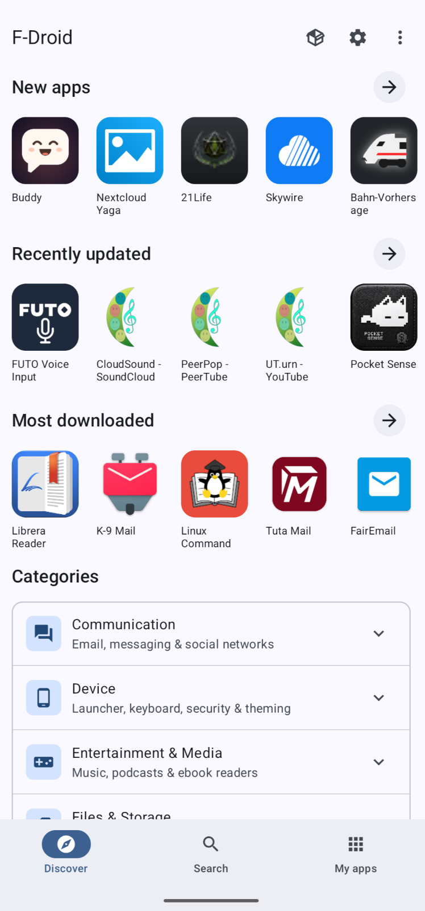<figcaption class="slide-source">F-Droid 2 · Discover</figcaption></figure>

f-droid.org

Note:
Aurora Store gets apps from Google Play without a Google account. microG stands in for Google's background services, on phones set up for it, like /e/OS.

The screenshot is our own, of F-Droid 2's Discover screen (2.0 came out in September 2026). A dark-mode copy is in img/tools/fdroid2-drk.png. The QR opens f-droid.org. Android only; there's no F-Droid for iPhone. Installing it means downloading its app file from f-droid.org and allowing your browser to install it once: say clearly that this app file is trusted because it comes from the official site, unlike one sent in a chat. Every app's code is public, and F-Droid builds most apps from it itself. Aurora Store is an open-source front end to Google Play, on F-Droid: its anonymous login means no Google account, though downloads still come from Google's servers, and signing in with your own Google account there can put that account at risk. microG is an open-source stand-in for Google Play Services, which many apps need; it isn't an app store, and it needs a system built for it (/e/OS, LineageOS for microG), so it belongs with Level 3. GrapheneOS takes a different route, sandboxed Google Play. Apps with ads, tracking or paid parts carry a warning label (F-Droid calls them Anti-Features). Check the install steps on a current Android phone the week of the event.

---

## *End-to-end encrypted* messaging. Almost nothing kept.

<svg class="logo" aria-hidden="true" fill="currentColor" role="img" viewBox="0 0 24 24" xmlns="http://www.w3.org/2000/svg"><path d="M12 0q-.934 0-1.83.139l.17 1.111a11 11 0 0 1 3.32 0l.172-1.111A12 12 0 0 0 12 0M9.152.34A12 12 0 0 0 5.77 1.742l.584.961a10.8 10.8 0 0 1 3.066-1.27zm5.696 0-.268 1.094a10.8 10.8 0 0 1 3.066 1.27l.584-.962A12 12 0 0 0 14.848.34M12 2.25a9.75 9.75 0 0 0-8.539 14.459c.074.134.1.292.064.441l-1.013 4.338 4.338-1.013a.62.62 0 0 1 .441.064A9.7 9.7 0 0 0 12 21.75c5.385 0 9.75-4.365 9.75-9.75S17.385 2.25 12 2.25m-7.092.068a12 12 0 0 0-2.59 2.59l.909.664a11 11 0 0 1 2.345-2.345zm14.184 0-.664.909a11 11 0 0 1 2.345 2.345l.909-.664a12 12 0 0 0-2.59-2.59M1.742 5.77A12 12 0 0 0 .34 9.152l1.094.268a10.8 10.8 0 0 1 1.269-3.066zm20.516 0-.961.584a10.8 10.8 0 0 1 1.27 3.066l1.093-.268a12 12 0 0 0-1.402-3.383M.138 10.168A12 12 0 0 0 0 12q0 .934.139 1.83l1.111-.17A11 11 0 0 1 1.125 12q0-.848.125-1.66zm23.723.002-1.111.17q.125.812.125 1.66c0 .848-.042 1.12-.125 1.66l1.111.172a12.1 12.1 0 0 0 0-3.662M1.434 14.58l-1.094.268a12 12 0 0 0 .96 2.591l-.265 1.14 1.096.255.36-1.539-.188-.365a10.8 10.8 0 0 1-.87-2.35m21.133 0a10.8 10.8 0 0 1-1.27 3.067l.962.584a12 12 0 0 0 1.402-3.383zm-1.793 3.848a11 11 0 0 1-2.345 2.345l.664.909a12 12 0 0 0 2.59-2.59zm-19.959 1.1L.357 21.48a1.8 1.8 0 0 0 2.162 2.161l1.954-.455-.256-1.095-1.953.455a.675.675 0 0 1-.81-.81l.454-1.954zm16.832 1.769a10.8 10.8 0 0 1-3.066 1.27l.268 1.093a12 12 0 0 0 3.382-1.402zm-10.94.213-1.54.36.256 1.095 1.139-.266c.814.415 1.683.74 2.591.961l.268-1.094a10.8 10.8 0 0 1-2.35-.869zm3.634 1.24-.172 1.111a12.1 12.1 0 0 0 3.662 0l-.17-1.111q-.812.125-1.66.125a11 11 0 0 1-1.66-.125"/></svg>
<b>Signal</b>free · about 2 minutes

<svg class="ic" aria-hidden="true" xmlns="http://www.w3.org/2000/svg" viewBox="0 0 24 24" fill="none" stroke="currentColor" stroke-width="2" stroke-linecap="round" stroke-linejoin="round" > <rect width="14" height="20" x="5" y="2" rx="2" ry="2" /> <path d="M12 18h.01" /> </svg>You

<svg class="ic" aria-hidden="true" xmlns="http://www.w3.org/2000/svg" viewBox="0 0 24 24" fill="none" stroke="currentColor" stroke-width="2" stroke-linecap="round" stroke-linejoin="round" > <rect width="18" height="11" x="3" y="11" rx="2" ry="2" /> <path d="M7 11V7a5 5 0 0 1 10 0v4" /> </svg>The server sees<code>x9#Lq…</code>

<svg class="ic" aria-hidden="true" xmlns="http://www.w3.org/2000/svg" viewBox="0 0 24 24" fill="none" stroke="currentColor" stroke-width="2" stroke-linecap="round" stroke-linejoin="round" > <rect width="14" height="20" x="5" y="2" rx="2" ry="2" /> <path d="M12 18h.01" /> </svg>Mama

<svg class="ic" aria-hidden="true" xmlns="http://www.w3.org/2000/svg" viewBox="0 0 24 24" fill="none" stroke="currentColor" stroke-width="2" stroke-linecap="round" stroke-linejoin="round" > <rect width="18" height="11" x="3" y="11" rx="2" ry="2" /> <path d="M7 11V7a5 5 0 0 1 10 0v4" /> </svg>

Locks

Every chat and call

<svg class="ic" aria-hidden="true" xmlns="http://www.w3.org/2000/svg" viewBox="0 0 24 24" fill="none" stroke="currentColor" stroke-width="2" stroke-linecap="round" stroke-linejoin="round" > <ellipse cx="12" cy="5" rx="9" ry="3" /> <path d="M3 5V19A9 3 0 0 0 21 19V5" /> <path d="M3 12A9 3 0 0 0 21 12" /> </svg>

Keeps only

Join date, last connection

<svg class="ic" aria-hidden="true" xmlns="http://www.w3.org/2000/svg" viewBox="0 0 24 24" fill="none" stroke="currentColor" stroke-width="2" stroke-linecap="round" stroke-linejoin="round" > <path d="M10.733 5.076a10.744 10.744 0 0 1 11.205 6.575 1 1 0 0 1 0 .696 10.747 10.747 0 0 1-1.444 2.49" /> <path d="M14.084 14.158a3 3 0 0 1-4.242-4.242" /> <path d="M17.479 17.499a10.75 10.75 0 0 1-15.417-5.151 1 1 0 0 1 0-.696 10.75 10.75 0 0 1 4.446-5.143" /> <path d="m2 2 20 20" /> </svg>

Not kept

Messages, contacts, groups

signal.org/download

Note:
When courts ordered Signal to hand over a user's data, those two dates were all it had. Start with your family's group.

Signal publishes the court orders it receives and its answers at signal.org/bigbrother: each time, the only data it had was the date an account was made and the date it last connected. Be fair to the others: Messenger, WhatsApp and Viber lock chats by default now too (Telegram only in "secret chats"), so the reason to switch is how little Signal collects and keeps, not the lock alone. Stickers, groups, voice and video calls work as you'd expect. Signal can't read profiles either: names and photos are encrypted too. The QR opens Signal's download page, which links to the official app stores. Check signal.org/bigbrother and each app's current default the week of the event.

---

## *Block the ads* and the scam ads go too.

<svg class="logo" aria-hidden="true" fill="currentColor" role="img" viewBox="0 0 24 24" xmlns="http://www.w3.org/2000/svg"><path d="M12 0C7.502 3 6.002 3 1.5 3c0 15.002 0 15.002 10.5 21 10.5-5.998 10.5-5.998 10.5-21-4.498 0-5.998 0-10.5-3zM5.956 7.472h1.512v4.536c0 1.322.19 1.508 1.512 1.508 1.323 0 1.512-.19 1.512-1.512V7.472H12v.767a3.75 3.75 0 012.268-.767 3.79 3.79 0 013.776 3.78 3.79 3.79 0 01-3.78 3.775 3.765 3.764 0 01-2.684-1.133c-.464.77-1.315 1.133-2.6 1.133-2.079 0-3.024-.944-3.024-3.023zm8.308 1.512A2.254 2.254 0 0012 11.252a2.254 2.254 0 002.268 2.264 2.254 2.254 0 002.264-2.268 2.254 2.254 0 00-2.268-2.264z"/></svg>
<b>uBlock Origin</b>free · in your browser · about 5 minutes

<b>Blocks</b>ads, scam ads and trackers

<b>In</b>Firefox; built into LibreWolf

<figure class="ad-shot">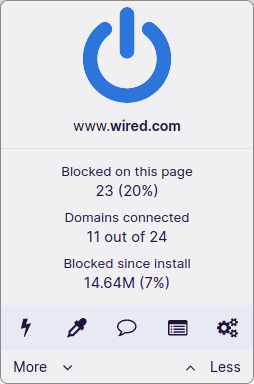<figcaption class="slide-source">uBlock Origin on a news site · GPL-3.0</figcaption></figure>

<svg class="logo" aria-hidden="true" fill="currentColor" role="img" viewBox="0 0 24 24" xmlns="http://www.w3.org/2000/svg"><path d="M4.344 0c.238 4.792 3.256 7.056 6.252 7.376.165-1.692-4.319-5.6-4.319-5.6-.008-.011.009-.025.019-.014 0 0 4.648 4.01 5.423 5.645 2.762-.15 5.196-1.947 5-4.912 0 0-4.12-.613-5 4.618C11.48 2.753 8.993 0 4.344 0zM12 7.682v.002a3.68 3.68 0 0 0-2.591 1.077L4.94 13.227a3.683 3.683 0 0 0-.86 1.356 3.31 3.31 0 0 0-.237 1.255A3.681 3.681 0 0 0 4.92 18.45l4.464 4.466a3.69 3.69 0 0 0 2.251 1.06l.002.001c.093.01.187.015.28.017l-.1-.008c.06.003.117.009.177.009l-.077-.001L12 24l-.004-.005a3.68 3.68 0 0 0 2.61-1.077l4.469-4.465a3.683 3.683 0 0 0 1.006-1.888l.012-.063a3.682 3.682 0 0 0 .057-.541l.003-.061c0-.017.003-.05.004-.06h-.002a3.683 3.683 0 0 0-1.077-2.607l-4.466-4.468a3.694 3.694 0 0 0-1.564-.927l-.07-.02a3.43 3.43 0 0 0-.946-.133L12 7.682zm3.165 3.357c.023 1.748-1.33 3.078-1.33 4.806.164 2.227 1.733 3.207 3.266 3.146-.035.003-.068.007-.104.009-1.847.135-3.209-1.326-5.002-1.326-2.23.164-3.21 1.736-3.147 3.27l-.008-.104c-.133-1.847 1.328-3.21 1.328-5.002-.173-2.32-1.867-3.284-3.46-3.132.1-.011.203-.021.31-.027 1.847-.133 3.209 1.328 5.002 1.328 2.082-.155 3.074-1.536 3.145-2.968zM4.344 0c.238 4.792 3.256 7.056 6.252 7.376.165-1.692-4.319-5.6-4.319-5.6-.008-.011.009-.025.019-.014 0 0 4.648 4.01 5.423 5.645 2.762-.15 5.196-1.947 5-4.912 0 0-4.12-.613-5 4.618C11.48 2.753 8.993 0 4.344 0zM12 7.682v.002a3.68 3.68 0 0 0-2.591 1.077L4.94 13.227a3.683 3.683 0 0 0-.86 1.356 3.31 3.31 0 0 0-.237 1.255A3.681 3.681 0 0 0 4.92 18.45l4.464 4.466a3.69 3.69 0 0 0 2.251 1.06l.002.001c.093.01.187.015.28.017l-.1-.008c.06.003.117.009.177.009l-.077-.001L12 24l-.004-.005a3.68 3.68 0 0 0 2.61-1.077l4.469-4.465a3.683 3.683 0 0 0 1.006-1.888l.012-.063a3.682 3.682 0 0 0 .057-.541l.003-.061c0-.017.003-.05.004-.06h-.002a3.683 3.683 0 0 0-1.077-2.607l-4.466-4.468a3.694 3.694 0 0 0-1.564-.927l-.07-.02a3.43 3.43 0 0 0-.946-.133L12 7.682zm3.165 3.357c.023 1.748-1.33 3.078-1.33 4.806.164 2.227 1.733 3.207 3.266 3.146-.035.003-.068.007-.104.009-1.847.135-3.209-1.326-5.002-1.326-2.23.164-3.21 1.736-3.147 3.27l-.008-.104c-.133-1.847 1.328-3.21 1.328-5.002-.173-2.32-1.867-3.284-3.46-3.132.1-.011.203-.021.31-.027 1.847-.133 3.209 1.328 5.002 1.328 2.082-.155 3.074-1.536 3.145-2.968z"/></svg>
<b>Pi-hole</b>free · DIY · for the whole house

<b>Blocks</b>ads on every device on your Wi-Fi

<b>Runs on</b>a Raspberry Pi at home

<figure class="ad-shot wide">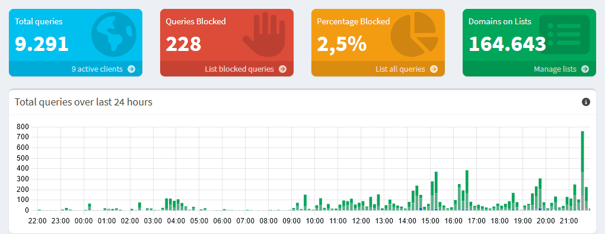<figcaption class="slide-source">Pi-hole's dashboard · MIT</figcaption></figure>

Note:
Scam ads and fake download buttons go with the ordinary ads. Pi-hole covers phones and TVs too.

The screenshot is from uBlock Origin's own README: one news page, 23 requests blocked. uBlock Origin runs fully in Firefox and its relatives; Chrome now allows only the lighter uBlock Origin Lite. Pi-hole is the DIY option for a household: a Raspberry Pi that blocks ads on every device on the network. The Pi-hole screenshot is Pi-hole's own (version 6 dashboard, github.com/pi-hole/graphics, MIT), cropped to its counters and the 24-hour chart. Check both the week of the event.

---

## *Browse* without being profiled.

<i></i><i></i><i></i><svg class="logo" aria-hidden="true" fill="currentColor" role="img" viewBox="0 0 24 24" xmlns="http://www.w3.org/2000/svg"><path d="M12 0C5.3726 0 0 5.3726 0 12s5.3726 12 12 12 12-5.3726 12-12A12 12 0 0 0 12 0m.0306 2.4174c2.539 0 4.7927.9097 6.619 2.6718.8799.849 1.47 1.654 1.9752 2.6953.6834 1.4085.96 2.6337.96 4.2503 0 2.1282-.6144 3.9841-1.891 5.7107-.3792.513-1.1202 1.2925-1.612 1.6955-1.3487 1.1057-3.068 1.8537-4.7739 2.0774-.5894.0772-1.982.0868-2.5232.0174v.0001c-1.681-.2156-3.2887-.8859-4.6919-1.9555-.4576-.3489-1.3163-1.213-1.6911-1.702-1.0497-1.3694-1.7025-2.9237-1.9179-4.5663-.0922-.7032-.0916-1.996.0011-2.6387.4635-3.213 2.4855-5.9688 5.389-7.3449 1.3505-.64 2.5868-.9111 4.1567-.9111m-.0315 1.4514c-1.4755-.0014-2.7693.3367-4.0497 1.0586-1.1657.6572-2.3708 1.8637-3.0308 3.0342-.486.862-.8417 1.8852-.9806 2.82-.091.613-.0929 1.8301-.0036 2.417.1786 1.1746.6241 2.3354 1.27 3.3091.3527.5317.3416.5259.6528.3479.5566-.3184.7018-.4726 1.005-1.0666.3546-.6946.7336-1.3016 1.0762-1.7232.3953-.4867.4496-.5732.648-1.0327.0997-.2312.2788-.5708.3978-.7546l.2165-.3341-.28-.2753c-.372-.3655-.6814-.7802-.7395-.991-.0595-.2152.0108-.3353.2902-.4967.2825-.1632.4845-.21 1.2396-.2877.3677-.0377.7668-.1069.8925-.1547.125-.0475.4988-.251.8305-.452.9577-.5807 1.0388-.6107 1.613-.5983.485.0106.4859.0103.7734-.1635.6026-.3642 1.4681-1.0215 2.607-1.9797.2183-.1838.4286-.328.4674-.3206.161.031.457.757.5019 1.2315.0272.2878-.0285.5725-.1992 1.018-.0466.1215-.068.2375-.0477.2577.0489.0486.2165-.1607.2165-.2703 0-.1397.0924-.1557.2182-.0377.0915.0859.1705.1105.3545.1105.201 0 .2507.0186.329.1232.1332.1775.1644.6616.0625.9682-.099.2983-.3986.6423-.6704.77-.2431.1143-.7354.5951-.9658.9432-.0882.1332-.2536.411-.3675.6172-.114.2063-.305.518-.4246.6925-.2354.3436-.437.823-.6316 1.5017-.1143.3987-.1238.5025-.1285 1.3918-.0057 1.0742-.0613 1.3378-.3518 1.6686-.3301.376-.6596 1.2018-.6873 1.7225-.0175.3286-.0682.649-.1401.8862-.0317.1045.0275.1032.38-.0079 1.027-.3237 1.8638-.7588 2.6718-1.3889.4296-.335 1.1722-1.0847 1.4835-1.4978.8445-1.1202 1.419-2.5235 1.5881-3.8785.0814-.6526.0342-2.0332-.0901-2.6325-.3293-1.5875-1.039-2.9284-2.1566-4.0759-.6968-.7154-1.3311-1.187-2.1473-1.5961-1.2384-.621-2.2994-.8718-3.6932-.8733m1.516 5.314-.6964.0976-.433.5544.6966-.0978z"/></svg>LibreWolf

<svg class="ic" aria-hidden="true" xmlns="http://www.w3.org/2000/svg" viewBox="0 0 24 24" fill="none" stroke="currentColor" stroke-width="2" stroke-linecap="round" stroke-linejoin="round" > <rect width="18" height="11" x="3" y="11" rx="2" ry="2" /> <path d="M7 11V7a5 5 0 0 1 10 0v4" /> </svg>news.example<svg class="logo" aria-hidden="true" fill="currentColor" role="img" viewBox="0 0 24 24" xmlns="http://www.w3.org/2000/svg"><path d="M12 0C7.502 3 6.002 3 1.5 3c0 15.002 0 15.002 10.5 21 10.5-5.998 10.5-5.998 10.5-21-4.498 0-5.998 0-10.5-3zM5.956 7.472h1.512v4.536c0 1.322.19 1.508 1.512 1.508 1.323 0 1.512-.19 1.512-1.512V7.472H12v.767a3.75 3.75 0 012.268-.767 3.79 3.79 0 013.776 3.78 3.79 3.79 0 01-3.78 3.775 3.765 3.764 0 01-2.684-1.133c-.464.77-1.315 1.133-2.6 1.133-2.079 0-3.024-.944-3.024-3.023zm8.308 1.512A2.254 2.254 0 0012 11.252a2.254 2.254 0 002.268 2.264 2.254 2.254 0 002.264-2.268 2.254 2.254 0 00-2.268-2.264z"/></svg><b>23</b>

<svg class="logo" aria-hidden="true" fill="currentColor" role="img" viewBox="0 0 24 24" xmlns="http://www.w3.org/2000/svg"><path d="M12 0C7.502 3 6.002 3 1.5 3c0 15.002 0 15.002 10.5 21 10.5-5.998 10.5-5.998 10.5-21-4.498 0-5.998 0-10.5-3zM5.956 7.472h1.512v4.536c0 1.322.19 1.508 1.512 1.508 1.323 0 1.512-.19 1.512-1.512V7.472H12v.767a3.75 3.75 0 012.268-.767 3.79 3.79 0 013.776 3.78 3.79 3.79 0 01-3.78 3.775 3.765 3.764 0 01-2.684-1.133c-.464.77-1.315 1.133-2.6 1.133-2.079 0-3.024-.944-3.024-3.023zm8.308 1.512A2.254 2.254 0 0012 11.252a2.254 2.254 0 002.268 2.264 2.254 2.254 0 002.264-2.268 2.254 2.254 0 00-2.268-2.264z"/></svg>uBlock Origin, built in

<svg class="logo" aria-hidden="true" fill="currentColor" role="img" viewBox="0 0 24 24" xmlns="http://www.w3.org/2000/svg"><path d="M12 0C5.3726 0 0 5.3726 0 12s5.3726 12 12 12 12-5.3726 12-12A12 12 0 0 0 12 0m.0306 2.4174c2.539 0 4.7927.9097 6.619 2.6718.8799.849 1.47 1.654 1.9752 2.6953.6834 1.4085.96 2.6337.96 4.2503 0 2.1282-.6144 3.9841-1.891 5.7107-.3792.513-1.1202 1.2925-1.612 1.6955-1.3487 1.1057-3.068 1.8537-4.7739 2.0774-.5894.0772-1.982.0868-2.5232.0174v.0001c-1.681-.2156-3.2887-.8859-4.6919-1.9555-.4576-.3489-1.3163-1.213-1.6911-1.702-1.0497-1.3694-1.7025-2.9237-1.9179-4.5663-.0922-.7032-.0916-1.996.0011-2.6387.4635-3.213 2.4855-5.9688 5.389-7.3449 1.3505-.64 2.5868-.9111 4.1567-.9111m-.0315 1.4514c-1.4755-.0014-2.7693.3367-4.0497 1.0586-1.1657.6572-2.3708 1.8637-3.0308 3.0342-.486.862-.8417 1.8852-.9806 2.82-.091.613-.0929 1.8301-.0036 2.417.1786 1.1746.6241 2.3354 1.27 3.3091.3527.5317.3416.5259.6528.3479.5566-.3184.7018-.4726 1.005-1.0666.3546-.6946.7336-1.3016 1.0762-1.7232.3953-.4867.4496-.5732.648-1.0327.0997-.2312.2788-.5708.3978-.7546l.2165-.3341-.28-.2753c-.372-.3655-.6814-.7802-.7395-.991-.0595-.2152.0108-.3353.2902-.4967.2825-.1632.4845-.21 1.2396-.2877.3677-.0377.7668-.1069.8925-.1547.125-.0475.4988-.251.8305-.452.9577-.5807 1.0388-.6107 1.613-.5983.485.0106.4859.0103.7734-.1635.6026-.3642 1.4681-1.0215 2.607-1.9797.2183-.1838.4286-.328.4674-.3206.161.031.457.757.5019 1.2315.0272.2878-.0285.5725-.1992 1.018-.0466.1215-.068.2375-.0477.2577.0489.0486.2165-.1607.2165-.2703 0-.1397.0924-.1557.2182-.0377.0915.0859.1705.1105.3545.1105.201 0 .2507.0186.329.1232.1332.1775.1644.6616.0625.9682-.099.2983-.3986.6423-.6704.77-.2431.1143-.7354.5951-.9658.9432-.0882.1332-.2536.411-.3675.6172-.114.2063-.305.518-.4246.6925-.2354.3436-.437.823-.6316 1.5017-.1143.3987-.1238.5025-.1285 1.3918-.0057 1.0742-.0613 1.3378-.3518 1.6686-.3301.376-.6596 1.2018-.6873 1.7225-.0175.3286-.0682.649-.1401.8862-.0317.1045.0275.1032.38-.0079 1.027-.3237 1.8638-.7588 2.6718-1.3889.4296-.335 1.1722-1.0847 1.4835-1.4978.8445-1.1202 1.419-2.5235 1.5881-3.8785.0814-.6526.0342-2.0332-.0901-2.6325-.3293-1.5875-1.039-2.9284-2.1566-4.0759-.6968-.7154-1.3311-1.187-2.1473-1.5961-1.2384-.621-2.2994-.8718-3.6932-.8733m1.516 5.314-.6964.0976-.433.5544.6966-.0978z"/></svg>LibreWolf

Firefox, set up for privacy

Computer

<i></i><i></i><i></i><svg class="logo" aria-hidden="true" fill="currentColor" role="img" viewBox="0 0 24 24" xmlns="http://www.w3.org/2000/svg"><path d="M8.824 7.287c.008 0 .004 0 0 0zm-2.8-1.4c.006 0 .003 0 0 0zm16.754 2.161c-.505-1.215-1.53-2.528-2.333-2.943.654 1.283 1.033 2.57 1.177 3.53l.002.02c-1.314-3.278-3.544-4.6-5.366-7.477-.091-.147-.184-.292-.273-.446a3.545 3.545 0 01-.13-.24 2.118 2.118 0 01-.172-.46.03.03 0 00-.027-.03.038.038 0 00-.021 0l-.006.001a.037.037 0 00-.01.005L15.624 0c-2.585 1.515-3.657 4.168-3.932 5.856a6.197 6.197 0 00-2.305.587.297.297 0 00-.147.37c.057.162.24.24.396.17a5.622 5.622 0 012.008-.523l.067-.005a5.847 5.847 0 011.957.222l.095.03a5.816 5.816 0 01.616.228c.08.036.16.073.238.112l.107.055a5.835 5.835 0 01.368.211 5.953 5.953 0 012.034 2.104c-.62-.437-1.733-.868-2.803-.681 4.183 2.09 3.06 9.292-2.737 9.02a5.164 5.164 0 01-1.513-.292 4.42 4.42 0 01-.538-.232c-1.42-.735-2.593-2.121-2.74-3.806 0 0 .537-2 3.845-2 .357 0 1.38-.998 1.398-1.287-.005-.095-2.029-.9-2.817-1.677-.422-.416-.622-.616-.8-.767a3.47 3.47 0 00-.301-.227 5.388 5.388 0 01-.032-2.842c-1.195.544-2.124 1.403-2.8 2.163h-.006c-.46-.584-.428-2.51-.402-2.913-.006-.025-.343.176-.389.206-.406.29-.787.616-1.136.974-.397.403-.76.839-1.085 1.303a9.816 9.816 0 00-1.562 3.52c-.003.013-.11.487-.19 1.073-.013.09-.026.181-.037.272a7.8 7.8 0 00-.069.667l-.002.034-.023.387-.001.06C.386 18.795 5.593 24 12.016 24c5.752 0 10.527-4.176 11.463-9.661.02-.149.035-.298.052-.448.232-1.994-.025-4.09-.753-5.844z"/></svg>Firefox

<svg class="ic" aria-hidden="true" xmlns="http://www.w3.org/2000/svg" viewBox="0 0 24 24" fill="none" stroke="currentColor" stroke-width="2" stroke-linecap="round" stroke-linejoin="round" > <rect width="18" height="11" x="3" y="11" rx="2" ry="2" /> <path d="M7 11V7a5 5 0 0 1 10 0v4" /> </svg>news.example<svg class="ic" aria-hidden="true" xmlns="http://www.w3.org/2000/svg" viewBox="0 0 24 24" fill="none" stroke="currentColor" stroke-width="2" stroke-linecap="round" stroke-linejoin="round" > <path d="M15.39 4.39a1 1 0 0 0 1.68-.474 2.5 2.5 0 1 1 3.014 3.015 1 1 0 0 0-.474 1.68l1.683 1.682a2.414 2.414 0 0 1 0 3.414L19.61 15.39a1 1 0 0 1-1.68-.474 2.5 2.5 0 1 0-3.014 3.015 1 1 0 0 1 .474 1.68l-1.683 1.682a2.414 2.414 0 0 1-3.414 0L8.61 19.61a1 1 0 0 0-1.68.474 2.5 2.5 0 1 1-3.014-3.015 1 1 0 0 0 .474-1.68l-1.683-1.682a2.414 2.414 0 0 1 0-3.414L4.39 8.61a1 1 0 0 1 1.68.474 2.5 2.5 0 1 0 3.014-3.015 1 1 0 0 1-.474-1.68l1.683-1.682a2.414 2.414 0 0 1 3.414 0z" /> </svg>

<svg class="logo" aria-hidden="true" fill="currentColor" role="img" viewBox="0 0 24 24" xmlns="http://www.w3.org/2000/svg"><path d="M12 0C7.502 3 6.002 3 1.5 3c0 15.002 0 15.002 10.5 21 10.5-5.998 10.5-5.998 10.5-21-4.498 0-5.998 0-10.5-3zM5.956 7.472h1.512v4.536c0 1.322.19 1.508 1.512 1.508 1.323 0 1.512-.19 1.512-1.512V7.472H12v.767a3.75 3.75 0 012.268-.767 3.79 3.79 0 013.776 3.78 3.79 3.79 0 01-3.78 3.775 3.765 3.764 0 01-2.684-1.133c-.464.77-1.315 1.133-2.6 1.133-2.079 0-3.024-.944-3.024-3.023zm8.308 1.512A2.254 2.254 0 0012 11.252a2.254 2.254 0 002.268 2.264 2.254 2.254 0 002.264-2.268 2.254 2.254 0 00-2.268-2.264z"/></svg>uBlock Origin<em>Add</em>

<svg class="logo" aria-hidden="true" fill="currentColor" role="img" viewBox="0 0 24 24" xmlns="http://www.w3.org/2000/svg"><path d="M8.824 7.287c.008 0 .004 0 0 0zm-2.8-1.4c.006 0 .003 0 0 0zm16.754 2.161c-.505-1.215-1.53-2.528-2.333-2.943.654 1.283 1.033 2.57 1.177 3.53l.002.02c-1.314-3.278-3.544-4.6-5.366-7.477-.091-.147-.184-.292-.273-.446a3.545 3.545 0 01-.13-.24 2.118 2.118 0 01-.172-.46.03.03 0 00-.027-.03.038.038 0 00-.021 0l-.006.001a.037.037 0 00-.01.005L15.624 0c-2.585 1.515-3.657 4.168-3.932 5.856a6.197 6.197 0 00-2.305.587.297.297 0 00-.147.37c.057.162.24.24.396.17a5.622 5.622 0 012.008-.523l.067-.005a5.847 5.847 0 011.957.222l.095.03a5.816 5.816 0 01.616.228c.08.036.16.073.238.112l.107.055a5.835 5.835 0 01.368.211 5.953 5.953 0 012.034 2.104c-.62-.437-1.733-.868-2.803-.681 4.183 2.09 3.06 9.292-2.737 9.02a5.164 5.164 0 01-1.513-.292 4.42 4.42 0 01-.538-.232c-1.42-.735-2.593-2.121-2.74-3.806 0 0 .537-2 3.845-2 .357 0 1.38-.998 1.398-1.287-.005-.095-2.029-.9-2.817-1.677-.422-.416-.622-.616-.8-.767a3.47 3.47 0 00-.301-.227 5.388 5.388 0 01-.032-2.842c-1.195.544-2.124 1.403-2.8 2.163h-.006c-.46-.584-.428-2.51-.402-2.913-.006-.025-.343.176-.389.206-.406.29-.787.616-1.136.974-.397.403-.76.839-1.085 1.303a9.816 9.816 0 00-1.562 3.52c-.003.013-.11.487-.19 1.073-.013.09-.026.181-.037.272a7.8 7.8 0 00-.069.667l-.002.034-.023.387-.001.06C.386 18.795 5.593 24 12.016 24c5.752 0 10.527-4.176 11.463-9.661.02-.149.035-.298.052-.448.232-1.994-.025-4.09-.753-5.844z"/></svg>Firefox

From a nonprofit; add uBlock Origin

Phone · computer

<i></i><i></i><i></i><svg class="logo" aria-hidden="true" fill="currentColor" role="img" viewBox="0 0 24 24" xmlns="http://www.w3.org/2000/svg"><path d="M15.68 0l2.096 2.38s1.84-.512 2.709.358c.868.87 1.584 1.638 1.584 1.638l-.562 1.381.715 2.047s-2.104 7.98-2.35 8.955c-.486 1.919-.818 2.66-2.198 3.633-1.38.972-3.884 2.66-4.293 2.916-.409.256-.92.692-1.38.692-.46 0-.97-.436-1.38-.692a185.796 185.796 0 01-4.293-2.916c-1.38-.973-1.712-1.714-2.197-3.633-.247-.975-2.351-8.955-2.351-8.955l.715-2.047-.562-1.381s.716-.768 1.585-1.638c.868-.87 2.708-.358 2.708-.358L8.321 0h7.36zm-3.679 14.936c-.14 0-1.038.317-1.758.69-.72.373-1.242.637-1.409.742-.167.104-.065.301.087.409.152.107 2.194 1.69 2.393 1.866.198.175.489.464.687.464.198 0 .49-.29.688-.464.198-.175 2.24-1.759 2.392-1.866.152-.108.254-.305.087-.41-.167-.104-.689-.368-1.41-.741-.72-.373-1.617-.69-1.757-.69zm0-11.278s-.409.001-1.022.206-1.278.46-1.584.46c-.307 0-2.581-.434-2.581-.434S4.119 7.152 4.119 7.849c0 .697.339.881.68 1.243l2.02 2.149c.192.203.59.511.356 1.066-.235.555-.58 1.26-.196 1.977.384.716 1.042 1.194 1.464 1.115.421-.08 1.412-.598 1.776-.834.364-.237 1.518-1.19 1.518-1.554 0-.365-1.193-1.02-1.413-1.168-.22-.15-1.226-.725-1.247-.95-.02-.227-.012-.293.284-.851.297-.559.831-1.304.742-1.8-.089-.495-.95-.753-1.565-.986-.615-.232-1.799-.671-1.947-.74-.148-.068-.11-.133.339-.175.448-.043 1.719-.212 2.292-.052.573.16 1.552.403 1.632.532.079.13.149.134.067.579-.081.445-.5 2.581-.541 2.96-.04.38-.12.63.288.724.409.094 1.097.256 1.333.256s.924-.162 1.333-.256c.408-.093.329-.344.288-.723-.04-.38-.46-2.516-.541-2.961-.082-.445-.012-.45.067-.579.08-.129 1.059-.372 1.632-.532.573-.16 1.845.009 2.292.052.449.042.487.107.339.175-.148.069-1.332.508-1.947.74-.615.233-1.476.49-1.565.986-.09.496.445 1.241.742 1.8.297.558.304.624.284.85-.02.226-1.026.802-1.247.95-.22.15-1.413.804-1.413 1.169 0 .364 1.154 1.317 1.518 1.554.364.236 1.355.755 1.776.834.422.079 1.08-.4 1.464-1.115.384-.716.039-1.422-.195-1.977-.235-.555.163-.863.355-1.066l2.02-2.149c.341-.362.68-.546.68-1.243 0-.697-2.695-3.96-2.695-3.96s-2.274.436-2.58.436c-.307 0-.972-.256-1.585-.461-.613-.205-1.022-.206-1.022-.206z"/></svg>Brave

<svg class="ic" aria-hidden="true" xmlns="http://www.w3.org/2000/svg" viewBox="0 0 24 24" fill="none" stroke="currentColor" stroke-width="2" stroke-linecap="round" stroke-linejoin="round" > <rect width="18" height="11" x="3" y="11" rx="2" ry="2" /> <path d="M7 11V7a5 5 0 0 1 10 0v4" /> </svg>news.example<svg class="logo" aria-hidden="true" fill="currentColor" role="img" viewBox="0 0 24 24" xmlns="http://www.w3.org/2000/svg"><path d="M15.68 0l2.096 2.38s1.84-.512 2.709.358c.868.87 1.584 1.638 1.584 1.638l-.562 1.381.715 2.047s-2.104 7.98-2.35 8.955c-.486 1.919-.818 2.66-2.198 3.633-1.38.972-3.884 2.66-4.293 2.916-.409.256-.92.692-1.38.692-.46 0-.97-.436-1.38-.692a185.796 185.796 0 01-4.293-2.916c-1.38-.973-1.712-1.714-2.197-3.633-.247-.975-2.351-8.955-2.351-8.955l.715-2.047-.562-1.381s.716-.768 1.585-1.638c.868-.87 2.708-.358 2.708-.358L8.321 0h7.36zm-3.679 14.936c-.14 0-1.038.317-1.758.69-.72.373-1.242.637-1.409.742-.167.104-.065.301.087.409.152.107 2.194 1.69 2.393 1.866.198.175.489.464.687.464.198 0 .49-.29.688-.464.198-.175 2.24-1.759 2.392-1.866.152-.108.254-.305.087-.41-.167-.104-.689-.368-1.41-.741-.72-.373-1.617-.69-1.757-.69zm0-11.278s-.409.001-1.022.206-1.278.46-1.584.46c-.307 0-2.581-.434-2.581-.434S4.119 7.152 4.119 7.849c0 .697.339.881.68 1.243l2.02 2.149c.192.203.59.511.356 1.066-.235.555-.58 1.26-.196 1.977.384.716 1.042 1.194 1.464 1.115.421-.08 1.412-.598 1.776-.834.364-.237 1.518-1.19 1.518-1.554 0-.365-1.193-1.02-1.413-1.168-.22-.15-1.226-.725-1.247-.95-.02-.227-.012-.293.284-.851.297-.559.831-1.304.742-1.8-.089-.495-.95-.753-1.565-.986-.615-.232-1.799-.671-1.947-.74-.148-.068-.11-.133.339-.175.448-.043 1.719-.212 2.292-.052.573.16 1.552.403 1.632.532.079.13.149.134.067.579-.081.445-.5 2.581-.541 2.96-.04.38-.12.63.288.724.409.094 1.097.256 1.333.256s.924-.162 1.333-.256c.408-.093.329-.344.288-.723-.04-.38-.46-2.516-.541-2.961-.082-.445-.012-.45.067-.579.08-.129 1.059-.372 1.632-.532.573-.16 1.845.009 2.292.052.449.042.487.107.339.175-.148.069-1.332.508-1.947.74-.615.233-1.476.49-1.565.986-.09.496.445 1.241.742 1.8.297.558.304.624.284.85-.02.226-1.026.802-1.247.95-.22.15-1.413.804-1.413 1.169 0 .364 1.154 1.317 1.518 1.554.364.236 1.355.755 1.776.834.422.079 1.08-.4 1.464-1.115.384-.716.039-1.422-.195-1.977-.235-.555.163-.863.355-1.066l2.02-2.149c.341-.362.68-.546.68-1.243 0-.697-2.695-3.96-2.695-3.96s-2.274.436-2.58.436c-.307 0-.972-.256-1.585-.461-.613-.205-1.022-.206-1.022-.206z"/></svg><b>23</b>

<svg class="ic" aria-hidden="true" xmlns="http://www.w3.org/2000/svg" viewBox="0 0 24 24" fill="none" stroke="currentColor" stroke-width="2" stroke-linecap="round" stroke-linejoin="round" > <path d="M20 13c0 5-3.5 7.5-7.66 8.95a1 1 0 0 1-.67-.01C7.5 20.5 4 18 4 13V6a1 1 0 0 1 1-1c2 0 4.5-1.2 6.24-2.72a1.17 1.17 0 0 1 1.52 0C14.51 3.81 17 5 19 5a1 1 0 0 1 1 1z" /> <path d="m9 12 2 2 4-4" /> </svg>Shields up · 23 blocked

<svg class="logo" aria-hidden="true" fill="currentColor" role="img" viewBox="0 0 24 24" xmlns="http://www.w3.org/2000/svg"><path d="M15.68 0l2.096 2.38s1.84-.512 2.709.358c.868.87 1.584 1.638 1.584 1.638l-.562 1.381.715 2.047s-2.104 7.98-2.35 8.955c-.486 1.919-.818 2.66-2.198 3.633-1.38.972-3.884 2.66-4.293 2.916-.409.256-.92.692-1.38.692-.46 0-.97-.436-1.38-.692a185.796 185.796 0 01-4.293-2.916c-1.38-.973-1.712-1.714-2.197-3.633-.247-.975-2.351-8.955-2.351-8.955l.715-2.047-.562-1.381s.716-.768 1.585-1.638c.868-.87 2.708-.358 2.708-.358L8.321 0h7.36zm-3.679 14.936c-.14 0-1.038.317-1.758.69-.72.373-1.242.637-1.409.742-.167.104-.065.301.087.409.152.107 2.194 1.69 2.393 1.866.198.175.489.464.687.464.198 0 .49-.29.688-.464.198-.175 2.24-1.759 2.392-1.866.152-.108.254-.305.087-.41-.167-.104-.689-.368-1.41-.741-.72-.373-1.617-.69-1.757-.69zm0-11.278s-.409.001-1.022.206-1.278.46-1.584.46c-.307 0-2.581-.434-2.581-.434S4.119 7.152 4.119 7.849c0 .697.339.881.68 1.243l2.02 2.149c.192.203.59.511.356 1.066-.235.555-.58 1.26-.196 1.977.384.716 1.042 1.194 1.464 1.115.421-.08 1.412-.598 1.776-.834.364-.237 1.518-1.19 1.518-1.554 0-.365-1.193-1.02-1.413-1.168-.22-.15-1.226-.725-1.247-.95-.02-.227-.012-.293.284-.851.297-.559.831-1.304.742-1.8-.089-.495-.95-.753-1.565-.986-.615-.232-1.799-.671-1.947-.74-.148-.068-.11-.133.339-.175.448-.043 1.719-.212 2.292-.052.573.16 1.552.403 1.632.532.079.13.149.134.067.579-.081.445-.5 2.581-.541 2.96-.04.38-.12.63.288.724.409.094 1.097.256 1.333.256s.924-.162 1.333-.256c.408-.093.329-.344.288-.723-.04-.38-.46-2.516-.541-2.961-.082-.445-.012-.45.067-.579.08-.129 1.059-.372 1.632-.532.573-.16 1.845.009 2.292.052.449.042.487.107.339.175-.148.069-1.332.508-1.947.74-.615.233-1.476.49-1.565.986-.09.496.445 1.241.742 1.8.297.558.304.624.284.85-.02.226-1.026.802-1.247.95-.22.15-1.413.804-1.413 1.169 0 .364 1.154 1.317 1.518 1.554.364.236 1.355.755 1.776.834.422.079 1.08-.4 1.464-1.115.384-.716.039-1.422-.195-1.977-.235-.555.163-.863.355-1.066l2.02-2.149c.341-.362.68-.546.68-1.243 0-.697-2.695-3.96-2.695-3.96s-2.274.436-2.58.436c-.307 0-.972-.256-1.585-.461-.613-.205-1.022-.206-1.022-.206z"/></svg>Brave

Blocks ads by itself

Phone · computer

<i></i><i></i><i></i><svg class="logo" aria-hidden="true" fill="currentColor" role="img" viewBox="0 0 24 24" xmlns="http://www.w3.org/2000/svg"><path d="M12 0C6.75 0 3.817 0 1.912 1.904.007 3.81 0 6.75 0 12s0 8.175 1.912 10.08C3.825 23.985 6.75 24 12 24c5.25 0 8.183 0 10.088-1.904C23.993 20.19 24 17.25 24 12s0-8.175-1.912-10.08C20.175.015 17.25 0 12 0zm-.168 3a9 9 0 016.49 2.648 9 9 0 010 12.704A9 9 0 1111.832 3zM7.568 7.496a1.433 1.433 0 00-.142.004A1.5 1.5 0 006.21 9.75l1.701 3c.93 1.582 1.839 3.202 2.791 4.822a1.417 1.417 0 001.41.75 1.5 1.5 0 001.223-.81l4.447-7.762A1.56 1.56 0 0018 8.768a1.5 1.5 0 10-2.828.914 2.513 2.513 0 01.256 1.119v.246a2.393 2.393 0 01-2.52 2.13 2.348 2.348 0 01-1.965-1.214c-.307-.51-.6-1.035-.9-1.553-.42-.72-.826-1.41-1.246-2.16a1.433 1.433 0 00-1.229-.754Z"/></svg>Vivaldi

<svg class="ic" aria-hidden="true" xmlns="http://www.w3.org/2000/svg" viewBox="0 0 24 24" fill="none" stroke="currentColor" stroke-width="2" stroke-linecap="round" stroke-linejoin="round" > <rect width="18" height="11" x="3" y="11" rx="2" ry="2" /> <path d="M7 11V7a5 5 0 0 1 10 0v4" /> </svg>news.example<svg class="ic" aria-hidden="true" xmlns="http://www.w3.org/2000/svg" viewBox="0 0 24 24" fill="none" stroke="currentColor" stroke-width="2" stroke-linecap="round" stroke-linejoin="round" > <path d="M20 13c0 5-3.5 7.5-7.66 8.95a1 1 0 0 1-.67-.01C7.5 20.5 4 18 4 13V6a1 1 0 0 1 1-1c2 0 4.5-1.2 6.24-2.72a1.17 1.17 0 0 1 1.52 0C14.51 3.81 17 5 19 5a1 1 0 0 1 1 1z" /> <path d="m9 12 2 2 4-4" /> </svg>

<i></i><i></i><i></i><i></i>

<svg class="ic" aria-hidden="true" xmlns="http://www.w3.org/2000/svg" viewBox="0 0 24 24" fill="none" stroke="currentColor" stroke-width="2" stroke-linecap="round" stroke-linejoin="round" > <path d="M20 13c0 5-3.5 7.5-7.66 8.95a1 1 0 0 1-.67-.01C7.5 20.5 4 18 4 13V6a1 1 0 0 1 1-1c2 0 4.5-1.2 6.24-2.72a1.17 1.17 0 0 1 1.52 0C14.51 3.81 17 5 19 5a1 1 0 0 1 1 1z" /> <path d="m9 12 2 2 4-4" /> </svg>Ads and trackers blocked

<svg class="logo" aria-hidden="true" fill="currentColor" role="img" viewBox="0 0 24 24" xmlns="http://www.w3.org/2000/svg"><path d="M12 0C6.75 0 3.817 0 1.912 1.904.007 3.81 0 6.75 0 12s0 8.175 1.912 10.08C3.825 23.985 6.75 24 12 24c5.25 0 8.183 0 10.088-1.904C23.993 20.19 24 17.25 24 12s0-8.175-1.912-10.08C20.175.015 17.25 0 12 0zm-.168 3a9 9 0 016.49 2.648 9 9 0 010 12.704A9 9 0 1111.832 3zM7.568 7.496a1.433 1.433 0 00-.142.004A1.5 1.5 0 006.21 9.75l1.701 3c.93 1.582 1.839 3.202 2.791 4.822a1.417 1.417 0 001.41.75 1.5 1.5 0 001.223-.81l4.447-7.762A1.56 1.56 0 0018 8.768a1.5 1.5 0 10-2.828.914 2.513 2.513 0 01.256 1.119v.246a2.393 2.393 0 01-2.52 2.13 2.348 2.348 0 01-1.965-1.214c-.307-.51-.6-1.035-.9-1.553-.42-.72-.826-1.41-1.246-2.16a1.433 1.433 0 00-1.229-.754Z"/></svg>Vivaldi

Built-in ad and tracker blocker

Phone · computer

Note:
They replace Chrome. Firefox brings your bookmarks and passwords across.

A browser that doesn't profile you has less to sell and less to leak. The four windows are drawings, not screenshots: each shows what sets that browser apart. Firefox, Brave and Vivaldi work on phones too; LibreWolf is for computers. Brave has its own optional ads and crypto wallet: say it can be switched off. Check each browser's current features the week of the event.

---

## *Search* without being profiled.

<svg class="logo" aria-hidden="true" fill="currentColor" role="img" viewBox="0 0 24 24" xmlns="http://www.w3.org/2000/svg"><path d="M12 0C5.373 0 0 5.373 0 12s5.373 12 12 12 12-5.373 12-12S18.627 0 12 0zm0 23C5.925 23 1 18.074 1 12S5.926 1 12 1s11 4.925 11 11-4.925 11-11 11zm10.219-11c0 4.805-3.317 8.833-7.786 9.925-.27-.521-.53-1.017-.749-1.438.645.249 1.93.718 2.208.615.376-.144.282-3.149-.14-3.245-.338-.075-1.632.837-2.141 1.209l.034.156c.078.397.144.993.03 1.247-.001.004-.002.01-.004.013a.218.218 0 0 1-.068.088c-.284.188-1.081.284-1.503.188a.516.516 0 0 1-.064-.02c-.694.396-2.01 1.109-2.25.971-.329-.188-.377-2.676-.329-3.288.035-.46 1.653.286 2.442.679.174-.163.602-.272.98-.31-.57-1.389-.99-2.977-.733-4.105 0 .002.002.002.002.002.356.248 2.73 1.05 3.91 1.027 1.18-.024 3.114-.743 2.903-1.323-.212-.58-2.135.51-4.142.324-1.486-.138-1.748-.804-1.42-1.29.414-.611 1.168.116 2.411-.256 1.245-.371 2.987-1.035 3.632-1.397 1.494-.833-.625-1.177-1.125-.947-.474.22-2.123.637-2.889.82.428-1.516-.603-4.149-1.757-5.3-.376-.376-.951-.612-1.603-.736-.25-.344-.654-.671-1.225-.977a5.772 5.772 0 0 0-3.595-.584l-.024.004-.034.004.004.002c-.148.028-.237.08-.357.098.148.016.705.276 1.057.418-.174.068-.412.108-.596.184a.828.828 0 0 0-.204.056c-.173.08-.303.375-.3.515.84-.086 2.082-.026 2.991.246-.644.09-1.235.258-1.661.482-.016.008-.03.018-.048.028-.054.02-.106.042-.152.066-1.367.72-1.971 2.405-1.611 4.424.323 1.824 1.665 8.088 2.29 11.064-3.973-1.4-6.822-5.186-6.822-9.639C1.781 6.356 6.356 1.781 12 1.781S22.219 6.356 22.219 12zM9.095 9.581a.758.758 0 1 0 0 1.516.758.758 0 0 0 0-1.516zm.338.702a.196.196 0 1 1 0-.392.196.196 0 0 1 0 .392zm4.724-1.043a.65.65 0 1 0 0 1.299.65.65 0 0 0 0-1.3zm.29.601a.168.168 0 1 1 0-.336.168.168 0 0 1 0 .336zM9.313 8.146s-.571-.26-1.125.09c-.554.348-.534.704-.534.704s-.294-.656.49-.978c.786-.32 1.17.184 1.17.184zm5.236-.052s-.41-.234-.73-.23c-.654.008-.831.296-.831.296s.11-.688.945-.55a.84.84 0 0 1 .616.484z"/></svg>DuckDuckGo

No search history kept

Phone · computer

<svg class="logo" aria-hidden="true" fill="currentColor" role="img" viewBox="0 0 24 24" xmlns="http://www.w3.org/2000/svg"><path d="m16.885 14.254.04-.06a8.723 8.723 0 0 0 1.851-4.309c-1.334 0-2.648 0-3.982.04a4.901 4.901 0 0 1-4.758 3.696 4.948 4.948 0 0 1-4.56-3.044 89.632 89.632 0 0 0-3.941.514c1.035 3.697 4.46 6.405 8.501 6.405a8.76 8.76 0 0 0 3.743-.83l.06-.02.04.04 5.455 6.603c.378.454.916.711 1.513.711.458 0 .896-.158 1.234-.435.399-.336.657-.79.697-1.304.04-.514-.1-1.009-.438-1.424zM5.118 8.56c.1-2.59 2.27-4.685 4.918-4.685a4.911 4.911 0 0 1 4.898 4.389c1.314.02 2.608.04 3.922.099C18.616 3.717 14.754 0 10.036 0c-4.858 0-8.82 3.934-8.82 8.758v.178a86.7 86.7 0 0 1 3.902-.376z"/></svg>Startpage

Google's results, untracked

Phone · computer

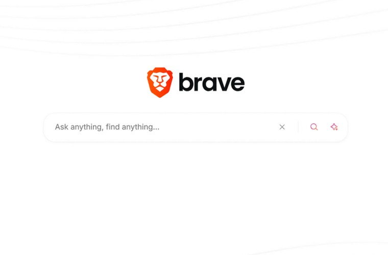

<svg class="logo" aria-hidden="true" fill="currentColor" role="img" viewBox="0 0 24 24" xmlns="http://www.w3.org/2000/svg"><path d="M15.68 0l2.096 2.38s1.84-.512 2.709.358c.868.87 1.584 1.638 1.584 1.638l-.562 1.381.715 2.047s-2.104 7.98-2.35 8.955c-.486 1.919-.818 2.66-2.198 3.633-1.38.972-3.884 2.66-4.293 2.916-.409.256-.92.692-1.38.692-.46 0-.97-.436-1.38-.692a185.796 185.796 0 01-4.293-2.916c-1.38-.973-1.712-1.714-2.197-3.633-.247-.975-2.351-8.955-2.351-8.955l.715-2.047-.562-1.381s.716-.768 1.585-1.638c.868-.87 2.708-.358 2.708-.358L8.321 0h7.36zm-3.679 14.936c-.14 0-1.038.317-1.758.69-.72.373-1.242.637-1.409.742-.167.104-.065.301.087.409.152.107 2.194 1.69 2.393 1.866.198.175.489.464.687.464.198 0 .49-.29.688-.464.198-.175 2.24-1.759 2.392-1.866.152-.108.254-.305.087-.41-.167-.104-.689-.368-1.41-.741-.72-.373-1.617-.69-1.757-.69zm0-11.278s-.409.001-1.022.206-1.278.46-1.584.46c-.307 0-2.581-.434-2.581-.434S4.119 7.152 4.119 7.849c0 .697.339.881.68 1.243l2.02 2.149c.192.203.59.511.356 1.066-.235.555-.58 1.26-.196 1.977.384.716 1.042 1.194 1.464 1.115.421-.08 1.412-.598 1.776-.834.364-.237 1.518-1.19 1.518-1.554 0-.365-1.193-1.02-1.413-1.168-.22-.15-1.226-.725-1.247-.95-.02-.227-.012-.293.284-.851.297-.559.831-1.304.742-1.8-.089-.495-.95-.753-1.565-.986-.615-.232-1.799-.671-1.947-.74-.148-.068-.11-.133.339-.175.448-.043 1.719-.212 2.292-.052.573.16 1.552.403 1.632.532.079.13.149.134.067.579-.081.445-.5 2.581-.541 2.96-.04.38-.12.63.288.724.409.094 1.097.256 1.333.256s.924-.162 1.333-.256c.408-.093.329-.344.288-.723-.04-.38-.46-2.516-.541-2.961-.082-.445-.012-.45.067-.579.08-.129 1.059-.372 1.632-.532.573-.16 1.845.009 2.292.052.449.042.487.107.339.175-.148.069-1.332.508-1.947.74-.615.233-1.476.49-1.565.986-.09.496.445 1.241.742 1.8.297.558.304.624.284.85-.02.226-1.026.802-1.247.95-.22.15-1.413.804-1.413 1.169 0 .364 1.154 1.317 1.518 1.554.364.236 1.355.755 1.776.834.422.079 1.08-.4 1.464-1.115.384-.716.039-1.422-.195-1.977-.235-.555.163-.863.355-1.066l2.02-2.149c.341-.362.68-.546.68-1.243 0-.697-2.695-3.96-2.695-3.96s-2.274.436-2.58.436c-.307 0-.972-.256-1.585-.461-.613-.205-1.022-.206-1.022-.206z"/></svg>Brave Search

Its own index, no profiling

Phone · computer

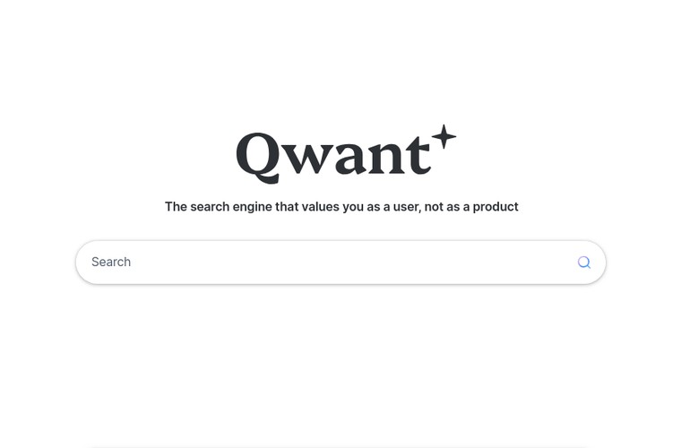

<svg class="logo" aria-hidden="true" fill="currentColor" role="img" viewBox="0 0 24 24" xmlns="http://www.w3.org/2000/svg"><path d="M9.313 5.163c4.289 0 7.766 2.589 7.766 7.616 0 4.759-3.072 7.301-7.003 7.59 1.87 1.142 4.693 1.143 6.45-.348l.547.297-.615 3.074-.226.285c-3.118.918-5.947-.099-7.921-3.329-3.816-.37-6.765-2.9-6.765-7.568 0-5.03 3.477-7.617 7.766-7.617zm0 13.88c2.756 0 4.08-2.804 4.08-6.264 0-3.46-1.148-6.264-4.08-6.264-2.85 0-4.08 2.805-4.08 6.264 0 3.46 1.182 6.264 4.08 6.264zm8.719-16.319L18.734 0h.263l.703 2.725 2.754.71v.248l-2.754.71-.703 2.725h-.263l-.702-2.725-2.696-.695V3.42z"/></svg>Qwant

European, no profiling

Phone · computer

Screenshots: DuckDuckGo, CC BY 4.0 · Startpage, public domain · Brave Software, public domain · via Wikimedia Commons · Qwant, ours

Note:
They replace Google Search. Make one your browser's default search engine.

A search engine that doesn't profile you has less to sell. Screenshots, cropped: DuckDuckGo (Wikimedia Commons, CC BY 4.0, DuckDuckGo, June 2026); Startpage (Commons, public domain, Startpage.com, 2025); Brave Search (Commons, public domain, Brave Software, 2025); Qwant's home page, our own. All four work in any browser, on phones and computers. Brave Search runs its own index rather than renting Google's or Bing's. Qwant is a French search engine that says it doesn't profile its users; check its current privacy terms the week of the event.

---

## *Passwords*: remember one, it keeps the rest.

<svg class="ic" aria-hidden="true" xmlns="http://www.w3.org/2000/svg" viewBox="0 0 24 24" fill="none" stroke="currentColor" stroke-width="2" stroke-linecap="round" stroke-linejoin="round" > <path d="M2.586 17.414A2 2 0 0 0 2 18.828V21a1 1 0 0 0 1 1h3a1 1 0 0 0 1-1v-1a1 1 0 0 1 1-1h1a1 1 0 0 0 1-1v-1a1 1 0 0 1 1-1h.172a2 2 0 0 0 1.414-.586l.814-.814a6.5 6.5 0 1 0-4-4z" /> <circle cx="16.5" cy="7.5" r=".5" fill="currentColor" /> </svg>
<b>A password manager</b>free · open source · phone and computer

<b>Replaces</b>the same password everywhere

<b>Brings</b>your saved passwords

<b>Try</b><svg class="logo" aria-hidden="true" fill="currentColor" role="img" viewBox="0 0 24 24" xmlns="http://www.w3.org/2000/svg"><path d="M12 0C5.378 0 0 5.378 0 12c0 6.623 5.378 12 12 12 6.623 0 12-5.377 12-12 0-6.622-5.377-12-12-12zm0 .791a11.203 11.203 0 0 1 11.209 11.21A11.202 11.202 0 0 1 12 23.208 11.203 11.203 0 0 1 .791 12 11.203 11.203 0 0 1 12.001.791zm0 1.871a9.356 9.356 0 0 0-1.705.162A1.746 1.746 0 0 0 12 4.95a1.746 1.746 0 0 0 1.706-2.126A9.342 9.342 0 0 0 12 2.662zM7.2 4a9.338 9.338 0 0 0-4.54 8 9.338 9.338 0 0 0 18.677 0 9.338 9.338 0 0 0-4.54-7.998 4.888 4.888 0 0 1-2.701 5.365l-.12 2.066 1.482 1.483-1.483 1.482.989.989-.989.988.12 1.857L12 20.328l-2.096-2.096V9.367A4.89 4.89 0 0 1 7.2 4zm3.4 6.543v6.99h.7v-6.99z"/></svg> KeePassXC · KeePassDX · <svg class="logo" aria-hidden="true" fill="currentColor" role="img" viewBox="0 0 24 24" xmlns="http://www.w3.org/2000/svg"><path d="M3.75 0A3.75 3.75 0 000 3.75v16.5A3.75 3.75 0 003.75 24h16.5A3.75 3.75 0 0024 20.25V3.75A3.75 3.75 0 0020.25 0zm1.36 2.92h13.8c.208 0 .388.076.54.228a.737.737 0 01.227.539v9.2c0 .687-.134 1.367-.401 2.042a7.618 7.618 0 01-.995 1.797 11.097 11.097 0 01-1.413 1.528c-.547.495-1.052.906-1.515 1.234-.464.327-.947.636-1.45.928-.503.291-.86.489-1.072.593-.212.104-.381.184-.51.24a.687.687 0 01-.31.071.688.688 0 01-.312-.072 13.784 13.784 0 01-.51-.24 20.61 20.61 0 01-1.071-.592 19.133 19.133 0 01-1.45-.928 16.457 16.457 0 01-1.515-1.234 11.11 11.11 0 01-1.414-1.528 7.617 7.617 0 01-.994-1.797 5.502 5.502 0 01-.401-2.042v-9.2c0-.208.076-.387.227-.54a.737.737 0 01.54-.227zm6.9 2.3v13.62c.95-.502 1.801-1.05 2.552-1.64 1.877-1.47 2.815-2.907 2.815-4.313V5.22Z"/></svg> Bitwarden

<svg class="ic" aria-hidden="true" xmlns="http://www.w3.org/2000/svg" viewBox="0 0 24 24" fill="none" stroke="currentColor" stroke-width="2" stroke-linecap="round" stroke-linejoin="round" > <circle cx="12" cy="12" r="10" /> <path d="m9 12 2 2 4-4" /> </svg>perago.example → fills in

<svg class="ic" aria-hidden="true" xmlns="http://www.w3.org/2000/svg" viewBox="0 0 24 24" fill="none" stroke="currentColor" stroke-width="2" stroke-linecap="round" stroke-linejoin="round" > <circle cx="12" cy="12" r="10" /> <path d="m15 9-6 6" /> <path d="m9 9 6 6" /> </svg>perago-verify.example → nothing

<svg class="ic" aria-hidden="true" xmlns="http://www.w3.org/2000/svg" viewBox="0 0 24 24" fill="none" stroke="currentColor" stroke-width="2" stroke-linecap="round" stroke-linejoin="round" > <path d="m21.73 18-8-14a2 2 0 0 0-3.48 0l-8 14A2 2 0 0 0 4 21h16a2 2 0 0 0 1.73-3" /> <path d="M12 9v4" /> <path d="M12 17h.01" /> </svg>Never save a password on a shared computer.

Note:
Saving passwords in your browser? Better than reusing one. A dedicated manager works in every browser and isn't tied to one company's account.

You remember one strong password; it makes and keeps a different one for every site, and checks the address, so a fake page gets nothing. KeePassXC is for computers and KeePassDX for Android; Bitwarden runs on both, and on iPhone. The example addresses are made up. Shared computers: a pisonet or computer-shop PC, a library machine, a classmate's laptop. Don't say "avoid your browser's password manager": it's far better than reusing one password, and it also fills in only on the real site. The dedicated manager's edge: it works across browsers and devices, it isn't tied to one company's account, and password-stealing malware goes after browser-saved passwords first. Protect the vault: a strong main password used nowhere else, 2FA on it, and the recovery kit saved somewhere safe.

---

## *2FA codes* a SIM swap can't steal.

<svg class="ic" aria-hidden="true" xmlns="http://www.w3.org/2000/svg" viewBox="0 0 24 24" fill="none" stroke="currentColor" stroke-width="2" stroke-linecap="round" stroke-linejoin="round" > <path d="M20 13c0 5-3.5 7.5-7.66 8.95a1 1 0 0 1-.67-.01C7.5 20.5 4 18 4 13V6a1 1 0 0 1 1-1c2 0 4.5-1.2 6.24-2.72a1.17 1.17 0 0 1 1.52 0C14.51 3.81 17 5 19 5a1 1 0 0 1 1 1z" /> <path d="m9 12 2 2 4-4" /> </svg>
<b>An authenticator app</b>free · Android, iPhone

<b>Replaces</b>codes by SMS

<b>Try</b><span class="logo mask" aria-hidden="true" style="--m:url()"> Ente Auth, <svg class="logo" aria-hidden="true" fill="currentColor" role="img" viewBox="0 0 24 24" xmlns="http://www.w3.org/2000/svg"><path d="m6.9487 19.8732-.0074.0133a1.483 1.483 0 0 0-.0013 1.469l.3165.5565c.2639.4638.7563.75 1.2897.75h.0163c1.139 0 1.853-1.2301 1.2883-2.219l-.325-.5697c-.5693-.9974-2.0074-.9974-2.577-.0002m3.4905-6.1074a1.483 1.483 0 0 0-.0013 1.4688l3.7964 6.6769c.2639.4638.756.7503 1.2897.7503h.0156c1.139 0 1.853-1.2301 1.2883-2.219l-3.8118-6.677c-.5693-.9974-2.0077-.9974-2.5768 0m.3275-11.692L.1972 20.4648c-.5618.9775.1438 2.1969 1.2713 2.1969a1.467 1.467 0 0 0 1.2734-.7393l7.9513-13.9285c.5632-.9867 1.9861-.9855 2.548.0026l7.9175 13.9239a1.466 1.466 0 0 0 1.2746.7416h.0982c1.1255 0 1.8313-1.2152 1.2736-2.193L13.3116 2.0776c-.5616-.9844-1.98-.9867-2.5448-.0039"/></svg> Aegis (Android)

<svg class="ic" aria-hidden="true" xmlns="http://www.w3.org/2000/svg" viewBox="0 0 24 24" fill="none" stroke="currentColor" stroke-width="2" stroke-linecap="round" stroke-linejoin="round" > <circle cx="12" cy="12" r="10" /> <path d="m15 9-6 6" /> <path d="m9 9 6 6" /> </svg>SMS code → a swapped SIM

<svg class="ic" aria-hidden="true" xmlns="http://www.w3.org/2000/svg" viewBox="0 0 24 24" fill="none" stroke="currentColor" stroke-width="2" stroke-linecap="round" stroke-linejoin="round" > <circle cx="12" cy="12" r="10" /> <path d="m9 12 2 2 4-4" /> </svg>App code → stays on your phone

<figure class="app-shot">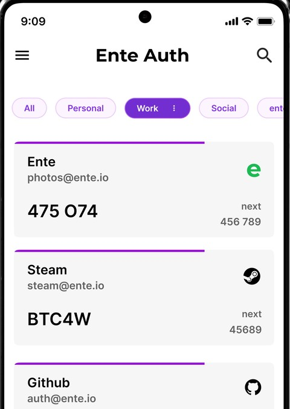<figcaption class="slide-source">Ente Auth · AGPL-3.0</figcaption></figure>
<figure class="app-shot">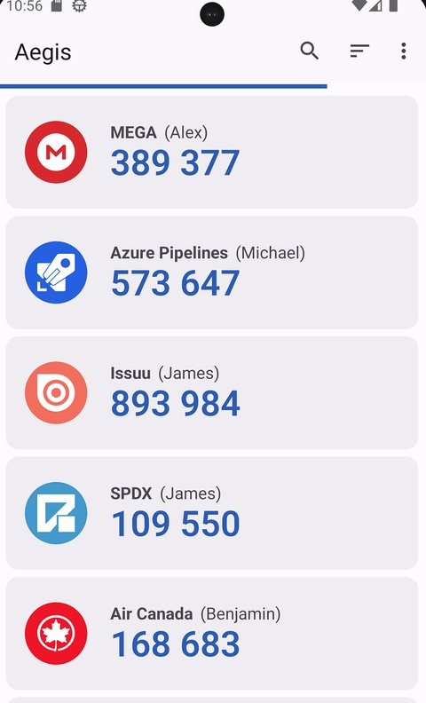<figcaption class="slide-source">Aegis · GPL-3.0</figcaption></figure>

Note:
A scammer who talks your telco into a new SIM gets your texts, not your app. Where a bank or e-wallet only sends SMS, keep it; switch everywhere else.

The screenshots are the apps' own store screenshots, cropped to the phone screen: Ente Auth from github.com/ente/ente (AGPL-3.0), Aegis from github.com/beemdevelopment/Aegis (GPL-3.0); the accounts in them are the projects' sample data. Setup: turn on 2FA in an app's settings, choose "authenticator app", scan the QR code.

---

## *Sign in* with a physical key.

<svg class="logo" aria-hidden="true" fill="currentColor" role="img" viewBox="0 0 24 24" xmlns="http://www.w3.org/2000/svg"><path d="m12.356 12.388 2.521-7.138h3.64l-6.135 15.093H8.539l1.755-4.136L6 5.25h3.717ZM12 0C5.381 0 0 5.381 0 12s5.381 12 12 12 12-5.381 12-12S18.619 0 12 0Zm0 1.5c5.808 0 10.5 4.692 10.5 10.5S17.808 22.5 12 22.5 1.5 17.808 1.5 12 6.192 1.5 12 1.5Z"/></svg>
<b>A security key</b>a small USB or tap key · paid · one-time cost

<b>Replaces</b>codes you could type into a fake page

<b>Try</b><svg class="logo" aria-hidden="true" fill="currentColor" role="img" viewBox="0 0 24 24" xmlns="http://www.w3.org/2000/svg"><path d="m12.356 12.388 2.521-7.138h3.64l-6.135 15.093H8.539l1.755-4.136L6 5.25h3.717ZM12 0C5.381 0 0 5.381 0 12s5.381 12 12 12 12-5.381 12-12S18.619 0 12 0Zm0 1.5c5.808 0 10.5 4.692 10.5 10.5S17.808 22.5 12 22.5 1.5 17.808 1.5 12 6.192 1.5 12 1.5Z"/></svg> YubiKey, Nitrokey

<b>Free</b><svg class="logo" aria-hidden="true" fill="currentColor" role="img" viewBox="0 0 24 24" xmlns="http://www.w3.org/2000/svg"><path d="M7.849 7.513a1.085 1.085 0 1 0 1.085 1.086v-.001c0-.599-.486-1.085-1.085-1.085zM4.942 10.553v1.418H6.89v4.793h.704V14.04h.509v2.724h.71v-6.211H4.941zM14.122 11.089H14.1c-.287-.416-.862-.702-1.639-.702-1.489 0-2.797 1.224-2.786 3.319 0 1.936 1.181 3.201 2.659 3.201.797 0 1.56-.361 1.935-1.04l.117.893h1.669V7.651h-1.934zm0 2.904c0 .158-.012.313-.034.465l.002-.017c-.11.532-.574.925-1.13.925h-.014.001c-.797 0-1.318-.659-1.318-1.723 0-.978.446-1.767 1.329-1.767.606 0 1.022.437 1.138.947.014.09.023.194.023.3l-.001.054v-.003zM4.802 8.89l.475-1.6a2.914 2.914 0 0 0-.384-.101l-.019-.003a3.654 3.654 0 0 0-.829-.092 3.73 3.73 0 0 0-1.084.159l.027-.007a2.022 2.022 0 0 0-.38.153l.011-.005a2.624 2.624 0 0 0-.663.475c-.5.49-.754 1.155-.754 1.975v.708H-.001v1.418h1.199v4.793h1.921V11.97h1.199v-1.416H3.119v-.75a1.019 1.019 0 0 1 .23-.713l-.001.002a.736.736 0 0 1 .063-.062l.001-.001s.414-.41 1.389-.14zM20.306 10.388c-2.01 0-3.327 1.286-3.327 3.307s1.393 3.212 3.213 3.212c1.664 0 3.276-1.04 3.276-3.327-.002-1.874-1.267-3.192-3.162-3.192zm-.063 5.126c-.832 0-1.276-.797-1.276-1.871 0-.915.361-1.861 1.276-1.861.871 0 1.234.936 1.234 1.851 0 1.137-.482 1.882-1.234 1.882zM22.493 9.761h.232v.589h.14v-.589h.231v-.117h-.603v.117zM23.799 9.644l-.182.505-.181-.505h-.203v.707h.13V9.78l.198.571h.113l.195-.571v.571h.13v-.707h-.201z"/></svg> passkeys, on your own phone

<figure class="key-photo">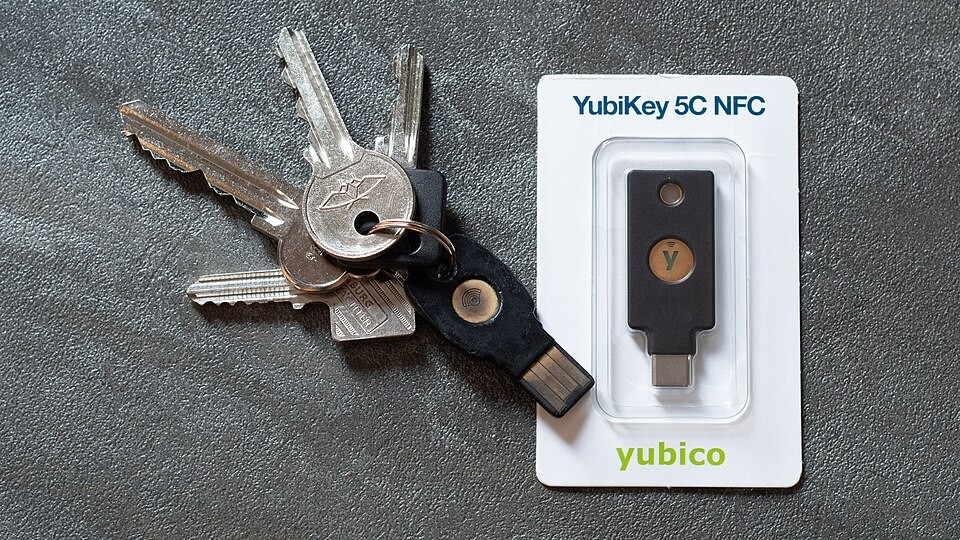<figcaption class="slide-source">YubiKey 5C NFC · Daniel Aleksandersen, CC BY 4.0, via Wikimedia Commons</figcaption></figure>

<svg class="ic" aria-hidden="true" xmlns="http://www.w3.org/2000/svg" viewBox="0 0 24 24" fill="none" stroke="currentColor" stroke-width="2" stroke-linecap="round" stroke-linejoin="round" > <circle cx="12" cy="12" r="10" /> <path d="m9 12 2 2 4-4" /> </svg>Real site → one touch, you're in

<svg class="ic" aria-hidden="true" xmlns="http://www.w3.org/2000/svg" viewBox="0 0 24 24" fill="none" stroke="currentColor" stroke-width="2" stroke-linecap="round" stroke-linejoin="round" > <circle cx="12" cy="12" r="10" /> <path d="m15 9-6 6" /> <path d="m9 9 6 6" /> </svg>Fake site → the key says no

Note:
It checks the site's real address. Most Philippine banks and e-wallets don't take keys yet. Save each account's recovery codes too.

The photo is a YubiKey 5C NFC on a keyring, from Wikimedia Commons (CC BY 4.0, Daniel Aleksandersen, 2026). The only Level 2 item that costs money. The key checks the website's real address before it answers, so a perfect copy of the page gets nothing. Use it on your email and big accounts. Passkeys work the same way and cost nothing. It stops fake pages, not every attack: a scammer who talks you into approving something still can. Keep two keys, one as a spare, and the recovery codes somewhere safe. Check prices from local sellers the week of the event, and which big services and local banks support keys and passkeys.

---

## *Private email* with *aliases* for every site.

<svg class="logo" aria-hidden="true" fill="currentColor" role="img" viewBox="0 0 24 24" xmlns="http://www.w3.org/2000/svg"><path d="m15.24 8.998 3.656-3.073v15.81H2.482C1.11 21.735 0 20.609 0 19.223V6.944l7.58 6.38a2.186 2.186 0 0 0 2.871-.042l4.792-4.284h-.003zm-5.456 3.538 1.809-1.616a2.438 2.438 0 0 1-1.178-.533L.905 2.395A.552.552 0 0 0 0 2.826v2.811l8.226 6.923a1.186 1.186 0 0 0 1.558-.024zM23.871 2.463a.551.551 0 0 0-.776-.068l-3.199 2.688v16.653h1.623c1.371 0 2.481-1.127 2.481-2.513V2.824a.551.551 0 0 0-.129-.36z"/></svg>
<b>Private email</b>free · about 10 minutes

<b>Try</b><svg class="logo" aria-hidden="true" fill="currentColor" role="img" viewBox="0 0 24 24" xmlns="http://www.w3.org/2000/svg"><path d="m15.24 8.998 3.656-3.073v15.81H2.482C1.11 21.735 0 20.609 0 19.223V6.944l7.58 6.38a2.186 2.186 0 0 0 2.871-.042l4.792-4.284h-.003zm-5.456 3.538 1.809-1.616a2.438 2.438 0 0 1-1.178-.533L.905 2.395A.552.552 0 0 0 0 2.826v2.811l8.226 6.923a1.186 1.186 0 0 0 1.558-.024zM23.871 2.463a.551.551 0 0 0-.776-.068l-3.199 2.688v16.653h1.623c1.371 0 2.481-1.127 2.481-2.513V2.824a.551.551 0 0 0-.129-.36z"/></svg> Proton Mail · <svg class="logo" aria-hidden="true" fill="currentColor" role="img" viewBox="0 0 24 24" xmlns="http://www.w3.org/2000/svg"><path d="M2.158.934C.978.934.025 1.895.023 3.08.017 9.74.005 16.413 0 23.066c.793-.297 1.67-.56 2.56-.918 6.188-2.485 11.249-4.598 11.253-6.983a1.66 1.66 0 0 0-.016-.23c-.32-2.356-5.916-3.087-5.908-4.166a.37.37 0 0 1 .05-.177c.673-1.184 3.336-1.128 4.316-1.212.982-.085 3.285-.067 3.397-.773a.44.44 0 0 0 .005-.065c.003-.656-1.584-.913-1.584-.913s1.925.29 1.92 1.042a.445.445 0 0 1-.015.114c-.207.81-1.901.962-3.021 1.017-1.06.054-2.673.175-2.679.695 0 .03.005.062.015.095.253.76 6.167 1.127 9.95 3.102 2.178 1.136 3.26 3.004 3.757 4.974V3.08A2.14 2.14 0 0 0 21.866.934H2.158Z"/></svg> Tuta

<b>Locks</b>your inbox: only you can read it

<b>No ads</b>nobody reads your mail to sell to you

<b>Brings</b>your old mail and contacts

<svg class="logo" aria-hidden="true" fill="currentColor" role="img" viewBox="0 0 24 24" xmlns="http://www.w3.org/2000/svg"><path d="M23.451 3.672c.106.105.199.222.277.348.178.293.272.628.272.97v9.604c0 .342-.095.679-.274.971a1.899 1.899 0 0 1-.383.444c-.335.286-.76.443-1.201.443H11.727a9.773 9.773 0 0 1-5.2 4.365l-.136.049-.135-.052a9.741 9.741 0 0 1-4.499-3.526A9.702 9.702 0 0 1 0 11.701a9.794 9.794 0 0 1 .227-2.1l.052-.237.236-.058c.055-.013.109-.028.162-.042a11.979 11.979 0 0 0 5.568-3.262l.04-.043.232-.239v-.73c0-.343.095-.68.274-.972.078-.126.171-.242.278-.346a1.835 1.835 0 0 1 1.193-.537h13.994a1.84 1.84 0 0 1 1.195.537Zm-15.075.346c-.033 0-.066.001-.098.004h-.142l.023.021 6.815 6.029a.435.435 0 0 0 .576 0l6.815-6.029.023-.021h-.146a1.042 1.042 0 0 0-.098-.004H8.376Zm-.898.605a.945.945 0 0 0-.072.367v1.586a11.997 11.997 0 0 0 4.938 2.681l.114.029.057.015.237.058.051.239a8.49 8.49 0 0 1 .1.565l.417-.369-5.842-5.171ZM2.329 16.719a9.049 9.049 0 0 0 4.074 3.312 8.997 8.997 0 0 0 5.68-10.036 12.736 12.736 0 0 1-5.555-3.169 12.751 12.751 0 0 1-5.583 3.177 9.044 9.044 0 0 0-.161 1.698 9.038 9.038 0 0 0 1.545 5.018Zm10.684-5.098a9.709 9.709 0 0 1-.837 3.944h10.212l-.028-.025-5.826-5.153-.985.87a.43.43 0 0 1-.575 0l-.985-.87-.984.87c.005.122.008.242.008.364Zm10.029 3.339a.94.94 0 0 0 .072-.366l.001-9.603a.967.967 0 0 0-.071-.364l-5.84 5.168 5.838 5.165ZM6.609 8.206a10.24 10.24 0 0 0 4.379 2.464c.074.404.113.813.118 1.223v.082a7.233 7.233 0 0 1-1.705 4.655l-.007.008a7.234 7.234 0 0 1-2.97 2.095 7.259 7.259 0 0 1-4.515-6.692c0-.458.043-.915.129-1.365a10.252 10.252 0 0 0 4.486-2.551l.084.081h.001Zm-3.177 5.053 2.752 2.752h.001l3.831-3.831-.847-.846-2.983 2.984-1.908-1.907-.846.848Z"/></svg>
<b>Aliases</b>free to start · about 5 minutes

<b>Try</b><svg class="logo" aria-hidden="true" fill="currentColor" role="img" viewBox="0 0 24 24" xmlns="http://www.w3.org/2000/svg"><path d="M23.451 3.672c.106.105.199.222.277.348.178.293.272.628.272.97v9.604c0 .342-.095.679-.274.971a1.899 1.899 0 0 1-.383.444c-.335.286-.76.443-1.201.443H11.727a9.773 9.773 0 0 1-5.2 4.365l-.136.049-.135-.052a9.741 9.741 0 0 1-4.499-3.526A9.702 9.702 0 0 1 0 11.701a9.794 9.794 0 0 1 .227-2.1l.052-.237.236-.058c.055-.013.109-.028.162-.042a11.979 11.979 0 0 0 5.568-3.262l.04-.043.232-.239v-.73c0-.343.095-.68.274-.972.078-.126.171-.242.278-.346a1.835 1.835 0 0 1 1.193-.537h13.994a1.84 1.84 0 0 1 1.195.537Zm-15.075.346c-.033 0-.066.001-.098.004h-.142l.023.021 6.815 6.029a.435.435 0 0 0 .576 0l6.815-6.029.023-.021h-.146a1.042 1.042 0 0 0-.098-.004H8.376Zm-.898.605a.945.945 0 0 0-.072.367v1.586a11.997 11.997 0 0 0 4.938 2.681l.114.029.057.015.237.058.051.239a8.49 8.49 0 0 1 .1.565l.417-.369-5.842-5.171ZM2.329 16.719a9.049 9.049 0 0 0 4.074 3.312 8.997 8.997 0 0 0 5.68-10.036 12.736 12.736 0 0 1-5.555-3.169 12.751 12.751 0 0 1-5.583 3.177 9.044 9.044 0 0 0-.161 1.698 9.038 9.038 0 0 0 1.545 5.018Zm10.684-5.098a9.709 9.709 0 0 1-.837 3.944h10.212l-.028-.025-5.826-5.153-.985.87a.43.43 0 0 1-.575 0l-.985-.87-.984.87c.005.122.008.242.008.364Zm10.029 3.339a.94.94 0 0 0 .072-.366l.001-9.603a.967.967 0 0 0-.071-.364l-5.84 5.168 5.838 5.165ZM6.609 8.206a10.24 10.24 0 0 0 4.379 2.464c.074.404.113.813.118 1.223v.082a7.233 7.233 0 0 1-1.705 4.655l-.007.008a7.234 7.234 0 0 1-2.97 2.095 7.259 7.259 0 0 1-4.515-6.692c0-.458.043-.915.129-1.365a10.252 10.252 0 0 0 4.486-2.551l.084.081h.001Zm-3.177 5.053 2.752 2.752h.001l3.831-3.831-.847-.846-2.983 2.984-1.908-1.907-.846.848Z"/></svg> SimpleLogin

<b>One per site</b>all landing in one inbox

<svg class="ic" aria-hidden="true" xmlns="http://www.w3.org/2000/svg" viewBox="0 0 24 24" fill="none" stroke="currentColor" stroke-width="2" stroke-linecap="round" stroke-linejoin="round" > <circle cx="12" cy="12" r="4" /> <path d="M16 8v5a3 3 0 0 0 6 0v-1a10 10 0 1 0-4 8" /> </svg>shop.liza@… → only the shop

<svg class="ic" aria-hidden="true" xmlns="http://www.w3.org/2000/svg" viewBox="0 0 24 24" fill="none" stroke="currentColor" stroke-width="2" stroke-linecap="round" stroke-linejoin="round" > <circle cx="12" cy="12" r="10" /> <path d="m15 9-6 6" /> <path d="m9 9 6 6" /> </svg>"Your bank" writes to shop.liza@ → scam

<svg class="ic" aria-hidden="true" xmlns="http://www.w3.org/2000/svg" viewBox="0 0 24 24" fill="none" stroke="currentColor" stroke-width="2" stroke-linecap="round" stroke-linejoin="round" > <path d="m21.73 18-8-14a2 2 0 0 0-3.48 0l-8 14A2 2 0 0 0 4 21h16a2 2 0 0 0 1.73-3" /> <path d="M12 9v4" /> <path d="M12 17h.01" /> </svg>Throwaway inboxes: one-time sign-ups only, never for accounts you need to keep.

Note:
An alias forwards to your real inbox. If one leaks, you switch it off, and you know who leaked it.

Proton's import tool brings Gmail across. Start by using the new address for new sign-ups. SimpleLogin belongs to Proton. Throwaway inboxes (temporary-mail sites) are often readable by anyone who types the same address and disappear after a while: fine for a one-time download or coupon, never for an account you'll need to recover or anything with your name, money or school on it.

---

## *VPN and DNS*: safer on any Wi-Fi.

<svg class="logo" aria-hidden="true" fill="currentColor" role="img" viewBox="0 0 24 24" xmlns="http://www.w3.org/2000/svg"><path d="m10.176 20.058.858-1.28 6.513-9.838c.57-.86.026-2.014-1.005-2.131L.378 4.95l8.373 15.055a.84.84 0 0 0 1.424.052h.001zM23.586 7.14l-9.662 14.61c-1.036 1.567-3.38 1.478-4.293-.162l-.093-.168c.3-.01.594-.086.855-.235a1.85 1.85 0 0 0 .612-.57l.86-1.28 6.516-9.844c.46-.694.525-1.56.173-2.314a2.375 2.375 0 0 0-1.899-1.364L.493 3.956l-.476-.054C-.163 2.392 1.101.95 2.784 1.143l18.991 2.16c1.856.21 2.835 2.289 1.812 3.838z"/></svg>
<b>A VPN you can check</b>free or paid · about 5 minutes

<b>Try</b><svg class="logo" aria-hidden="true" fill="currentColor" role="img" viewBox="0 0 24 24" xmlns="http://www.w3.org/2000/svg"><path d="m10.176 20.058.858-1.28 6.513-9.838c.57-.86.026-2.014-1.005-2.131L.378 4.95l8.373 15.055a.84.84 0 0 0 1.424.052h.001zM23.586 7.14l-9.662 14.61c-1.036 1.567-3.38 1.478-4.293-.162l-.093-.168c.3-.01.594-.086.855-.235a1.85 1.85 0 0 0 .612-.57l.86-1.28 6.516-9.844c.46-.694.525-1.56.173-2.314a2.375 2.375 0 0 0-1.899-1.364L.493 3.956l-.476-.054C-.163 2.392 1.101.95 2.784 1.143l18.991 2.16c1.856.21 2.835 2.289 1.812 3.838z"/></svg> Proton VPN · <svg class="logo" aria-hidden="true" fill="currentColor" role="img" viewBox="0 0 24 24" xmlns="http://www.w3.org/2000/svg"><path d="M12 0C5.371 0 0 5.362 0 12c0 6.629 5.381 12 12 12s12-5.371 12-12S18.629 0 12 0zm1.651 3.363c1.908-.02 4.059 1.28 4.701 2.951.381 1 .267 2.086-.057 3.086-.266.819-1.238 2-.876 2.886-.143-.038-3.124-1.048-3.98-1.505-1.344-.838-2.544-1.867-3.448-2.657l-.03-.029-3.047-1.447a1.037 1.037 0 0 1-.104-.058c.419.029 2.085.23 2.828.058-.143-.39-.105-.896.095-1.372.286-.657.83-1.095 1.343-1.095.105 0 .2.019.296.057A3.411 3.411 0 0 1 12.39 3.6a3.49 3.49 0 0 1 1.26-.237zm-2.499.97c-.457 0-.962.42-1.228 1.02-.2.447-.229.933-.086 1.304a.813.813 0 0 0 .41.457.696.696 0 0 0 .285.058c.457 0 .962-.42 1.22-1.02.161-.362.209-.742.152-1.076a.91.91 0 0 0-.467-.676.6.6 0 0 0-.286-.067zm0 .286c.057 0 .115.01.172.038.152.067.266.238.304.467.048.276.01.6-.133.905-.21.485-.619.838-.962.838a.444.444 0 0 1-.162-.029c-.142-.057-.219-.19-.257-.295-.114-.286-.085-.705.076-1.086.21-.495.62-.838.962-.838zM3.01 6.362 2.943 7.79l.133.037.943-1.123-.648 1.104c1.01-.2 2.658-.247 4.42-.114l1.837.895c.915.8 2.124 1.839 3.486 2.686l3.553 1.4.438.638h-.372l.781.943-.714-.114c.01.066.714.876.714.876l-.562.076c.02.067.572.753.572.753l-.42-.03c.03.106.677 1.153.677 1.163 0 .01-.229-.057-.381-.105.543 1.21 1.324 1.448 1.362 1.943-2.667 3.419-9.667 3.952-12.771.124-.067-.314.619-.838 1.057-1.429.21-.286.4-.59.533-.905.19-.58-.21-.533-.476-1.028-.047-.086-.086-.2-.047-.305.057-.19.38-.324.438-.286 1.314.877 3.762.59 5.266-1.142 0 0 .458.114.696.18l-.686-.457-.048-.028c-.028.019-.067.038-.095.057-3.124 2.38-5.152 1.352-5.152 1.352a3.243 3.243 0 0 0-.438-.39c-2.124-1.495-3.639-3.505-4.324-4.81l-.257 1.381.057-1.838-.914 1.276.676-1.371c-.505-.067-.79-.572-.676-.981.094-.426.63-.738 1.096-.527z"/></svg> Mullvad

<b>Hides</b>your browsing from the Wi-Fi you're on

<b>Instead of</b>free VPN apps that sell your data

<svg class="logo" aria-hidden="true" fill="currentColor" role="img" viewBox="0 0 24 24" xmlns="http://www.w3.org/2000/svg"><path d="M6.822 24h5.608l6.331-9.48c1.463-2.185 2.288-4.197 2.288-6.4C21.05 3.458 17.144 0 12 0 6.822 0 2.95 3.493 2.95 8.207c0 4.507 3.459 8 8.345 8 .413 0 .757-.018 1.083-.07zM12 12.129c-2.426 0-4.215-1.634-4.215-3.957 0-2.34 1.79-3.957 4.215-3.957 2.409 0 4.215 1.617 4.215 3.957 0 2.323-1.806 3.957-4.215 3.957z"/></svg>
<b>Private DNS</b>free · about 2 minutes

<b>Try</b><svg class="logo" aria-hidden="true" fill="currentColor" role="img" viewBox="0 0 24 24" xmlns="http://www.w3.org/2000/svg"><path d="M6.822 24h5.608l6.331-9.48c1.463-2.185 2.288-4.197 2.288-6.4C21.05 3.458 17.144 0 12 0 6.822 0 2.95 3.493 2.95 8.207c0 4.507 3.459 8 8.345 8 .413 0 .757-.018 1.083-.07zM12 12.129c-2.426 0-4.215-1.634-4.215-3.957 0-2.34 1.79-3.957 4.215-3.957 2.409 0 4.215 1.617 4.215 3.957 0 2.323-1.806 3.957-4.215 3.957z"/></svg> Quad9

<b>Blocks</b>known scam and malware sites

<b>Android</b>Settings → Network → Private DNS → dns.quad9.net

<svg class="ic" aria-hidden="true" xmlns="http://www.w3.org/2000/svg" viewBox="0 0 24 24" fill="none" stroke="currentColor" stroke-width="2" stroke-linecap="round" stroke-linejoin="round" > <path d="m21.73 18-8-14a2 2 0 0 0-3.48 0l-8 14A2 2 0 0 0 4 21h16a2 2 0 0 0 1.73-3" /> <path d="M12 9v4" /> <path d="M12 17h.01" /> </svg>A VPN hides where you go from the network, not who you are from the sites you log in to.

Note:
Proton VPN has a free plan; Mullvad is paid and needs no email to sign up. On "FREE_MALL_WIFI", a VPN keeps what you do away from whoever runs it.

Ties back to the fake Wi-Fi in Part 1's toolbox. Many free VPN apps make their money from your data, so pick one whose owner and policy you can check. Proton VPN's free plan has no data cap but fewer servers; Mullvad costs about €5 a month and takes cash or an account number, no email. A VPN moves your trust from the Wi-Fi to the VPN company; it doesn't make you anonymous. Quad9 is a free, nonprofit DNS service that refuses to look up known scam and malware sites. On Android 9 and later: Settings → Network & internet → Private DNS → "Private DNS provider hostname" → dns.quad9.net (the menu name varies by phone). On iPhone, Quad9's site offers a profile to install. Check the prices and menu paths the week of the event.

---

## Switch without breaking your *life*.

<svg class="ic" aria-hidden="true" xmlns="http://www.w3.org/2000/svg" viewBox="0 0 24 24" fill="none" stroke="currentColor" stroke-width="2" stroke-linecap="round" stroke-linejoin="round" > <path d="M5 12h14" /> <path d="M12 5v14" /> </svg>

1

Add

Install it beside the old one

<svg class="ic" aria-hidden="true" xmlns="http://www.w3.org/2000/svg" viewBox="0 0 24 24" fill="none" stroke="currentColor" stroke-width="2" stroke-linecap="round" stroke-linejoin="round" > <path d="m16 3 4 4-4 4" /> <path d="M20 7H4" /> <path d="m8 21-4-4 4-4" /> <path d="M4 17h16" /> </svg>

2

Move one

One group, one account

<svg class="ic" aria-hidden="true" xmlns="http://www.w3.org/2000/svg" viewBox="0 0 24 24" fill="none" stroke="currentColor" stroke-width="2" stroke-linecap="round" stroke-linejoin="round" > <path d="M20 6 9 17l-5-5" /> </svg>

3

Let go

When nothing's left

One switch a week.

Note:
Your e-wallet, your school chats and some of your family will stay where they are for now. That's fine.

Nobody has to delete anything today. Add first.

---

## Want to go *further*?

<svg class="ic" aria-hidden="true" xmlns="http://www.w3.org/2000/svg" viewBox="0 0 24 24" fill="none" stroke="currentColor" stroke-width="2" stroke-linecap="round" stroke-linejoin="round" > <path d="M12 7v14" /> <path d="M3 18a1 1 0 0 1-1-1V4a1 1 0 0 1 1-1h5a4 4 0 0 1 4 4 4 4 0 0 1 4-4h5a1 1 0 0 1 1 1v13a1 1 0 0 1-1 1h-6a3 3 0 0 0-3 3 3 3 0 0 0-3-3z" /> </svg>

Tools, by your threat

privacyguides.org

<svg class="ic" aria-hidden="true" xmlns="http://www.w3.org/2000/svg" viewBox="0 0 24 24" fill="none" stroke="currentColor" stroke-width="2" stroke-linecap="round" stroke-linejoin="round" > <circle cx="12" cy="12" r="10" /> <path d="m4.93 4.93 4.24 4.24" /> <path d="m14.83 9.17 4.24-4.24" /> <path d="m14.83 14.83 4.24 4.24" /> <path d="m9.17 14.83-4.24 4.24" /> <circle cx="12" cy="12" r="4" /> </svg>

At higher risk

Access Now's Helpline

Free help for civil society

<svg class="ic" aria-hidden="true" xmlns="http://www.w3.org/2000/svg" viewBox="0 0 24 24" fill="none" stroke="currentColor" stroke-width="2" stroke-linecap="round" stroke-linejoin="round" > <path d="M20 10c0 4.993-5.539 10.193-7.399 11.799a1 1 0 0 1-1.202 0C9.539 20.193 4 14.993 4 10a8 8 0 0 1 16 0" /> <circle cx="12" cy="10" r="3" /> </svg>

Today

Our booth

Ask us anything from today

Next: Level 3, your own cloud, higher risk, and spotting surveillance.

Note:
Three places to keep going after today. Then the bonus part, Going further; its section slide has the skip-ahead note.

---

<!-- .slide: class="section-slide" -->
Bonus part

# Going *further*.

Note:
For those who want more, or who face more than scammers. Bonus part: Level 3, your own cloud, threats from people you know and from powerful groups, and the tools that detect fake towers and trackers. Short on time? Press G, type 67 (the "What's next" section), and Enter to skip it.

---

## Level 3: take full *control*.

<svg class="ic" aria-hidden="true" xmlns="http://www.w3.org/2000/svg" viewBox="0 0 24 24" fill="none" stroke="currentColor" stroke-width="2" stroke-linecap="round" stroke-linejoin="round" > <rect width="20" height="8" x="2" y="2" rx="2" ry="2" /> <rect width="20" height="8" x="2" y="14" rx="2" ry="2" /> <line x1="6" x2="6.01" y1="6" y2="6" /> <line x1="6" x2="6.01" y1="18" y2="18" /> </svg>

Self-host

Your own cloud

Next slide

<svg class="logo" aria-hidden="true" fill="currentColor" role="img" viewBox="0 0 24 24" xmlns="http://www.w3.org/2000/svg"><path d="m6.953 7.244 3.458-1.97a1.901 1.901 0 0 1-.108-.608c0-.835.608-1.525 1.407-1.67V0h.58v2.995a1.704 1.704 0 0 1 1.407 1.67c0 .219-.045.418-.118.609l3.468 1.97c.127-.146.281-.273.454-.382a1.705 1.705 0 0 1 2.151.382l2.596-1.498.29.508-2.595 1.498a1.69 1.69 0 0 1-1.244 2.242v4.012a1.69 1.69 0 0 1 1.244 2.242l2.596 1.498-.29.508-2.597-1.498a1.705 1.705 0 0 1-2.151.382 2.065 2.065 0 0 1-.454-.382c-1.153.654-2.306 1.317-3.468 1.97.073.19.118.39.118.608 0 .835-.608 1.525-1.407 1.67V24h-.58v-2.995a1.704 1.704 0 0 1-1.407-1.67c0-.219.045-.418.108-.609l-3.458-1.97a2.065 2.065 0 0 1-.454.382 1.705 1.705 0 0 1-2.151-.382l-2.596 1.498-.29-.508 2.595-1.498a1.69 1.69 0 0 1 1.244-2.242V9.994a1.69 1.69 0 0 1-1.244-2.242L1.461 6.254l.29-.508 2.597 1.498a1.705 1.705 0 0 1 2.151-.382c.173.11.327.236.454.382Zm9.803 9.004a1.682 1.682 0 0 1 .128-1.425 1.702 1.702 0 0 1 1.234-.835v-3.976a1.702 1.702 0 0 1-1.234-.835 1.682 1.682 0 0 1-.128-1.425L13.29 5.773c-.318.363-.772.59-1.289.59-.517 0-.971-.227-1.289-.59L7.244 7.752c.163.454.136.98-.128 1.425a1.702 1.702 0 0 1-1.234.835v3.976c.5.073.962.363 1.234.835.264.445.291.971.128 1.425l3.467 1.979c.318-.363.772-.59 1.289-.59.517 0 .971.227 1.289.59z"/></svg>

Phone

GrapheneOS, LineageOS

<svg class="logo" aria-hidden="true" fill="currentColor" role="img" viewBox="0 0 24 24" xmlns="http://www.w3.org/2000/svg"><path d="M12.504 0c-.155 0-.315.008-.48.021-4.226.333-3.105 4.807-3.17 6.298-.076 1.092-.3 1.953-1.05 3.02-.885 1.051-2.127 2.75-2.716 4.521-.278.832-.41 1.684-.287 2.489a.424.424 0 00-.11.135c-.26.268-.45.6-.663.839-.199.199-.485.267-.797.4-.313.136-.658.269-.864.68-.09.189-.136.394-.132.602 0 .199.027.4.055.536.058.399.116.728.04.97-.249.68-.28 1.145-.106 1.484.174.334.535.47.94.601.81.2 1.91.135 2.774.6.926.466 1.866.67 2.616.47.526-.116.97-.464 1.208-.946.587-.003 1.23-.269 2.26-.334.699-.058 1.574.267 2.577.2.025.134.063.198.114.333l.003.003c.391.778 1.113 1.132 1.884 1.071.771-.06 1.592-.536 2.257-1.306.631-.765 1.683-1.084 2.378-1.503.348-.199.629-.469.649-.853.023-.4-.2-.811-.714-1.376v-.097l-.003-.003c-.17-.2-.25-.535-.338-.926-.085-.401-.182-.786-.492-1.046h-.003c-.059-.054-.123-.067-.188-.135a.357.357 0 00-.19-.064c.431-1.278.264-2.55-.173-3.694-.533-1.41-1.465-2.638-2.175-3.483-.796-1.005-1.576-1.957-1.56-3.368.026-2.152.236-6.133-3.544-6.139zm.529 3.405h.013c.213 0 .396.062.584.198.19.135.33.332.438.533.105.259.158.459.166.724 0-.02.006-.04.006-.06v.105a.086.086 0 01-.004-.021l-.004-.024a1.807 1.807 0 01-.15.706.953.953 0 01-.213.335.71.71 0 00-.088-.042c-.104-.045-.198-.064-.284-.133a1.312 1.312 0 00-.22-.066c.05-.06.146-.133.183-.198.053-.128.082-.264.088-.402v-.02a1.21 1.21 0 00-.061-.4c-.045-.134-.101-.2-.183-.333-.084-.066-.167-.132-.267-.132h-.016c-.093 0-.176.03-.262.132a.8.8 0 00-.205.334 1.18 1.18 0 00-.09.4v.019c.002.089.008.179.02.267-.193-.067-.438-.135-.607-.202a1.635 1.635 0 01-.018-.2v-.02a1.772 1.772 0 01.15-.768c.082-.22.232-.406.43-.533a.985.985 0 01.594-.2zm-2.962.059h.036c.142 0 .27.048.399.135.146.129.264.288.344.465.09.199.14.4.153.667v.004c.007.134.006.2-.002.266v.08c-.03.007-.056.018-.083.024-.152.055-.274.135-.393.2.012-.09.013-.18.003-.267v-.015c-.012-.133-.04-.2-.082-.333a.613.613 0 00-.166-.267.248.248 0 00-.183-.064h-.021c-.071.006-.13.04-.186.132a.552.552 0 00-.12.27.944.944 0 00-.023.33v.015c.012.135.037.2.08.334.046.134.098.2.166.268.01.009.02.018.034.024-.07.057-.117.07-.176.136a.304.304 0 01-.131.068 2.62 2.62 0 01-.275-.402 1.772 1.772 0 01-.155-.667 1.759 1.759 0 01.08-.668 1.43 1.43 0 01.283-.535c.128-.133.26-.2.418-.2zm1.37 1.706c.332 0 .733.065 1.216.399.293.2.523.269 1.052.468h.003c.255.136.405.266.478.399v-.131a.571.571 0 01.016.47c-.123.31-.516.643-1.063.842v.002c-.268.135-.501.333-.775.465-.276.135-.588.292-1.012.267a1.139 1.139 0 01-.448-.067 3.566 3.566 0 01-.322-.198c-.195-.135-.363-.332-.612-.465v-.005h-.005c-.4-.246-.616-.512-.686-.71-.07-.268-.005-.47.193-.6.224-.135.38-.271.483-.336.104-.074.143-.102.176-.131h.002v-.003c.169-.202.436-.47.839-.601.139-.036.294-.065.466-.065zm2.8 2.142c.358 1.417 1.196 3.475 1.735 4.473.286.534.855 1.659 1.102 3.024.156-.005.33.018.513.064.646-1.671-.546-3.467-1.089-3.966-.22-.2-.232-.335-.123-.335.59.534 1.365 1.572 1.646 2.757.13.535.16 1.104.021 1.67.067.028.135.06.205.067 1.032.534 1.413.938 1.23 1.537v-.043c-.06-.003-.12 0-.18 0h-.016c.151-.467-.182-.825-1.065-1.224-.915-.4-1.646-.336-1.77.465-.008.043-.013.066-.018.135-.068.023-.139.053-.209.064-.43.268-.662.669-.793 1.187-.13.533-.17 1.156-.205 1.869v.003c-.02.334-.17.838-.319 1.35-1.5 1.072-3.58 1.538-5.348.334a2.645 2.645 0 00-.402-.533 1.45 1.45 0 00-.275-.333c.182 0 .338-.03.465-.067a.615.615 0 00.314-.334c.108-.267 0-.697-.345-1.163-.345-.467-.931-.995-1.788-1.521-.63-.4-.986-.87-1.15-1.396-.165-.534-.143-1.085-.015-1.645.245-1.07.873-2.11 1.274-2.763.107-.065.037.135-.408.974-.396.751-1.14 2.497-.122 3.854a8.123 8.123 0 01.647-2.876c.564-1.278 1.743-3.504 1.836-5.268.048.036.217.135.289.202.218.133.38.333.59.465.21.201.477.335.876.335.039.003.075.006.11.006.412 0 .73-.134.997-.268.29-.134.52-.334.74-.4h.005c.467-.135.835-.402 1.044-.7zm2.185 8.958c.037.6.343 1.245.882 1.377.588.134 1.434-.333 1.791-.765l.211-.01c.315-.007.577.01.847.268l.003.003c.208.199.305.53.391.876.085.4.154.78.409 1.066.486.527.645.906.636 1.14l.003-.007v.018l-.003-.012c-.015.262-.185.396-.498.595-.63.401-1.746.712-2.457 1.57-.618.737-1.37 1.14-2.036 1.191-.664.053-1.237-.2-1.574-.898l-.005-.003c-.21-.4-.12-1.025.056-1.69.176-.668.428-1.344.463-1.897.037-.714.076-1.335.195-1.814.12-.465.308-.797.641-.984l.045-.022zm-10.814.049h.01c.053 0 .105.005.157.014.376.055.706.333 1.023.752l.91 1.664.003.003c.243.533.754 1.064 1.189 1.637.434.598.77 1.131.729 1.57v.006c-.057.744-.48 1.148-1.125 1.294-.645.135-1.52.002-2.395-.464-.968-.536-2.118-.469-2.857-.602-.369-.066-.61-.2-.723-.4-.11-.2-.113-.602.123-1.23v-.004l.002-.003c.117-.334.03-.752-.027-1.118-.055-.401-.083-.71.043-.94.16-.334.396-.4.69-.533.294-.135.64-.202.915-.47h.002v-.002c.256-.268.445-.601.668-.838.19-.201.38-.336.663-.336zm7.159-9.074c-.435.201-.945.535-1.488.535-.542 0-.97-.267-1.28-.466-.154-.134-.28-.268-.373-.335-.164-.134-.144-.333-.074-.333.109.016.129.134.199.2.096.066.215.2.36.333.292.2.68.467 1.167.467.485 0 1.053-.267 1.398-.466.195-.135.445-.334.648-.467.156-.136.149-.267.279-.267.128.016.034.134-.147.332a8.097 8.097 0 01-.69.468zm-1.082-1.583V5.64c-.006-.02.013-.042.029-.05.074-.043.18-.027.26.004.063 0 .16.067.15.135-.006.049-.085.066-.135.066-.055 0-.092-.043-.141-.068-.052-.018-.146-.008-.163-.065zm-.551 0c-.02.058-.113.049-.166.066-.047.025-.086.068-.14.068-.05 0-.13-.02-.136-.068-.01-.066.088-.133.15-.133.08-.031.184-.047.259-.005.019.009.036.03.03.05v.02h.003z"/></svg>

Computer

Linux

<svg class="logo" aria-hidden="true" fill="currentColor" role="img" viewBox="0 0 24 24" xmlns="http://www.w3.org/2000/svg"><path d="M12 21.82v-1.46A8.36 8.36 0 0020.36 12 8.36 8.36 0 0012 3.64V2.18A9.83 9.83 0 0121.82 12 9.83 9.83 0 0112 21.82zm0-5.09A4.74 4.74 0 0016.73 12 4.74 4.74 0 0012 7.27V5.82A6.17 6.17 0 0118.18 12 6.17 6.17 0 0112 18.18zm0-7.27A2.54 2.54 0 0114.55 12 2.54 2.54 0 0112 14.54zM0 12a12 12 0 0012 12 12 12 0 0012-12A12 12 0 0012 0 12 12 0 000 12z"/></svg>

Browse

Tor Browser

<svg class="logo" aria-hidden="true" fill="currentColor" role="img" viewBox="0 0 24 24" xmlns="http://www.w3.org/2000/svg"><path d="M23.268 5.313c-.35-2.578-2.617-4.61-5.304-5.004C17.51.242 15.792 0 11.813 0h-.03c-3.98 0-4.835.242-5.288.309C3.882.692 1.496 2.518.917 5.127.64 6.412.61 7.837.661 9.143c.074 1.874.088 3.745.26 5.611.118 1.24.325 2.47.62 3.68.55 2.237 2.777 4.098 4.96 4.857 2.336.792 4.849.923 7.256.38.265-.061.527-.132.786-.213.585-.184 1.27-.39 1.774-.753a.057.057 0 0 0 .023-.043v-1.809a.052.052 0 0 0-.02-.041.053.053 0 0 0-.046-.01 20.282 20.282 0 0 1-4.709.545c-2.73 0-3.463-1.284-3.674-1.818a5.593 5.593 0 0 1-.319-1.433.053.053 0 0 1 .066-.054c1.517.363 3.072.546 4.632.546.376 0 .75 0 1.125-.01 1.57-.044 3.224-.124 4.768-.422.038-.008.077-.015.11-.024 2.435-.464 4.753-1.92 4.989-5.604.008-.145.03-1.52.03-1.67.002-.512.167-3.63-.024-5.545zm-3.748 9.195h-2.561V8.29c0-1.309-.55-1.976-1.67-1.976-1.23 0-1.846.79-1.846 2.35v3.403h-2.546V8.663c0-1.56-.617-2.35-1.848-2.35-1.112 0-1.668.668-1.67 1.977v6.218H4.822V8.102c0-1.31.337-2.35 1.011-3.12.696-.77 1.608-1.164 2.74-1.164 1.311 0 2.302.5 2.962 1.498l.638 1.06.638-1.06c.66-.999 1.65-1.498 2.96-1.498 1.13 0 2.043.395 2.74 1.164.675.77 1.012 1.81 1.012 3.12z"/></svg>

Social

Mastodon, PeerTube

<svg class="logo" aria-hidden="true" fill="currentColor" role="img" viewBox="0 0 24 24" xmlns="http://www.w3.org/2000/svg"><path d="M12.48 10.92v3.28h7.84c-.24 1.84-.853 3.187-1.787 4.133-1.147 1.147-2.933 2.4-6.053 2.4-4.827 0-8.6-3.893-8.6-8.72s3.773-8.72 8.6-8.72c2.6 0 4.507 1.027 5.907 2.347l2.307-2.307C18.747 1.44 16.133 0 12.48 0 5.867 0 .307 5.387.307 12s5.56 12 12.173 12c3.573 0 6.267-1.173 8.373-3.36 2.16-2.16 2.84-5.213 2.84-7.667 0-.76-.053-1.467-.173-2.053H12.48z"/></svg>

Accounts

Leave Google

<svg class="logo" aria-hidden="true" fill="currentColor" role="img" viewBox="0 0 24 24" xmlns="http://www.w3.org/2000/svg"><path d="M12 0C5.365 0 0 5.373 0 12.015c0 1.335.228 2.607.618 3.81h3.577V5.729L12 13.545l7.805-7.815v10.095h3.577c.389-1.203.618-2.475.618-3.81C24 5.375 18.635 0 12 0zm-1.788 15.307l-3.417-3.421v6.351H1.758C3.87 21.689 7.678 24 12 24s8.162-2.311 10.245-5.764h-5.04v-6.351l-3.386 3.421-1.788 1.79-1.814-1.79h-.005z"/></svg>

Pay

Cash, Monero

Not an investment

<svg class="ic" aria-hidden="true" xmlns="http://www.w3.org/2000/svg" viewBox="0 0 24 24" fill="none" stroke="currentColor" stroke-width="2" stroke-linecap="round" stroke-linejoin="round" > <path d="M12 7v14" /> <path d="M3 18a1 1 0 0 1-1-1V4a1 1 0 0 1 1-1h5a4 4 0 0 1 4 4 4 4 0 0 1 4-4h5a1 1 0 0 1 1 1v13a1 1 0 0 1-1 1h-6a3 3 0 0 0-3 3 3 3 0 0 0-3-3z" /> </svg>

Learn more

privacyguides.org

ssd.eff.org · awesome-selfhosted.net

Note:
For when you're ready. Anyone promising returns in crypto is showing you Easy money.

Show, don't push. One minute here. Point back to the intro: "Linux and GrapheneOS are what I use every day." Learn more: Privacy Guides (privacyguides.org) for tools, EFF's Surveillance Self-Defense (ssd.eff.org) for step-by-step guides, and awesome-selfhosted.net for apps you can run yourself.

---

## Your own cloud, at *home*.

<svg class="ic" aria-hidden="true" xmlns="http://www.w3.org/2000/svg" viewBox="0 0 24 24" fill="none" stroke="currentColor" stroke-width="2" stroke-linecap="round" stroke-linejoin="round" > <line x1="22" x2="2" y1="12" y2="12" /> <path d="M5.45 5.11 2 12v6a2 2 0 0 0 2 2h16a2 2 0 0 0 2-2v-6l-3.45-6.89A2 2 0 0 0 16.76 4H7.24a2 2 0 0 0-1.79 1.11z" /> <line x1="6" x2="6.01" y1="16" y2="16" /> <line x1="10" x2="10.01" y1="16" y2="16" /> </svg>

Your storage

A NAS or old PC

Drives you own, at home

<svg class="logo" aria-hidden="true" fill="currentColor" role="img" viewBox="0 0 24 24" xmlns="http://www.w3.org/2000/svg"><path d="M11.9863.2695c-2.409 0-5.207 1.091-5.207 3.8946v.1523c1.3428.597 2.9347 1.6629 4.4121 2.9707 1.5713 1.3912 2.8374 2.8821 3.6524 4.2871 1.3997-2.5034 2.3358-5.4784 2.3476-7.373V4.164c0-2.8035-2.796-3.8946-5.205-3.8946m7.5117 4.4903c-.3778-.0081-.7747.0502-1.1914.1855-.0366.0118-.086.0278-.1445.0469-.1525 1.4611-.6756 3.304-1.4629 5.1133-.8373 1.9243-1.8627 3.5898-2.9472 4.7988 2.8132.558 5.9307.5273 7.7363-.0469.0126-.004.0246-.0065.0351-.0097 2.6665-.8666 2.84-3.8636 2.0957-6.1543-.6279-1.9332-2.081-3.89-4.121-3.9336m-14.996.039C2.4618 4.8424 1.0088 6.7973.3809 8.7305c-.7442 2.291-.5708 5.288 2.0957 6.1543l.1445.0468c.982-1.0926 2.4873-2.2761 4.1875-3.2773 1.8088-1.0646 3.619-1.808 5.207-2.1484-1.9483-2.1049-4.4884-3.9132-6.287-4.5098l-.0352-.0117c-.4167-.1354-.8136-.1936-1.1914-.1856m4.6718 6.7578c-2.6038 1.2025-5.1088 3.0598-6.2324 4.586l-.0215.0293c-1.6478 2.2683-.0272 4.7953 1.9219 6.211 1.9487 1.4159 4.8518 2.1765 6.5-.0919.0228-.0309.0536-.071.0898-.121-.7356-1.2717-1.396-3.0718-1.8222-4.9981-.4534-2.0492-.6023-4-.4356-5.6153m1.0723 3.338c.3387 2.8478 1.3315 5.8037 2.4355 7.3437l.0215.0293c1.6478 2.2683 4.551 1.5078 6.5.0918 1.9487-1.416 3.5697-3.943 1.9219-6.211-.0228-.0309-.0517-.073-.0879-.123-1.4367.3066-3.3522.3794-5.3164.1894-2.089-.2017-3.9895-.6623-5.4746-1.3203"/></svg>

Instead of Google Photos

Immich

Your photos, backed up from your phone

<svg class="logo" aria-hidden="true" fill="currentColor" role="img" viewBox="0 0 24 24" xmlns="http://www.w3.org/2000/svg"><path d="M12 .002C8.826.002-1.398 18.537.16 21.666c1.56 3.129 22.14 3.094 23.682 0C25.384 18.573 15.177 0 12 0zm7.76 18.949c-1.008 2.028-14.493 2.05-15.514 0C3.224 16.9 9.92 4.755 12.003 4.755c2.081 0 8.77 12.166 7.759 14.196zM12 9.198c-1.054 0-4.446 6.15-3.93 7.189.518 1.04 7.348 1.027 7.86 0 .511-1.027-2.874-7.19-3.93-7.19z"/></svg>

For media you own

Jellyfin

Your films, shows and music

<svg class="logo" aria-hidden="true" fill="currentColor" role="img" viewBox="0 0 24 24" xmlns="http://www.w3.org/2000/svg"><path d="M12.018 6.537c-2.5 0-4.6 1.712-5.241 4.015-.56-1.232-1.793-2.105-3.225-2.105A3.569 3.569 0 0 0 0 12a3.569 3.569 0 0 0 3.552 3.553c1.432 0 2.664-.874 3.224-2.106.641 2.304 2.742 4.016 5.242 4.016 2.487 0 4.576-1.693 5.231-3.977.569 1.21 1.783 2.067 3.198 2.067A3.568 3.568 0 0 0 24 12a3.569 3.569 0 0 0-3.553-3.553c-1.416 0-2.63.858-3.199 2.067-.654-2.284-2.743-3.978-5.23-3.977zm0 2.085c1.878 0 3.378 1.5 3.378 3.378 0 1.878-1.5 3.378-3.378 3.378A3.362 3.362 0 0 1 8.641 12c0-1.878 1.5-3.378 3.377-3.378zm-8.466 1.91c.822 0 1.467.645 1.467 1.468s-.644 1.467-1.467 1.468A1.452 1.452 0 0 1 2.085 12c0-.823.644-1.467 1.467-1.467zm16.895 0c.823 0 1.468.645 1.468 1.468s-.645 1.468-1.468 1.468A1.452 1.452 0 0 1 18.98 12c0-.823.644-1.467 1.467-1.467z"/></svg>

Instead of Google Drive

Nextcloud

Files, calendar, contacts

<svg class="logo" aria-hidden="true" fill="currentColor" role="img" viewBox="0 0 24 24" xmlns="http://www.w3.org/2000/svg"><path d="M11.5405.4477c-.143.2381-.3334.5239-.4382.6286-.1715.181-.181.1715-.7334-.3715-.6667-.6666-.7715-.6476-1.086.2096-.1332.3524-.295.6-.4285.6762-.1905.0953-.2856.0667-.7619-.2761-.8001-.562-.9429-.4763-1.0954.619-.038.2763-.1143.4763-.2095.5144-.0762.0286-.4-.0667-.7049-.219-.781-.3716-.8953-.2858-.9048.619 0 .3715-.0476.7238-.0952.7715-.0667.0667-.3144.0476-.781-.0666-.9144-.2191-.9716-.162-.7525.7524.1142.4667.1333.7144.0666.781-.0476.0477-.4.0953-.7715.0953-.9143.0095-.9906.1238-.6095.9049.3714.781.2762 1.0096-.4477 1.1049-1.0669.1523-1.1335.2857-.543 1.0762.4763.6286.4477.724-.3429 1.0096-.8476.324-.8667.4286-.2 1.0954.543.5524.5525.562.3715.7334-.1047.1048-.3905.2953-.6286.4382-.5906.3428-.5906.5714 0 .9143.2381.143.5239.3333.6286.4381.181.1715.1715.181-.3715.7335-.6667.6667-.6476.7715.2096 1.0859.3525.1332.6.2951.6762.4285.0953.1905.0667.2857-.2761.762-.562.8-.4763.9428.6191 1.0953.2762.038.4762.1143.5143.2095.0286.0763-.0666.4-.219.705-.3716.7809-.2858.8953.619.9048.3715 0 .724.0476.7715.0951.0667.0667.0476.3144-.0666.7812-.219.9143-.162.9715.7524.7524.4667-.1143.7144-.1334.7811-.0667.0476.0476.0952.4.0952.7715.0095.9144.1239.9906.9049.6096.781-.3715 1.0096-.2762 1.1049.4476.1524 1.067.2857 1.1335 1.0762.543.6286-.4763.724-.4477 1.0097.343.3238.8476.419.8667 1.1049.1903.6666-.6476.6095-.6571 1.1619.2763.343.581.5715.581.9145 0 .5523-.9334.4952-.924 1.1619-.2763.6859.6764.781.6573 1.0954-.2.1333-.3523.2952-.6.4286-.6762.1905-.0953.2858-.0667.762.2762.8.562.943.4762 1.0953-.619.0381-.2763.1143-.4763.2096-.5144.0762-.0286.4.0666.7048.219.781.3715.8954.2857.905-.619 0-.3715.0474-.724.0951-.7716.0667-.0667.3143-.0476.781.0667.9145.219.9716.162.7525-.7524-.1143-.4668-.1333-.7145-.0667-.7812.0477-.0475.4-.0951.7715-.0951.9144-.0095.9906-.1238.6097-.905-.3715-.7809-.2763-1.0096.4476-1.1048 1.0667-.1523 1.1334-.2857.543-1.0762-.4763-.6287-.4478-.724.3428-1.0097.8477-.3238.8668-.419.1905-1.105-.6477-.6666-.6572-.6095.2762-1.1618.2953-.181.4382-.324.4382-.4573 0-.1334-.143-.2763-.4382-.4571-.9334-.5525-.924-.4954-.2762-1.1621.6763-.6858.6572-.781-.2-1.0953-.3524-.1334-.6001-.2953-.6763-.4287-.0952-.1905-.0667-.2857.2763-.7619.562-.8001.4761-.9429-.6192-1.0954-.2762-.038-.4762-.1143-.5143-.2096-.0286-.0762.0667-.4.219-.7048.3715-.781.2858-.8953-.619-.905-.3715 0-.7239-.0474-.7716-.0951-.0666-.0666-.0476-.3143.0667-.781.219-.9143.162-.9715-.7524-.7524-.4668.1142-.7144.1333-.781.0666-.0478-.0477-.0953-.4-.0953-.7715-.0095-.9144-.1238-.9906-.905-.6096-.7809.3714-1.0095.2763-1.1047-.4477-.1524-1.0667-.2858-1.1334-1.0763-.543-.6287.4764-.724.4478-1.0096-.3428-.324-.8476-.4287-.8667-1.0954-.2-.5525.543-.562.5525-.7335.3715-.1047-.1048-.2952-.3905-.438-.6286C12.2739.1429 12.1309 0 11.9976 0c-.1333 0-.2761.1429-.4571.4477zm.9334 1.9335c.1048.1048.1905.3143.1905.4762 0 .162-.0857.3715-.1905.4763-.4096.4095-1.143.1048-1.143-.4763 0-.362.3048-.6667.6667-.6667.162 0 .3715.0857.4763.1905zM11.007 4.0004c.924.8953 1.0573.8953 1.9812 0l.6858-.6667.6667.1905c.762.2095 1.9431.7143 1.9431.8382 0 .038-.8953 2.6287-1.9907 5.7434-1.0953 3.1146-2.0478 5.8386-2.105 6.0577-.0666.2286-.1524.4096-.1905.4096-.038 0-.1143-.162-.162-.3524-.057-.2-1-2.9432-2.1049-6.1054-1.1143-3.1622-2.0192-5.772-2.0192-5.791 0-.1143 2.1145-.9334 2.5622-.9811.0285-.0095.3524.2857.7333.6572zm-3.3432 9.601c1.3526 3.7908 2.4288 6.9054 2.4003 6.934-.0667.0762-1.0763-.219-1.5048-.4477-.343-.1715-.3525-.1905-.4763-1-.0763-.524-.1906-.905-.3049-1.0573-.1904-.2381-.219-.2381-.8667-.1715-1.4287.162-1.3715.181-1.9335-.5714-.6096-.8096-1.181-1.9431-1.4573-2.9051-.162-.5334-.219-1.0668-.2571-2.0954l-.0477-1.3812.8572-.4571c1.1525-.6 1.181-.7049.5905-1.8764-.4285-.8477-.4285-.8.124-1.6002.1523-.2286.3142-.381.3523-.3334.038.0381 1.1716 3.1717 2.524 6.9627Zm11.8203-6.2101.2382.4-.3906.7715c-.5905 1.181-.562 1.2858.581 1.8859l.8478.4476v1.0763c0 1.2478-.1715 2.2193-.581 3.2575-.3144.7905-.943 1.8383-1.448 2.4288l-.3237.381-.7524-.1143c-.4096-.0666-.8668-.1142-1.0096-.1142-.4 0-.6002.3523-.7335 1.2858l-.1238.8286-.5048.219c-.581.2573-1.2859.4668-1.3526.3906-.038-.038 4.01-11.5249 4.8482-13.7728l.0952-.2381.1905.2381c.1048.1238.2953.4096.419.6287zM3.7586 8.715c.4478.4382.181 1.0954-.4475 1.0954-.4 0-.6478-.2381-.6478-.6286 0-.6286.6573-.9144 1.0954-.4668zm17.221-.1332c.2761.1523.3523.2666.3523.5999 0 .381-.2477.6287-.6381.6287-.6382 0-.9144-.6477-.4573-1.0954.2572-.2666.4287-.2952.743-.1332zM7.2352 19.1543c.3429.8191-.8287 1.3239-1.2097.5144-.1429-.2953-.1429-.343.0095-.5716.3239-.4952.9906-.4666 1.2.0572zm10.563-.2572c.238.1905.3047.524.1523.8192-.3905.7619-1.524.219-1.1905-.562.1713-.4286.6667-.5524 1.0382-.2572z"/></svg>

Instead of a cloud vault

Vaultwarden

Your own password server

<svg class="logo" aria-hidden="true" fill="currentColor" role="img" viewBox="0 0 24 24" xmlns="http://www.w3.org/2000/svg"><path d="M4.344 0c.238 4.792 3.256 7.056 6.252 7.376.165-1.692-4.319-5.6-4.319-5.6-.008-.011.009-.025.019-.014 0 0 4.648 4.01 5.423 5.645 2.762-.15 5.196-1.947 5-4.912 0 0-4.12-.613-5 4.618C11.48 2.753 8.993 0 4.344 0zM12 7.682v.002a3.68 3.68 0 0 0-2.591 1.077L4.94 13.227a3.683 3.683 0 0 0-.86 1.356 3.31 3.31 0 0 0-.237 1.255A3.681 3.681 0 0 0 4.92 18.45l4.464 4.466a3.69 3.69 0 0 0 2.251 1.06l.002.001c.093.01.187.015.28.017l-.1-.008c.06.003.117.009.177.009l-.077-.001L12 24l-.004-.005a3.68 3.68 0 0 0 2.61-1.077l4.469-4.465a3.683 3.683 0 0 0 1.006-1.888l.012-.063a3.682 3.682 0 0 0 .057-.541l.003-.061c0-.017.003-.05.004-.06h-.002a3.683 3.683 0 0 0-1.077-2.607l-4.466-4.468a3.694 3.694 0 0 0-1.564-.927l-.07-.02a3.43 3.43 0 0 0-.946-.133L12 7.682zm3.165 3.357c.023 1.748-1.33 3.078-1.33 4.806.164 2.227 1.733 3.207 3.266 3.146-.035.003-.068.007-.104.009-1.847.135-3.209-1.326-5.002-1.326-2.23.164-3.21 1.736-3.147 3.27l-.008-.104c-.133-1.847 1.328-3.21 1.328-5.002-.173-2.32-1.867-3.284-3.46-3.132.1-.011.203-.021.31-.027 1.847-.133 3.209 1.328 5.002 1.328 2.082-.155 3.074-1.536 3.145-2.968zM4.344 0c.238 4.792 3.256 7.056 6.252 7.376.165-1.692-4.319-5.6-4.319-5.6-.008-.011.009-.025.019-.014 0 0 4.648 4.01 5.423 5.645 2.762-.15 5.196-1.947 5-4.912 0 0-4.12-.613-5 4.618C11.48 2.753 8.993 0 4.344 0zM12 7.682v.002a3.68 3.68 0 0 0-2.591 1.077L4.94 13.227a3.683 3.683 0 0 0-.86 1.356 3.31 3.31 0 0 0-.237 1.255A3.681 3.681 0 0 0 4.92 18.45l4.464 4.466a3.69 3.69 0 0 0 2.251 1.06l.002.001c.093.01.187.015.28.017l-.1-.008c.06.003.117.009.177.009l-.077-.001L12 24l-.004-.005a3.68 3.68 0 0 0 2.61-1.077l4.469-4.465a3.683 3.683 0 0 0 1.006-1.888l.012-.063a3.682 3.682 0 0 0 .057-.541l.003-.061c0-.017.003-.05.004-.06h-.002a3.683 3.683 0 0 0-1.077-2.607l-4.466-4.468a3.694 3.694 0 0 0-1.564-.927l-.07-.02a3.43 3.43 0 0 0-.946-.133L12 7.682zm3.165 3.357c.023 1.748-1.33 3.078-1.33 4.806.164 2.227 1.733 3.207 3.266 3.146-.035.003-.068.007-.104.009-1.847.135-3.209-1.326-5.002-1.326-2.23.164-3.21 1.736-3.147 3.27l-.008-.104c-.133-1.847 1.328-3.21 1.328-5.002-.173-2.32-1.867-3.284-3.46-3.132.1-.011.203-.021.31-.027 1.847-.133 3.209 1.328 5.002 1.328 2.082-.155 3.074-1.536 3.145-2.968z"/></svg>

For the whole house

Pi-hole

Blocks ads on every device

Note:
A homelab can start with an old laptop or a Raspberry Pi and one external drive. Everything stays on hardware you own, so nobody can change the price, the terms or what they do with your files.

This is Level 3 for people who like to tinker, and a good club or school project. Start small: one old computer, one app (Immich for the family's photos is the easiest win), and a backup. awesome-selfhosted.net lists hundreds more. Self-hosting also means you're responsible for updates and backups: say so.

---

## Match your defences to your *threat*.

<svg class="ic" aria-hidden="true" xmlns="http://www.w3.org/2000/svg" viewBox="0 0 24 24" fill="none" stroke="currentColor" stroke-width="2" stroke-linecap="round" stroke-linejoin="round" > <path d="M2 12a5 5 0 0 0 5 5 8 8 0 0 1 5 2 8 8 0 0 1 5-2 5 5 0 0 0 5-5V7h-5a8 8 0 0 0-5 2 8 8 0 0 0-5-2H2Z" /> <path d="M6 11c1.5 0 3 .5 3 2-2 0-3 0-3-2Z" /> <path d="M18 11c-1.5 0-3 .5-3 2 2 0 3 0 3-2Z" /> </svg>

Everyone

Scammers

Levels 1 and 2

<svg class="ic" aria-hidden="true" xmlns="http://www.w3.org/2000/svg" viewBox="0 0 24 24" fill="none" stroke="currentColor" stroke-width="2" stroke-linecap="round" stroke-linejoin="round" > <circle cx="10" cy="7" r="4" /> <path d="M10.3 15H7a4 4 0 0 0-4 4v2" /> <circle cx="17" cy="17" r="3" /> <path d="m21 21-1.9-1.9" /> </svg>

Many of us

Someone you know

An ex, a classmate, a stalker

<svg class="ic" aria-hidden="true" xmlns="http://www.w3.org/2000/svg" viewBox="0 0 24 24" fill="none" stroke="currentColor" stroke-width="2" stroke-linecap="round" stroke-linejoin="round" > <path d="M6 22V4a2 2 0 0 1 2-2h8a2 2 0 0 1 2 2v18Z" /> <path d="M6 12H4a2 2 0 0 0-2 2v6a2 2 0 0 0 2 2h2" /> <path d="M18 9h2a2 2 0 0 1 2 2v9a2 2 0 0 1-2 2h-2" /> <path d="M10 6h4" /> <path d="M10 10h4" /> <path d="M10 14h4" /> <path d="M10 18h4" /> </svg>

Everyone

Companies

Data brokers and ad trackers

<svg class="ic" aria-hidden="true" xmlns="http://www.w3.org/2000/svg" viewBox="0 0 24 24" fill="none" stroke="currentColor" stroke-width="2" stroke-linecap="round" stroke-linejoin="round" > <line x1="3" x2="21" y1="22" y2="22" /> <line x1="6" x2="6" y1="18" y2="11" /> <line x1="10" x2="10" y1="18" y2="11" /> <line x1="14" x2="14" y1="18" y2="11" /> <line x1="18" x2="18" y1="18" y2="11" /> <polygon points="12 2 20 7 4 7" /> </svg>

Some of us

Powerful groups

Governments, armed groups

Note:
Five questions decide how far to go: What do I want to protect? From whom? How likely is it? How bad if I fail? How much trouble will I take to prevent it?

Threat modelling, from Privacy Guides. Most of the hall needs the first column. Say it calmly: this isn't to scare anyone, it's so the people who need more know where to start.

---

## At higher risk? Start with your *phone*.

<svg class="logo" aria-hidden="true" fill="currentColor" role="img" viewBox="0 0 24 24" xmlns="http://www.w3.org/2000/svg"><path d="m6.953 7.244 3.458-1.97a1.901 1.901 0 0 1-.108-.608c0-.835.608-1.525 1.407-1.67V0h.58v2.995a1.704 1.704 0 0 1 1.407 1.67c0 .219-.045.418-.118.609l3.468 1.97c.127-.146.281-.273.454-.382a1.705 1.705 0 0 1 2.151.382l2.596-1.498.29.508-2.595 1.498a1.69 1.69 0 0 1-1.244 2.242v4.012a1.69 1.69 0 0 1 1.244 2.242l2.596 1.498-.29.508-2.597-1.498a1.705 1.705 0 0 1-2.151.382 2.065 2.065 0 0 1-.454-.382c-1.153.654-2.306 1.317-3.468 1.97.073.19.118.39.118.608 0 .835-.608 1.525-1.407 1.67V24h-.58v-2.995a1.704 1.704 0 0 1-1.407-1.67c0-.219.045-.418.108-.609l-3.458-1.97a2.065 2.065 0 0 1-.454.382 1.705 1.705 0 0 1-2.151-.382l-2.596 1.498-.29-.508 2.595-1.498a1.69 1.69 0 0 1 1.244-2.242V9.994a1.69 1.69 0 0 1-1.244-2.242L1.461 6.254l.29-.508 2.597 1.498a1.705 1.705 0 0 1 2.151-.382c.173.11.327.236.454.382Zm9.803 9.004a1.682 1.682 0 0 1 .128-1.425 1.702 1.702 0 0 1 1.234-.835v-3.976a1.702 1.702 0 0 1-1.234-.835 1.682 1.682 0 0 1-.128-1.425L13.29 5.773c-.318.363-.772.59-1.289.59-.517 0-.971-.227-1.289-.59L7.244 7.752c.163.454.136.98-.128 1.425a1.702 1.702 0 0 1-1.234.835v3.976c.5.073.962.363 1.234.835.264.445.291.971.128 1.425l3.467 1.979c.318-.363.772-.59 1.289-.59.517 0 .971.227 1.289.59z"/></svg>

Enter PIN

<i></i><i></i><i></i><i></i><i></i><i></i>

<svg class="ic" aria-hidden="true" xmlns="http://www.w3.org/2000/svg" viewBox="0 0 24 24" fill="none" stroke="currentColor" stroke-width="2" stroke-linecap="round" stroke-linejoin="round" > <path d="m21.73 18-8-14a2 2 0 0 0-3.48 0l-8 14A2 2 0 0 0 4 21h16a2 2 0 0 0 1.73-3" /> <path d="M12 9v4" /> <path d="M12 17h.01" /> </svg> Duress PIN → wipe

A hardened phone

GrapheneOS on a Pixel, kept updated, with a duress PIN

<svg class="key-art" viewBox="0 0 320 140" aria-hidden="true"><rect x="8" y="30" width="230" height="80" rx="22" fill="#0c2340"/><rect x="238" y="50" width="62" height="40" rx="8" fill="#9aa5b4"/><rect x="250" y="60" width="38" height="20" rx="4" fill="#6f7c8e"/><circle cx="110" cy="70" r="26" fill="#ffa500"/><circle cx="110" cy="70" r="15" fill="none" stroke="#0c2340" stroke-width="4"/><circle cx="40" cy="70" r="11" fill="none" stroke="#f5f5f5" stroke-width="5"/></svg>
Touch to sign in

Security keys

On every key account: a fake page gets nothing

<svg class="ic" aria-hidden="true" xmlns="http://www.w3.org/2000/svg" viewBox="0 0 24 24" fill="none" stroke="currentColor" stroke-width="2" stroke-linecap="round" stroke-linejoin="round" > <rect width="18" height="11" x="3" y="11" rx="2" ry="2" /> <path d="M7 11V7a5 5 0 0 1 10 0v4" /> </svg> End-to-end encrypted

Meeting moved to 3 pm. Same place.

<svg class="ic" aria-hidden="true" xmlns="http://www.w3.org/2000/svg" viewBox="0 0 24 24" fill="none" stroke="currentColor" stroke-width="2" stroke-linecap="round" stroke-linejoin="round" > <line x1="10" x2="14" y1="2" y2="2" /> <line x1="12" x2="15" y1="14" y2="11" /> <circle cx="12" cy="14" r="8" /> </svg> Disappears after 1 day

Disappearing and encrypted messages

On Signal, for sensitive chats

Note:
For journalists, activists, community leaders and lawyers: people a powerful group might target on purpose. A duress PIN wipes the phone if someone forces you to unlock it.

Short, and only for those who need it. GrapheneOS runs only on Google Pixel phones. Its duress PIN or password: entering it instead of the real one wipes the phone. Wiping a phone during a lawful search can itself be an offence, so flag this line for legal review and don't present it as a way around the police. Check the exact menu name on a current GrapheneOS release before the event. All three pictures are drawings.

---

## Your computer: leave nothing *behind*.

<svg class="logo" aria-hidden="true" fill="currentColor" role="img" viewBox="0 0 24 24" xmlns="http://www.w3.org/2000/svg"><path d="M21.356 11.162v3.98c0 .122-.081.154-.181.071l-2.032-1.682a.55.55 0 0 1-.181-.37v-.501l-.635-.516c-.68-.554-1.226-1.677-1.226-2.5 0-.822.549-1.036 1.226-.478l.635.516V9.18c0-.122.081-.154.181-.071l2.032 1.682c.1.082.181.248.181.37zm-2.993-1.265c-.358-.296-.648-.182-.648.253s.29 1.027.648 1.323l.599.486v-1.576l-.599-.486zM21.202 19.934l.013-.01a.334.334 0 0 0 .037-.036l.004-.004a.36.36 0 0 0 .032-.046l.007-.013a.299.299 0 0 0 .019-.042l.004-.01a.329.329 0 0 0 .013-.055v-.014l.003-.027.003-.152-5.223-4.28.022-12.91-.147-.111-.004-.003-.034-.02c-.007-.004-.014-.01-.022-.013l-.03-.01c-.01-.004-.02-.009-.03-.011l-.026-.004c-.013-.002-.026-.005-.039-.005H15.8l-.023.001c-.013 0-.025.001-.037.003l-.03.007c-.01.003-.021.005-.031.01-.01.003-.02.008-.029.012l-.029.015a.202.202 0 0 0-.014.01c-.012.004-.024.007-.035.013l-3.444 1.726.72.57.027 10.067-5.246-4.32-.003-5.241L7.623.328l-.001-.01a.283.283 0 0 0-.004-.035c-.001-.01-.002-.02-.005-.03L7.605.223C7.6.213 7.597.201 7.59.19L7.588.181l-.01-.015c-.006-.01-.012-.021-.02-.031L7.54.112A.354.354 0 0 0 7.466.05.294.294 0 0 0 7.44.035c-.01-.004-.02-.01-.03-.013a.365.365 0 0 0-.061-.016L7.314.002 7.294 0l-.009.001a.3.3 0 0 0-.036.004c-.01.001-.02.002-.03.005-.01.002-.019.006-.029.009a.286.286 0 0 0-.033.012l-.009.004L2.825 2.2l-.016.01a.336.336 0 0 0-.077.061.303.303 0 0 0-.053.078.402.402 0 0 0-.023.06.284.284 0 0 0-.01.065c-.001.006-.003.013-.002.02l.006 10.108v.02l.002.008c0 .015.003.03.006.044l.002.009.004.011a.32.32 0 0 0 .02.054v.001h.001c.009.018.02.034.031.05l.007.01.006.006a.31.31 0 0 0 .031.032l.006.006c.004.003.008.005.01.008.002 0 .003.003.005.004l4.7 3.909-.107 2.673v.038l.004.025.002.015c0 .005.002.01.004.015 0 .004.002.007.003.011l.001.005.003.01c.005.014.01.028.017.04v.002a.32.32 0 0 0 .031.049l.006.008.005.005a.342.342 0 0 0 .037.039l.005.003.003.002.003.004 5.317 4.212c.1.078.236.092.35.035l7.988-4 .004-.002a.321.321 0 0 0 .045-.029zM5.475 10.985L3.819 9.706v1.1l.844.585-1.392.698-.006-9.376 2.176-1.09.023 2.392-1.546-1.236v1.1l1.554 1.235.024 1.182L3.901 5.02v1.1l1.603 1.275-.006 1.283-1.573-1.257v1.1l1.58 1.256.01 1.187zm3.433 6.038l-5.309-4.365 3.668-1.837 5.309 4.365zM6.123 1.282l.733-.367.079 9.34-.733.366zM8.617 8.396l-.001-1.59L9.925 7.83l.001 1.591zM9.926 6.568l-1.31-1.025V3.952l1.309 1.025zM11.018 5.816c.507.646 1.026 1.907 1.026 3.073 0 1.165-.519 1.562-1.026 1.362V5.816z"/></svg><svg class="ic" aria-hidden="true" xmlns="http://www.w3.org/2000/svg" viewBox="0 0 24 24" fill="none" stroke="currentColor" stroke-width="2" stroke-linecap="round" stroke-linejoin="round" > <circle cx="10" cy="7" r="1" /> <circle cx="4" cy="20" r="1" /> <path d="M4.7 19.3 19 5" /> <path d="m21 3-3 1 2 2Z" /> <path d="M9.26 7.68 5 12l2 5" /> <path d="m10 14 5 2 3.5-3.5" /> <path d="m18 12 1-1 1 1-1 1Z" /> </svg> on a USB stick

Tails

<b>T</b>he <b>A</b>mnesic <b>I</b>ncognito <b>L</b>ive <b>S</b>ystem: a whole computer on a USB stick that forgets everything

<svg class="ic" aria-hidden="true" xmlns="http://www.w3.org/2000/svg" viewBox="0 0 24 24" fill="none" stroke="currentColor" stroke-width="2" stroke-linecap="round" stroke-linejoin="round" > <line x1="22" x2="2" y1="12" y2="12" /> <path d="M5.45 5.11 2 12v6a2 2 0 0 0 2 2h16a2 2 0 0 0 2-2v-6l-3.45-6.89A2 2 0 0 0 16.76 4H7.24a2 2 0 0 0-1.79 1.11z" /> <line x1="6" x2="6.01" y1="16" y2="16" /> <line x1="10" x2="10.01" y1="16" y2="16" /> </svg><svg class="ic" aria-hidden="true" xmlns="http://www.w3.org/2000/svg" viewBox="0 0 24 24" fill="none" stroke="currentColor" stroke-width="2" stroke-linecap="round" stroke-linejoin="round" > <rect width="18" height="11" x="3" y="11" rx="2" ry="2" /> <path d="M7 11V7a5 5 0 0 1 10 0v4" /> </svg> locked without your password

Encrypt your drives

Laptop, phone and USB sticks: lost or taken, they give nothing away

<svg class="logo" aria-hidden="true" fill="currentColor" role="img" viewBox="0 0 24 24" xmlns="http://www.w3.org/2000/svg"><path d="M12 21.82v-1.46A8.36 8.36 0 0020.36 12 8.36 8.36 0 0012 3.64V2.18A9.83 9.83 0 0121.82 12 9.83 9.83 0 0112 21.82zm0-5.09A4.74 4.74 0 0016.73 12 4.74 4.74 0 0012 7.27V5.82A6.17 6.17 0 0118.18 12 6.17 6.17 0 0112 18.18zm0-7.27A2.54 2.54 0 0114.55 12 2.54 2.54 0 0112 14.54zM0 12a12 12 0 0012 12 12 12 0 0012-12A12 12 0 0012 0 12 12 0 000 12z"/></svg><svg class="ic" aria-hidden="true" xmlns="http://www.w3.org/2000/svg" viewBox="0 0 24 24" fill="none" stroke="currentColor" stroke-width="2" stroke-linecap="round" stroke-linejoin="round" > <path d="M10.733 5.076a10.744 10.744 0 0 1 11.205 6.575 1 1 0 0 1 0 .696 10.747 10.747 0 0 1-1.444 2.49" /> <path d="M14.084 14.158a3 3 0 0 1-4.242-4.242" /> <path d="M17.479 17.499a10.75 10.75 0 0 1-15.417-5.151 1 1 0 0 1 0-.696 10.75 10.75 0 0 1 4.446-5.143" /> <path d="m2 2 20 20" /> </svg> hides where you connect from

Tor Browser

On any computer: sites can't see where you are, your network can't see which sites

Note:
Tails: plug in the USB stick, start the computer from it, and everything goes through Tor; shut down, and nothing is left. Encryption is built in: FileVault on a Mac, BitLocker or Device Encryption on Windows, LUKS on Linux, and VeraCrypt for USB sticks. Phones encrypt themselves once you set a PIN.

Tails stands for The Amnesic Incognito Live System: amnesic because it forgets everything when you shut down, incognito because everything goes through Tor, live because it runs from the USB stick without installing. It's free and open source (tails.net). It's for when the computer itself can't be trusted, or when leaving no trace matters. Full-disk encryption is the one most people can turn on today. Windows' Device Encryption saves its recovery key to your Microsoft account, so whoever gets into that account can unlock the drive. Tor hides where you are, not who you are: log in to an account, and the site knows it's you. Check which Windows editions have BitLocker versus Device Encryption before the event.

---

## Keep things separate, and don't go it *alone*.

<svg class="ic" aria-hidden="true" xmlns="http://www.w3.org/2000/svg" viewBox="0 0 24 24" fill="none" stroke="currentColor" stroke-width="2" stroke-linecap="round" stroke-linejoin="round" > <path d="m12.83 2.18a2 2 0 0 0-1.66 0L2.6 6.08a1 1 0 0 0 0 1.83l8.58 3.91a2 2 0 0 0 1.66 0l8.58-3.9a1 1 0 0 0 0-1.83Z" /> <path d="m22 17.65-9.17 4.16a2 2 0 0 1-1.66 0L2 17.65" /> <path d="m22 12.65-9.17 4.16a2 2 0 0 1-1.66 0L2 12.65" /> </svg> Keep things separate

A second number, account and browser for sensitive work.

<svg class="ic" aria-hidden="true" xmlns="http://www.w3.org/2000/svg" viewBox="0 0 24 24" fill="none" stroke="currentColor" stroke-width="2" stroke-linecap="round" stroke-linejoin="round" > <circle cx="12" cy="12" r="10" /> <path d="m4.93 4.93 4.24 4.24" /> <path d="m14.83 9.17 4.24-4.24" /> <path d="m14.83 14.83 4.24 4.24" /> <path d="m9.17 14.83-4.24 4.24" /> <circle cx="12" cy="12" r="4" /> </svg> Get help, for free

Access Now's Digital Security Helpline. EFF's Surveillance Self-Defense. Privacy Guides.

Note:
If one part of your life leaks, the rest stays apart. And you don't have to work it out alone: Access Now's helpline answers civil society any time, and EFF's and Privacy Guides' guides walk you through each step.

Check the helpline's details the week of the event. Point people to us at the booth too.

---

## Rayhunter spots fake cell *towers*.

<b>Rayhunter</b>by EFF · free and open source

<b>Spots</b>fake towers, like SMS blasters

<b>Runs on</b>a cheap mobile hotspot

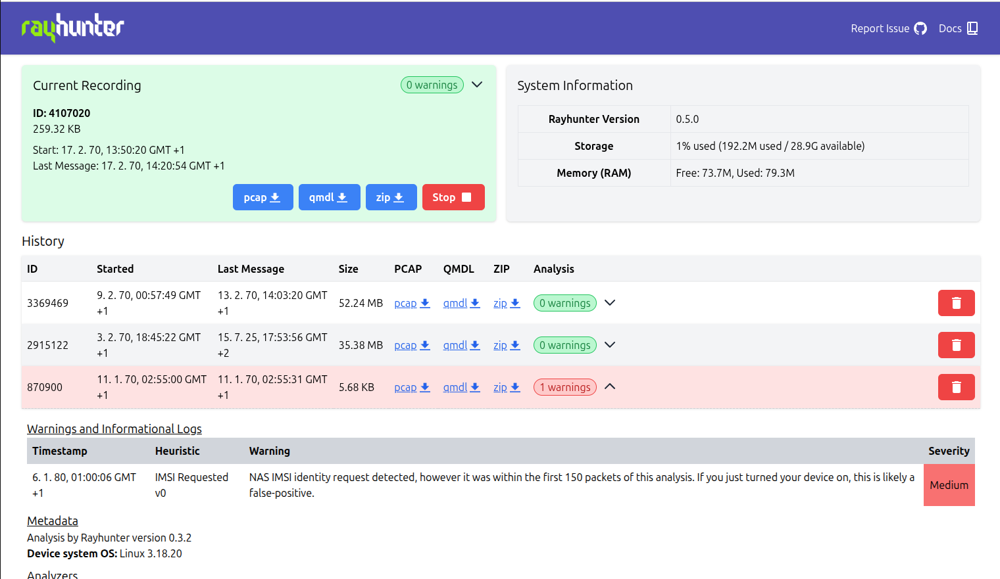

Rayhunter's dashboard · EFF, GPL-3.0

Note:
github.com/EFForg/rayhunter. It runs on an Orbic mobile hotspot and raises a warning when a cell-site simulator is nearby: the same kind of fake tower as the SMS blasters in Part 1. Check what hardware is available here before recommending a purchase.

---

## OUI-SPY listens for *trackers*.

<svg class="ic" aria-hidden="true" xmlns="http://www.w3.org/2000/svg" viewBox="0 0 24 24" fill="none" stroke="currentColor" stroke-width="2" stroke-linecap="round" stroke-linejoin="round" > <path d="M19.07 4.93A10 10 0 0 0 6.99 3.34" /> <path d="M4 6h.01" /> <path d="M2.29 9.62A10 10 0 1 0 21.31 8.35" /> <path d="M16.24 7.76A6 6 0 1 0 8.23 16.67" /> <path d="M12 18h.01" /> <path d="M17.99 11.66A6 6 0 0 1 15.77 16.67" /> <circle cx="12" cy="12" r="2" /> <path d="m13.41 10.59 5.66-5.66" /> </svg>
<b>OUI-SPY</b>a small open-source board

<b>Spots</b>some trackers, cameras and drones nearby

<b>How</b>it only listens; it sends nothing

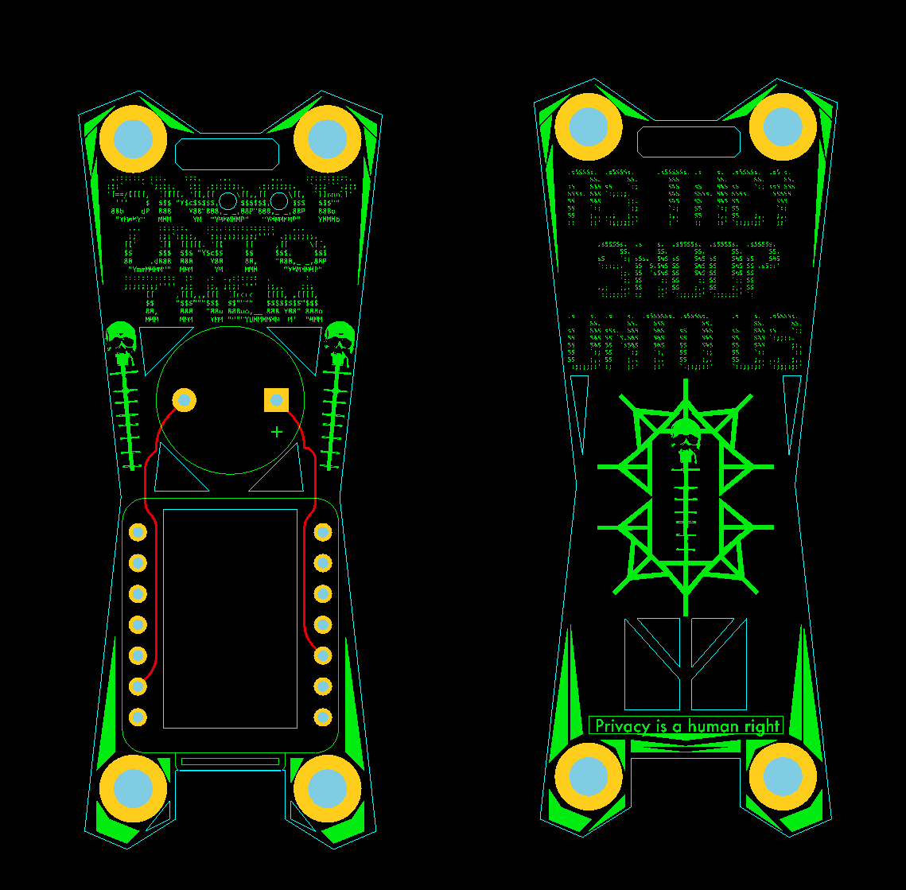

OUI-SPY board · colonelpanichacks, MIT

Note:
github.com/colonelpanichacks/oui-spy. An ESP32 board whose firmware watches for devices by their maker's Bluetooth and Wi-Fi addresses. Its current firmware is detection-only. It can miss devices that keep changing their address, which phones and AirTags do; for a tracker following you, your phone's own unknown-tracker alerts are the first check. Check availability and legality here before recommending it.

---

<!-- .slide: class="section-slide" -->
Part 6

# What's *next*.

---

## Tonight, protect *one person*.

<svg class="ic" aria-hidden="true" xmlns="http://www.w3.org/2000/svg" viewBox="0 0 24 24" fill="none" stroke="currentColor" stroke-width="2" stroke-linecap="round" stroke-linejoin="round" > <circle cx="12" cy="8" r="5" /> <path d="M20 21a8 8 0 0 0-16 0" /> </svg>

Mama

2FA on

<svg class="ic" aria-hidden="true" xmlns="http://www.w3.org/2000/svg" viewBox="0 0 24 24" fill="none" stroke="currentColor" stroke-width="2" stroke-linecap="round" stroke-linejoin="round" > <circle cx="12" cy="8" r="5" /> <path d="M20 21a8 8 0 0 0-16 0" /> </svg>

Papa

Code word agreed

<svg class="ic" aria-hidden="true" xmlns="http://www.w3.org/2000/svg" viewBox="0 0 24 24" fill="none" stroke="currentColor" stroke-width="2" stroke-linecap="round" stroke-linejoin="round" > <circle cx="12" cy="8" r="5" /> <path d="M20 21a8 8 0 0 0-16 0" /> </svg>

Lola

Patience

<svg class="logo" aria-hidden="true" fill="currentColor" role="img" viewBox="0 0 24 24" xmlns="http://www.w3.org/2000/svg"><path d="M12 0q-.934 0-1.83.139l.17 1.111a11 11 0 0 1 3.32 0l.172-1.111A12 12 0 0 0 12 0M9.152.34A12 12 0 0 0 5.77 1.742l.584.961a10.8 10.8 0 0 1 3.066-1.27zm5.696 0-.268 1.094a10.8 10.8 0 0 1 3.066 1.27l.584-.962A12 12 0 0 0 14.848.34M12 2.25a9.75 9.75 0 0 0-8.539 14.459c.074.134.1.292.064.441l-1.013 4.338 4.338-1.013a.62.62 0 0 1 .441.064A9.7 9.7 0 0 0 12 21.75c5.385 0 9.75-4.365 9.75-9.75S17.385 2.25 12 2.25m-7.092.068a12 12 0 0 0-2.59 2.59l.909.664a11 11 0 0 1 2.345-2.345zm14.184 0-.664.909a11 11 0 0 1 2.345 2.345l.909-.664a12 12 0 0 0-2.59-2.59M1.742 5.77A12 12 0 0 0 .34 9.152l1.094.268a10.8 10.8 0 0 1 1.269-3.066zm20.516 0-.961.584a10.8 10.8 0 0 1 1.27 3.066l1.093-.268a12 12 0 0 0-1.402-3.383M.138 10.168A12 12 0 0 0 0 12q0 .934.139 1.83l1.111-.17A11 11 0 0 1 1.125 12q0-.848.125-1.66zm23.723.002-1.111.17q.125.812.125 1.66c0 .848-.042 1.12-.125 1.66l1.111.172a12.1 12.1 0 0 0 0-3.662M1.434 14.58l-1.094.268a12 12 0 0 0 .96 2.591l-.265 1.14 1.096.255.36-1.539-.188-.365a10.8 10.8 0 0 1-.87-2.35m21.133 0a10.8 10.8 0 0 1-1.27 3.067l.962.584a12 12 0 0 0 1.402-3.383zm-1.793 3.848a11 11 0 0 1-2.345 2.345l.664.909a12 12 0 0 0 2.59-2.59zm-19.959 1.1L.357 21.48a1.8 1.8 0 0 0 2.162 2.161l1.954-.455-.256-1.095-1.953.455a.675.675 0 0 1-.81-.81l.454-1.954zm16.832 1.769a10.8 10.8 0 0 1-3.066 1.27l.268 1.093a12 12 0 0 0 3.382-1.402zm-10.94.213-1.54.36.256 1.095 1.139-.266c.814.415 1.683.74 2.591.961l.268-1.094a10.8 10.8 0 0 1-2.35-.869zm3.634 1.24-.172 1.111a12.1 12.1 0 0 0 3.662 0l-.17-1.111q-.812.125-1.66.125a11 11 0 0 1-1.66-.125"/></svg>

Family chat

On Signal

One fix for someone at home. No one stays safe alone.

Note:
Agree the code word, turn on their 2FA, or ask together: "Why do they need that?" Lola will ask again, and that's fine. The take-home card at the booth has a list to tick.

---

## Build a *community*.

1<b>Inform and educate</b>Share what you learned today about safety, privacy and digital rights.

2<b>Be patient</b>Not everyone will be as quick or as keen as you.

3<b>Speak up</b>Push back on rules that erode our digital freedoms.

4<b>Support the groups</b>Back those who defend our digital freedoms.

Start with your barkada, your family's group chat, your school org.

Note:
Adapted from "Be an advocate" in my open-source and local-first talk. This is the leadership part of the summit: you don't have to be an expert to be the person others ask. Point to our page (facebook.com/bnhr.xyz, the QR on my intro slide) and to the booth for anyone who wants to keep going.

---

## Communities grow from small *meetups*.

<figure>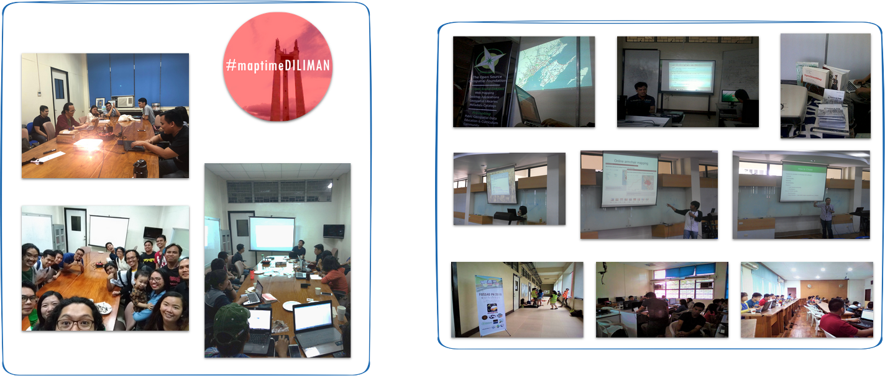<figcaption>From small local meetups…</figcaption></figure>
<figure>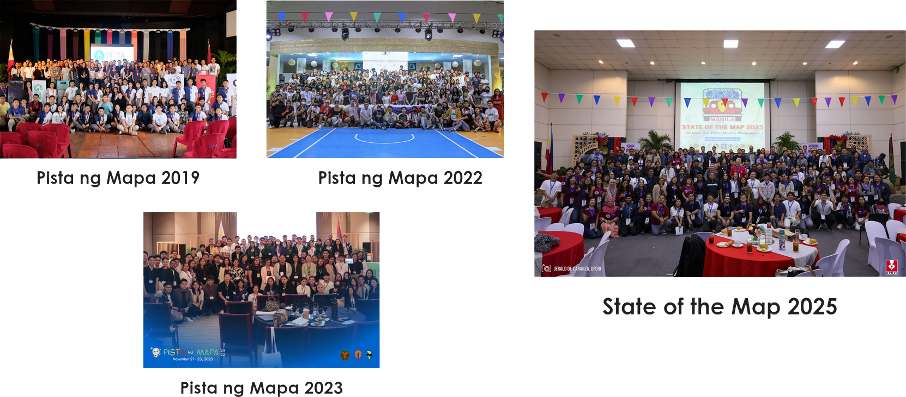<figcaption>…to Pista ng Mapa and State of the Map 2025, in Manila</figcaption></figure>

We started with only a few people around a table.

Note:
From my open-source and local-first talk. The open mapping community began as a handful of people at meetups like #maptimeDILIMAN and grew into Pista ng Mapa and the international State of the Map conference, held in Manila in 2025. A safety-minded barkada or school org can start the same way.

---

## BUDOL: play the scam from *both sides*.

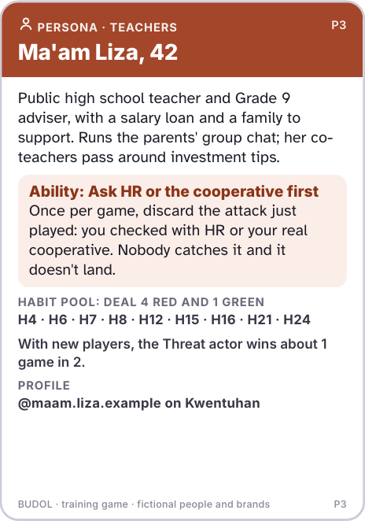

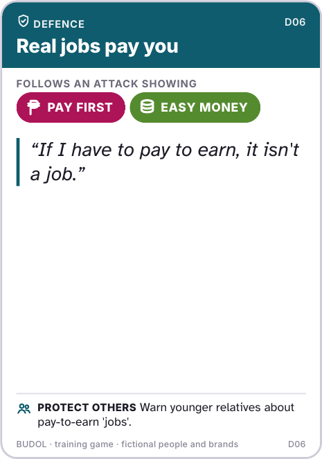
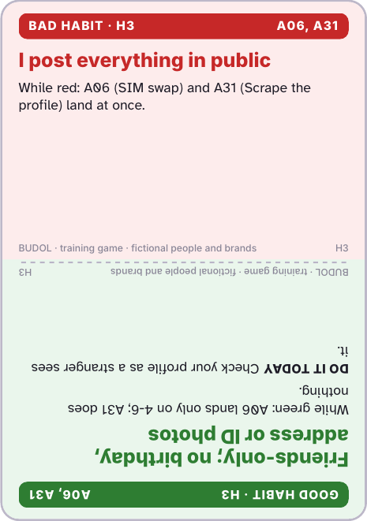

One side is the ethical tester. The other keeps Ma'am Liza safe. All ages, ten minutes.

Note:
Every scam card shows its warning signs; you block it with a card showing the same sign, and you say the sign out loud, like we just did. Catch a scam and you turn one of her bad habits green.

This is the game behind everything the hall has done today: Ma'am Liza's PIN, the nine signs, and "shout the sign" are all from BUDOL. Show the scam card, then reveal the card that blocks it (same signs: Pay first, Easy money), then a habit card turning from red to green.

---

## Come to our *booth*.

<svg class="ic" aria-hidden="true" xmlns="http://www.w3.org/2000/svg" viewBox="0 0 24 24" fill="none" stroke="currentColor" stroke-width="2" stroke-linecap="round" stroke-linejoin="round" > <rect width="12" height="12" x="2" y="10" rx="2" ry="2" /> <path d="m17.92 14 3.5-3.5a2.24 2.24 0 0 0 0-3l-5-4.92a2.24 2.24 0 0 0-3 0L10 6" /> <path d="M6 18h.01" /> <path d="M10 14h.01" /> <path d="M15 6h.01" /> <path d="M18 9h.01" /> </svg>

All ages

Play BUDOL

<svg class="ic" aria-hidden="true" xmlns="http://www.w3.org/2000/svg" viewBox="0 0 24 24" fill="none" stroke="currentColor" stroke-width="2" stroke-linecap="round" stroke-linejoin="round" > <path d="M20 13c0 5-3.5 7.5-7.66 8.95a1 1 0 0 1-.67-.01C7.5 20.5 4 18 4 13V6a1 1 0 0 1 1-1c2 0 4.5-1.2 6.24-2.72a1.17 1.17 0 0 1 1.52 0C14.51 3.81 17 5 19 5a1 1 0 0 1 1 1z" /> <path d="m9 12 2 2 4-4" /> </svg>

Ask us

Your questions

Note:
The card game: play the tester or the target in ten minutes, and help Ma'am Liza.

About anything from today: a message you're unsure of, a setting, an app.

Say where the booth is in the hall.

---

<!-- .slide: class="section-slide" -->
Spot it. Stop it. Switch it.

# Humayo kayo at magpaka- *open-source*.

Note:
Maraming salamat. Pause, check, switch one. Questions: at our booth, all day.
